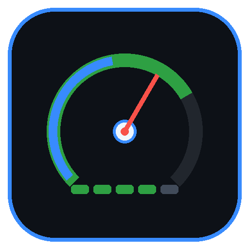

# ⚡ Antigravity Quota Monitor & Dashboard

<p align="center">
  
</p>

<p align="center">
  <strong>Real-time AI model quota monitor, countdown timers, and visual dashboard for Google Antigravity IDE.</strong><br>
  <em>Supports modern <code>agy</code> and legacy <code>language_server</code> architectures.</em>
</p>

<p align="center">
  <a href="https://open-vsx.org/extension/nordicstock/antigravity-quota-monitor"></a>
  <a href="LICENSE"></a>
  <a href="https://antigravity.google"></a>
</p>

---

## 🌟 Why Antigravity Quota Monitor?

While coding in Antigravity, running out of Gemini or Claude rate limits unexpectedly breaks your development flow. **Antigravity Quota Monitor** gives you immediate visual clarity directly on your status bar:

- 📊 **Real-time Status Bar Widget:** At-a-glance percentages and color-coded progress bars (`G: 64% 🟩🟩🟩⬜⬜ | C: 84% 🟩🟩🟩🟩⬜`).
- ⏱️ **Exact Reset Countdowns:** Know exactly how many hours/minutes remain until your quota refills (`Resets in 3h 45m`).
- 🎨 **Visual Webview Dashboard:** Dedicated full-screen glassmorphic dashboard with live progress bars, prompt credits gauge, and account tier.
- 🌐 **Multi-Language (i18n):** English, Estonian (Eesti), German (Deutsch), Finnish (Suomi), Spanish (Español), French (Français).
- 🔒 **100% Client-Side Privacy:** Directly connects to your local machine's background `agy` process via `localhost`. No external servers, no tracking, no shared credentials.

---

## 📸 Preview

```text
Status Bar:
[⚡ G: 64% 🟩🟩🟩⬜⬜ | C: 84% 🟩🟩🟩🟩⬜]
```

### 🖥️ Interactive Dashboard
Clicking the status bar opens the full visual dashboard showing:
- **Account & Subscription Tier** (e.g., Google AI Pro)
- **Prompt Credits Balance** (e.g., 500 / 50,000)
- **Live Model Family Gauges:**
  - Gemini 3.8 Flash (High / Medium / Low)
  - Gemini 4 Argon
  - Claude Opus 5.5
  - Claude Sonnet 5.5
  - GPT-OSS 120B

---

## ⚙️ Configuration & Customization

Configure settings in `Settings` (`Cmd + ,`) under **Antigravity Quota**:

| Setting | Type | Default | Description |
| :--- | :--- | :--- | :--- |
| `antigravityQuota.language` | `enum` | `"auto"` | UI language (`auto`, `en`, `et`, `de`, `fi`, `es`, `fr`). |
| `antigravityQuota.displayMode` | `enum` | `"compact"` | Status bar view: `compact` (G \| C), `lowest`, `gemini`, `claude`. |
| `antigravityQuota.barStyle` | `enum` | `"colored"` | Bar style: `colored` (🟩🟨🟥), `blocks` ([████░]), `squares`, etc. |
| `antigravityQuota.pollingInterval`| `number` | `60` | Background update frequency in seconds (min 15s). |
| `antigravityQuota.warnThreshold` | `number` | `30` | Warning threshold % for yellow indicator. |
| `antigravityQuota.criticalThreshold`| `number`| `15` | Critical threshold % for red indicator. |

---

## 🛠️ Installation

### Via Open VSX (Recommended)
1. In Antigravity IDE, open the Extensions view (`Cmd + Shift + X`).
2. Search for **Antigravity Quota Monitor**.
3. Click **Install**.

### Manual Installation (VSIX)
1. Download `antigravity-quota-monitor-1.3.0.vsix`.
2. Press `Cmd + Shift + P` and choose `Extensions: Install from VSIX...`.
3. Select the file and restart/reload Antigravity IDE.

---

## 💖 Support & Contributions

If you find this monitor helpful, star the repository on GitHub or consider supporting future developments!

- **GitHub Issues:** [Report a Bug or Request a Feature](https://github.com/nordicstock/antigravity-quota-monitor/issues)
- **License:** MIT License © 2026 NordicStock
