

# Antigravity Quota Monitor — Ultimate Cockpit & Dashboard

**Stop getting locked out of Claude Opus 5.5, Sonnet 5.5, and Gemini 4 Argon mid-sprint.**  
**Real-time 5-Hour & 7-Day Weekly AI Quota Telemetry, Scheduled `07:00` Session Auto-Warmup, Reserve Guard & Phone Alerts for Google Antigravity IDE.**

[-10B981?style=flat-square)](https://open-vsx.org/extension/Nordicstocks/antigravity-quota-monitor)

 

&nbsp;&nbsp;

---

##  Every New Install Includes a 7-Day Full Pro Trial — Automatically Inside the IDE (No Credit Card Required!)

Install the extension and **every Pro feature unlocks automatically for 7 full days** right inside your IDE — zero registration, zero credit card required:

- 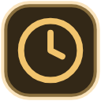 **Scheduled `07:00` 5-Hour Session Auto-Warmup + Laptop Wake Catch-Up:** Your 5-hour quota window only starts ticking after your first message of the day. Our `07:00` Auto-Warmup sends a tiny 1-token ping while you make morning coffee so your quota **resets back to 100% at `12:00` Noon** — giving you **two full 5-hour sprints every single workday**.
- 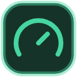 **Exact Reset Countdown & Live Clock (`4h 39m · ↻19:52`) + Burn-Rate Forecast:** Know the exact minute your quota refills and whether your current coding pace will last until reset.
-  **20% Reserve Guard & Instant Model Switch Assist:** Protects your emergency quota reserve and recommends which full model (`Gemini 3.8 Flash`, `Claude Sonnet 5.5`, `GPT-OSS 120B`) to switch to in 1 click.
- 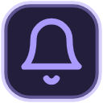 **Instant Phone & Desktop Push Alerts (`ntfy.sh`, Telegram, Discord/Slack):** Step away from your desk when quota runs out — your phone buzzes the second your model resets to **100%**.
-  **1-Click Second-Monitor Web Browser Dashboard:** Open the live auto-refreshing Cockpit in Chrome, Safari, Edge, or Firefox on a second display.

---

## 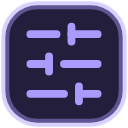 Why Developers Upgrade to Lifetime Pro (€9.99 One-Time)

If you already pay **\$20 to \$200/month** for AI coding plans (Google AI Pro/Ultra, Claude Max), losing even **one afternoon sprint** to an unexpected 5-hour quota lockout costs more than **€9.99**.

| What Happens Without Antigravity Pro | What Happens With Antigravity Pro (€9.99 Forever) |
| :--- | :--- |
| You send your first prompt at `09:30` → locked until `14:30`. | **`07:00` Auto-Warmup** starts your 5h window early → **100% fresh refill at `12:00` Noon**. |
| You burn through Claude Opus/Sonnet blindly and get cut off mid-refactor. | **Burn-Rate Forecast + 20% Reserve Guard** warns you early and switches you cleanly. |
| You keep checking the IDE to see if your 5-hour timer has reset yet. | **Phone Push Alert (`ntfy.sh` / Telegram)** pings your phone the instant quota hits **100%**. |
| Another monthly SaaS subscription draining your card every month. | **€9.99 One-Time Lifetime Payment** (or **€2.99/mo** after a 14-day free trial). |

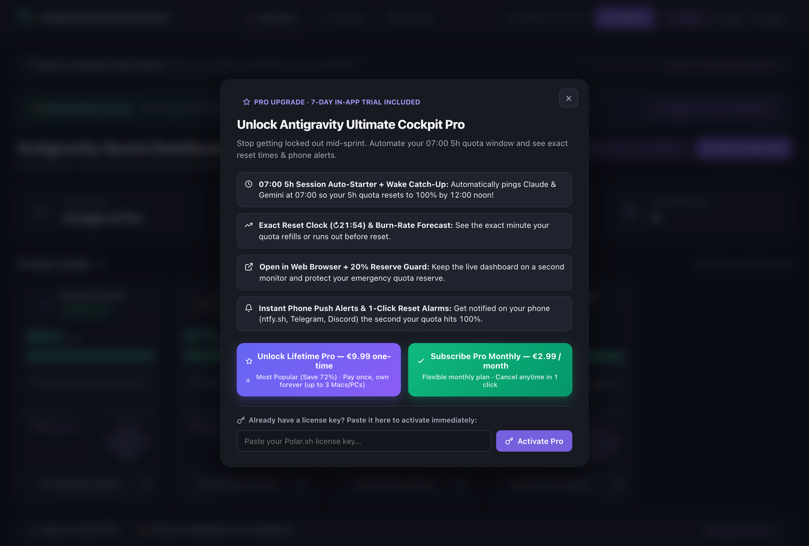

---

## 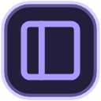 Complete Visual Tour (100% Modern Glassmorphic UI — Night & Day Themes)

### 1. Overview Dashboard — Crisp Daylight Mode (`Day`)
Switch seamlessly between **Night**, **Day**, and **Auto (IDE Theme Sync)** in 1 click. Every model card features a **10-cell LED gauge**, **custom card color palette** (`Mint`, `Sky`, `Lavender`, `Peach`, `Rose`, `Teal`), **drag-and-drop card reordering (`⋮⋮`)**, and **1-click Notify When Reset (`🔔`)**.

---

### 2. Dedicated Left Activity Bar Sidebar + 1-Click Cache Cleaner
Click the **Antigravity Cockpit** gauge icon on your left Activity Bar at any time to check your **Account Plan Tier**, **5-Hour Limits**, **7-Day Weekly Limits**, clean old `brain/` and `code_tracker/` cache folders in 1 click, or trigger a **5-Hour Session Warmup** immediately.

---

### 3. On-Screen Settings Control Center (`Night` & `Day`)
Configure your **Status Bar Display Mode**, **Progress Bar Style**, **UI Language (37 languages)**, **Reserve Guard %**, **Scheduled `07:00` Auto-Warmup**, **Phone Push Notifications (`ntfy.sh`, Telegram, Webhook)**, and **Pro License Key** directly on screen — every setting includes an interactive **`i` Info Popover** explaining how it works in plain language.

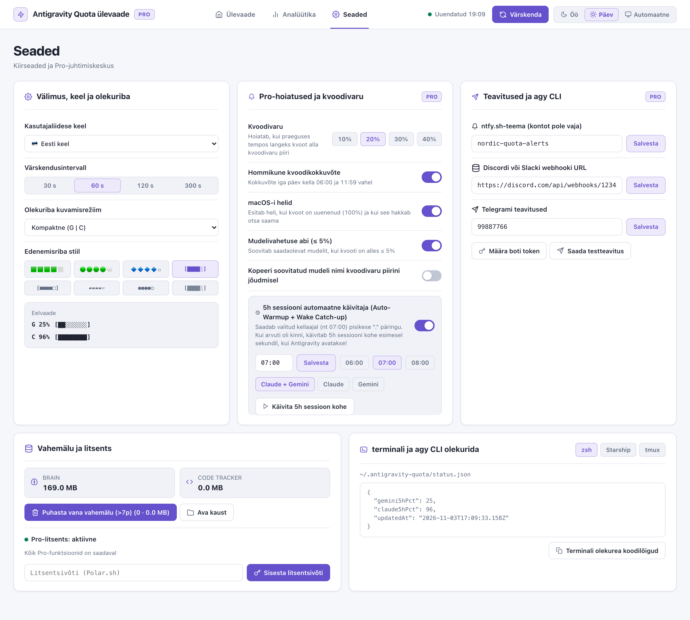

---

### 4. Pro Analytics, 90-Day Usage Heatmap, Per-Project Attribution & Terminal CLI Export (`Night` & `Day`)
Track which workspace folders consume the most AI quota, inspect your **90-Day Weekday × Hour Usage Heatmap**, copy a ready-made **zsh / Starship / tmux** status line snippet from `~/.antigravity-quota/status.json`, and export **CSV / JSON / Weekly Reports** in 1 click.

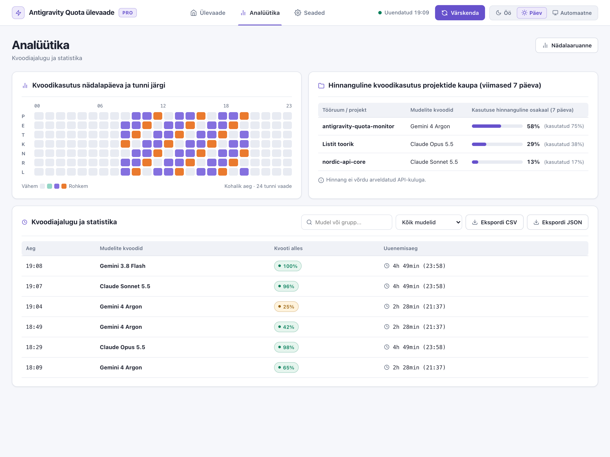

---

##  Free vs. Pro Feature Comparison

> **Remember:** Every new installation automatically includes **7 days of full Pro access inside the app** (no credit card required), plus you can start a **14-Day Free Trial (€0.00 today)** or unlock **Lifetime Pro for €9.99 one-time** at any time.

<!-- FEATURES_TABLE_START -->
| Feature |  Free Version |  Pro Edition (€2.99/mo or €9.99 One-Time) |
| :--- | :---: | :---: |
|  **Real-time Status Bar Quota Gauge (% Remaining)** |  Included | ** Included** |
| 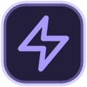 **Modern `agy` Daemon & CLI Compatibility** |  Included | ** Included** |
|  **Custom Progress Bar Styles** (8 Colored & Monochrome Scales) |  Included | ** Included** |
|  **Activity Bar Sidebar Panel + Interactive Visual Dashboard + Draggable Cards (`⋮⋮`), 7 Card Tints & 1-Click Cache Cleaner** (Day & Night Modes) |  Included | ** Included** |
|  **Multi-Language UI** (37 Languages: All EU + Global) |  Included | ** Included** |
|  **Basic Visual Quota Reset & Low-Quota Warnings** |  Included | ** Included** |
|  **24-Hour Local Quota History** |  Included | ** Included** |
|  **P1: Exact Reset Countdown & Live Clock (`4h 39m · ↻19:52`), Burn-Rate Forecast & Second-Monitor Browser View** | 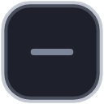 | ** Included** |
| 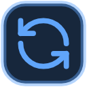 **P2: Model Switch Assist** (Recommends an available model & copies its name in 1 click) |  | ** Included** |
|  **P3: Reserve Guard** ("Keep 20% for tomorrow" + pace breach alerts) |  | ** Included** |
|  **P4: 90-Day JSONL History, Sparkline Trend Lines & Weekday×Hour Usage Heatmap** |  | ** Included** |
|  **P5: Phone & Desktop Notifications** (`ntfy.sh`, Telegram Bot, Discord/Slack Webhooks) |  | ** Included** |
|  **P6: Per-Project Workspace Usage Attribution** (Estimated quota use by project) |  | ** Included** |
| 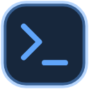 **P7: Terminal & `agy` CLI Status Line** (`~/.antigravity-quota/status.json` + zsh/Starship/tmux) |  | ** Included** |
|  **P8: 5-Hour Session Auto-Starter (`07:00`) + Wake Catch-Up, Reset Alarms & Morning Summary** |  | ** Included** |
|  **P9: Weekly HTML & Markdown Usage Report** |  | ** Included** |
|  **macOS System Audio Chimes** (`Glass.aiff`, `Sosumi.aiff`, `Basso.aiff`, macOS only) |  | ** Included** |
| 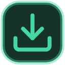 **CSV & JSON Usage History Export** (Up to 90 days) |  | ** Included** |
<!-- FEATURES_TABLE_END -->

 
&nbsp;&nbsp;
  

---

##  How to Set Up Phone Notifications in 30 Seconds (`ntfy.sh` or Telegram)

Want your phone to buzz the exact second your **Claude Opus/Sonnet** or **Gemini** quota refills to **100%**?

### Option A: `ntfy.sh` (Fastest — 30 Seconds, Zero Account Required)
1. Install the free **ntfy** app on [iOS App Store](https://apps.apple.com/app/ntfy/id1625396347) or [Google Play](https://play.google.com/store/apps/details?id=io.heckel.ntfy).
2. Open the app, tap **`+`**, and subscribe to a unique secret topic name (for example: `antigravity-quota-yourname-774`).
3. In Antigravity Quota Monitor, open **Settings (`⚙️`) → Phone & Desktop Notifications**, enter `https://ntfy.sh/antigravity-quota-yourname-774` into the **`ntfy.sh` Topic URL** box, and click **Save Notification Settings**.
4. Click **Send Test Alert** — your phone will chime within 1 second!

### Option B: Telegram Bot
1. Message **[@BotFather](https://t.me/BotFather)** on Telegram with `/newbot` to get your **Bot Token**, and message **[@userinfobot](https://t.me/userinfobot)** to get your numeric **Chat ID**.
2. Paste both into **Settings (`⚙️`) → Phone & Desktop Notifications**, click **Save**, and click **Send Test Alert**.

---

##  37 Built-In Languages (Automatic OS Detection)

On first launch, **Antigravity Quota Monitor** automatically detects your Windows, macOS, or Linux system language (`auto`) and renders the entire interface in your native language — or pick any of the **37 supported languages** manually in Settings:

`English`, `Eesti`, `Suomi`, `Svenska`, `Norsk`, `Dansk`, `Deutsch`, `Français`, `Español`, `Italiano`, `Português`, `Nederlands`, `Polski`, `Čeština`, `Slovenčina`, `Magyar`, `Română`, `Български`, `Ελληνικά`, `Hrvatski`, `Slovenščina`, `Lietuvių`, `Latviešu`, `Gaeilge`, `Malti`, `Türkçe`, `Українська`, `Русский`, `日本語`, `한국어`, `简体中文`, `繁體中文`, `العربية`, `हिन्दी`, `ไทย`, `Tiếng Việt`, `Bahasa Indonesia`.

### Regional Dedicated Editions on Open VSX
- **Japanese Edition (日本語版):** [`Nordicstocks.antigravity-quota-monitor-ja`](https://open-vsx.org/extension/Nordicstocks/antigravity-quota-monitor-ja)
- **Chinese Edition (中文版):** [`Nordicstocks.antigravity-quota-monitor-zh`](https://open-vsx.org/extension/Nordicstocks/antigravity-quota-monitor-zh)
- **Spanish Edition (Edición Español):** [`Nordicstocks.antigravity-quota-monitor-es`](https://open-vsx.org/extension/Nordicstocks/antigravity-quota-monitor-es)

---

##  Privacy, Offline Architecture & Support

- **100% Local Telemetry:** Quota polling communicates strictly with your local Antigravity Language Server (`127.0.0.1`) and local `~/.gemini/antigravity` cache directories. Zero source code or prompts ever leave your machine.
- **License & Billing Support:** [GitHub Issues](https://github.com/Nordicstocks/antigravity-quota-monitor/issues)
