<!-- Generated by scripts/build-store-readme.mjs. Edit docs/store-sections/ instead. -->

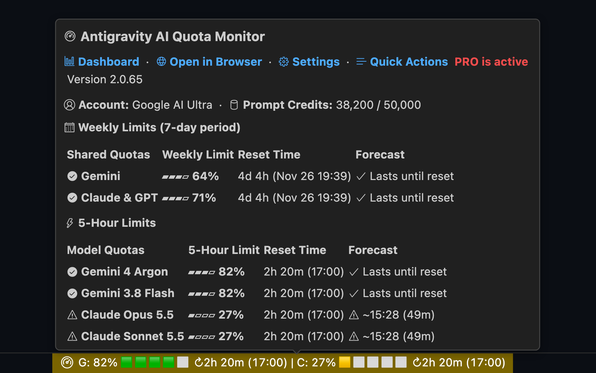

**See how much Antigravity quota is left, before a limit stops your work.**

- **Always in view.** Your remaining quota sits in the status bar. Hover for the 5-hour and weekly limits of each model: Claude and Gemini.
- **A warning first.** Get an alert in the editor when a model runs low.
- **Quota back? Your phone tells you (Pro).** Connect your phone, keep the editor open and your computer awake, and step away. You get a message when your quota is full again.
- **Codex, Claude Code and Grok too.** If they are on your computer, the limits of your own Codex, Claude Code and Grok plans appear below Antigravity's, in their own cards.

**Free to use. Pro: 7 days free right after install, no card. To keep it: €9.99 one-time or €2.99/month.** [Compare Free and Pro](#free-and-pro) · [Buy Pro](https://buy.polar.sh/polar_cl_aUt37UmhWCxHCB9s7dFpmvoT5KNrFqzVWx64q073KIJ)

Windows and macOS. Reads your quota on your own computer: from Antigravity, and from Codex, Claude Code and the Grok CLI when they are installed. No extra account, no API key, no usage analytics. *Not made by or affiliated with Google, Anthropic, OpenAI or xAI.*

**User guide:** [English](https://github.com/Nordicstocks/antigravity-quota-monitor/blob/main/USER-GUIDE.md) · [Eesti](https://github.com/Nordicstocks/antigravity-quota-monitor/blob/main/USER-GUIDE.et.md) · [Deutsch](https://github.com/Nordicstocks/antigravity-quota-monitor/blob/main/USER-GUIDE.de.md) · [日本語](https://github.com/Nordicstocks/antigravity-quota-monitor/blob/main/USER-GUIDE.ja.md) · [简体中文](https://github.com/Nordicstocks/antigravity-quota-monitor/blob/main/USER-GUIDE.zh-CN.md) · [한국어](https://github.com/Nordicstocks/antigravity-quota-monitor/blob/main/USER-GUIDE.ko.md) · [Español](https://github.com/Nordicstocks/antigravity-quota-monitor/blob/main/USER-GUIDE.es.md) · 30 more languages inside the guide

**Read this page in:** [Eesti](#lang-et) · [Deutsch](#lang-de) · [日本語](#lang-ja) · [简体中文](#lang-zh-cn) · [한국어](#lang-ko) · [Español](#lang-es)

---

## Free and Pro

The first time you install the extension, you get 7 days of full Pro, with no card and no registration. After that, everything in the Free column keeps working.

| | Free | Pro |
| :--- | :---: | :---: |
| Quota in the status bar, with 5-hour and weekly limits on hover | ✓ | ✓ |
| Side panel and dashboard, with day and night themes | ✓ | ✓ |
| Alerts in the editor when quota runs low or resets | ✓ | ✓ |
| Codex, Claude Code and Grok limits, in their own cards | ✓ | ✓ |
| Reset time and run-out forecast | | ✓ |
| Reserve Guard: warns you when your current pace will take a model's quota below your reserve (20% by default) | | ✓ |
| Phone and chat alerts: ntfy.sh, Telegram, Discord, Slack | | ✓ |
| 90-day history, day × hour heatmap, estimated use per project | | ✓ |
| Optional Auto-Starter for your 5-hour window, also as an interval and also for Codex and Claude Code | | ✓ |

**See every feature**
<!-- FEATURES_TABLE_START -->
| Feature | Free | Pro (€2.99/mo or €9.99 one-time) |
| :--- | :---: | :---: |
| 📊 **Status Bar Quota Gauge (% Left)** | ✅ | ✅ |
| ⚡ **Works with the `agy` Daemon & CLI** | ✅ | ✅ |
| 🎨 **Custom Progress Bar Styles** (8 Colored & Monochrome Bars) | ✅ | ✅ |
| 📌 **Activity Bar Sidebar + Day & Night Dashboard + Draggable Cards (`⋮⋮`), 6 Card Colors & Old Conversation Files Cleaner** | ✅ | ✅ |
| 🌍 **37 Interface Languages** | ✅ | ✅ |
| 🔔 **Quota Reset & Low-Quota Alerts** (in the editor) | ✅ | ✅ |
| 🕒 **24-Hour Local Quota History** | ✅ | ✅ |
| 🧰 **Codex, Claude Code & Grok Plan Limits** (read from their own programs; reset time, forecast & reminder with Pro) | ✅ | ✅ |
| ⏱️ **Reset Countdown & Clock (`4h 39m · ↻19:52`), Run-Out Forecast & Second-Monitor Browser View** | ➖ | ✅ |
| 🔄 **Model Switch Assist** (Recommends an available model & copies its name) | ➖ | ✅ |
| 🛡️ **Reserve Guard** (Alerts you before your pace drops a model's quota below the reserve you set, 20% by default) | ➖ | ✅ |
| 📈 **90-Day History, Trend Lines & Day × Hour Usage Heatmap** | ➖ | ✅ |
| 📲 **Phone & Chat Notifications** (`ntfy.sh` QR, Telegram, Discord/Slack) | ➖ | ✅ |
| 📁 **Estimated Quota Use per Project** | ➖ | ✅ |
| 💻 **Terminal Status File & Shell Snippets** (`~/.antigravity-quota/status.json`, zsh, Starship, tmux) | ➖ | ✅ |
| ⏰ **Optional 5-Hour Auto-Starter (`07:00` or your own time, optional repeat every `5:01`, also for Codex & Claude Code), `🔔` Remind Me at Reset & Morning Summary** | ➖ | ✅ |
| 📋 **Weekly HTML & Markdown Usage Report** | ➖ | ✅ |
| 🔊 **Sound Alerts** | ➖ | ✅ |
| 📥 **CSV & JSON Usage History Export** (Up to 90 days) | ➖ | ✅ |
<!-- FEATURES_TABLE_END -->

**Lifetime Pro: €9.99 one-time.** No subscription. It costs less than 4 months of Pro Monthly. [Buy Lifetime Pro](https://buy.polar.sh/polar_cl_aUt37UmhWCxHCB9s7dFpmvoT5KNrFqzVWx64q073KIJ)

**Pro Monthly: €2.99/month.** Cancel in the customer portal of Polar, our payment provider. Removing the key from the extension does not cancel the plan. [Buy Pro Monthly](https://buy.polar.sh/polar_cl_LjI4JhW7qEbGDJyCyQslb5pSeHyETQ2Dfiuqb0tNkI5)

Your license key is in the purchase email and on Polar's confirmation page. Paste it in Settings to activate Pro.

---

## What you get

**One dashboard for every limit.** Each model has a gauge, its 5-hour and weekly limits, and with Pro its reset time and forecast. Drag the cards into your own order, and hide the ones you do not use.

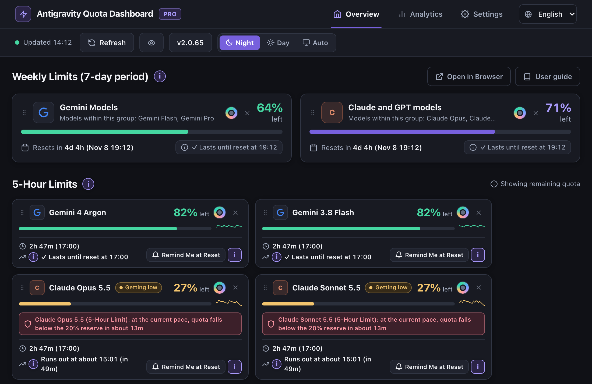

**See where your quota goes (Pro).** The heatmap shows your busiest hours. The per-project view estimates which project uses the most quota.

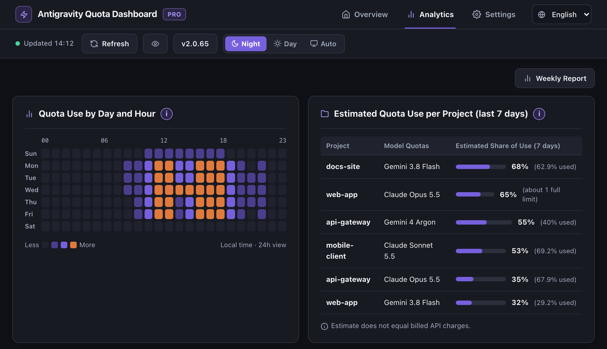

**Also included.** A visual weekly report and CSV or JSON export (Pro). A status file for your terminal prompt (Pro). A second-monitor view in your browser (Pro). A cleaner for old conversation files: it lists folders in `~/.gemini/antigravity/brain` with no changes in the last 7 days and moves them to the system Trash (Recycle Bin on Windows) only if you confirm. `code_tracker/` is only measured, never cleaned.

---

## Codex, Claude Code and Grok

**Your other AI plans, next to Antigravity's.** Antigravity Quota Monitor — Ultimate Cockpit & Dashboard also shows the limits of your own Codex (ChatGPT), Claude Code (Anthropic) and Grok (xAI) plans: on the dashboard, in the side panel and in the status bar. Each card names the tool and the limit, and shows your plan and what is left. With Pro it also shows the reset time and the forecast, and reminds you at reset.

- Each tool's limits are read from its own program on your computer. No conversation is started, nothing is sent to a model and no password is needed.
- A tool that is not on your computer is not shown. Each can be switched off under Settings → Codex, Claude Code and Grok.
- Claude Code here is your own Anthropic plan. The Claude models inside Antigravity use Antigravity's quota and keep their own cards.
- On Grok's Free plan, Grok reports no usage percentage, so its card shows no bar.

---

## How the Auto-Starter works

**New in 2.0.58: “Only remind me”.** At the chosen time you can get just a notification instead: “Your 5-hour window can start now”. You then send any prompt in Antigravity yourself. The extension runs nothing and sends nothing, so no quota is used and the terms below do not come into it. This is the default for new users; “Start it automatically” stays available with your consent.

Your 5-hour window starts with your first prompt, not at a fixed time. If that is at `09:30` and you run out of quota, you may have to wait until `14:30` for it to reset.

With the Auto-Starter (Pro) set to `07:00`, the extension runs `agy`, Antigravity's command-line tool, at that time and sends a short but real prompt, `OK`, from your own account to the models you choose. `agy` must be installed. Your 5-hour limit then resets at about `12:00`, so a second full 5-hour window fits in your workday, as long as you have weekly quota left.

It is off by default and asks for your consent first. It uses some quota. The editor must be open at the time you set; if it is closed, the Auto-Starter runs when you next open the editor, as long as no more than 3 hours have passed since that time.

**New in 2.0.64: “Repeat as an interval”.** After the first start at your chosen time, the Auto-Starter can start the 5-hour window again every `5:01` (5 hours 1 minute, the recommended value) or at an interval you set between `1:00` and `24:00`, until the next day's start at that time. With `5:01` that is at most 4 starts a day. Each start sends a real request and uses a little quota. Off by default.

**New in 2.0.64: Codex and Claude Code.** You choose individually what it starts: Claude and Gemini in Antigravity, and your own Codex and Claude Code when they are installed, you are signed in and your plan has a 5-hour window. For those two the extension runs `codex exec` (read-only, in a temporary folder) or `claude -p` (with its tools switched off) and sends one short request, `OK`, from your own account. That starts the tool's own 5-hour window and uses a little of its limit. Before the first request for each of the two, the extension asks for your consent separately, because the request comes from your OpenAI or Anthropic account, not your Antigravity account. Deselecting a tool withdraws that consent; selecting it again asks for consent again.

You are asked for consent separately for each account a request comes from: once for Claude and Gemini through `agy`, and once each for Codex and Claude Code. Requests are sent only in “Start it automatically” mode.

Section 6 of the [Google Antigravity Additional Terms of Service](https://antigravity.google/terms) says that using third-party software to access the service is a breach that may lead to suspension or termination of your account. Whether to turn it on is your decision.

---

## Privacy, Network Use & Support

Antigravity's quota numbers come from your local Antigravity language server on `127.0.0.1`. The extension sends no usage analytics to anyone. It uses the network only in these cases:

- **Update check:** on each start, and again every 6 hours while the editor stays open, it asks `open-vsx.org` for the latest version number.
- **License:** with a license key, it validates the key at `api.polar.sh` about once a day. If the extension cannot reach Polar for 7 days, Pro pauses until the connection is restored.
- **Notifications (optional):** it sends quota messages to `ntfy.sh`, Telegram, or your Discord/Slack webhook, only if you set them up.
- **Codex, Claude Code and Grok (on when the tool is installed; can be switched off):** the extension runs the matching program on your computer (`codex app-server`, `claude -p /usage` or the Grok CLI). That program asks its own service (OpenAI, Anthropic or xAI) for your plan's limits, using your own sign-in. No conversation is started and no prompt is sent. Switch each one off under Settings → Codex, Claude Code and Grok.
- **Auto-Starter (optional, off by default):** when you turn it on, `agy` sends a short prompt (`OK`) to the selected Antigravity models from your account. If you also select Codex or Claude Code, each sends one short `OK` request from your own account through its own program, in a temporary folder. Your source code is not included.
- **Error reports (on by default, can be turned off):** when something in the extension fails unexpectedly, it sends an anonymous report to `oeqbchgyoderqxnzcubh.supabase.co` with the extension's version and edition, your editor's name, version and language, your operating system and processor type, your plan (Free, trial or Pro) and the error message with where in the code it happened. No usage numbers, no files, no account details and no license key. Nothing is sent while your editor's telemetry setting is off. To turn reports off, switch off Settings → General → `Send error reports` (setting `antigravityQuota.sendErrorReports`).

**Clipboard:** the extension reads it in one case only. If you click a buy button and return to the editor within 30 minutes, it checks the clipboard once for a license key. Whatever it finds is not stored, and goes to `api.polar.sh` only if you click Activate. It never reads the clipboard at any other time.

**How to set up phone alerts**
**ntfy.sh, no account needed.** Install the free ntfy app from the [App Store](https://apps.apple.com/app/ntfy/id1625396347) or [Google Play](https://play.google.com/store/apps/details?id=io.heckel.ntfy). In the app, tap `+` and enter the topic the extension suggests under Settings → Connect your phone. On Android you can scan the QR code instead. Click `Save and send a test notification`. `ntfy.sh` topics are public: anyone who knows the name can read and send messages. The extension suggests a random, hard-to-guess name. Do not share it.

**Telegram.** Message [@BotFather](https://t.me/BotFather) with `/newbot` to get a Bot Token. Open the link to your new bot and tap Start once, or Telegram will not deliver its messages. Message [@userinfobot](https://t.me/userinfobot) to get your numeric Chat ID. Under Settings, enter the Chat ID, click Save, click Set Bot Token, paste the token and click Test Notification.

**Discord or Slack.** Paste the webhook URL in the same Settings section and click Save.

**Languages.** The extension uses your editor's language, or your system language if the editor is in English. Pick any other in Settings. Some newer text may still appear in English.

**All 37 languages**
`English`, `Eesti keel`, `Deutsch`, `Suomi`, `Español`, `Français`, `Italiano`, `Polski`, `Nederlands`, `Svenska`, `Português (Portugal)`, `Português (Brasil)`, `Български`, `Hrvatski`, `Čeština`, `Dansk`, `Ελληνικά`, `Magyar`, `Gaeilge`, `Latviešu`, `Lietuvių`, `Lëtzebuergesch`, `Malti`, `Română`, `Slovenčina`, `Slovenščina`, `Українська`, `Afrikaans`, `日本語`, `简体中文`, `繁體中文`, `한국어`, `Tiếng Việt`, `Bahasa Indonesia`, `हिन्दी`, `Kiswahili`, `العربية`

### Language Editions on Open VSX

Dedicated listings: [日本語版](https://open-vsx.org/extension/Nordicstocks/antigravity-quota-monitor-ja) · [中文版](https://open-vsx.org/extension/Nordicstocks/antigravity-quota-monitor-zh) · [Edición en español](https://open-vsx.org/extension/Nordicstocks/antigravity-quota-monitor-es)

---

**Help:** [User Guide](https://github.com/Nordicstocks/antigravity-quota-monitor/blob/main/USER-GUIDE.md) · [Report a problem](https://github.com/Nordicstocks/antigravity-quota-monitor/issues) · [Changelog](https://github.com/Nordicstocks/antigravity-quota-monitor/blob/main/CHANGELOG.md)

*Google Antigravity, Gemini, Claude, Claude Code, Codex, ChatGPT and Grok belong to their respective owners.*

<!-- LANG-SECTIONS -->

---

## Eesti

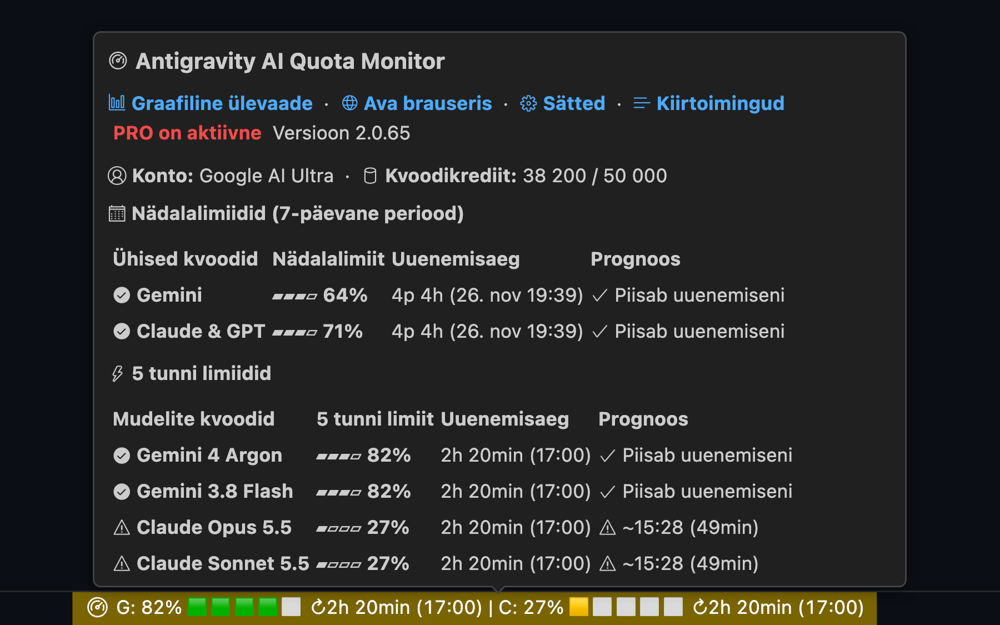

**Kui palju Antigravity kvooti on alles? Näed seda enne, kui limiit töö seisma paneb.**

- **Alati silma all.** Allesolev kvoot on näha olekuribal. Hoia kursorit mõõdiku kohal ja näed iga mudeli (Claude ja Gemini) 5 tunni limiiti ja nädalalimiiti.
- **Hoiatus õigel ajal.** Kui mudeli kvoot hakkab otsa saama, saad redaktoris hoiatuse.
- **Kvoot taastus? Telefon annab teada (Pro).** Ühenda telefon, jäta redaktor avatuks, ära lase arvutil unerežiimi minna ja tõuse laua tagant. Kui kvoot on jälle täis, saad sõnumi.
- **Ka Codex, Claude Code ja Grok.** Kui need on sinu arvutis olemas, on Antigravity kaartide all ka sinu enda Codexi, Claude Code’i ja Groki paketi limiidid, igal tööriistal oma kaardid.

**Laiendus on tasuta. Pro: 7 päeva tasuta kohe pärast paigaldamist, kaarti pole vaja. Seejärel 9,99 € ühekordselt või 2,99 € kuus.** [Tasuta plaani ja Pro võrdlus](#free-and-pro-et) · [Osta Pro](https://buy.polar.sh/polar_cl_aUt37UmhWCxHCB9s7dFpmvoT5KNrFqzVWx64q073KIJ)

Windows ja macOS. Laiendus loeb kvoodiandmeid sinu enda arvutis: Antigravityst ning Codexist, Claude Code’ist ja Grok CLI-st, kui need on paigaldatud. Lisakontot ega API-võtit pole vaja, kasutusanalüütikat ei saadeta. *See ei ole Google’i, Anthropicu, OpenAI ega xAI toode ega ole seotud ühegagi neist.*

**Kasutusjuhend:** [English](https://github.com/Nordicstocks/antigravity-quota-monitor/blob/main/USER-GUIDE.md) · [Eesti](https://github.com/Nordicstocks/antigravity-quota-monitor/blob/main/USER-GUIDE.et.md) · [Deutsch](https://github.com/Nordicstocks/antigravity-quota-monitor/blob/main/USER-GUIDE.de.md) · [日本語](https://github.com/Nordicstocks/antigravity-quota-monitor/blob/main/USER-GUIDE.ja.md) · [简体中文](https://github.com/Nordicstocks/antigravity-quota-monitor/blob/main/USER-GUIDE.zh-CN.md) · [한국어](https://github.com/Nordicstocks/antigravity-quota-monitor/blob/main/USER-GUIDE.ko.md) · [Español](https://github.com/Nordicstocks/antigravity-quota-monitor/blob/main/USER-GUIDE.es.md) · veel 30 keelt on juhendi sees

**Loe seda lehte teistes keeltes:** [English](#top) · [Deutsch](#lang-de) · [日本語](#lang-ja) · [简体中文](#lang-zh-cn) · [한국어](#lang-ko) · [Español](#lang-es)

---

## Tasuta plaan ja Pro

Kui paigaldad laienduse esimest korda, saad 7 päevaks kõik Pro-funktsioonid, ilma maksekaardi ja registreerimiseta. Pärast seda töötab edasi kõik, mis on tulbas Tasuta.

| | Tasuta | Pro |
| :--- | :---: | :---: |
| Kvoot olekuribal; kui hoiad kursorit mõõdiku kohal, ka 5 tunni limiit ja nädalalimiit | ✓ | ✓ |
| Külgpaneel ja graafiline ülevaade, heleda ja tumeda teemaga | ✓ | ✓ |
| Teated redaktoris, kui kvoot hakkab otsa saama või uueneb | ✓ | ✓ |
| Codexi, Claude Code’i ja Groki limiidid, igal tööriistal oma kaardid | ✓ | ✓ |
| Uuenemisaeg ja otsasaamise prognoos | | ✓ |
| Reserve Guard ehk Kvoodivaru: hoiatab, kui mudeli kvoot langeb praeguse tempoga alla sinu määratud varupiiri (vaikimisi 20 %) | | ✓ |
| Telefoni- ja sõnumiteavitused: ntfy.sh, Telegram, Discord, Slack | | ✓ |
| 90 päeva kasutusajalugu, soojuskaart (päev × tund), hinnanguline kasutus projekti kaupa | | ✓ |
| Automaatkäivitaja 5 tunni perioodi alustamiseks (valikuline), ka intervalliga ning Codexile ja Claude Code’ile | | ✓ |

**Eluaegne Pro: 9,99 € ühekordselt.** See ei ole tellimus. Pro-kuutellimuse eest maksad juba 4 kuuga rohkem. [Osta Eluaegne Pro](https://buy.polar.sh/polar_cl_aUt37UmhWCxHCB9s7dFpmvoT5KNrFqzVWx64q073KIJ)

**Pro-kuutellimus: 2,99 € kuus.** Tellimuse saad tühistada Polari kliendiportaalis (Polar on meie makseteenuse pakkuja). Võtme eemaldamine laiendusest tellimust ei tühista. [Osta Pro-kuutellimus](https://buy.polar.sh/polar_cl_LjI4JhW7qEbGDJyCyQslb5pSeHyETQ2Dfiuqb0tNkI5)

Litsentsivõtme saad pärast ostu e-kirjaga, see on ka Polari kinnituslehel. Pro aktiveerimiseks kleebi võti vahekaardil Sätted jaotisesse Litsents.

---

## Mis on kaasas

**Kõik limiidid ühes ülevaates.** Igal mudelil on oma mõõdik, 5 tunni limiit ja nädalalimiit, Pro-versioonis ka uuenemisaeg ja prognoos. Lohista kaardid endale sobivasse järjekorda ja peida need, mida ei kasuta.

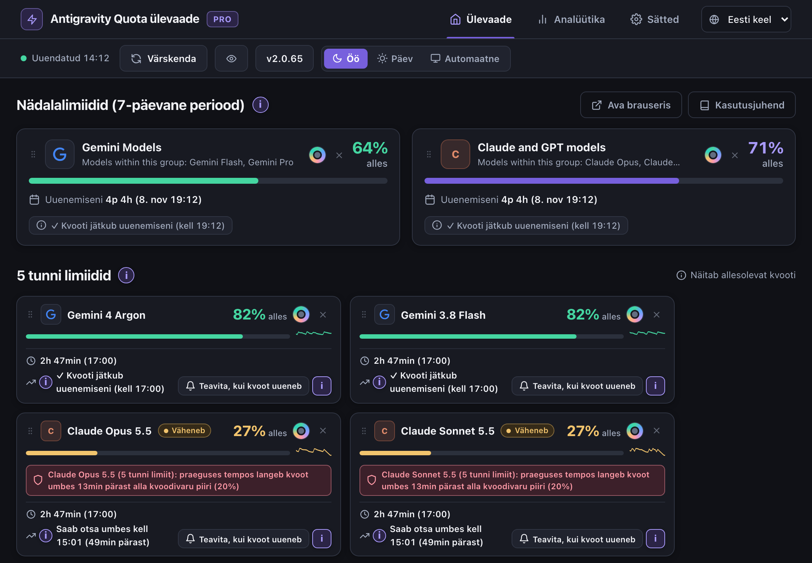

**Kuhu kvoot kulub (Pro).** Soojuskaart näitab sinu kõige tihedamaid töötunde. Projektide vaatest näed ligikaudu, milline projekt kulutab kvooti kõige rohkem.

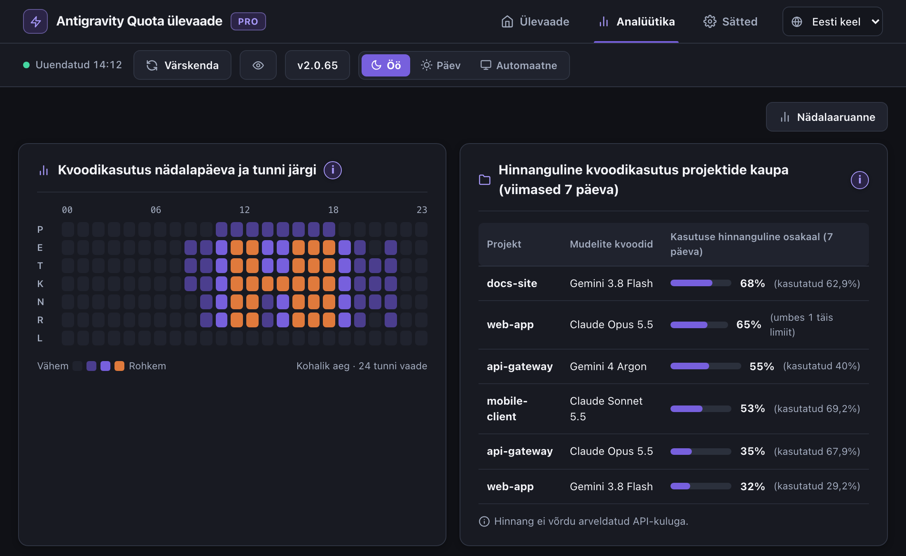

**Veel kaasas.** Graafiline nädalaaruanne ning eksport CSV- või JSON-failina (Pro). Olekufail terminali käsurea jaoks (Pro). Graafiline ülevaade brauseris teise ekraani jaoks (Pro). Vanade vestlusfailide koristamine: laiendus loetleb kaustas `~/.gemini/antigravity/brain` need alamkaustad, kus viimase 7 päeva jooksul pole midagi muutunud, ja viib need süsteemi prügikasti ainult siis, kui kinnitad. Kausta `code_tracker/` laiendus ainult mõõdab ega korista kunagi.

---

## Codex, Claude Code ja Grok

**Sinu teised AI-paketid Antigravity kõrval.** Antigravity Quota Monitor — Ultimate Cockpit & Dashboard näitab ka sinu enda Codexi (ChatGPT), Claude Code’i (Anthropic) ja Groki (xAI) paketi limiite: graafilises ülevaates, külgpaneelil ja olekuribal. Igal kaardil on tööriista ja limiidi nimi, sinu pakett ja see, kui palju on alles. Pro-versioonis näed ka limiidi uuenemisaega ja prognoosi ning saad uuenemisel meeldetuletuse.

- Iga tööriista limiidid loetakse sinu arvutis selle tööriista enda programmist. Vestlust ei alustata, mudelile ei saadeta midagi ja parooli ei küsita.
- Tööriista, mida sinu arvutis pole, ei näidata. Iga tööriista saab välja lülitada: Sätted → Codex, Claude Code ja Grok.
- Claude Code tähendab siin sinu enda Anthropicu paketti. Antigravity Claude’i mudelid kasutavad Antigravity kvooti ja neil on oma kaardid.
- Groki Free-paketi puhul ei näita Grok kasutusprotsenti, seega pole selle kaardil mõõdikuriba.

---

## Kuidas Automaatkäivitaja töötab

**Uus versioonis 2.0.58: „Ainult meeldetuletus“.** Valitud kellaajal võid saada ainult teate „Nüüd saad 5 tunni perioodi alustada“. Siis saadad Antigravitys ise ükskõik millise päringu. Laiendus ei käivita midagi ega saada midagi, seega kvooti ei kulu ja allpool nimetatud tingimused seda ei puuduta. See on uutel kasutajatel vaikimisi; „Automaatne käivitamine“ jääb sinu nõusolekul alles.

5 tunni periood algab sinu esimesest päringust, mitte kindlal kellaajal. Kui teed esimese päringu kell `09:30` ja kvoot saab otsa, võib juhtuda, et pead ootama: see uueneb alles kell `14:30`.

Kui Automaatkäivitaja (Pro) on seatud kellaajale `07:00`, käivitab laiendus sel ajal Antigravity käsureatööriista `agy` ja saadab sinu enda kontolt valitud mudelitele lühikese tegeliku päringu `OK`. Selleks peab `agy` olema paigaldatud. 5 tunni limiit uueneb siis umbes kell `12:00`, nii et tööpäeva mahub veel üks terve 5 tunni periood, kui nädalakvooti on veel alles.

Vaikimisi on Automaatkäivitaja välja lülitatud ja esimesel korral küsib sinult nõusolekut. See kulutab veidi kvooti. Redaktor peab valitud kellaajal olema avatud. Suletud redaktori puhul käivitub Automaatkäivitaja järgmisel avamisel, kui valitud kellaajast pole möödas üle 3 tunni.

**Uus versioonis 2.0.64: „Korda intervalliga“.** Pärast esimest käivitust valitud kellaajal võib Automaatkäivitaja alustada 5 tunni perioodi uuesti intervalliga `5:01` (5 tundi ja 1 minut, soovitatav väärtus) või muu sinu määratud intervalliga vahemikus `1:00`–`24:00` kuni järgmise päeva käivituseni samal kellaajal. Intervalliga `5:01` tuleb päevas kuni 4 käivitust. Iga käivitus saadab päris päringu ja kulutab veidi kvooti. Vaikimisi on kordamine välja lülitatud.

**Uus versioonis 2.0.64: Codex ja Claude Code.** Valid ükshaaval, mida Automaatkäivitaja käivitab: Claude’i ja Gemini Antigravitys ning sinu enda Codexi ja Claude Code’i, kui need on paigaldatud, oled neisse sisse loginud ja sinu paketis on 5 tunni periood. Nende kahe puhul käivitab laiendus käsu `codex exec` (ainult lugemisõigusega, ajutises kaustas) või `claude -p` (tööriistad välja lülitatud) ja saadab sinu enda kontolt ühe lühikese päringu `OK`. See käivitab tööriista enda 5 tunni perioodi ja kasutab veidi selle limiidist. Enne kummagi esimest päringut küsib laiendus sinult eraldi nõusolekut, sest päring läheb sinu OpenAI või Anthropicu kontolt, mitte Antigravity kontolt. Kui võtad tööriista valikust ära, võtad nõusoleku tagasi; kui valid selle uuesti, küsitakse nõusolekut uuesti.

Nõusolekut küsitakse eraldi iga konto kohta, millelt päring läheb: üks kord Claude’i ja Gemini jaoks (`agy` kaudu) ning eraldi nii Codexi kui ka Claude Code’i jaoks. Päringuid saadetakse ainult režiimis „Automaatne käivitamine“.

[Google Antigravity lisakasutustingimuste](https://antigravity.google/terms) 6. jaotise järgi on rikkumine, kui kasutad teenusele ligipääsuks kolmanda osapoole tarkvara; selle eest võidakse sinu konto peatada või sulgeda. Kas Automaatkäivitaja sisse lülitada, otsustad ise.

---

## Privaatsus, võrgukasutus ja tugi

Antigravity kvoodinumbrid tulevad sinu arvutis töötavast Antigravity keeleserverist aadressil `127.0.0.1`. Laiendus ei saada kellelegi kasutusanalüütikat. Võrku kasutab see ainult järgmistel juhtudel:

- **Uuenduste kontroll:** igal käivitamisel ja seejärel iga 6 tunni järel, kuni redaktor on avatud, küsib laiendus aadressilt `open-vsx.org` uusima versiooni numbrit.
- **Litsents:** kui litsentsivõti on sisestatud, kontrollib laiendus seda umbes kord päevas aadressil `api.polar.sh`. Kui laiendus ei saa 7 päeva jooksul Polariga ühendust, lülituvad Pro-funktsioonid ajutiselt välja, kuni ühendus taastub.
- **Teavitused (valikuline):** laiendus saadab kvoodisõnumeid teenusesse `ntfy.sh`, Telegrami või sinu Discordi/Slacki webhooki ainult siis, kui oled need seadistanud.
- **Codex, Claude Code ja Grok (sees, kui tööriist on paigaldatud; saab välja lülitada):** laiendus käivitab sinu arvutis selle tööriista programmi (`codex app-server`, `claude -p /usage`, Grok CLI). Programm küsib oma teenuselt (OpenAI, Anthropic või xAI) sinu sisselogitud konto kaudu sinu paketi limiite. Vestlust ei alustata ja mudelile päringut ei saadeta. Iga tööriista saad välja lülitada: Sätted → Codex, Claude Code ja Grok.
- **Automaatkäivitaja (valikuline, vaikimisi väljas):** kui lülitad selle sisse, saadab `agy` sinu kontolt valitud Antigravity mudelitele lühikese päringu (`OK`). Kui valid ka Codexi või Claude Code’i, saadab iga valitud tööriist oma programmi kaudu ajutisest kaustast sinu enda kontolt ühe päringu `OK`. Sinu lähtekoodi see ei sisalda.
- **Veateated (vaikimisi sees, saab välja lülitada):** kui laienduses läheb midagi ootamatult valesti, saadab see aadressile `oeqbchgyoderqxnzcubh.supabase.co` anonüümse teate, milles on laienduse versioon ja väljaanne, redaktori nimi, versioon ja keel, operatsioonisüsteem ja protsessori tüüp, sinu plaan (tasuta, prooviaeg või Pro) ning veatekst koos kohaga koodis, kus viga tekkis. Kasutusnumbreid, faile, kontoandmeid ega litsentsivõtit ei saadeta. Kui redaktori telemeetria on välja lülitatud, ei saadeta midagi. Veateated lülitad välja nii: Sätted → Üldine → `Saada veateated` (säte `antigravityQuota.sendErrorReports`).

**Lõikelaud:** laiendus loeb seda ainult ühel juhul. Kui klõpsad ostunupul ja naased redaktorisse 30 minuti jooksul, kontrollib laiendus ühe korra, kas lõikelaual on litsentsivõti. Leitud võtit ei salvestata ja see läheb aadressile `api.polar.sh` ainult siis, kui klõpsad nupul `Aktiveeri`. Muul ajal ei loe laiendus lõikelauda kunagi.

**Kuidas telefoniteavitused seadistada**
**ntfy.sh, kontot pole vaja.** Paigalda tasuta äpp ntfy: [App Store](https://apps.apple.com/app/ntfy/id1625396347) või [Google Play](https://play.google.com/store/apps/details?id=io.heckel.ntfy). Puuduta äpis `+` ja sisesta teema, mida laiendus pakub jaotises Sätted → `Ühenda telefon`. Androidis võid selle asemel skannida QR-koodi. Klõpsa nupul `Salvesta ja saada testteavitus`. `ntfy.sh`-i teemad on avalikud: igaüks, kes teema nime teab, saab sõnumeid lugeda ja saata. Laiendus pakub juhuslikku, raskesti äraarvatavat nime. Ära jaga seda.

**Telegram.** Kirjuta botile [@BotFather](https://t.me/BotFather) käsk `/newbot`, vastuseks saad boti tokeni. Ava link, mis viib sinu uue botini, ja puuduta üks kord nuppu Start, muidu Telegram boti sõnumeid ei edasta. Kirjuta botile [@userinfobot](https://t.me/userinfobot), et saada oma vestluse numbriline ID. Sisesta jaotises Sätted vestluse ID, klõpsa nupul `Salvesta`, seejärel nupul `Määra boti token`, kleebi token ja klõpsa nupul `Saada testteavitus`.

**Discord või Slack.** Kleebi samas jaotises webhooki URL ja klõpsa nupul `Salvesta`.

**Keeled.** Laienduse liides on saadaval 37 keeles. Laiendus kasutab sinu redaktori keelt, ingliskeelse redaktori puhul süsteemi keelt. Teise keele saad valida jaotises Sätted. Mõni uuem tekst võib olla veel inglise keeles.

---

**Abi:** [Kasutusjuhend](https://github.com/Nordicstocks/antigravity-quota-monitor/blob/main/USER-GUIDE.et.md) · [Teata probleemist](https://github.com/Nordicstocks/antigravity-quota-monitor/issues) · [Muudatuste logi](https://github.com/Nordicstocks/antigravity-quota-monitor/blob/main/CHANGELOG.md)

*Google Antigravity, Gemini, Claude, Claude Code, Codex, ChatGPT ja Grok on nende omanike kaubamärgid.*

---

## Deutsch

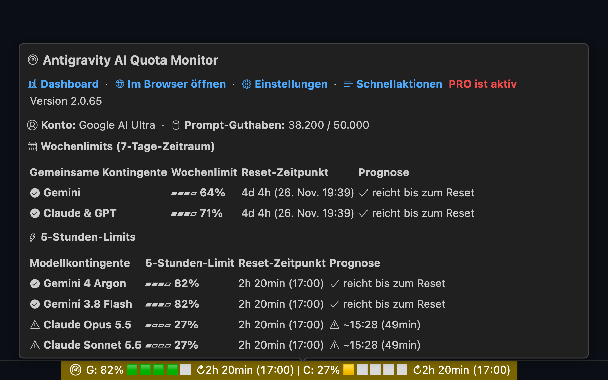

**Wie viel Antigravity-Kontingent bleibt dir noch? Du siehst es, bevor ein Limit deine Arbeit unterbricht.**

- **Immer im Blick.** Dein Restkontingent steht in der Statusleiste. Fahre mit der Maus darüber, und du siehst das 5-Stunden- und das Wochenlimit jedes Modells: Claude und Gemini.
- **Rechtzeitig gewarnt.** Wird das Kontingent eines Modells knapp, erscheint eine Meldung im Editor.
- **Kontingent wieder da? Dein Handy meldet es dir (Pro).** Verbinde dein Handy, lass den Editor offen und schick den Computer nicht in den Ruhezustand. Dann kannst du den Schreibtisch ruhig verlassen. Sobald dein Kontingent wieder aufgefüllt ist, bekommst du eine Nachricht.
- **Auch Codex, Claude Code und Grok.** Sind die Programme auf deinem Computer installiert, siehst du die Limits deiner eigenen Tarife für Codex, Claude Code und Grok unter denen von Antigravity, jeweils auf eigenen Karten.

**Kostenlos nutzbar. Pro: 7 Tage gratis direkt nach der Installation, ohne Kreditkarte. Preis: einmalig 9,99 € oder 2,99 €/Monat.** [Kostenlos und Pro im Vergleich](#free-and-pro-de) · [Pro kaufen](https://buy.polar.sh/polar_cl_aUt37UmhWCxHCB9s7dFpmvoT5KNrFqzVWx64q073KIJ)

Windows und macOS. Die Erweiterung liest deine Kontingentwerte auf deinem eigenen Computer: von Antigravity sowie von Codex, Claude Code und der Grok CLI, sofern sie installiert sind. Kein zusätzliches Konto, kein API-Schlüssel, keine Nutzungsanalysen. *Nicht von Google, Anthropic, OpenAI oder xAI entwickelt und ohne Verbindung zu diesen Unternehmen.*

**Benutzerhandbuch:** [English](https://github.com/Nordicstocks/antigravity-quota-monitor/blob/main/USER-GUIDE.md) · [Eesti](https://github.com/Nordicstocks/antigravity-quota-monitor/blob/main/USER-GUIDE.et.md) · [Deutsch](https://github.com/Nordicstocks/antigravity-quota-monitor/blob/main/USER-GUIDE.de.md) · [日本語](https://github.com/Nordicstocks/antigravity-quota-monitor/blob/main/USER-GUIDE.ja.md) · [简体中文](https://github.com/Nordicstocks/antigravity-quota-monitor/blob/main/USER-GUIDE.zh-CN.md) · [한국어](https://github.com/Nordicstocks/antigravity-quota-monitor/blob/main/USER-GUIDE.ko.md) · [Español](https://github.com/Nordicstocks/antigravity-quota-monitor/blob/main/USER-GUIDE.es.md) · 30 weitere Sprachen im Handbuch

**Diese Seite auf:** [English](#top) · [Eesti](#lang-et) · [日本語](#lang-ja) · [简体中文](#lang-zh-cn) · [한국어](#lang-ko) · [Español](#lang-es)

---

## Kostenlos oder Pro

Bei der ersten Installation bekommst du 7 Tage lang alle Pro-Funktionen, ohne Kreditkarte und ohne Registrierung. Danach kannst du alle Funktionen aus der Spalte „Kostenlos“ weiter nutzen.

| | Kostenlos | Pro |
| :--- | :---: | :---: |
| Kontingent in der Statusleiste, 5-Stunden- und Wochenlimit im Pop-up | ✓ | ✓ |
| Seitenleiste und Dashboard, mit Tag- und Nachtmodus | ✓ | ✓ |
| Meldungen im Editor bei knappem Kontingent und beim Reset | ✓ | ✓ |
| Limits von Codex, Claude Code und Grok auf eigenen Karten | ✓ | ✓ |
| Reset-Zeitpunkt und Verbrauchsprognose | | ✓ |
| Reserveschutz (Reserve Guard): warnt dich, wenn das Kontingent eines Modells bei deinem aktuellen Tempo voraussichtlich unter deine Reserve fällt (standardmäßig 20 %) | | ✓ |
| Handy- und Chat-Benachrichtigungen: ntfy.sh, Telegram, Discord, Slack | | ✓ |
| 90-Tage-Verlauf, Heatmap nach Tag und Uhrzeit, geschätzte Nutzung pro Projekt | | ✓ |
| Optionaler Auto-Starter für dein 5-Stunden-Fenster, auch mit Wiederholung in regelmäßigen Abständen und für Codex und Claude Code | | ✓ |

**Lifetime Pro: einmalig 9,99 €.** Kein Abo. Das ist weniger, als 4 Monate Pro-Monatsabo kosten. [Lifetime Pro kaufen](https://buy.polar.sh/polar_cl_aUt37UmhWCxHCB9s7dFpmvoT5KNrFqzVWx64q073KIJ)

**Pro-Monatsabo: 2,99 €/Monat.** Kündigen kannst du im Kundenportal von Polar, unserem Zahlungsanbieter. Entfernst du den Schlüssel aus der Erweiterung, ist das Abo damit nicht gekündigt. [Pro-Monatsabo abschließen](https://buy.polar.sh/polar_cl_LjI4JhW7qEbGDJyCyQslb5pSeHyETQ2Dfiuqb0tNkI5)

Deinen Lizenzschlüssel findest du in der Bestätigungs-E-Mail und auf der Bestätigungsseite von Polar. Füge ihn in den Einstellungen ein, um Pro zu aktivieren.

---

## Das bekommst du

**Ein Dashboard für alle Limits.** Für jedes Modell siehst du eine Füllstandsanzeige, das 5-Stunden- und das Wochenlimit, mit Pro auch den Reset-Zeitpunkt und die Prognose. Ordne die Karten per Drag-and-drop nach Belieben an und blende aus, was du nicht brauchst.

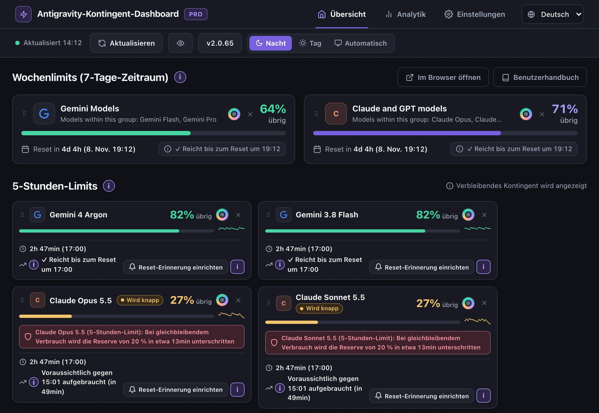

**Wohin dein Kontingent fließt (Pro).** Die Heatmap zeigt, zu welchen Uhrzeiten dein Verbrauch am höchsten ist. Die Projektansicht zeigt, welches Projekt schätzungsweise am meisten Kontingent verbraucht.

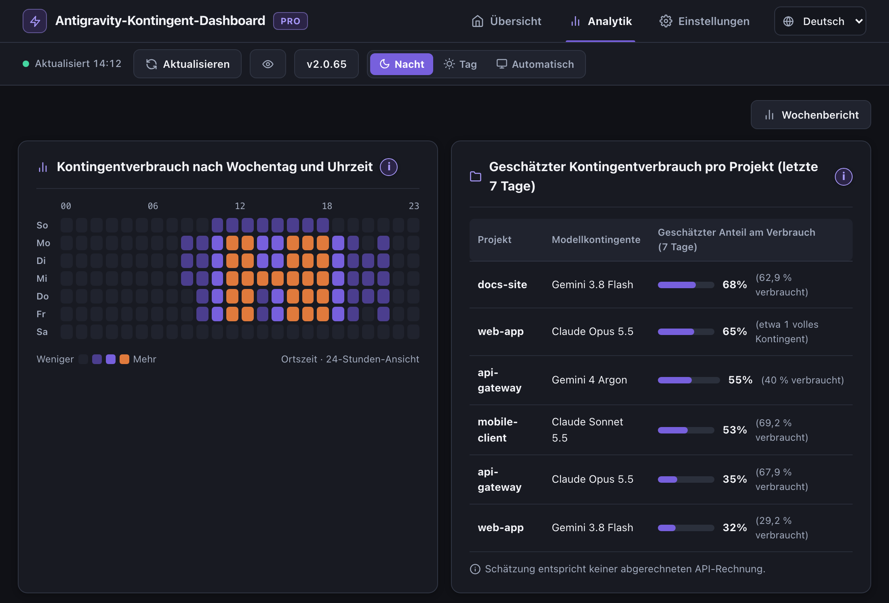

**Außerdem dabei.** Ein grafischer Wochenbericht und ein Export als CSV oder JSON (Pro). Eine Statusdatei für deinen Terminal-Prompt (Pro). Eine Browseransicht für den zweiten Monitor (Pro). Die Bereinigung alter Chat-Dateien listet die Ordner in `~/.gemini/antigravity/brain` auf, in denen sich in den letzten 7 Tagen nichts geändert hat, und verschiebt sie nur nach deiner Bestätigung in den Papierkorb des Systems. Von `code_tracker/` wird nur die Größe ermittelt, der Ordner wird nie bereinigt.

---

## Codex, Claude Code und Grok

**Deine anderen KI-Tarife neben Antigravity.** Antigravity Quota Monitor — Ultimate Cockpit & Dashboard zeigt auch die Limits deiner eigenen Tarife für Codex (ChatGPT), Claude Code (Anthropic) und Grok (xAI) – im Dashboard, in der Seitenleiste und in der Statusleiste. Jede Karte nennt das Tool und das Limit und zeigt deinen Tarif und dein Restkontingent. Mit Pro siehst du außerdem den Reset-Zeitpunkt und die Verbrauchsprognose und bekommst beim Reset eine Erinnerung.

- Die Limits jedes Tools werden aus dem jeweiligen Programm auf deinem Computer ausgelesen. Dabei wird kein Chat gestartet, nichts an ein Modell gesendet und kein Passwort benötigt.
- Ein Tool, das nicht auf deinem Computer installiert ist, wird nicht angezeigt. Jedes Tool lässt sich unter Einstellungen → Codex, Claude Code und Grok einzeln abschalten.
- Claude Code steht hier für deinen eigenen Tarif bei Anthropic. Die Claude-Modelle in Antigravity nutzen das Kontingent von Antigravity und behalten ihre eigenen Karten.
- Im Tarif Free meldet Grok keinen prozentualen Verbrauch. Deshalb zeigt die Grok-Karte keinen Balken.

---

## So funktioniert der Auto-Starter

**Neu in 2.0.58: „Nur erinnern“.** Mit „Nur erinnern“ erhältst du zur gewählten Uhrzeit lediglich die Benachrichtigung „Dein 5-Stunden-Fenster kann jetzt starten: Sende dazu einen beliebigen Prompt in Antigravity.“ Die Erweiterung führt nichts aus und sendet nichts, sodass kein Kontingent verbraucht wird und die folgenden Bedingungen nicht gelten. Für neue Nutzer ist dies die Standardeinstellung; „Automatisch starten“ bleibt mit deiner Zustimmung verfügbar.

Dein 5-Stunden-Fenster beginnt mit deinem ersten Prompt, nicht zu einer festen Uhrzeit. Schickst du ihn um `09:30` ab und brauchst dein Kontingent auf, wartest du womöglich bis `14:30` auf den Reset.

Stellst du den Auto-Starter (Pro) auf `07:00`, führt die Erweiterung zu dieser Zeit `agy` aus, das Kommandozeilen-Tool von Antigravity. Dabei sendet `agy` über dein eigenes Konto einen kurzen, aber echten Prompt (`OK`) an die Modelle, die du auswählst. `agy` muss installiert sein. Dein 5-Stunden-Limit wird dann gegen `12:00` zurückgesetzt, sodass ein zweites volles 5-Stunden-Fenster in deinen Arbeitstag passt, sofern du noch Wochenkontingent übrig hast.

Der Auto-Starter ist standardmäßig aus und fragt zuerst nach deiner Zustimmung. Er verbraucht etwas von deinem Kontingent. Der Editor muss zur gewählten Uhrzeit geöffnet sein. Ist er geschlossen, läuft der Auto-Starter beim nächsten Öffnen des Editors, sofern seit der gewählten Uhrzeit nicht mehr als 3 Stunden vergangen sind.

**Neu in 2.0.64: „In regelmäßigen Abständen wiederholen“.** Nach dem ersten Start zur gewählten Uhrzeit kann der Auto-Starter das 5-Stunden-Fenster im Abstand von `5:01` (5 Stunden und 1 Minute, der empfohlene Wert) oder in einem von dir festgelegten Intervall zwischen `1:00` und `24:00` erneut starten – bis zum Start zur gewählten Uhrzeit am nächsten Tag. Bei `5:01` sind das höchstens 4 Starts am Tag. Jeder Start sendet einen echten Prompt und verbraucht etwas von deinem Kontingent. Die Wiederholung ist standardmäßig ausgeschaltet.

**Neu in 2.0.64: Codex und Claude Code.** Du wählst einzeln aus, was der Auto-Starter startet: Claude und Gemini in Antigravity sowie Codex und Claude Code mit deinen eigenen Konten, sofern das jeweilige Programm installiert ist, du angemeldet bist und dein jeweiliger Tarif ein 5-Stunden-Fenster hat. Für diese beiden führt die Erweiterung `codex exec` (schreibgeschützt in einem temporären Ordner) beziehungsweise `claude -p` (ohne Tool-Nutzung) aus und sendet über dein eigenes Konto einen kurzen Prompt: `OK`. Das startet das 5-Stunden-Fenster des jeweiligen Tools und verbraucht etwas von dessen Kontingent. Vor dem ersten Prompt für jedes der beiden Tools bittet dich die Erweiterung gesondert um Zustimmung, denn der Prompt wird über dein OpenAI- beziehungsweise Anthropic-Konto gesendet, nicht über dein Antigravity-Konto. Wenn du ein Tool abwählst, widerrufst du damit deine Zustimmung. Wählst du es erneut aus, wirst du wieder um Zustimmung gebeten.

Für jedes Konto, über das ein Prompt gesendet wird, wirst du gesondert um Zustimmung gebeten: einmal für Claude und Gemini über `agy` und jeweils einmal für Codex und Claude Code. Prompts werden nur im Modus „Automatisch starten“ gesendet.

Laut Abschnitt 6 der [Zusätzlichen Nutzungsbedingungen von Google Antigravity](https://antigravity.google/terms) verstößt es gegen diese Bedingungen, mit Software von Drittanbietern auf den Dienst zuzugreifen. Das kann zur Sperrung oder Kündigung deines Kontos führen. Ob du den Auto-Starter einschaltest, entscheidest du selbst.

---

## Datenschutz, Netzwerkzugriffe und Support

Die Kontingentwerte von Antigravity stammen von deinem lokalen Antigravity-Sprachserver auf `127.0.0.1`. Die Erweiterung sendet keine Nutzungsanalysen. Eine Internetverbindung baut sie nur in diesen Fällen auf:

- **Update-Prüfung:** Bei jedem Start und danach alle 6 Stunden, solange der Editor geöffnet bleibt, fragt die Erweiterung bei `open-vsx.org` die neueste Versionsnummer ab.
- **Lizenz:** Hast du einen Lizenzschlüssel eingegeben, prüft die Erweiterung ihn etwa einmal am Tag bei `api.polar.sh`. Erreicht sie Polar 7 Tage lang nicht, wird Pro pausiert, bis die Verbindung wiederhergestellt ist.
- **Benachrichtigungen (optional):** Die Erweiterung sendet Kontingentmeldungen an `ntfy.sh`, Telegram oder deinen Discord-/Slack-Webhook, aber nur, wenn du das eingerichtet hast.
- **Codex, Claude Code und Grok (aktiviert, wenn das Tool installiert ist; abschaltbar):** Die Erweiterung führt das jeweilige Programm auf deinem Computer aus (`codex app-server`, `claude -p /usage` oder die Grok CLI). Das Programm nutzt deine bestehende Anmeldung, um die Limits deines Tarifs beim jeweiligen Dienst (OpenAI, Anthropic oder xAI) abzufragen. Dabei wird kein Chat gestartet und kein Prompt gesendet. Du kannst jedes Tool unter Einstellungen → Codex, Claude Code und Grok einzeln abschalten.
- **Auto-Starter (optional, standardmäßig deaktiviert):** Wenn du ihn einschaltest, sendet `agy` über dein Konto einen kurzen Prompt (`OK`) an die ausgewählten Antigravity-Modelle. Wählst du auch Codex oder Claude Code aus, führt die Erweiterung das jeweilige Programm in einem temporären Ordner aus, und es sendet über dein eigenes Konto einen kurzen Prompt (`OK`). Dein Quellcode wird nicht mitgesendet.
- **Fehlerberichte (standardmäßig aktiviert, abschaltbar):** Wenn in der Erweiterung unerwartet etwas fehlschlägt, sendet sie einen anonymen Bericht an `oeqbchgyoderqxnzcubh.supabase.co` mit der Version und Edition der Erweiterung, dem Namen, der Version und Sprache deines Editors, deinem Betriebssystem und Prozessortyp, der Angabe, ob du die kostenlose Version, die Testphase oder Pro nutzt, sowie der Fehlermeldung und der Stelle im Code, an der der Fehler aufgetreten ist. Kontingentwerte, Dateien, Kontodaten und Lizenzschlüssel werden nicht gesendet. Ist die Telemetrie deines Editors deaktiviert, wird nichts gesendet. Um die Berichte abzuschalten, deaktiviere unter Einstellungen → Allgemein die Option `Fehlerberichte senden` (Einstellung `antigravityQuota.sendErrorReports`).

**Zwischenablage:** Die Erweiterung liest sie nur in einem einzigen Fall aus. Klickst du auf eine Kaufschaltfläche und kehrst innerhalb von 30 Minuten zum Editor zurück, prüft sie die Zwischenablage einmal auf einen Lizenzschlüssel. Was sie dort findet, wird nicht gespeichert und nur dann an `api.polar.sh` gesendet, wenn du auf **Aktivieren** klickst. Zu keinem anderen Zeitpunkt liest die Erweiterung die Zwischenablage aus.

**So richtest du Handy-Benachrichtigungen ein**
**`ntfy.sh`, kein Konto nötig.** Installiere die kostenlose ntfy-App aus dem [App Store](https://apps.apple.com/app/ntfy/id1625396347) oder von [Google Play](https://play.google.com/store/apps/details?id=io.heckel.ntfy). Tippe in der App auf `+` und gib das Topic ein, das die Erweiterung unter **Einstellungen → Handy verbinden** vorschlägt. Unter Android kannst du stattdessen den QR-Code scannen. Klicke auf **Speichern und Testbenachrichtigung senden**. `ntfy.sh`-Topics sind öffentlich: Wer den Namen kennt, kann Nachrichten lesen und senden. Die Erweiterung schlägt einen zufälligen, schwer zu erratenden Namen vor. Gib ihn nicht weiter.

**Telegram.** Sende [@BotFather](https://t.me/BotFather) den Befehl `/newbot`, um ein Bot-Token zu bekommen. Öffne den Link zu deinem neuen Bot und tippe einmal auf **Starten**, sonst stellt Telegram die Nachrichten des Bots nicht zu. Schreibe an [@userinfobot](https://t.me/userinfobot), um deine numerische Chat-ID zu bekommen. Gib unter **Einstellungen** die Chat-ID ein und klicke auf **Speichern**. Klicke dann auf **Bot-Token festlegen**, füge das Token ein und klicke auf **Testbenachrichtigung**.

**Discord oder Slack.** Füge die Webhook-URL im selben Bereich der Einstellungen ein und klicke auf **Speichern**.

**Sprachen.** Die Oberfläche der Erweiterung gibt es in 37 Sprachen. Verwendet wird die Sprache deines Editors oder, wenn der Editor auf Englisch steht, deine Systemsprache. In den Einstellungen kannst du jede andere auswählen. Einige neuere Texte können noch auf Englisch erscheinen.

---

**Hilfe:** [Benutzerhandbuch](https://github.com/Nordicstocks/antigravity-quota-monitor/blob/main/USER-GUIDE.de.md) · [Problem melden](https://github.com/Nordicstocks/antigravity-quota-monitor/issues) · [Änderungsprotokoll](https://github.com/Nordicstocks/antigravity-quota-monitor/blob/main/CHANGELOG.md)

*Google Antigravity, Gemini, Claude, Claude Code, Codex, ChatGPT und Grok sind Marken ihrer jeweiligen Inhaber.*

---

## 日本語

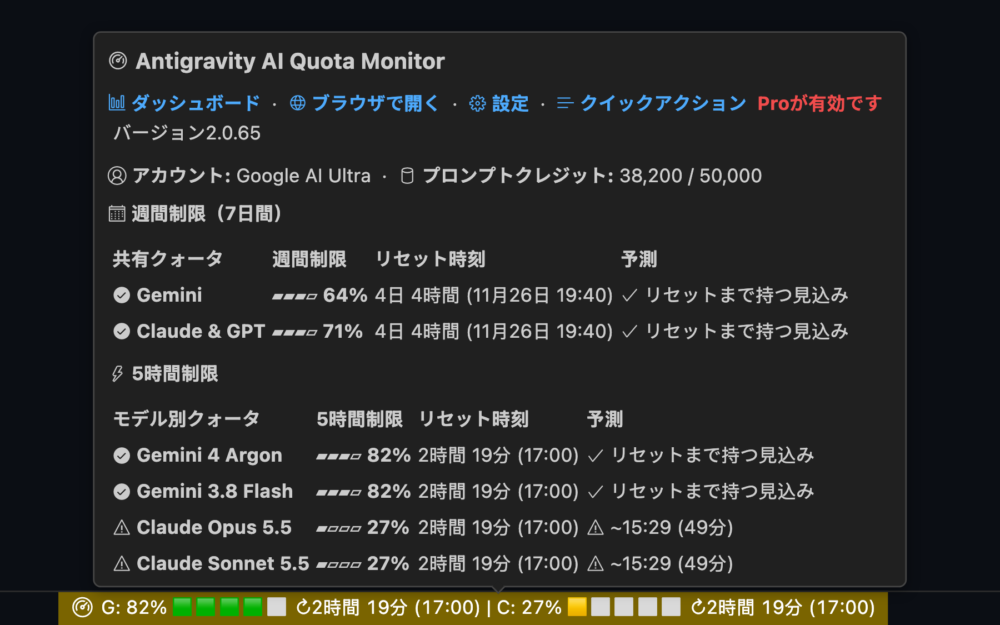

**制限で作業が止まる前に、Antigravityのクォータ残量を把握できます。**

- **いつでもひと目で確認。** クォータ残量はステータスバーに表示されます。カーソルを合わせると、ClaudeとGeminiの各モデルの5時間枠と週間枠の残量がわかります。
- **使い切る前に警告。** モデルのクォータ残量が少なくなると、エディターにアラートを表示します。
- **クォータが回復したら、スマホに通知（Pro）。** スマホを接続しておけば、席を外していても安心です。エディターは開いたままにし、コンピューターをスリープさせないでください。クォータが100%に戻ると、メッセージが届きます。
- **Codex、Claude Code、Grokも確認。** コンピューターにインストールされていれば、ご自身の各プランの制限と残量を、Antigravityのカードの下にそれぞれ表示します。

**無料で使えます。Proはインストール直後から7日間無料（カード不要）、その後は買い切り€9.99または月額€2.99。** [無料版とProを比較](#free-and-pro-ja) · [Proを購入](https://buy.polar.sh/polar_cl_aUt37UmhWCxHCB9s7dFpmvoT5KNrFqzVWx64q073KIJ)

WindowsとmacOSに対応しています。クォータは、お使いのコンピューター上のAntigravityと、インストールされているCodex、Claude Code、Grok CLIから読み取ります。新たなアカウントやAPIキーは不要で、使用状況の分析データも送信しません。*この拡張機能は、Google、Anthropic、OpenAI、xAIの製品ではなく、各社と提携もしていません。*

**ユーザーガイド:** [English](https://github.com/Nordicstocks/antigravity-quota-monitor/blob/main/USER-GUIDE.md) · [Eesti](https://github.com/Nordicstocks/antigravity-quota-monitor/blob/main/USER-GUIDE.et.md) · [Deutsch](https://github.com/Nordicstocks/antigravity-quota-monitor/blob/main/USER-GUIDE.de.md) · [日本語](https://github.com/Nordicstocks/antigravity-quota-monitor/blob/main/USER-GUIDE.ja.md) · [简体中文](https://github.com/Nordicstocks/antigravity-quota-monitor/blob/main/USER-GUIDE.zh-CN.md) · [한국어](https://github.com/Nordicstocks/antigravity-quota-monitor/blob/main/USER-GUIDE.ko.md) · [Español](https://github.com/Nordicstocks/antigravity-quota-monitor/blob/main/USER-GUIDE.es.md) · ほか30言語はガイド内から

**他の言語で読む：** [English](#top) · [Eesti](#lang-et) · [Deutsch](#lang-de) · [简体中文](#lang-zh-cn) · [한국어](#lang-ko) · [Español](#lang-es)

---

## 無料版とPro

拡張機能を初めてインストールすると、Proの全機能を7日間使えます。カードやアカウントの登録は不要です。体験期間の終了後も、無料版に含まれる機能はそのまま使えます。

| | 無料版 | Pro |
| :--- | :---: | :---: |
| ステータスバーのクォータ残量（カーソルを合わせると、5時間枠と週間枠の残量を表示） | ✓ | ✓ |
| サイドパネルとダッシュボード（ライトテーマとダークテーマ） | ✓ | ✓ |
| エディター内のアラート（クォータが少なくなったとき・リセットされたとき） | ✓ | ✓ |
| Codex、Claude Code、Grokの制限と残量をそれぞれのカードに表示 | ✓ | ✓ |
| リセット時刻とクォータ切れの予測 | | ✓ |
| 残量ガード：今のペースではモデルのクォータが下限（既定では20%）を下回りそうなときに警告 | | ✓ |
| スマホとチャットへの通知：ntfy.sh、Telegram、Discord、Slack | | ✓ |
| 90日間の履歴、曜日×時間帯のヒートマップ、プロジェクト別の推定使用量 | | ✓ |
| 5時間枠の自動スタート（任意）：間隔を指定した繰り返し、CodexとClaude Codeにも対応 | | ✓ |

**Pro買い切りプラン：€9.99（1回払い）。** サブスクリプションではありません。Pro月額プランの4か月分より安くなります。[Pro買い切りプランを購入](https://buy.polar.sh/polar_cl_aUt37UmhWCxHCB9s7dFpmvoT5KNrFqzVWx64q073KIJ)

**Pro月額プラン：€2.99/月。** 解約は、決済サービスPolarのカスタマーポータルで行います。拡張機能からキーを削除しても、プランは解約されません。[Pro月額プランに登録](https://buy.polar.sh/polar_cl_LjI4JhW7qEbGDJyCyQslb5pSeHyETQ2Dfiuqb0tNkI5)

ライセンスキーは、購入確認メールとPolarの確認ページに記載されています。設定に貼り付けて、Proを有効化してください。

---

## できること

**すべての制限を1つのダッシュボードで。** 各モデルのカードには、残量バーと、5時間枠・週間枠の残量が並び、Proではリセット時刻とクォータ切れの予測も加わります。カードはドラッグで好きな順に並べ替えられ、使わないものは非表示にできます。

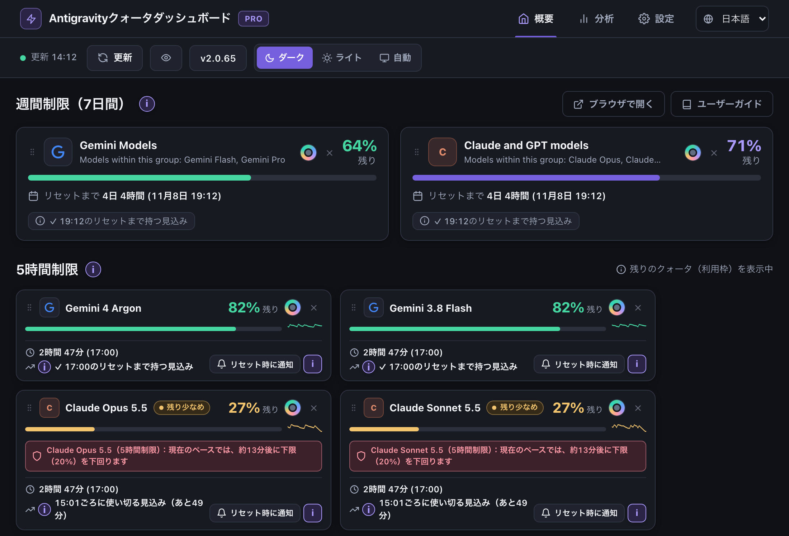

**クォータの消費傾向がわかります（Pro）。** 使用が最も多い時間帯は、ヒートマップで確認できます。プロジェクト別の表示では、どのプロジェクトで最も多くクォータを消費しているかを推定します。

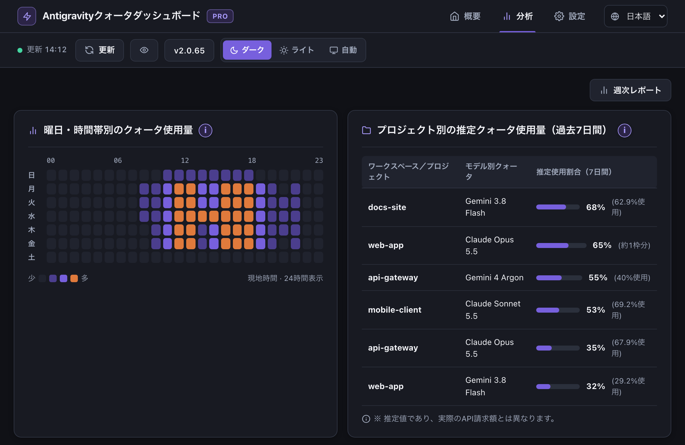

**その他の機能：** グラフ付きの週次レポートと、CSVまたはJSONでのエクスポート（Pro）。ターミナルのプロンプトに使えるステータスファイル（Pro）。サブモニター用のブラウザ表示（Pro）。古い会話ファイルのクリーナーは、`~/.gemini/antigravity/brain`内で過去7日間変更のないフォルダーを一覧にし、確認のうえ実行した場合に限り、ゴミ箱に移動します。`code_tracker/`は容量を測るだけで、整理の対象にはなりません。

---

## Codex、Claude Code、Grok

**他のAIプランもAntigravityと一緒に確認。** Antigravity Quota Monitor — Ultimate Cockpit & Dashboardでは、ご自身のCodex（ChatGPT）、Claude Code（Anthropic）、Grok（xAI）のプランについても、ダッシュボード、サイドパネル、ステータスバーで利用上限と残量を確認できます。それぞれのカードには、ツール名、利用上限、利用中のプラン、残量が表示されます。Proではリセット時刻と使い切り予測も表示され、リセット時には通知を受け取れます。

- 各ツールの利用上限と残量は、コンピューター上のそれぞれのプログラムから読み取ります。会話は開始せず、モデルには何も送信しません。パスワードも不要です。
- コンピューターにインストールされていないツールは表示されません。設定 → Codex、Claude Code、Grokで、それぞれオフにできます。
- ここで表示するClaude Codeの残量は、ご自身のAnthropicのプランのものです。Antigravity内のClaudeモデルはAntigravityのクォータを使い、これまでどおり別のカードに表示されます。
- GrokのFreeプランでは、Grokが使用率を返さないため、カードに残量バーは表示されません。

---

## 5時間枠の自動スタートの仕組み

**2.0.58の新機能：「通知のみ」。** 指定した時刻に「5時間枠を開始できます。Antigravityで任意のプロンプトを送信してください。」という通知だけを受け取り、Antigravityでのプロンプト送信はご自身で行えます。拡張機能は何も実行・送信しないため、クォータは消費されず、以下の条件も適用されません。新規ユーザーには「通知のみ」が初期設定となり、同意すれば「自動で開始」も引き続き利用できます。

5時間枠は、決まった時刻ではなく、最初のプロンプトで始まります。たとえば最初のプロンプトが`09:30`の場合、途中でクォータを使い切ると、リセットされる`14:30`まで待つことになります。

自動スタート（Pro）を`07:00`に設定すると、拡張機能はその時刻にAntigravityのコマンドラインツール`agy`を実行し、ご自身のアカウントから、選択したモデルに短いプロンプト（`OK`）を実際に送信します。`agy`のインストールが必要です。5時間枠は`12:00`ごろにリセットされるので、週間クォータが残っていれば、勤務時間内にもう1枠まるごと使えます。

自動スタートは初期状態ではオフで、初回は同意を求められます。実行するとクォータを消費します。指定した時刻にはエディターが開いている必要があります。閉じていた場合は、その時刻から3時間以内にエディターを開いた時点で、自動スタートが実行されます。

**2.0.64の新機能：「一定間隔で繰り返す」を追加。** 5時間枠の自動スタートでは、指定した時刻に最初の枠を開始した後、翌日の同じ時刻まで一定間隔で開始を繰り返せます。間隔は`1:00`～`24:00`の範囲で設定でき、推奨は`5:01`（5時間1分）です。`5:01`の場合、開始は1日最大4回です。毎回実際のリクエストを送信し、クォータを消費します。初期状態ではオフです。

**2.0.64の新機能：CodexとClaude Codeにも対応。** 5時間枠の自動スタートでは、Antigravity内のClaudeとGeminiに加え、ご自身のCodexとClaude Codeも、それぞれ選んで開始できます。CodexとClaude Codeは、インストール・サインイン済みで、利用中のプランに5時間枠がある場合に選べます。拡張機能は`codex exec`（読み取り専用で一時フォルダー内で実行）または`claude -p`（ツールをオフにして実行）を使い、ご自身のアカウントから短いリクエスト（`OK`）を1回送信します。これにより各ツールの5時間枠が始まり、そのツールのクォータが消費されます。リクエストはAntigravityのアカウントではなくOpenAIまたはAnthropicのアカウントから送信されるため、それぞれ初回の送信前に個別に同意を求めます。ツールの選択を外すと同意も取り消され、再び選択するときに改めて同意を求めます。

リクエストの送信元となるアカウントごとに同意を求めます。`agy`を使うClaudeとGeminiでまとめて1回、CodexとClaude Codeでそれぞれ1回です。リクエストを送信するのは「自動で開始」モードのときだけです。

[Google Antigravity 追加利用規約](https://antigravity.google/terms)のセクション6では、第三者のソフトウェアを使ってサービスにアクセスすることは違反にあたり、アカウントの停止や終了につながる場合がある、とされています。オンにするかどうかは、ご自身で判断してください。

---

## プライバシー、ネットワーク利用、サポート

Antigravityのクォータの数値は、ローカルのAntigravity言語サーバー（`127.0.0.1`）から取得します。この拡張機能は、使用状況の分析データをどこにも送信しません。ネットワークを使うのは次の場合だけです。

- **更新の確認：** 起動のたびに、またエディターを開いている間は6時間ごとに、`open-vsx.org`に最新のバージョン番号を問い合わせます。
- **ライセンス：** ライセンスキーがある場合、1日に1回程度`api.polar.sh`でキーを検証します。7日間Polarに接続できないと、接続が回復するまでProの機能は一時的に使えなくなります。
- **通知（任意）：** 設定した場合に限り、`ntfy.sh`、Telegram、またはDiscord/SlackのWebhookにクォータの通知を送信します。
- **Codex、Claude Code、Grok（ツールがインストールされている場合はオン、オフに変更可能）：** 拡張機能は、コンピューター上で対応するプログラム（`codex app-server`、`claude -p /usage`、Grok CLI）を実行します。各プログラムはご自身のサインイン情報を使って、それぞれのサービス（OpenAI、Anthropic、xAI）にプランの制限と残量を問い合わせます。会話は開始せず、プロンプトも送信しません。設定 → Codex、Claude Code、Grokで、それぞれオフにできます。
- **5時間枠の自動スタート（任意、初期状態ではオフ）：** オンにすると、`agy`がご自身のアカウントから、選択したAntigravityのモデルに短いプロンプト（`OK`）を送信します。CodexやClaude Codeも選択した場合、それぞれのプログラムが一時フォルダー内で、ご自身のアカウントから短いリクエスト（`OK`）を1回送信します。リクエストにソースコードは含まれません。
- **エラーレポート（初期状態ではオン、オフに変更可能）：** 拡張機能で予期しないエラーが発生したときに、拡張機能のバージョンとエディション、エディターの名前・バージョン・言語、オペレーティングシステムとプロセッサーの種類、利用中のプラン（無料版、体験期間、Pro）、エラーメッセージとコード内の発生箇所を含む匿名のレポートを`oeqbchgyoderqxnzcubh.supabase.co`に送信します。使用量の数値、ファイル、アカウント情報、ライセンスキーは送信しません。エディターのテレメトリ設定がオフの間は何も送信しません。レポートの送信を停止するには、設定 → 全般 → `エラーレポートを送信`をオフにします（設定`antigravityQuota.sendErrorReports`）。

**クリップボード：** 読み取るのは次の場合だけです。購入ボタンをクリックして30分以内にエディターに戻ると、ライセンスキーがないか、クリップボードを1回確認します。見つかった内容は保存されず、**有効化**をクリックした場合にのみ`api.polar.sh`に送信されます。これ以外のときにクリップボードを読み取ることはありません。

**スマホ通知の設定方法**
**ntfy.sh（アカウント不要）：** 無料のntfyアプリを[App Store](https://apps.apple.com/app/ntfy/id1625396347)または[Google Play](https://play.google.com/store/apps/details?id=io.heckel.ntfy)からインストールします。アプリで`+`をタップし、拡張機能の**設定 → スマホを接続**に表示されているトピックを入力します。Androidなら、代わりにQRコードを読み取ることもできます。**保存してテスト通知を送信**をクリックします。`ntfy.sh`のトピックは公開されています。トピック名を知っていれば誰でもメッセージを読んだり送ったりできます。拡張機能は推測されにくいランダムな名前を提案します。この名前は他の人に教えないでください。

**Telegram：** [@BotFather](https://t.me/BotFather)に`/newbot`を送り、ボットトークンを取得します。新しいボットへのリンクを開き、Startを1回タップしてください。タップしないと、ボットからのメッセージが届きません。[@userinfobot](https://t.me/userinfobot)にメッセージを送り、数値形式のチャットIDを確認します。**設定**でチャットIDを入力して**保存**をクリックします。次に**ボットトークンを設定**をクリックしてトークンを貼り付け、最後に**テスト通知**をクリックします。

**DiscordまたはSlack：** **設定**の同じセクションにWebhook URLを貼り付け、**保存**をクリックします。

**言語：** 37言語に対応しています。表示言語はエディターの設定に従います。ただし、エディターの表示言語が英語の場合は、システムの言語で表示します。設定で他の言語を選ぶこともできます。新しい文言の一部は、英語のまま表示されることがあります。

---

**ヘルプ：** [ユーザーガイド](https://github.com/Nordicstocks/antigravity-quota-monitor/blob/main/USER-GUIDE.ja.md) · [問題を報告](https://github.com/Nordicstocks/antigravity-quota-monitor/issues) · [変更履歴](https://github.com/Nordicstocks/antigravity-quota-monitor/blob/main/CHANGELOG.md)

Google Antigravity、Gemini、Claude、Claude Code、Codex、ChatGPT、Grokの名称および商標は、それぞれの権利者に帰属します。

---

## 简体中文

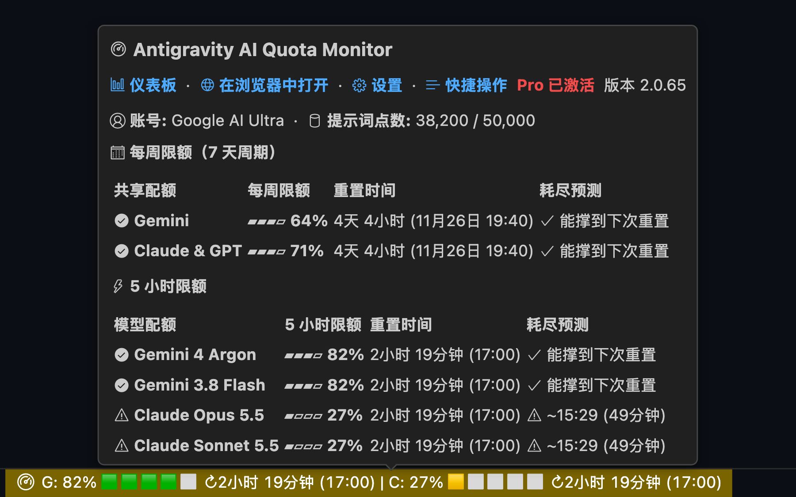

**在被限额卡住之前，先看清 Antigravity 还剩多少配额。**

- **随时可见**。剩余配额一直显示在状态栏。鼠标悬停，就能看到 Claude 和 Gemini 各模型的 5 小时限额和每周限额。
- **提前提醒**。某个模型的配额所剩不多时，编辑器里会提醒你。
- **配额恢复了，手机会告诉你（Pro）**。连接手机，让编辑器开着、电脑不休眠，你就不用守在电脑前了。配额恢复到 100% 时，你会收到一条消息。
- **也能查看 Codex、Claude Code 和 Grok**。如果电脑上安装了这些工具，你自己的 Codex、Claude Code 和 Grok 会员方案限额会分别以独立卡片显示在 Antigravity 下方。

**免费版可直接使用，安装后还能免费试用 Pro 7 天，无需绑定银行卡。想继续用 Pro，可选 €9.99 一次性买断或 €2.99/月订阅。** [比较免费版和 Pro](#free-and-pro-zh-cn) · [购买 Pro](https://buy.polar.sh/polar_cl_aUt37UmhWCxHCB9s7dFpmvoT5KNrFqzVWx64q073KIJ)

支持 Windows 和 macOS。插件在本机读取 Antigravity 以及已安装的 Codex、Claude Code 和 Grok CLI 的配额。无需额外账号和 API 密钥，也不发送使用分析数据。*本插件并非由 Google、Anthropic、OpenAI 或 xAI 开发，也与这些公司没有关联。*

**用户指南:** [English](https://github.com/Nordicstocks/antigravity-quota-monitor/blob/main/USER-GUIDE.md) · [Eesti](https://github.com/Nordicstocks/antigravity-quota-monitor/blob/main/USER-GUIDE.et.md) · [Deutsch](https://github.com/Nordicstocks/antigravity-quota-monitor/blob/main/USER-GUIDE.de.md) · [日本語](https://github.com/Nordicstocks/antigravity-quota-monitor/blob/main/USER-GUIDE.ja.md) · [简体中文](https://github.com/Nordicstocks/antigravity-quota-monitor/blob/main/USER-GUIDE.zh-CN.md) · [한국어](https://github.com/Nordicstocks/antigravity-quota-monitor/blob/main/USER-GUIDE.ko.md) · [Español](https://github.com/Nordicstocks/antigravity-quota-monitor/blob/main/USER-GUIDE.es.md) · 另有 30 种语言可在指南内选择

**其他语言：** [English](#top) · [Eesti](#lang-et) · [Deutsch](#lang-de) · [日本語](#lang-ja) · [한국어](#lang-ko) · [Español](#lang-es)

---

## 免费版和 Pro

首次安装插件后的 7 天内，你可以使用全部 Pro 功能，无需绑定银行卡，也无需注册账号。试用期结束后，免费版这一列的所有功能都可以继续使用。

| | 免费版 | Pro |
| :--- | :---: | :---: |
| 状态栏显示配额，鼠标悬停可查看 5 小时限额和每周限额 | ✓ | ✓ |
| 侧边栏和仪表板，支持日间和夜间主题 | ✓ | ✓ |
| 配额偏低或重置时，在编辑器中提醒 | ✓ | ✓ |
| Codex、Claude Code 和 Grok 的限额（独立卡片显示） | ✓ | ✓ |
| 重置时间和预计耗尽时间 | | ✓ |
| 配额预留保护：按当前消耗速度，某个模型的配额快要跌破这条线（默认 20%）时会提醒你 | | ✓ |
| 手机和聊天软件通知：ntfy.sh、Telegram、Discord、Slack | | ✓ |
| 90 天历史记录、按星期和时段统计的热力图、各项目用量估算 | | ✓ |
| 5 小时窗口自动预热（可选）：支持按间隔重复，也支持 Codex 和 Claude Code | | ✓ |

**Pro 终身版：€9.99 一次性买断**。无需订阅，比 Pro 月付版 4 个月的费用还低。[购买 Pro 终身版](https://buy.polar.sh/polar_cl_aUt37UmhWCxHCB9s7dFpmvoT5KNrFqzVWx64q073KIJ)

**Pro 月付版：€2.99/月**。如需取消，请前往 Polar（我们的支付服务商）的客户门户。仅从插件中移除密钥不会取消订阅。[购买 Pro 月付版](https://buy.polar.sh/polar_cl_LjI4JhW7qEbGDJyCyQslb5pSeHyETQ2Dfiuqb0tNkI5)

购买后，你可以在邮件和 Polar 的确认页面上找到许可证密钥。把它粘贴到**设置**中，即可激活 Pro。

---

## 功能一览

**一个仪表板，看清所有限额**。每个模型都有自己的配额条，并显示 5 小时限额和每周限额；开通 Pro 后，还会显示重置时间和预计耗尽时间。卡片可以拖动排序，用不到的可以隐藏。

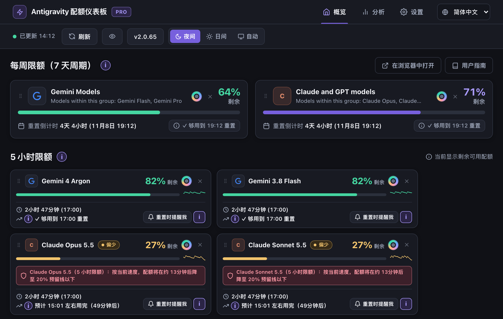

**弄清配额都花在了哪里（Pro）**。热力图显示你哪些时段用得最多，按项目统计的视图可以估算出哪个项目最耗配额。

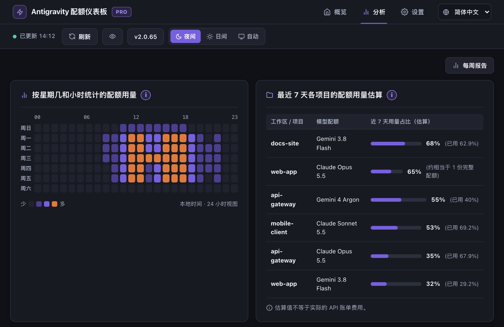

**此外**：可视化周报、CSV 或 JSON 导出（Pro），可供命令行提示符读取的状态文件（Pro），可放到第二块显示器上的浏览器视图（Pro）。插件还能清理旧对话文件：它会列出 `~/.gemini/antigravity/brain` 中最近 7 天没有改动的文件夹，只有你确认之后，才会把它们移到系统废纸篓（Windows 上是回收站）。`code_tracker/` 只统计大小，从不清理。

---

## Codex、Claude Code 和 Grok

**其他 AI 会员方案，也能和 Antigravity 一起查看**。Antigravity Quota Monitor — Ultimate Cockpit & Dashboard 还能在仪表板、侧边栏和状态栏显示你自己的 Codex（ChatGPT）、Claude Code（Anthropic）和 Grok（xAI）会员方案限额。每张卡片都会标明工具和限额，并显示你的会员方案和剩余配额。开通 Pro 后，还会显示重置时间和预计耗尽时间，并在重置时提醒你。

- 每个工具的限额都从电脑上对应的程序读取。读取时不会开启对话，不会向模型发送任何内容，也不需要密码。
- 电脑上没有安装的工具不会显示。你可以在设置 → Codex、Claude Code 和 Grok 中分别关闭它们。
- 这里的 Claude Code 使用你自己的 Anthropic 会员方案。Antigravity 中的 Claude 模型使用 Antigravity 的配额，仍有各自的卡片。
- Grok 的免费（Free）方案不提供用量百分比，因此卡片上不会显示配额条。

---

## 自动预热是怎么工作的

**2.0.58 新增：“仅提醒我”。** 到了设定时间，你只会收到通知：“现在可以开启 5 小时窗口了：在 Antigravity 中发送任意提示词即可开始计时。”之后由你自行发送提示词；插件不会运行任何命令或发送任何内容，因此不会消耗配额，下文条款也不适用。新用户默认使用“仅提醒我”，你仍可随时选择“自动开始计时”。

5 小时窗口不是从固定时间算起，而是从你发出第一条提示词时开始计时。如果你 `09:30` 才发第一条，又把配额用完了，可能要等到 `14:30` 才重置。

把自动预热（Pro）设为 `07:00` 后，插件会在这个时间运行 Antigravity 的命令行工具 `agy`，用你自己的账号向所选模型发送一条简短的真实提示词 `OK`（需先安装 `agy`）。这样，5 小时限额大约在 `12:00` 重置，只要每周配额还有剩余，当天工作时间内就能多用一轮完整配额。

此功能默认关闭，第一次使用时会征求你的同意。它会消耗一些配额。到了设定时间，编辑器需要开着；如果没开，只要距离设定时间不超过 3 小时，下次打开时会补上这次预热。

**2.0.64 新增：“按间隔重复”**。在你设定的时间首次开启窗口后，自动预热可以每隔 `5:01`（5 小时 1 分钟，推荐值）再次开启 5 小时窗口；你也可以在 `1:00` 到 `24:00` 之间自行设置间隔。之后会按该间隔持续重复，直到次日设定的开始时间。使用 `5:01` 时，每天最多开启 4 次。每次都会发送一条真实请求，并消耗一些配额。此功能默认关闭。

**2.0.64 新增：Codex 和 Claude Code**。你可以分别选择要为哪些工具开启自动预热：Antigravity 中的 Claude 和 Gemini，以及你自己已安装、已登录且会员方案包含 5 小时窗口的 Codex 和 Claude Code。对于后两者，插件会运行 `codex exec`（只读，在临时文件夹中运行）或 `claude -p`（关闭工具调用），用你自己的账号发送一条简短的真实提示词 `OK`。这会开启对应工具自己的 5 小时窗口，并消耗该工具的一些配额。由于请求分别来自你的 OpenAI 或 Anthropic 账号，而不是 Antigravity 账号，插件会在首次通过这两个工具发送请求前分别征求你的同意。取消选择某个工具即撤回相应的同意；再次选择时，插件会重新征求同意。

插件会按发送请求的账号分别征求你的同意：通过 `agy` 使用 Claude 和 Gemini 时征求一次，Codex 和 Claude Code 各征求一次。只有在自动预热中选择“自动开始计时”时，才会发送请求。

[Google Antigravity 附加服务条款](https://antigravity.google/terms)第 6 条写明，使用第三方软件访问该服务构成违约，可能导致你的账号被暂停或终止。是否开启，决定权在你。

---

## 隐私、联网和支持

Antigravity 的配额数据来自本机 `127.0.0.1` 上的 Antigravity 语言服务器。插件不会向任何人发送使用分析数据。只有以下情况才会联网：

- **检查更新**：每次启动时，以及编辑器保持打开期间每隔 6 小时，向 `open-vsx.org` 查询最新版本号。
- **许可证**：有许可证密钥时，大约每天向 `api.polar.sh` 验证一次。如果连续 7 天连不上 Polar，Pro 功能会暂停，连接恢复后才能继续使用。
- **通知（可选）**：只有在你完成设置后，插件才会把配额消息发送到 `ntfy.sh`、Telegram 或你的 Discord/Slack Webhook。
- **Codex、Claude Code 和 Grok（已安装时默认开启，可关闭）**：插件会在你的电脑上运行对应的程序（`codex app-server`、`claude -p /usage` 或 Grok CLI）。该程序使用你自己的登录状态，向对应的服务（OpenAI、Anthropic 或 xAI）查询你的会员方案限额。不会开启对话，也不会发送提示词。你可以在设置 → Codex、Claude Code 和 Grok 中分别关闭它们。
- **自动预热（可选，默认关闭）**：开启后，`agy` 会用你的账号向所选 Antigravity 模型发送一条简短的真实提示词（`OK`），并消耗一些配额。如果你还选择了 Codex 或 Claude Code，插件也会在临时文件夹中通过各自的程序，用你自己的账号发送一条简短的真实请求（`OK`），并消耗一些配额。不会附带你的源代码。
- **错误报告（默认开启，可关闭）**：插件意外出错时，会向 `oeqbchgyoderqxnzcubh.supabase.co` 发送匿名报告，其中包含插件的版本号和版本类型、编辑器的名称、版本和语言、操作系统和处理器类型、插件方案（免费版、试用期或 Pro），以及错误消息和代码中的出错位置。不包含用量数据、文件、账号信息或许可证密钥。编辑器的遥测设置关闭时，不会发送任何内容。如需关闭，请在设置 → 常规中关闭 `发送错误报告`（设置项 `antigravityQuota.sendErrorReports`）。

**剪贴板**：插件只在一种情况下读取剪贴板。如果你在点击购买按钮后 30 分钟内回到编辑器，它会检查一次剪贴板里有没有许可证密钥。读到的内容不会保存，只有你点击**激活**时才会发送到 `api.polar.sh`。其他任何时候都不会读取剪贴板。

**如何设置手机通知**
**ntfy.sh，无需账号**。从 [App Store](https://apps.apple.com/app/ntfy/id1625396347) 或 [Google Play](https://play.google.com/store/apps/details?id=io.heckel.ntfy) 安装免费的 ntfy 应用。在应用中点击 `+`，输入插件在**设置 → 连接手机**中给出的主题名（topic）。在 Android 上也可以直接扫描二维码。然后点击**保存并发送测试通知**。`ntfy.sh` 的主题是公开的：知道名称的人都能读取和发送消息。插件提供的主题名随机生成、难以猜测，请不要泄露给他人。

**Telegram**。向 [@BotFather](https://t.me/BotFather) 发送 `/newbot`，获取机器人令牌（Bot Token）。打开新机器人的链接，点击一次 Start，否则你收不到这个机器人发来的消息。向 [@userinfobot](https://t.me/userinfobot) 发消息，获取纯数字的聊天 ID（Chat ID）。在**设置**中输入聊天 ID，点击**保存**，再点击**设置机器人令牌**，粘贴令牌，然后点击**测试通知**。

**Discord 或 Slack**。把 Webhook URL 粘贴到**设置**中的对应位置，然后点击**保存**。

**语言**。插件提供 37 种界面语言，默认使用编辑器的语言；如果编辑器是英文，则使用系统语言。你也可以在**设置**中选择其他语言。部分新增文字可能暂时仍显示为英文。

---

**帮助：** [用户指南](https://github.com/Nordicstocks/antigravity-quota-monitor/blob/main/USER-GUIDE.zh-CN.md) · [反馈问题](https://github.com/Nordicstocks/antigravity-quota-monitor/issues) · [更新日志](https://github.com/Nordicstocks/antigravity-quota-monitor/blob/main/CHANGELOG.md)

*Google Antigravity、Gemini、Claude、Claude Code、Codex、ChatGPT 和 Grok 归各自权利人所有。*

---

## 한국어

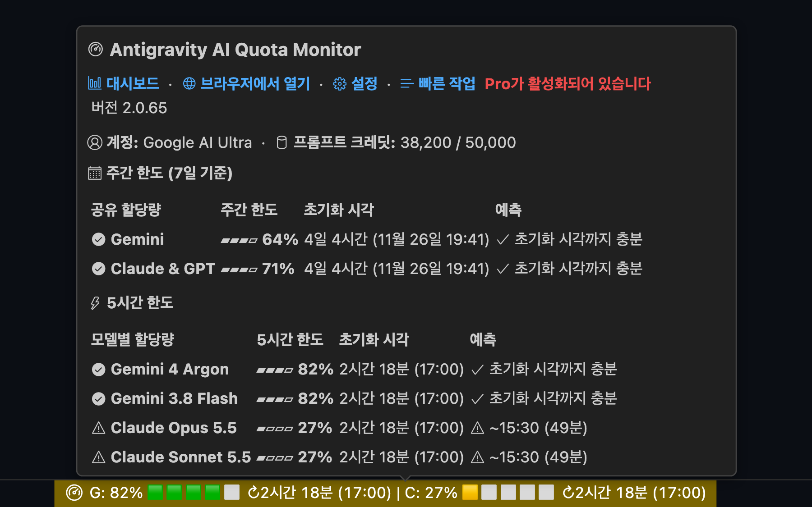

**한도에 걸려 작업이 멈추기 전에, Antigravity 할당량이 얼마나 남았는지 확인하세요.**

- **언제나 한눈에.** 남은 할당량은 상태 표시줄에서 바로 확인할 수 있습니다. 마우스를 올리면 Claude와 Gemini 모델별 5시간 한도와 주간 한도를 볼 수 있습니다.
- **미리 알려 줍니다.** 모델의 할당량이 얼마 남지 않으면 편집기에 알림이 표시됩니다.
- **할당량이 초기화되면 휴대전화로 알려 줍니다(Pro).** 휴대전화를 연결한 뒤 편집기를 열어 두고 컴퓨터가 절전 모드로 전환되지 않게 해 두면, 자리를 비워도 됩니다. 할당량이 100%로 초기화되면 메시지가 옵니다.
- **Codex, Claude Code, Grok도 함께.** 컴퓨터에 설치되어 있다면 본인의 Codex, Claude Code, Grok 플랜 한도가 Antigravity 아래에 각각 별도의 카드로 표시됩니다.

**무료로 사용할 수 있습니다. Pro는 설치 직후부터 7일 동안 무료로 써 볼 수 있고(카드 불필요), 계속 쓰려면 1회 결제 €9.99 또는 월 €2.99입니다.** [무료와 Pro 비교](#free-and-pro-ko) · [Pro 구매](https://buy.polar.sh/polar_cl_aUt37UmhWCxHCB9s7dFpmvoT5KNrFqzVWx64q073KIJ)

Windows와 macOS에서 작동합니다. 할당량은 본인 컴퓨터의 Antigravity에서 읽어 오며, Codex, Claude Code, Grok CLI가 설치되어 있으면 해당 프로그램에서도 읽어 옵니다. 별도의 계정이나 API 키가 필요 없고, 사용 분석 데이터도 보내지 않습니다. *Google, Anthropic, OpenAI, xAI가 만든 제품이 아니며 이들 회사와 제휴 관계도 없습니다.*

**사용 설명서:** [English](https://github.com/Nordicstocks/antigravity-quota-monitor/blob/main/USER-GUIDE.md) · [Eesti](https://github.com/Nordicstocks/antigravity-quota-monitor/blob/main/USER-GUIDE.et.md) · [Deutsch](https://github.com/Nordicstocks/antigravity-quota-monitor/blob/main/USER-GUIDE.de.md) · [日本語](https://github.com/Nordicstocks/antigravity-quota-monitor/blob/main/USER-GUIDE.ja.md) · [简体中文](https://github.com/Nordicstocks/antigravity-quota-monitor/blob/main/USER-GUIDE.zh-CN.md) · [한국어](https://github.com/Nordicstocks/antigravity-quota-monitor/blob/main/USER-GUIDE.ko.md) · [Español](https://github.com/Nordicstocks/antigravity-quota-monitor/blob/main/USER-GUIDE.es.md) · 그 밖의 30개 언어는 설명서 안에서 선택

**다른 언어로 읽기:** [English](#top) · [Eesti](#lang-et) · [Deutsch](#lang-de) · [日本語](#lang-ja) · [简体中文](#lang-zh-cn) · [Español](#lang-es)

---

## 무료와 Pro

확장 프로그램을 처음 설치하면 카드 등록이나 가입 없이 7일 동안 모든 Pro 기능을 사용할 수 있습니다. 체험이 끝나도 아래 표의 무료 항목은 계속 쓸 수 있습니다.

| | 무료 | Pro |
| :--- | :---: | :---: |
| 상태 표시줄의 할당량, 마우스를 올리면 5시간 한도와 주간 한도 표시 | ✓ | ✓ |
| 사이드 패널과 대시보드, 라이트·다크 테마 | ✓ | ✓ |
| 할당량이 부족해지거나 초기화될 때 편집기 알림 | ✓ | ✓ |
| Codex, Claude Code, Grok 한도를 각각 별도의 카드에 표시 | ✓ | ✓ |
| 초기화 시각과 소진 예측 | | ✓ |
| 예비량 보호(Reserve Guard): 지금 속도로는 모델 할당량이 예비량(기본 20%) 아래로 떨어질 것으로 예상되면 경고 | | ✓ |
| 휴대전화 및 채팅 알림: ntfy.sh, Telegram, Discord, Slack | | ✓ |
| 90일 기록, 요일 × 시간대 히트맵, 프로젝트별 추정 사용량 | | ✓ |
| 5시간 기간용 Auto-Starter(선택 사항): 반복 간격 설정 및 Codex, Claude Code 지원 | | ✓ |

**평생 Pro: 1회 결제 €9.99.** 구독이 아닙니다. Pro 월간 요금 4개월분보다 저렴합니다. [평생 Pro 구매](https://buy.polar.sh/polar_cl_aUt37UmhWCxHCB9s7dFpmvoT5KNrFqzVWx64q073KIJ)

**Pro 월간: 월 €2.99.** 해지는 결제 대행사 Polar의 고객 포털에서 할 수 있습니다. 확장 프로그램에서 키를 제거해도 구독은 해지되지 않습니다. [Pro 월간 구매](https://buy.polar.sh/polar_cl_LjI4JhW7qEbGDJyCyQslb5pSeHyETQ2Dfiuqb0tNkI5)

라이선스 키는 구매 후 받는 이메일과 Polar 확인 페이지에서 볼 수 있습니다. 설정에 붙여 넣어 Pro를 활성화하세요.

---

## 주요 기능

**모든 한도를 대시보드 하나에서.** 모델마다 게이지와 5시간 한도, 주간 한도가 표시되고, Pro에서는 초기화 시각과 예측도 함께 볼 수 있습니다. 카드는 끌어서 원하는 순서로 배치하고, 쓰지 않는 카드는 숨길 수 있습니다.

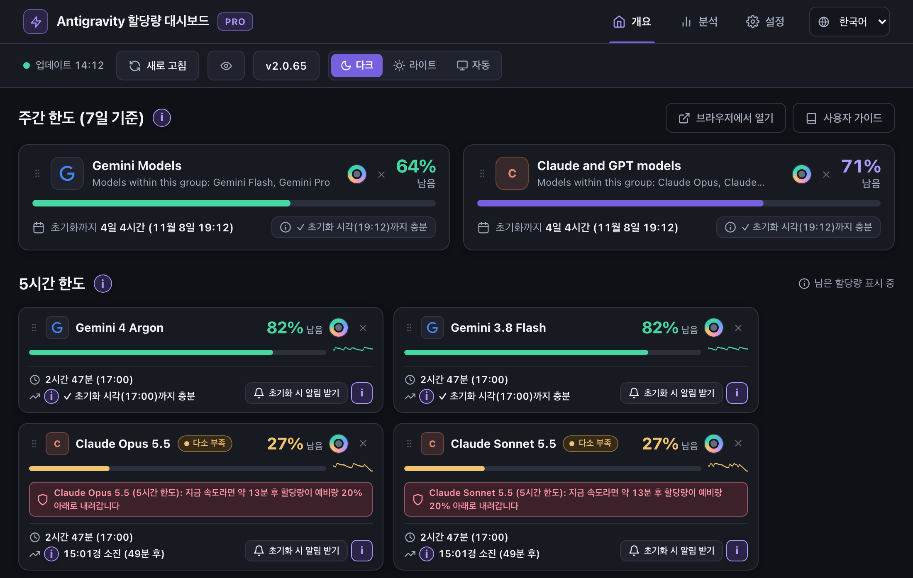

**할당량이 어디에 쓰이는지 보여 줍니다(Pro).** 히트맵에서는 사용량이 가장 많은 시간대를 볼 수 있고, 프로젝트별 보기에서는 어느 프로젝트가 할당량을 가장 많이 사용하는지 추정할 수 있습니다.

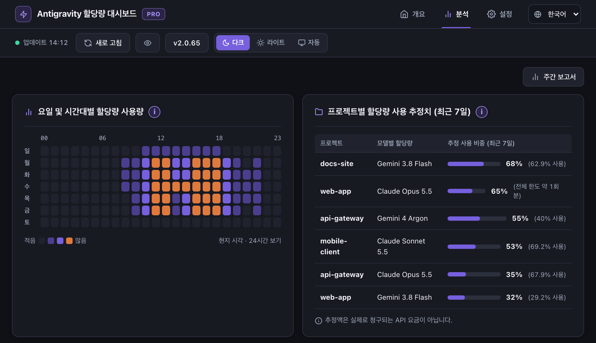

**그 밖의 기능.** 차트로 보는 주간 보고서와 CSV·JSON 내보내기(Pro), 터미널 프롬프트용 상태 파일(Pro), 브라우저에서 여는 보조 모니터용 화면(Pro)도 있습니다. 오래된 대화 파일 정리 기능은 `~/.gemini/antigravity/brain`에서 최근 7일 동안 변경이 없는 폴더를 나열하고, 사용자가 확인한 경우에만 시스템 휴지통으로 옮깁니다. `code_tracker/`는 크기만 측정하며 정리하지 않습니다.

---

## Codex, Claude Code 및 Grok

**다른 AI 플랜도 Antigravity와 함께.** Antigravity Quota Monitor — Ultimate Cockpit & Dashboard는 본인의 Codex(ChatGPT), Claude Code(Anthropic), Grok(xAI) 플랜 한도도 대시보드, 사이드 패널, 상태 표시줄에 표시합니다. 각 카드에는 도구 이름과 한도 종류, 플랜과 남은 할당량이 표시됩니다. Pro에서는 초기화 시각과 소진 예측도 볼 수 있으며, 초기화될 때 알림을 받을 수 있습니다.

- 각 도구의 한도는 본인 컴퓨터에 설치된 해당 프로그램에서 읽어 옵니다. 대화를 시작하거나 모델에 아무것도 보내지 않으며, 비밀번호도 필요 없습니다.
- 컴퓨터에 설치되지 않은 도구는 표시되지 않습니다. 설정 → Codex, Claude Code 및 Grok에서 각 도구를 끌 수 있습니다.
- 여기서 말하는 Claude Code는 본인의 Anthropic 플랜입니다. Antigravity 안의 Claude 모델은 Antigravity 할당량을 사용하며 별도의 카드에 계속 표시됩니다.
- Grok의 Free 플랜에서는 Grok이 사용률을 제공하지 않으므로 카드에 사용률 막대가 표시되지 않습니다.

---

## Auto-Starter 작동 방식

**2.0.58의 새로운 기능: “알림만 받기”.** 지정한 시각에 “지금 5시간 기간을 시작할 수 있습니다. Antigravity에서 아무 프롬프트나 전송해 보세요.”라는 알림만 받고, Antigravity에서 직접 아무 프롬프트나 보내면 됩니다. 확장 프로그램은 아무것도 실행하거나 전송하지 않으므로 할당량을 사용하지 않으며 아래 조건도 적용되지 않습니다. 신규 사용자의 기본 옵션이며, 동의하면 “자동으로 시작”도 계속 사용할 수 있습니다.

5시간 기간은 정해진 시각이 아니라 첫 프롬프트를 보낼 때 시작됩니다. 첫 프롬프트를 `09:30`에 보낸 뒤 할당량을 다 쓰면, `14:30`에 초기화될 때까지 기다려야 할 수도 있습니다.

Auto-Starter(Pro)를 `07:00`에 맞춰 두면, 확장 프로그램이 그 시각에 Antigravity의 명령줄 도구인 `agy`를 실행해 선택한 모델에 본인 계정으로 프롬프트 `OK`를 보냅니다. 짧지만 실제 요청입니다. 이렇게 하면 5시간 한도가 약 `12:00`에 초기화되므로, 주간 할당량이 남아 있는 한 업무 시간 안에 5시간 기간을 한 번 더 온전히 쓸 수 있습니다. 이 기능을 쓰려면 `agy`가 설치되어 있어야 합니다.

기본적으로 꺼져 있으며, 처음 사용하기 전에 동의를 요청합니다. 이 프롬프트도 할당량을 일부 사용합니다. 지정한 시각에 편집기가 열려 있어야 합니다. 닫혀 있었다면 그 시각부터 3시간 안에 편집기를 다시 열 때만 Auto-Starter가 실행됩니다.

**2.0.64의 새로운 기능: “일정 간격으로 반복”.** 지정한 시각에 처음 시작한 뒤, 다음 날 같은 시각에 시작할 때까지 Auto-Starter가 `5:01`(5시간 1분, 권장값)마다 또는 `1:00`에서 `24:00` 사이에서 직접 정한 간격으로 5시간 기간을 다시 시작할 수 있습니다. `5:01`로 설정하면 하루에 최대 4번 시작합니다. 시작할 때마다 실제 요청을 보내며 할당량을 일부 사용합니다. 기본적으로 꺼져 있습니다.

**2.0.64의 새로운 기능: Codex와 Claude Code.** Antigravity의 Claude와 Gemini, 그리고 본인의 Codex와 Claude Code 중에서 시작할 대상을 각각 선택할 수 있습니다. Codex와 Claude Code는 설치되어 있고 로그인되어 있으며 해당 플랜에 5시간 사용 기간이 있는 경우에 사용할 수 있습니다. 이 두 도구의 경우 확장 프로그램이 `codex exec`(임시 폴더에서 읽기 전용) 또는 `claude -p`(도구 호출 기능을 끈 상태)를 실행해 본인 계정으로 짧은 `OK` 요청을 한 번 보냅니다. 이 요청으로 해당 도구의 5시간 기간이 시작되며, 한도가 일부 차감됩니다. 요청은 Antigravity 계정이 아닌 본인의 OpenAI 또는 Anthropic 계정을 통해 전송되므로, 확장 프로그램은 두 도구 각각의 첫 요청 전에 별도로 동의를 구합니다. 도구 선택을 해제하면 해당 동의가 철회되며, 다시 선택하면 동의를 다시 요청합니다.

요청을 보내는 계정마다 따로 동의를 받습니다. `agy`를 통한 Claude와 Gemini는 한 번, Codex와 Claude Code는 각각 한 번씩 동의를 받습니다. 요청은 “자동으로 시작” 모드에서만 전송됩니다.

[Google Antigravity 추가 서비스 약관](https://antigravity.google/terms) 제6조에는 서비스에 접근하기 위해 타사 소프트웨어를 사용하는 것은 약관 위반이며 그 결과 계정이 정지되거나 해지될 수 있다고 명시되어 있습니다. 이 기능을 켤지는 직접 결정할 수 있습니다.

---

## 개인정보 보호, 네트워크 사용, 지원

Antigravity 할당량 수치는 `127.0.0.1`에서 실행되는 로컬 Antigravity 언어 서버에서 가져옵니다. 확장 프로그램은 사용 분석 데이터를 누구에게도 보내지 않습니다. 네트워크는 다음 경우에만 사용합니다.

- **업데이트 확인:** 시작할 때마다, 그리고 편집기가 열려 있는 동안 6시간마다 `open-vsx.org`에서 최신 버전 번호를 확인합니다.
- **라이선스:** 라이선스 키가 있으면 하루에 한 번 정도 `api.polar.sh`에서 키를 검증합니다. 7일 동안 Polar에 연결할 수 없으면 연결이 복구될 때까지 Pro 기능이 일시 중지됩니다.
- **알림(선택 사항):** 직접 설정한 경우에만 `ntfy.sh`, Telegram 또는 본인의 Discord/Slack 웹후크로 할당량 메시지를 보냅니다.
- **Codex, Claude Code 및 Grok(도구가 설치되어 있으면 켜짐, 비활성화 가능):** 확장 프로그램이 컴퓨터에서 해당 프로그램(`codex app-server`, `claude -p /usage` 또는 Grok CLI)을 실행합니다. 해당 프로그램은 본인의 로그인 정보를 사용해 자체 서비스(OpenAI, Anthropic 또는 xAI)에서 플랜 한도를 조회합니다. 대화가 시작되거나 프롬프트가 전송되지는 않습니다. 설정 → Codex, Claude Code 및 Grok에서 각 도구를 끌 수 있습니다.
- **Auto-Starter(선택 사항, 기본값 꺼짐):** 켜면 선택한 Antigravity 모델에 `agy`가 본인 계정으로 짧은 프롬프트(`OK`)를 보냅니다. Codex 또는 Claude Code도 선택하면 확장 프로그램이 각 도구의 프로그램을 임시 폴더에서 실행해 본인 계정으로 짧은 요청(`OK`)을 한 번 보냅니다. 소스 코드는 포함되지 않습니다.
- **오류 보고서(기본값 켜짐, 비활성화 가능):** 확장 프로그램에서 예기치 않은 오류가 발생하면 `oeqbchgyoderqxnzcubh.supabase.co`로 익명 보고서를 보냅니다. 보고서에는 확장 프로그램 버전 및 에디션, 편집기 이름·버전·언어, 운영 체제 및 프로세서 유형, 사용 중인 확장 프로그램 플랜(무료, 체험판 또는 Pro), 오류 메시지, 오류가 발생한 코드 위치가 포함됩니다. 사용량 수치, 파일, 계정 정보, 라이선스 키는 보내지 않습니다. 편집기의 원격 분석 설정이 꺼져 있는 동안에는 아무것도 보내지 않습니다. 오류 보고서 전송을 비활성화하려면 설정 → 일반 → `오류 보고서 보내기`를 끄십시오(`antigravityQuota.sendErrorReports` 설정).

**클립보드:** 확장 프로그램이 클립보드를 읽는 경우는 단 한 가지뿐입니다. 구매 버튼을 클릭한 뒤 30분 안에 편집기로 돌아오면, 클립보드에 라이선스 키가 있는지 한 번 확인합니다. 찾은 내용은 저장되지 않으며, `활성화`를 클릭한 경우에만 `api.polar.sh`로 전송됩니다. 그 밖의 경우에는 클립보드를 읽지 않습니다.

**휴대전화 알림 설정 방법**
**ntfy.sh(계정 불필요).** [App Store](https://apps.apple.com/app/ntfy/id1625396347) 또는 [Google Play](https://play.google.com/store/apps/details?id=io.heckel.ntfy)에서 무료 ntfy 앱을 설치하세요. 앱에서 `+`를 누른 뒤, 확장 프로그램이 설정 → 휴대전화 연결에서 제안하는 토픽을 입력하세요. Android에서는 QR 코드를 스캔해도 됩니다. `저장하고 테스트 알림 보내기`를 클릭하세요. `ntfy.sh` 토픽은 공개되어 있어, 이름을 아는 사람은 누구나 메시지를 읽고 보낼 수 있습니다. 확장 프로그램은 추측하기 어려운 무작위 이름을 제안합니다. 다른 사람에게 알려 주지 마세요.

**Telegram.** [@BotFather](https://t.me/BotFather)에게 `/newbot`을 보내 봇 토큰을 받으세요. 새 봇 링크를 열고 `Start`를 한 번 누르세요. 그러지 않으면 Telegram이 봇의 메시지를 전달하지 않습니다. [@userinfobot](https://t.me/userinfobot)에게 메시지를 보내 숫자로 된 채팅 ID를 받으세요. 설정에서 채팅 ID를 입력하고 `저장`을 클릭한 다음, `봇 토큰 설정`을 클릭해 토큰을 붙여 넣고 `테스트 알림`을 클릭하세요.

**Discord 또는 Slack.** 같은 설정 섹션에 웹후크 URL을 붙여 넣고 `저장`을 클릭하세요.

**언어.** 인터페이스는 37개 언어를 지원합니다. 확장 프로그램은 편집기 언어를 따르고, 편집기가 영어로 설정되어 있으면 시스템 언어를 따릅니다. 설정에서 다른 언어를 고를 수도 있습니다. 새로 추가된 일부 문구는 아직 영어로 표시될 수 있습니다.

---

**도움말:** [사용자 가이드](https://github.com/Nordicstocks/antigravity-quota-monitor/blob/main/USER-GUIDE.ko.md) · [문제 신고](https://github.com/Nordicstocks/antigravity-quota-monitor/issues) · [변경 내역](https://github.com/Nordicstocks/antigravity-quota-monitor/blob/main/CHANGELOG.md)

*Google Antigravity, Gemini, Claude, Claude Code, Codex, ChatGPT, Grok에 대한 권리는 해당 권리자에게 귀속됩니다.*

---

## Español

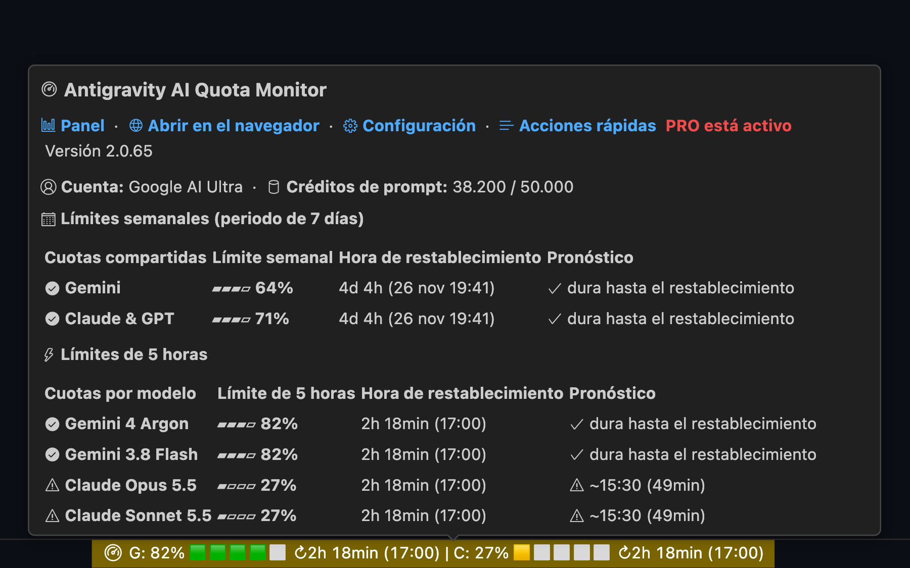

**Comprueba cuánta cuota de Antigravity te queda antes de llegar a un límite y quedarte a medias.**

- **Siempre a la vista.** La cuota que te queda aparece en la barra de estado. Pasa el cursor por encima y verás los límites de 5 horas y semanales de cada modelo: Claude y Gemini.
- **Aviso a tiempo.** Recibes una alerta en el editor cuando a un modelo le queda poca cuota.
- **¿Se ha restablecido tu cuota? Recibe un aviso en el teléfono (Pro).** Conecta tu teléfono, deja el editor abierto, evita que el equipo entre en suspensión y ya puedes irte. Recibirás un mensaje cuando recuperes toda la cuota.
- **También Codex, Claude Code y Grok.** Si están instalados en tu equipo, los límites de tus propios planes de Codex, Claude Code y Grok aparecen debajo de los de Antigravity, cada uno en su propia tarjeta.

**La extensión es gratuita. Pro: 7 días gratis justo después de instalarla, sin tarjeta. Para seguir con Pro: 9,99 € en un solo pago o 2,99 €/mes.** [Comparar Gratis y Pro](#free-and-pro-es) · [Comprar Pro](https://buy.polar.sh/polar_cl_aUt37UmhWCxHCB9s7dFpmvoT5KNrFqzVWx64q073KIJ)

Windows y macOS. La extensión lee tu cuota en tu propio equipo: la de Antigravity y la de Codex, Claude Code y Grok CLI cuando están instalados. Sin cuenta adicional, sin clave de API, sin datos analíticos de uso. *Es una extensión independiente: no está afiliada a Google, Anthropic, OpenAI ni xAI, y ninguna de estas empresas la ha creado.*

**Guía de usuario:** [English](https://github.com/Nordicstocks/antigravity-quota-monitor/blob/main/USER-GUIDE.md) · [Eesti](https://github.com/Nordicstocks/antigravity-quota-monitor/blob/main/USER-GUIDE.et.md) · [Deutsch](https://github.com/Nordicstocks/antigravity-quota-monitor/blob/main/USER-GUIDE.de.md) · [日本語](https://github.com/Nordicstocks/antigravity-quota-monitor/blob/main/USER-GUIDE.ja.md) · [简体中文](https://github.com/Nordicstocks/antigravity-quota-monitor/blob/main/USER-GUIDE.zh-CN.md) · [한국어](https://github.com/Nordicstocks/antigravity-quota-monitor/blob/main/USER-GUIDE.ko.md) · [Español](https://github.com/Nordicstocks/antigravity-quota-monitor/blob/main/USER-GUIDE.es.md) · 30 idiomas más dentro de la guía

**Esta página en otros idiomas:** [English](#top) · [Eesti](#lang-et) · [Deutsch](#lang-de) · [日本語](#lang-ja) · [简体中文](#lang-zh-cn) · [한국어](#lang-ko)

---

## Gratis y Pro

La primera vez que instalas la extensión, tienes Pro con todas las funciones durante 7 días, sin tarjeta y sin registro. Después, sigue funcionando todo lo que aparece en la columna Gratis.

| | Gratis | Pro |
| :--- | :---: | :---: |
| Cuota en la barra de estado, con los límites de 5 horas y semanales al pasar el cursor | ✓ | ✓ |
| Barra lateral y panel, con modo día y modo noche | ✓ | ✓ |
| Alertas en el editor cuando queda poca cuota o cuando se restablece | ✓ | ✓ |
| Límites de Codex, Claude Code y Grok, cada uno en su propia tarjeta | ✓ | ✓ |
| Hora de restablecimiento y pronóstico de cuándo se agotará la cuota | | ✓ |
| Protección de reserva (Reserve Guard): te avisa cuando, a tu ritmo actual, la cuota de un modelo vaya a caer por debajo de tu reserva (20 % por defecto) | | ✓ |
| Alertas en el teléfono y por chat: ntfy.sh, Telegram, Discord, Slack | | ✓ |
| Historial de 90 días, mapa de calor por día y hora, uso estimado por proyecto | | ✓ |
| Inicio automático opcional de la ventana de 5 horas, con repetición a intervalos y también para Codex y Claude Code | | ✓ |

**Pro de por vida: 9,99 € en un solo pago.** Sin suscripción. Cuesta menos que 4 meses de Pro mensual. [Comprar Pro de por vida](https://buy.polar.sh/polar_cl_aUt37UmhWCxHCB9s7dFpmvoT5KNrFqzVWx64q073KIJ)

**Pro mensual: 2,99 €/mes.** Cancélalo en el portal de clientes de Polar, nuestro proveedor de pagos. Quitar la clave de la extensión no cancela el plan. [Comprar Pro mensual](https://buy.polar.sh/polar_cl_LjI4JhW7qEbGDJyCyQslb5pSeHyETQ2Dfiuqb0tNkI5)

Tu clave de licencia está en el correo que recibes al comprar y en la página de confirmación de Polar. Pégala en Configuración para activar Pro.

---

## Qué incluye

**Un solo panel para todos los límites.** Para cada modelo verás un medidor, el límite de 5 horas, el límite semanal y, con Pro, la hora de restablecimiento y el pronóstico. Arrastra las tarjetas para ordenarlas a tu gusto y oculta las que no uses.

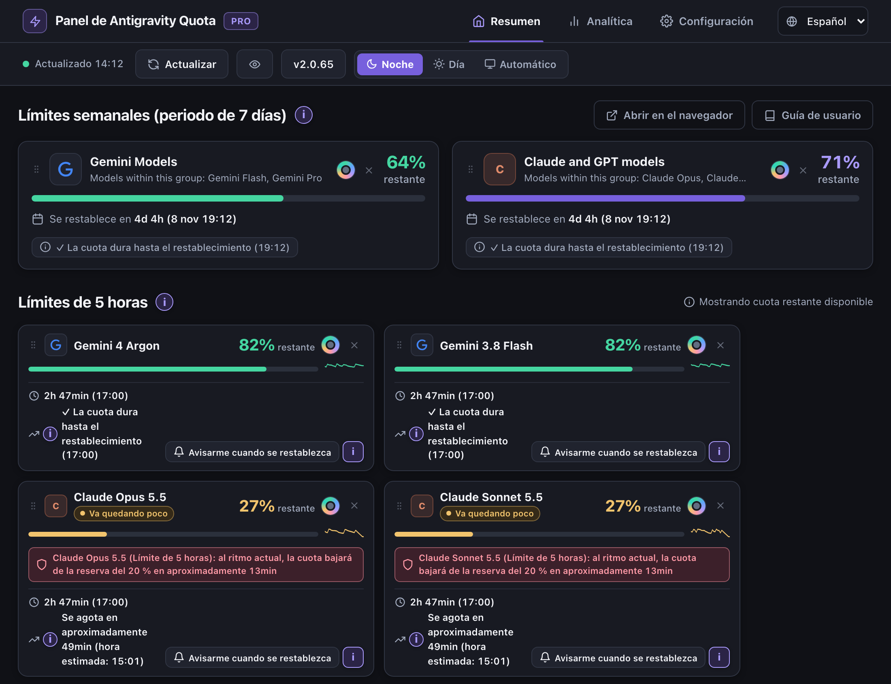

**Mira en qué se te va la cuota (Pro).** El mapa de calor muestra tus horas de mayor uso. La vista por proyecto estima cuál consume más cuota.

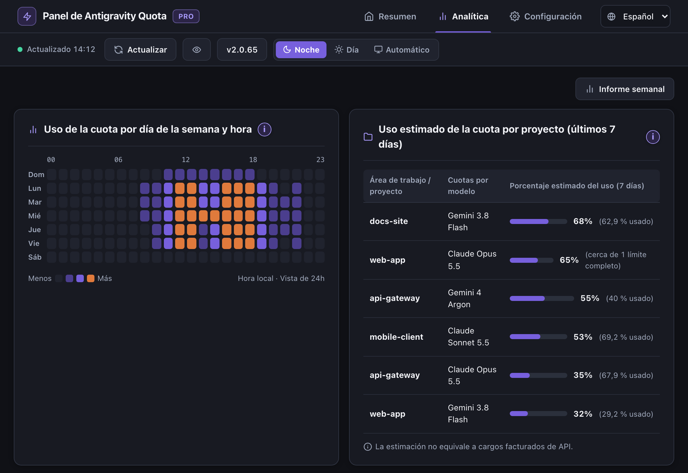

**Además:** un informe semanal con gráficos y exportación a CSV o JSON (Pro); un archivo de estado para el terminal (Pro); una vista en el navegador para un segundo monitor (Pro); y un limpiador de conversaciones antiguas: muestra las carpetas de `~/.gemini/antigravity/brain` que llevan 7 días sin cambios y, solo si lo confirmas, las mueve a la Papelera del sistema (Papelera de reciclaje en Windows). La extensión solo calcula el tamaño de la carpeta `code_tracker/`; nunca la limpia.

---

## Codex, Claude Code y Grok

**Tus otros planes de IA, junto al de Antigravity.** Antigravity Quota Monitor — Ultimate Cockpit & Dashboard también muestra los límites de tus propios planes de Codex (ChatGPT), Claude Code (Anthropic) y Grok (xAI) en el panel, la barra lateral y la barra de estado. Cada tarjeta indica la herramienta y el límite, y muestra tu plan y la cuota que te queda. Con Pro, también muestra la hora de restablecimiento y el pronóstico de agotamiento, y la extensión te avisa cuando se restablece.

- La extensión lee los límites de cada herramienta desde su propio programa en tu equipo. No inicia ninguna conversación, no envía nada a un modelo y no necesita ninguna contraseña.
- Si una herramienta no está instalada en tu equipo, no aparece. Puedes desactivar cada herramienta en Configuración → Codex, Claude Code y Grok.
- Aquí, Claude Code corresponde a tu propio plan de Anthropic. Los modelos Claude de Antigravity usan la cuota de Antigravity y conservan sus propias tarjetas.
- En el plan gratuito (Free) de Grok, el servicio no indica el porcentaje de uso, por lo que su tarjeta no muestra ninguna barra.

---

## Cómo funciona el Inicio automático

**Novedad en la versión 2.0.58: «Solo avisarme».** A la hora que elijas, puedes recibir únicamente esta notificación: «Ya puedes iniciar la ventana de 5 horas: envía cualquier prompt en Antigravity para hacerlo.» Después, envía tú mismo cualquier prompt en Antigravity. La extensión no ejecuta ni envía nada, así que no consume cuota y las condiciones que se explican a continuación no se aplican. «Solo avisarme» es la opción predeterminada para los nuevos usuarios; «Iniciarla automáticamente» sigue disponible con tu consentimiento.

Tu ventana de 5 horas empieza con tu primer prompt, no a una hora fija. Si lo envías a las `09:30` y te quedas sin cuota, puede que no se restablezca hasta las `14:30`.

Si programas el Inicio automático (Pro) a las `07:00`, a esa hora la extensión ejecuta `agy`, la herramienta de línea de comandos de Antigravity, y envía desde tu propia cuenta un prompt breve pero real, `OK`, a los modelos que elijas. `agy` tiene que estar instalado. Tu límite de 5 horas se restablece entonces alrededor de las `12:00`, así que puedes aprovechar una segunda ventana completa de 5 horas durante la jornada, siempre que te quede cuota semanal.

El Inicio automático viene desactivado por defecto y primero te pide consentimiento. Usarlo consume algo de tu cuota. El editor tiene que estar abierto a la hora que hayas elegido; si está cerrado, el Inicio automático se ejecuta la próxima vez que lo abras, siempre que sea dentro de las 3 horas siguientes.

**Novedad en la versión 2.0.64: «Repetir a intervalos».** Después del primer inicio a la hora que elijas, el Inicio automático puede volver a iniciar la ventana de 5 horas cada `5:01` (5 horas y 1 minuto, el valor recomendado) o con un intervalo que elijas entre `1:00` y `24:00`, hasta el inicio programado a esa misma hora del día siguiente. Con `5:01`, hay como máximo 4 inicios al día. Cada inicio envía una solicitud real y consume algo de cuota. Esta opción viene desactivada por defecto.

**Novedad en la versión 2.0.64: Codex y Claude Code.** Puedes elegir por separado qué iniciar: Claude y Gemini en Antigravity, así como Codex y Claude Code con tus propios planes, si tienes los programas instalados, has iniciado sesión y tu plan incluye una ventana de 5 horas. Con estas dos herramientas, la extensión ejecuta `codex exec` (en modo de solo lectura, en una carpeta temporal) o `claude -p` (con el uso de herramientas desactivado) y envía desde tu propia cuenta una solicitud breve (`OK`). Esto inicia la ventana de 5 horas de la herramienta y consume una pequeña parte de su límite. Antes de la primera solicitud de cada una de estas dos herramientas, la extensión te pide consentimiento por separado, porque la solicitud sale de tu cuenta de OpenAI o Anthropic, no de tu cuenta de Antigravity. Al desmarcar una herramienta, retiras ese consentimiento; si vuelves a seleccionarla, la extensión te lo pide de nuevo.

La extensión te pide consentimiento por separado para cada cuenta desde la que se envían solicitudes: una vez para Claude y Gemini a través de `agy`, otra para Codex y otra para Claude Code. Las solicitudes solo se envían si eliges «Iniciarla automáticamente» para la ventana de 5 horas.

La sección 6 de los [Términos de servicio adicionales de Google Antigravity](https://antigravity.google/terms) indica que usar software de terceros para acceder al servicio es un incumplimiento que puede dar lugar a la suspensión o la cancelación de tu cuenta. Tú decides si activas o no el Inicio automático.

---

## Privacidad, uso de la red y soporte

Las cifras de tu cuota de Antigravity proceden del servidor de lenguaje local de Antigravity, en `127.0.0.1`. La extensión no envía datos analíticos de uso a nadie. Solo usa la red en estos casos:

- **Comprobación de actualizaciones:** al iniciarse, y de nuevo cada 6 horas mientras el editor siga abierto, la extensión consulta en `open-vsx.org` el número de la última versión.
- **Licencia:** si tienes una clave de licencia, la extensión la comprueba en `api.polar.sh` aproximadamente una vez al día. Si no puede conectarse con Polar durante 7 días, Pro queda en pausa hasta que vuelva la conexión.
- **Notificaciones (opcional):** la extensión envía mensajes sobre la cuota a `ntfy.sh`, a Telegram o a tu webhook de Discord/Slack, solo si has configurado alguno de estos destinos.
- **Codex, Claude Code y Grok (se activa si la herramienta está instalada; se puede desactivar):** la extensión ejecuta el programa correspondiente en tu equipo (`codex app-server`, `claude -p /usage` o Grok CLI). Ese programa consulta los límites de tu plan en su propio servicio (OpenAI, Anthropic o xAI) usando tu sesión iniciada. No se inicia ninguna conversación ni se envía ningún prompt. Puedes desactivar cada herramienta en Configuración → Codex, Claude Code y Grok.
- **Inicio automático (opcional, desactivado por defecto):** cuando lo activas, `agy` envía desde tu cuenta un prompt breve (`OK`) a los modelos de Antigravity seleccionados. Si también seleccionas Codex o Claude Code, la extensión ejecuta su programa en una carpeta temporal, y este envía desde tu propia cuenta una solicitud breve (`OK`). Tu código fuente no se incluye.
- **Informes de errores (activados por defecto; se pueden desactivar):** cuando se produce un error inesperado en la extensión, se envía a `oeqbchgyoderqxnzcubh.supabase.co` un informe anónimo con la versión y la edición de la extensión, el nombre, la versión y el idioma del editor, el sistema operativo y el tipo de procesador, tu plan (Gratis, prueba o Pro) y el mensaje de error junto con el lugar del código donde se produjo. No incluye cifras de uso, archivos, datos de la cuenta ni la clave de licencia. No se envía nada si la telemetría del editor está desactivada. Para desactivar los informes, ve a Configuración → General y desactiva `Enviar informes de errores` (opción `antigravityQuota.sendErrorReports`).

**Portapapeles:** la extensión lo lee en un solo caso. Si haces clic en un botón de compra y vuelves al editor en menos de 30 minutos, comprueba una sola vez si contiene una clave de licencia. Lo que encuentre no se guarda, y solo se envía a `api.polar.sh` si haces clic en `Activar`. La extensión no lee el portapapeles en ningún otro momento.

**Cómo configurar las alertas en el teléfono**
**ntfy.sh, sin necesidad de cuenta.** Instala la aplicación gratuita ntfy: [App Store](https://apps.apple.com/app/ntfy/id1625396347) o [Google Play](https://play.google.com/store/apps/details?id=io.heckel.ntfy). En la aplicación, toca `+` e introduce el tema que la extensión propone en Configuración → `Conecta tu teléfono`. En Android puedes escanear el código QR en lugar de escribir el tema. Haz clic en `Guardar y enviar una notificación de prueba`. Los temas de `ntfy.sh` son públicos: cualquiera que conozca el nombre puede leer y enviar mensajes. La extensión propone un nombre aleatorio y difícil de adivinar. No lo compartas.

**Telegram.** Envía `/newbot` a [@BotFather](https://t.me/BotFather) para obtener un token de bot. Abre el enlace de tu nuevo bot y toca Iniciar (`Start`) una vez; de lo contrario, no recibirás los mensajes del bot en Telegram. Escribe a [@userinfobot](https://t.me/userinfobot) para obtener tu ID de chat numérico. En Configuración, introduce el ID de chat, haz clic en `Guardar`, después en `Configurar token del bot`, pega el token y haz clic en `Notificación de prueba`.

**Discord o Slack.** Pega la URL del webhook en la misma sección de Configuración y haz clic en `Guardar`.

**Idiomas.** La interfaz está disponible en 37 idiomas. La extensión usa el de tu editor, o el de tu sistema si el editor está en inglés, y puedes elegir cualquier otro en Configuración. Algunos textos añadidos recientemente pueden aparecer aún en inglés.

---

**Ayuda:** [Guía de usuario](https://github.com/Nordicstocks/antigravity-quota-monitor/blob/main/USER-GUIDE.es.md) · [Comunicar un problema](https://github.com/Nordicstocks/antigravity-quota-monitor/issues) · [Registro de cambios](https://github.com/Nordicstocks/antigravity-quota-monitor/blob/main/CHANGELOG.md)

*Google Antigravity, Gemini, Claude, Claude Code, Codex, ChatGPT y Grok pertenecen a sus respectivos propietarios.*
