

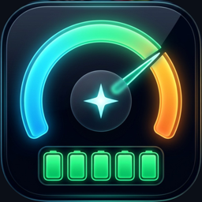

# Antigravity Quota Monitor — Ultimate Cockpit & Dashboard

**Stop getting locked out of Claude Opus 5.5, Sonnet 5.5, and Gemini 4 Argon mid-sprint.**  
**Live 5-Hour & 7-Day Weekly AI Quota View, Optional `07:00` Session Auto-Starter, Reserve Guard & Phone Alerts for Google Antigravity.**

[-10B981?style=flat-square)](https://open-vsx.org/extension/Nordicstocks/antigravity-quota-monitor)

 

&nbsp;&nbsp;

---

## 🌟 Stop Hitting Surprise Antigravity Limits: Free Quota Monitor + 7 Days of Full Pro, No Credit Card

**Antigravity Quota Monitor** shows your remaining **Antigravity quota** in the status bar and warns you before a limit stops your work, with no registration and no API key to set up.

- 🚫 **See a quota limit coming before it stops your work.** Your remaining quota is always in the **status bar**. Hover over it for your **5-hour** and **weekly limits** across **Claude Opus**, **Sonnet**, **Gemini** and **GPT-OSS**.
- ⏱️ **Know when your quota resets.** The **reset time** is shown as a countdown and a clock (`4h 39m · ↻19:52`), and the **run-out forecast** tells you whether your quota will last until then or run out sooner.
- 📲 **Leave your desk. Your phone buzzes when your quota is back.** The extension checks your quota every 60 seconds by default while the editor is open, and you get a message when it is back at **100%** (`ntfy.sh`, Telegram, Discord/Slack).
- ⏰ **Start your 5-hour window before you sit down (optional).** Your first prompt starts the 5-hour window. If that is at `09:30` and you run out of quota, you may have to wait until `14:30` for it to reset. Leave the editor open, set the **Auto-Starter** to `07:00`, and your quota is back at 100% by `12:00`, with a second full window left in your workday. It is off by default and uses some quota.
- 🛡️ **Keep a reserve for the work that cannot wait.** **Reserve Guard** (20% by default) alerts you before your current pace drops a model's quota below your reserve. **Model Switch Assist** recommends a model that still has quota and copies its name in 1 click.
- 📈 **Find out where your quota goes.** The **day × hour heatmap**, 90-day history and estimated use per project show which hours and which projects burn the most quota.
- 🌐 **Put your quota on a second monitor.** Open the dashboard in Chrome, Safari, Edge or Firefox.

After the 7 days, the quota monitor stays free: the status bar gauge, the sidebar, the dashboard in day and night themes, quota reset and low-quota alerts in the editor, and more. See the full Free vs. Pro table below.

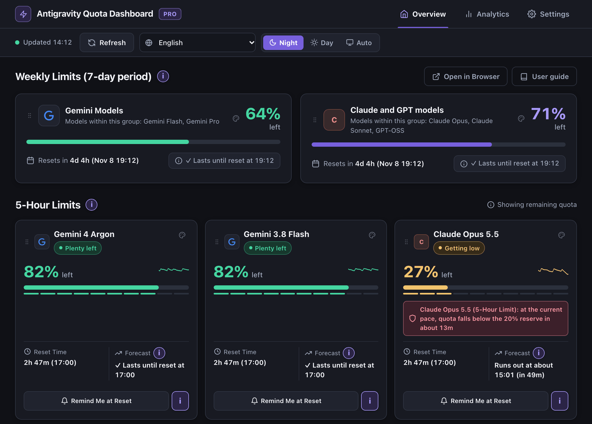

---

## 📌 Complete Visual Tour

### 1. Overview Dashboard — Crisp Daylight Mode (`Day`)

Switch between **Night**, **Day** and **Auto**, which follows your editor theme. The top row shows your **Account Plan** (such as **Google AI Pro** or **Google AI Ultra**) and **Prompt Credits**. Every model card has a **10-cell LED gauge** and a **color you choose** (`Mint`, `Sky`, `Lavender`, `Peach`, `Rose`, `Teal`), and you can **drag and drop it to reorder (`⋮⋮`)**. With Pro, each card also shows its **reset time** and forecast, and the **`🔔` Remind Me at Reset** bell sets a reminder in 1 click.

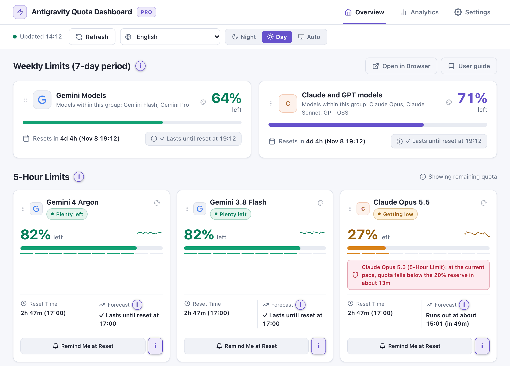

---

### 2. Status Bar, Hover Details & Quick Actions

Your **Antigravity quota** stays in the **status bar**, with green blocks you can change in Settings. When a **weekly limit** runs low, a colored mark appears right beside it. Hover over it for every model's **5-hour limit**, **weekly limit**, **reset time** and forecast. **Quick Actions** puts refresh, reminders, reports and settings one click from your work.

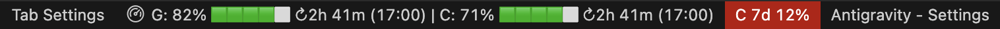

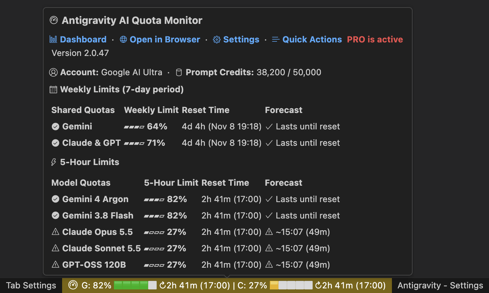

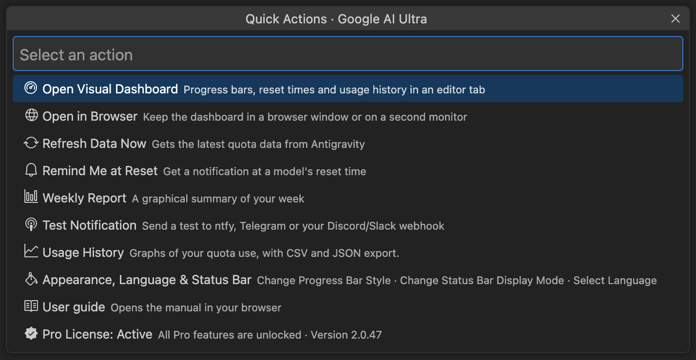

---

### 3. Dedicated Activity Bar Sidebar + Old Conversation Files Cleaner

Click the **gauge icon** in the Activity Bar on the left at any time to check your **Account Plan**, **5-hour limits** and **weekly limits** without opening a full tab.

The **Old Conversation Files Cleaner** shows how much disk space your old conversations use, and nothing is moved without your confirmation. It looks at `~/.gemini/antigravity/brain` and lists the folders with no changes in the last 7 days, with their size. If you confirm, it moves them to the system Trash, where you can restore them. `code_tracker/` is only measured, never cleaned.

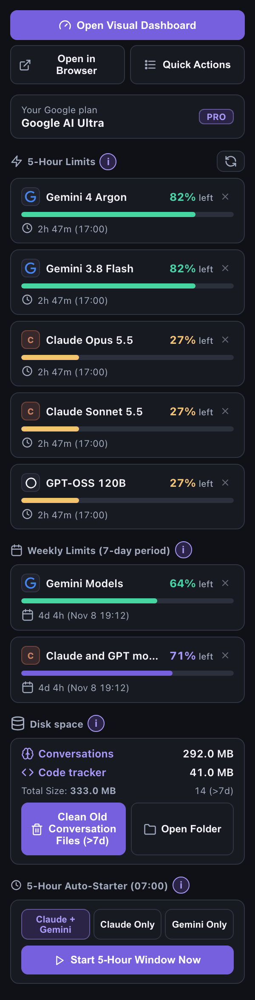

---

### 4. Settings Tab: Reserve Guard, Alerts & the 5-Hour Auto-Starter

Set your **status bar display mode**, **progress bar style**, **language**, **Reserve Guard %**, **morning summary**, **macOS sounds**, phone notifications and license key, all in one tab. The `i` buttons explain how things work in plain language.

**⏰ 5-Hour Auto-Starter: optional, off by default, and only with your consent.** Your 5-hour window starts with your first prompt, not at a fixed time, and your quota refills to 100% five hours later. So if your first prompt is at `09:30` and you run out of quota, you may have to wait until `14:30` for it to reset.

Turn on the Auto-Starter, accept the consent dialog, and choose your time (`07:00` unless you change it). At that time the extension runs `agy` and sends a short but real prompt (`OK`) from your own account to Claude, Gemini or both, while you make your morning coffee. It uses some quota. With a `07:00` start, your quota is back at 100% at `12:00`, which leaves a second full window in your workday. If the editor is closed at that time, the Auto-Starter runs when you next open it, if that is within 3 hours.

Antigravity's terms prohibit using the service with products not provided by Google. They say third-party access may be treated as a breach and can lead to account suspension. That's why the Auto-Starter is off by default and the decision is yours.

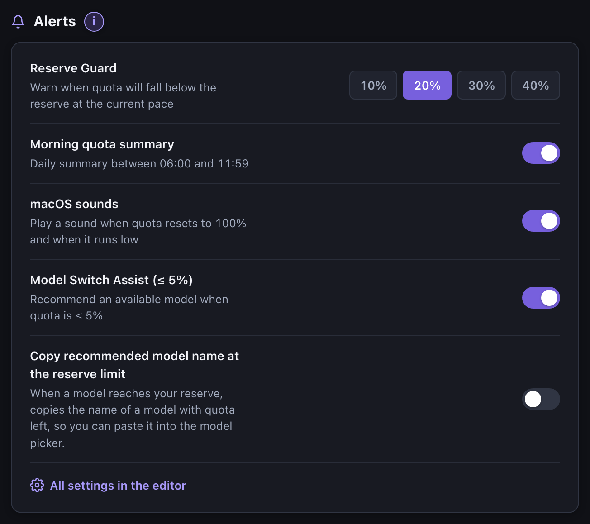

---

### 5. Pro Analytics, 90-Day Usage Heatmap, Per-Project Estimates & Terminal Status

See when you burn the most quota with the **day × hour usage heatmap**, and get an estimate of how much of your **Antigravity quota** each project uses. Open the visual **weekly report** for a recap of your week, or **usage history** for your quota over 7, 30 or 90 days. Save the report as HTML or Markdown, and your history as **CSV or JSON**.

Do you work in the terminal with the **`agy` CLI**? Each time the extension checks your quota, it writes your Claude and Gemini percentages to `~/.antigravity-quota/status.json`, and a ready-made snippet puts them in your **zsh** or **Starship** prompt or your **tmux** status bar.

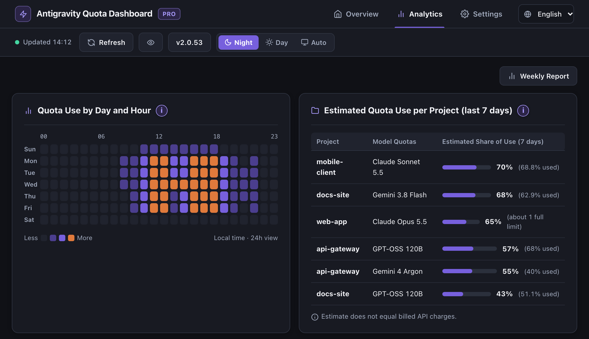

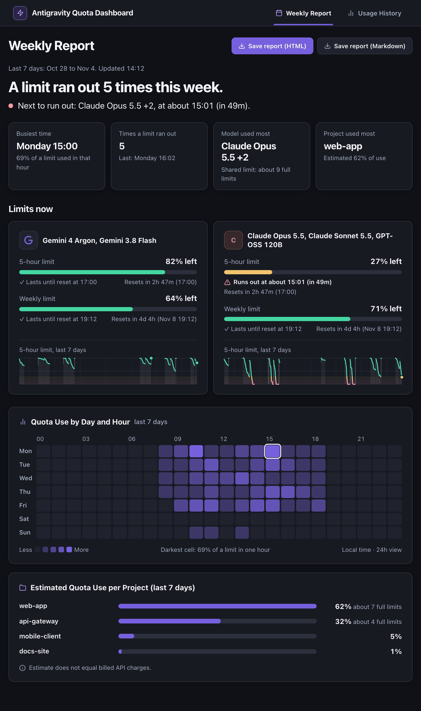

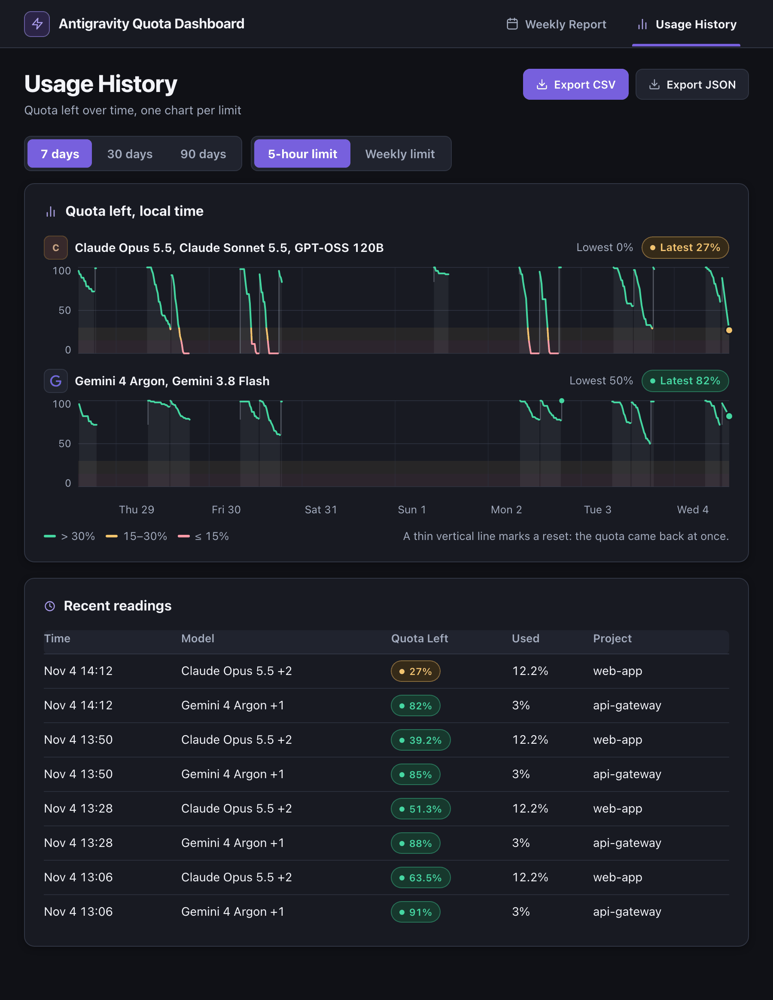

---

## 🎛️ Why Developers Upgrade: What Changes in Your Day

You already pay for **Google AI Pro**, **Google AI Ultra** or another AI plan. Losing one afternoon of work to a surprise **5-hour limit** can cost you more than **€9.99**.

| Your Day Without Pro | Your Day With Pro |
| :--- | :--- |
| Your 5-hour window starts only with your first prompt, so a late start can leave you waiting in the afternoon. | The optional **Auto-Starter** starts it early (`07:00` by default), with **a second full window left in your workday**. |
| You see your percentage, but not how fast **Claude Opus** and **Sonnet** are using it, so a limit can interrupt a refactor. | The **run-out forecast + Reserve Guard** warn you early, and **Model Switch Assist** recommends a model that still has quota. |
| You keep going back to the editor to see whether your **5-hour limit** has reset yet. | **Your phone buzzes** when your quota is back at **100%** (`ntfy.sh`, Telegram), so you can leave your desk. |
| You guess which hours and which projects use up your **weekly limit**. | The **heatmap** and per-project estimates show when and where you use the most quota. |

**All of that for a €9.99 one-time payment** (or €2.99/month).

---

## ✅ Free vs. Pro Feature Comparison

> **Remember:** Every new install includes **7 days of full Pro, unlocked automatically**, with no credit card and no registration. After that, everything in the Free column keeps working.

<!-- FEATURES_TABLE_START -->
| Feature | Free | Pro (€2.99/mo or €9.99 one-time) |
| :--- | :---: | :---: |
| 📊 **Status Bar Quota Gauge (% Left)** | ✅ | ✅ |
| ⚡ **Works with the `agy` Daemon & CLI** | ✅ | ✅ |
| 🎨 **Custom Progress Bar Styles** (8 Colored & Monochrome Bars) | ✅ | ✅ |
| 📌 **Activity Bar Sidebar + Day & Night Dashboard + Draggable Cards (`⋮⋮`), 6 Card Colors & Old Conversation Files Cleaner** | ✅ | ✅ |
| 🌍 **37 Interface Languages** | ✅ | ✅ |
| 🔔 **Quota Reset & Low-Quota Alerts** (in the editor) | ✅ | ✅ |
| 🕒 **24-Hour Local Quota History** | ✅ | ✅ |
| ⏱️ **Reset Countdown & Clock (`4h 39m · ↻19:52`), Run-Out Forecast & Second-Monitor Browser View** | ➖ | ✅ |
| 🔄 **Model Switch Assist** (Recommends an available model & copies its name) | ➖ | ✅ |
| 🛡️ **Reserve Guard** (Alerts you before your pace drops a model's quota below the reserve you set, 20% by default) | ➖ | ✅ |
| 📈 **90-Day History, Trend Lines & Day × Hour Usage Heatmap** | ➖ | ✅ |
| 📲 **Phone & Chat Notifications** (`ntfy.sh` QR, Telegram, Discord/Slack) | ➖ | ✅ |
| 📁 **Estimated Quota Use per Project** | ➖ | ✅ |
| 💻 **Terminal Status File & Shell Snippets** (`~/.antigravity-quota/status.json`, zsh, Starship, tmux) | ➖ | ✅ |
| ⏰ **Optional 5-Hour Auto-Starter (`07:00` or your own time), `🔔` Remind Me at Reset & Morning Summary** | ➖ | ✅ |
| 📋 **Weekly HTML & Markdown Usage Report** | ➖ | ✅ |
| 🔊 **macOS Sound Alerts** | ➖ | ✅ |
| 📥 **CSV & JSON Usage History Export** (Up to 90 days) | ➖ | ✅ |
<!-- FEATURES_TABLE_END -->

---

## 💳 Keep Pro After the Trial: Pricing & License Key

Your 7-day trial is free and needs no card. To keep Pro after it, choose a plan through Polar:

- **Lifetime Pro: €9.99 one-time payment.** No subscription. It costs less than 4 months of Pro Monthly, and 72% less than a full year.
- **Pro Monthly: €2.99/month.** This plan has no trial of its own: billing starts the day you buy it, even if you still have trial days left. Cancel in Polar's customer portal.

 
&nbsp;&nbsp;
  

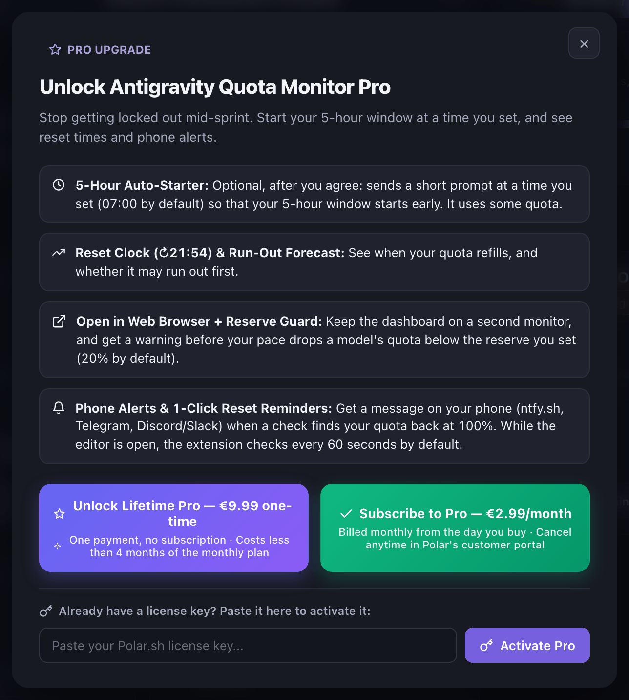

You'll find your license key in the purchase email and on Polar's confirmation page. Paste it in Settings to activate Pro.

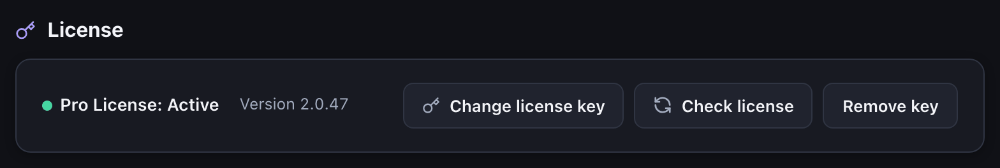

---

## 🔔 How to Set Up Phone Notifications (`ntfy.sh` or Telegram)

Want your phone to buzz when your **Claude Opus**, **Sonnet** or **Gemini quota** is back at **100%**, or when a model runs low?

### Option A: `ntfy.sh` (No Account Needed)

1. Install the free **ntfy** app from the [App Store](https://apps.apple.com/app/ntfy/id1625396347) or [Google Play](https://play.google.com/store/apps/details?id=io.heckel.ntfy).
2. In the app, tap **`+`** and enter the topic the extension suggests under **Settings → Connect your phone**. On Android, you can scan the Android QR code instead.
3. Click **Save and send a test notification**. Your phone should buzz.

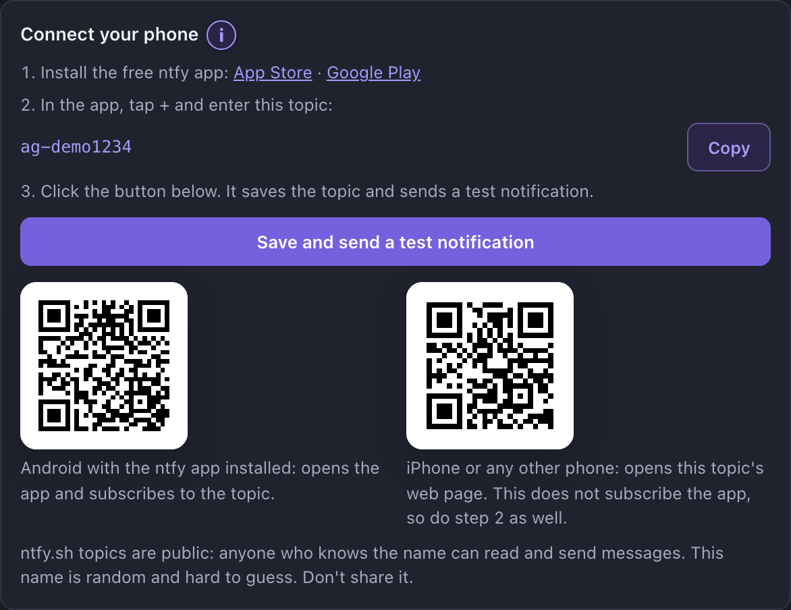

`ntfy.sh` topics are public: anyone who knows the name can read and send messages. The extension suggests a random, hard-to-guess name. Do not share it.

### Option B: Telegram Bot

1. Message **[@BotFather](https://t.me/BotFather)** on Telegram with `/newbot` to get your **Bot Token**. Open the link to your new bot and tap **Start** once, or Telegram will not deliver its messages.
2. Message **[@userinfobot](https://t.me/userinfobot)** to get your numeric **Chat ID**.
3. Under **Settings**, enter the Chat ID and click **Save**. Then click **Set Bot Token**, paste the token and click **Test Notification**.

A **Discord or Slack webhook** works too: paste its URL in the same Settings section.

---

## 🌐 37 Built-In Languages (Automatic Detection)

**Antigravity Quota Monitor** uses your editor's language, or your system language if the editor is in English. You can also pick any of the **37 languages** in Settings. Some newer text may still appear in English.

`English`, `Eesti keel`, `Deutsch`, `Suomi`, `Español`, `Français`, `Italiano`, `Polski`, `Nederlands`, `Svenska`, `Português (Portugal)`, `Português (Brasil)`, `Български`, `Hrvatski`, `Čeština`, `Dansk`, `Ελληνικά`, `Magyar`, `Gaeilge`, `Latviešu`, `Lietuvių`, `Lëtzebuergesch`, `Malti`, `Română`, `Slovenčina`, `Slovenščina`, `Українська`, `Afrikaans`, `日本語`, `简体中文`, `繁體中文`, `한국어`, `Tiếng Việt`, `Bahasa Indonesia`, `हिन्दी`, `Kiswahili`, `العربية`

### Language Editions on Open VSX

**Antigravity Quota Monitor** also has dedicated Open VSX listings in these languages:

- **Japanese Edition (日本語版):** [`Nordicstocks.antigravity-quota-monitor-ja`](https://open-vsx.org/extension/Nordicstocks/antigravity-quota-monitor-ja)
- **Chinese Edition (中文版):** [`Nordicstocks.antigravity-quota-monitor-zh`](https://open-vsx.org/extension/Nordicstocks/antigravity-quota-monitor-zh)
- **Spanish Edition (Edición en español):** [`Nordicstocks.antigravity-quota-monitor-es`](https://open-vsx.org/extension/Nordicstocks/antigravity-quota-monitor-es)

---

## 🛡️ Privacy, Network Use & Support

Your **Antigravity quota** numbers come from your local Antigravity language server on `127.0.0.1`. The extension has no analytics and no telemetry. It uses the network only in these cases:

- **Update check:** on each start it asks `open-vsx.org` for the latest version number.
- **License:** with a license key, it validates the key at `api.polar.sh` about once a day. If the extension cannot reach Polar for 7 days, Pro pauses until the connection is restored.
- **Notifications (optional):** it sends quota messages to `ntfy.sh`, Telegram, or your Discord/Slack webhook, only if you set them up.
- **Auto-Starter (optional, off by default):** when you turn it on, `agy` sends a short prompt (`OK`) to the selected models from your account. Your source code is not included.

**Clipboard:** the extension reads it in one case only. If you click a buy button and return to the editor within 30 minutes, it checks the clipboard once for a license key. That text is not stored, and it goes to `api.polar.sh` only if you click Activate. It never reads the clipboard at any other time.

Read the [User Guide (English and Estonian)](https://github.com/Nordicstocks/antigravity-quota-monitor/blob/main/USER-GUIDE.md). Questions about your license or anything else: [GitHub Issues](https://github.com/Nordicstocks/antigravity-quota-monitor/issues).

---

## 🌟 Schluss mit überraschenden Antigravity-Limits: kostenloser Kontingent-Monitor + alle Pro-Funktionen 7 Tage gratis, ohne Kreditkarte

**Antigravity Quota Monitor** zeigt dein verbleibendes **Antigravity-Kontingent** in der Statusleiste und warnt dich, bevor ein Limit deine Arbeit stoppt. Du brauchst keine Registrierung und musst keinen API-Schlüssel einrichten.

- 🚫 **Du merkst früh genug, wenn du dich einem Limit näherst.** Dein Restkontingent steht immer in der **Statusleiste**. Fahre mit der Maus darüber, und du siehst deine **5-Stunden-Limits** und **Wochenlimits** für **Claude Opus**, **Sonnet**, **Gemini** und **GPT-OSS**.
- ⏱️ **Du weißt, wann dein Kontingent zurückgesetzt wird.** Der **Reset-Zeitpunkt** erscheint als Countdown und als Uhrzeit (`4h 39min · ↻19:52`), und die **Verbrauchsprognose** sagt dir, ob dein Kontingent bis dahin reicht oder vorher aufgebraucht ist.
- 📲 **Geh ruhig vom Schreibtisch weg. Dein Handy meldet sich, wenn das Kontingent wieder da ist.** Die Erweiterung prüft dein Kontingent standardmäßig alle 60 Sekunden, solange der Editor offen ist, und du bekommst eine Nachricht, sobald es wieder bei **100 %** steht (`ntfy.sh`, Telegram, Discord/Slack).
- ⏰ **Starte dein 5-Stunden-Fenster, bevor du dich an den Schreibtisch setzt (optional).** Dein erster Prompt startet das 5-Stunden-Fenster. Schickst du ihn um `09:30` ab und brauchst dein Kontingent auf, wartest du womöglich bis `14:30` auf den Reset. Lass den Editor offen, stelle den **Auto-Starter** auf `07:00`, und dein Kontingent steht um `12:00` wieder bei 100 %. So passt ein zweites volles Fenster in deinen Arbeitstag. Der Auto-Starter ist standardmäßig aus. Eingeschaltet verbraucht er etwas von deinem Kontingent.
- 🛡️ **Halte dir eine Reserve für die Arbeit frei, die nicht warten kann.** Der **Reserveschutz** (Reserve Guard, standardmäßig 20 %) warnt dich, bevor das Kontingent eines Modells bei deinem aktuellen Tempo unter deine Reserve fällt. Der **Modellwechsel-Assistent** empfiehlt ein Modell, das noch Kontingent hat, und kopiert dessen Namen mit einem Klick.
- 📈 **Finde heraus, wohin dein Kontingent fließt.** Die **Heatmap nach Wochentag und Uhrzeit**, der 90-Tage-Verlauf und die geschätzte Nutzung pro Projekt zeigen, zu welchen Uhrzeiten und in welchen Projekten du am meisten Kontingent verbrauchst.
- 🌐 **Behalte dein Kontingent auf dem zweiten Monitor im Blick.** Öffne das Dashboard in Chrome, Safari, Edge oder Firefox.

Nach den 7 Tagen bleibt der Kontingent-Monitor kostenlos: die Anzeige in der Statusleiste, die Seitenleiste, das Dashboard im Tag- und Nachtmodus, Meldungen im Editor bei Reset und knappem Kontingent und mehr. Die vollständige Tabelle „Kostenlos oder Pro“ findest du weiter unten.

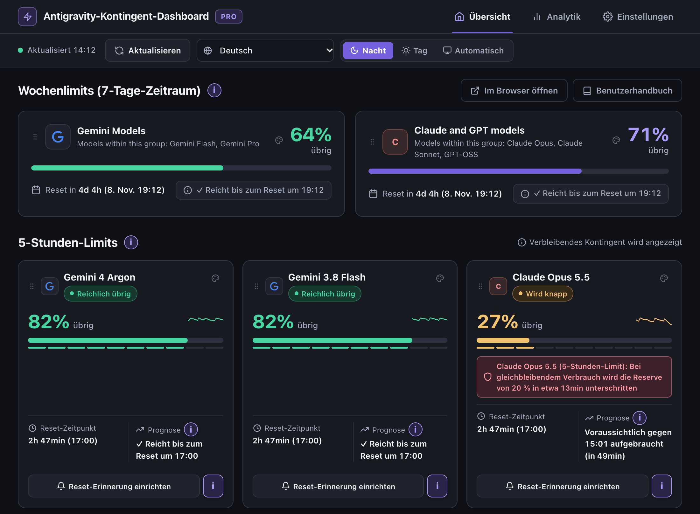

---

## 📌 Der komplette Rundgang in Bildern

### 1. Kontingent-Dashboard – hell und klar im Tagmodus (`Tag`)

Wechsle zwischen **Nacht**, **Tag** und **Automatisch** (folgt dem Design deines Editors). Die oberste Reihe zeigt den **Tarif des Kontos** (etwa **Google AI Pro** oder **Google AI Ultra**) und dein **Prompt-Guthaben**. Jede Modellkarte hat eine **LED-Anzeige mit 10 Segmenten** und eine **Farbe deiner Wahl** (`Mint`, `Himmelblau`, `Lavendel`, `Pfirsich`, `Rosé`, `Petrol`), und du kannst die Karten **per Drag-and-drop neu anordnen (`⋮⋮`)**. Mit Pro zeigt jede Karte außerdem ihren **Reset-Zeitpunkt** und die Prognose, und mit einem Klick auf die Glocke **`🔔`** richtest du eine **Reset-Erinnerung** ein.

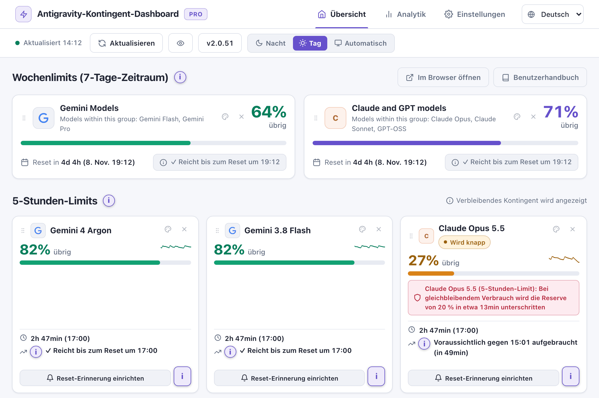

---

### 2. Statusleiste, Details zu 5-Stunden-Limit und Wochenlimit & Schnellaktionen

Dein **Antigravity-Kontingent** bleibt in der **Statusleiste** als grüne Blöcke sichtbar. Den Stil kannst du in den Einstellungen ändern. Wird es bei einem **Wochenlimit** knapp, erscheint direkt daneben eine farbige Markierung. Fahre mit der Maus darüber, und du siehst für jedes Modell **5-Stunden-Limit**, **Wochenlimit**, **Reset-Zeitpunkt** und Prognose. Über die **Schnellaktionen** erreichst du Aktualisierung, Erinnerungen, Berichte und Einstellungen mit einem Klick, ohne deine Arbeit zu unterbrechen.

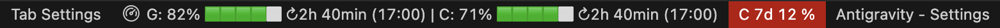

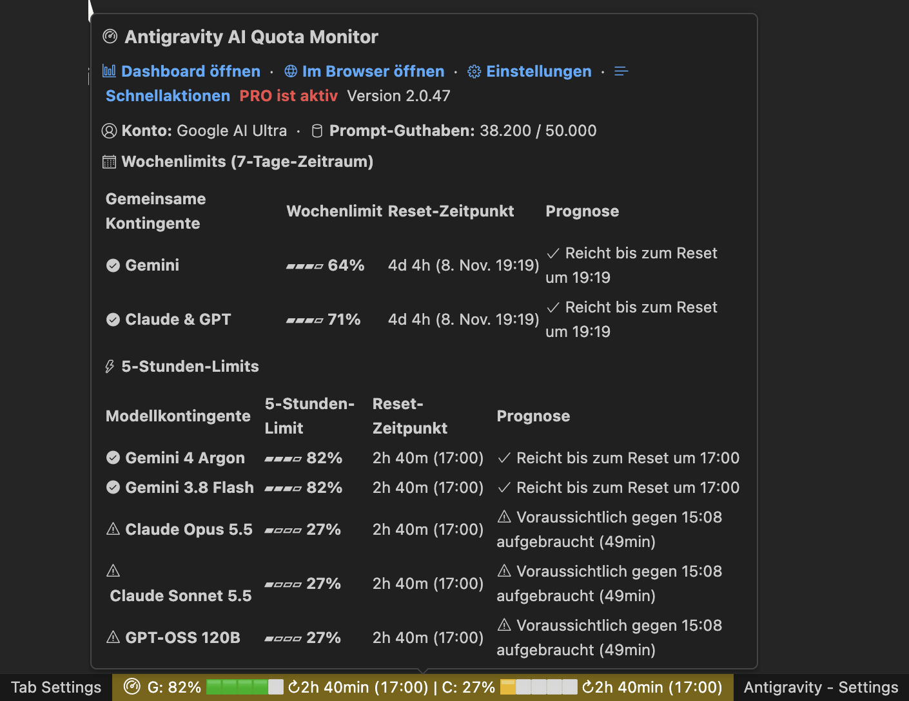

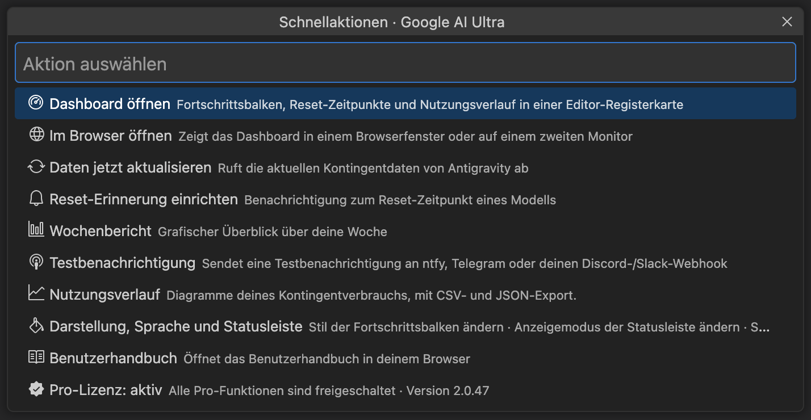

---

### 3. Eigene Seitenleiste, erreichbar über die Aktivitätsleiste + Bereinigung alter Chat-Dateien

Ein Klick auf das **Tacho-Symbol** links in der Aktivitätsleiste zeigt dir jederzeit den **Tarif des Kontos**, deine **5-Stunden-Limits** und deine **Wochenlimits**, ganz ohne eigene Registerkarte.

Die **Bereinigung alter Chat-Dateien** zeigt, wie viel Speicherplatz deine alten Chats belegen, und ohne deine Bestätigung wird nichts verschoben. Die Bereinigung prüft `~/.gemini/antigravity/brain` und listet die Ordner auf, in denen sich in den letzten 7 Tagen nichts geändert hat, samt ihrer Größe. Nach deiner Bestätigung landen diese Ordner im Papierkorb des Systems, wo du sie wiederherstellen kannst. Bei `code_tracker/` wird nur die Größe erfasst, bereinigt wird der Ordner nie.

---

### 4. Einstellungen: Reserveschutz, Warnungen & 5-Stunden-Auto-Starter

Auf einer einzigen Registerkarte stellst du alles ein: **Anzeigemodus der Statusleiste**, **Stil der Fortschrittsbalken**, **Sprache**, **Reserveschutz in %**, **Morgendliche Kontingentübersicht**, **macOS-Systemtöne** und Handy-Benachrichtigungen. Auch den Lizenzschlüssel gibst du hier ein. Die `i`-Schaltflächen erklären verständlich, wie alles funktioniert.

**⏰ 5-Stunden-Auto-Starter: optional, standardmäßig aus und nur mit deiner Zustimmung.** Dein 5-Stunden-Fenster beginnt mit deinem ersten Prompt, nicht zu einer festen Uhrzeit, und dein Kontingent steht fünf Stunden später wieder bei 100 %. Schickst du den ersten Prompt also um `09:30` ab und brauchst dein Kontingent auf, wartest du womöglich bis `14:30` auf den Reset.

Schalte den Auto-Starter ein, bestätige den Zustimmungsdialog und wähle deine Uhrzeit (standardmäßig `07:00`). Zu dieser Zeit führt die Erweiterung `agy` aus und sendet von deinem eigenen Konto einen kurzen, aber echten Prompt (`OK`) an Claude, Gemini oder beide, während du deinen Morgenkaffee machst. Das verbraucht etwas von deinem Kontingent. Mit einem Start um `07:00` steht dein Kontingent um `12:00` wieder bei 100 %, und ein zweites volles Fenster passt in deinen Arbeitstag. Ist der Editor zu dieser Zeit geschlossen, läuft der Auto-Starter beim nächsten Öffnen, sofern das innerhalb von 3 Stunden geschieht.

Die Nutzungsbedingungen von Antigravity verbieten es, den Dienst mit Produkten zu nutzen, die nicht von Google bereitgestellt werden. Laut den Bedingungen kann der Zugriff über Drittanbieter als Verstoß gewertet werden und zur Sperrung des Kontos führen. Deshalb ist der Auto-Starter standardmäßig aus, und du entscheidest selbst.

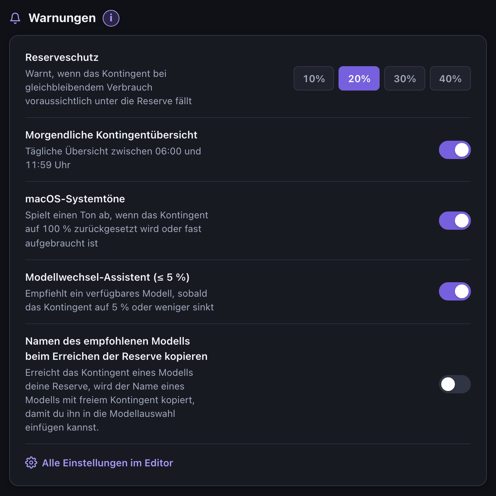

---

### 5. Pro-Analysen: 90-Tage-Nutzungs-Heatmap, Schätzungen pro Projekt & Terminal-Status

Die **Nutzungs-Heatmap nach Wochentag und Uhrzeit** zeigt dir, wann du am meisten Kontingent verbrauchst, und du bekommst eine Schätzung, wie viel deines **Antigravity-Kontingents** auf jedes Projekt entfällt. Öffne den grafischen **Wochenbericht** als Rückblick auf deine Woche oder den **Nutzungsverlauf** für dein Kontingent über 7, 30 oder 90 Tage. Speichere den Bericht als HTML oder Markdown und deinen Verlauf als **CSV oder JSON**.

Arbeitest du im Terminal mit der **`agy`-CLI**? Bei jeder Kontingentprüfung schreibt die Erweiterung deine Claude- und Gemini-Prozentwerte nach `~/.antigravity-quota/status.json`, und mit einem fertigen Codeausschnitt zeigst du sie in deinem **zsh**- oder **Starship**-Prompt oder in deiner **tmux**-Statuszeile an.

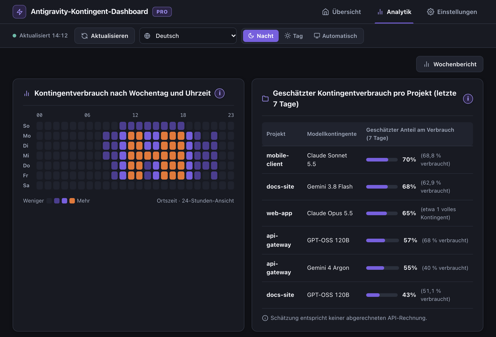

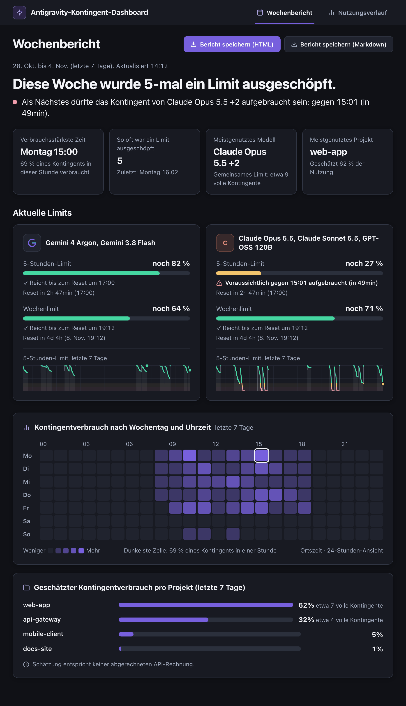

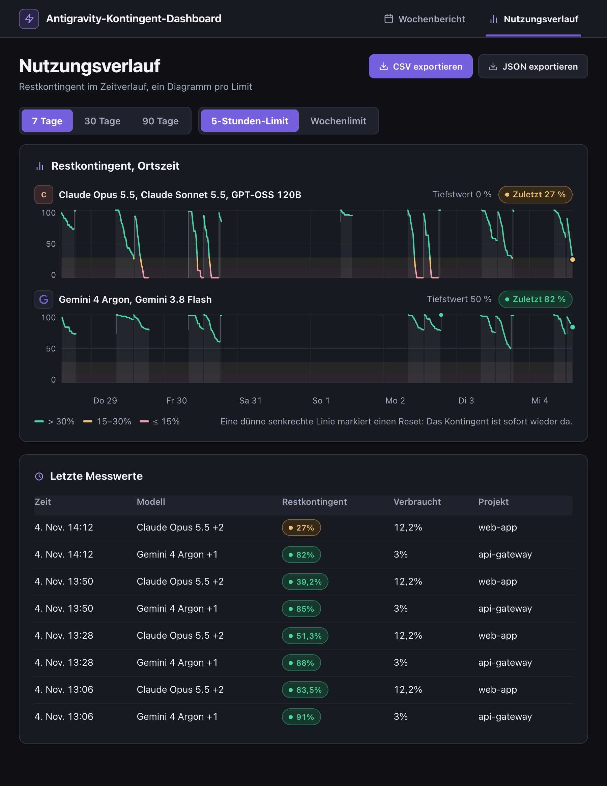

---

## 🎛️ Warum Entwickler auf Pro umsteigen: Das ändert sich in deinem Alltag

Du zahlst bereits für **Google AI Pro**, **Google AI Ultra** oder einen anderen KI-Tarif. Schon ein einziger Nachmittag, den du wegen eines überraschenden **5-Stunden-Limits** verlierst, kann dich mehr kosten als **9,99 €**.

| Dein Tag ohne Pro | Dein Tag mit Pro |
| :--- | :--- |
| Dein 5-Stunden-Fenster beginnt erst mit deinem ersten Prompt. Fängst du spät an, musst du am Nachmittag womöglich warten. | Der optionale **Auto-Starter** lässt das Fenster früh beginnen (standardmäßig um `07:00`), und **ein zweites volles Fenster passt in deinen Arbeitstag**. |
| Du siehst deinen Prozentwert, aber nicht, wie schnell **Claude Opus** und **Sonnet** das Kontingent verbrauchen. So kann dich ein Limit mitten im Refactoring ausbremsen. | **Verbrauchsprognose + Reserveschutz** warnen dich früh, und der **Modellwechsel-Assistent** empfiehlt ein Modell, das noch Kontingent hat. |
| Du schaust immer wieder in den Editor, ob dein **5-Stunden-Limit** schon zurückgesetzt ist. | **Geh ruhig vom Schreibtisch weg:** Dein Handy meldet sich, sobald dein Kontingent wieder bei **100 %** steht (`ntfy.sh`, Telegram). |
| Du kannst nur raten, zu welchen Uhrzeiten und in welchen Projekten du dein **Wochenlimit** ausschöpfst. | Die **Heatmap** und die Schätzungen pro Projekt zeigen, wann und wo du am meisten Kontingent verbrauchst. |

**All das für einmalig 9,99 €** (oder 2,99 €/Monat).

---

## ✅ Kostenlos oder Pro: alle Funktionen des Kontingent-Monitors im Vergleich

> **Gut zu wissen:** Bei jeder Neuinstallation sind **alle Pro-Funktionen 7 Tage lang automatisch freigeschaltet**, ohne Kreditkarte und ohne Registrierung. Danach funktioniert alles aus der Spalte „Kostenlos“ weiter.

| Funktion | Kostenlos | Pro (2,99 €/Monat oder einmalig 9,99 €) |
| :--- | :---: | :---: |
| 📊 **Kontingentanzeige in der Statusleiste (% übrig)** | ✅ | ✅ |
| ⚡ **Funktioniert mit dem `agy`-Daemon & der CLI** | ✅ | ✅ |
| 🎨 **Wählbare Stile für die Fortschrittsbalken** (8 Balkenstile, farbig oder einfarbig) | ✅ | ✅ |
| 📌 **Seitenleiste mit Symbol in der Aktivitätsleiste + Dashboard im Tag- & Nachtmodus + verschiebbare Karten (`⋮⋮`), 6 Kartenfarben & Bereinigung alter Chat-Dateien** | ✅ | ✅ |
| 🌍 **37 Oberflächensprachen** | ✅ | ✅ |
| 🔔 **Meldungen bei Reset & knappem Kontingent** (im Editor) | ✅ | ✅ |
| 🕒 **Lokaler Kontingentverlauf über 24 Stunden** | ✅ | ✅ |
| ⏱️ **Reset-Countdown & Uhrzeit (`4h 39min · ↻19:52`), Verbrauchsprognose & Browseransicht für den zweiten Monitor** | ➖ | ✅ |
| 🔄 **Modellwechsel-Assistent** (empfiehlt ein verfügbares Modell & kopiert dessen Namen) | ➖ | ✅ |
| 🛡️ **Reserveschutz** (warnt dich, bevor das Kontingent eines Modells bei deinem Tempo unter die festgelegte Reserve fällt, standardmäßig 20 %) | ➖ | ✅ |
| 📈 **90-Tage-Verlauf, Trendlinien & Nutzungs-Heatmap nach Wochentag und Uhrzeit** | ➖ | ✅ |
| 📲 **Handy- & Chat-Benachrichtigungen** (`ntfy.sh`-QR-Code, Telegram, Discord/Slack) | ➖ | ✅ |
| 📁 **Geschätzter Kontingentverbrauch pro Projekt** | ➖ | ✅ |
| 💻 **Terminal-Statusdatei & Shell-Codeausschnitte** (`~/.antigravity-quota/status.json`, zsh, Starship, tmux) | ➖ | ✅ |
| ⏰ **Optionaler 5-Stunden-Auto-Starter (`07:00` oder deine eigene Uhrzeit), `🔔` Reset-Erinnerung & morgendliche Kontingentübersicht** | ➖ | ✅ |
| 📋 **Wöchentlicher Nutzungsbericht in HTML & Markdown** | ➖ | ✅ |
| 🔊 **macOS-Systemtöne** | ➖ | ✅ |
| 📥 **Export des Nutzungsverlaufs als CSV & JSON** (bis zu 90 Tage) | ➖ | ✅ |

---

## 💳 Pro nach der Testphase behalten: Preise & Lizenzschlüssel

Deine 7-tägige Testphase ist kostenlos und läuft ganz ohne Kreditkarte. Um Pro danach zu behalten, wählst du über Polar einen Tarif:

- **Lifetime Pro: einmalig 9,99 €.** Kein Abo. Das kostet weniger als 4 Monate im Pro-Monatsabo und 72 % weniger als ein ganzes Jahr im Abo.
- **Pro-Monatsabo: 2,99 €/Monat.** Dieser Tarif hat keine eigene Testphase: Die Abrechnung beginnt am Tag des Kaufs, auch wenn du noch Testtage übrig hast. Kündigen kannst du im Kundenportal von Polar.

 
&nbsp;&nbsp;
  

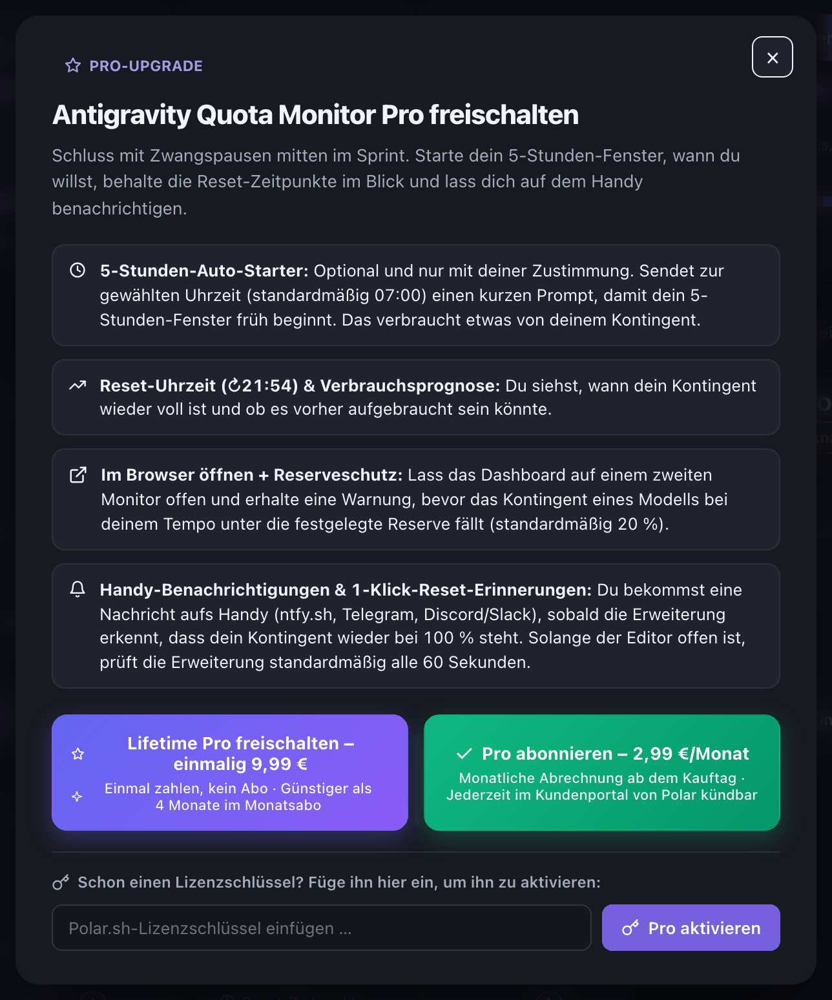

Deinen Lizenzschlüssel findest du in der Bestätigungs-E-Mail und auf der Bestätigungsseite von Polar. Füge ihn in den Einstellungen ein, um Pro zu aktivieren.

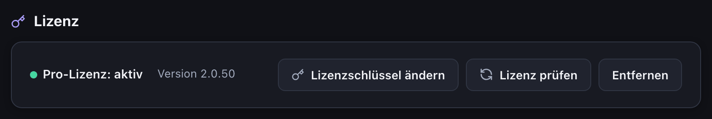

---

## 🔔 So richtest du Handy-Benachrichtigungen ein (`ntfy.sh` oder Telegram)

Soll sich dein Handy melden, wenn dein **Claude-Opus-**, **Sonnet-** oder **Gemini-Kontingent** wieder bei **100 %** steht oder das Kontingent eines Modells knapp wird?

### Option A: `ntfy.sh` (kein Konto nötig)

1. Installiere die kostenlose **ntfy**-App aus dem [App Store](https://apps.apple.com/app/ntfy/id1625396347) oder von [Google Play](https://play.google.com/store/apps/details?id=io.heckel.ntfy).
2. Tippe in der App auf **`+`** und gib das Topic ein, das die Erweiterung unter **Einstellungen → Handy verbinden** vorschlägt. Unter Android kannst du stattdessen den Android-QR-Code scannen.
3. Klicke auf **Speichern und Testbenachrichtigung senden**. Dein Handy sollte sich melden.

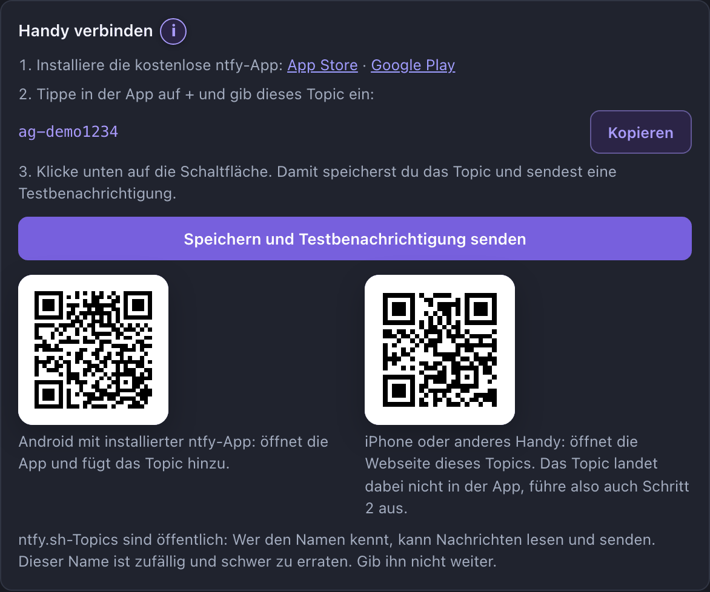

`ntfy.sh`-Topics sind öffentlich: Wer den Namen kennt, kann Nachrichten lesen und senden. Die Erweiterung schlägt einen zufälligen, schwer zu erratenden Namen vor. Gib ihn nicht weiter.

### Option B: Telegram-Bot

1. Sende **[@BotFather](https://t.me/BotFather)** in Telegram den Befehl `/newbot`, um dein **Bot-Token** zu bekommen. Öffne den Link zu deinem neuen Bot und tippe einmal auf **Starten**, sonst stellt Telegram die Nachrichten des Bots nicht zu.
2. Schreibe **[@userinfobot](https://t.me/userinfobot)**, um deine numerische **Chat-ID** zu bekommen.
3. Gib unter **Einstellungen** die Chat-ID ein und klicke auf **Speichern**. Klicke dann auf **Bot-Token festlegen**, füge das Token ein und klicke auf **Testbenachrichtigung**.

Auch ein **Discord- oder Slack-Webhook** funktioniert: Füge seine URL im selben Bereich der Einstellungen ein.

---

## 🌐 37 integrierte Sprachen (automatische Erkennung)

**Antigravity Quota Monitor** verwendet die Sprache deines Editors oder, wenn der Editor auf Englisch eingestellt ist, deine Systemsprache. In den Einstellungen kannst du auch jede der **37 Sprachen** auswählen. Einige neuere Texte können noch auf Englisch erscheinen.

---

## 🛡️ Datenschutz, Netzwerknutzung & Support

Deine **Antigravity-Kontingentwerte** stammen von deinem lokalen Antigravity-Sprachserver auf `127.0.0.1`. Die Erweiterung verwendet weder Tracking noch Telemetrie. Ins Netz geht sie nur in diesen Fällen:

- **Update-Prüfung:** Bei jedem Start fragt die Erweiterung bei `open-vsx.org` die neueste Versionsnummer ab.
- **Lizenz:** Hast du einen Lizenzschlüssel eingegeben, prüft die Erweiterung ihn etwa einmal am Tag bei `api.polar.sh`. Erreicht sie Polar 7 Tage lang nicht, pausiert Pro, bis die Verbindung wieder steht.
- **Benachrichtigungen (optional):** Die Erweiterung sendet Kontingentmeldungen an `ntfy.sh`, Telegram oder deinen Discord-/Slack-Webhook, aber nur, wenn du das eingerichtet hast.
- **Auto-Starter (optional, standardmäßig aus):** Wenn du ihn einschaltest, sendet `agy` von deinem Konto einen kurzen Prompt (`OK`) an die ausgewählten Modelle. Dein Quellcode wird nicht mitgesendet.

**Zwischenablage:** Die Erweiterung liest sie nur in einem einzigen Fall. Klickst du auf eine Kaufschaltfläche und kehrst innerhalb von 30 Minuten zum Editor zurück, prüft sie die Zwischenablage einmal auf einen Lizenzschlüssel. Der Inhalt der Zwischenablage wird nicht gespeichert und nur dann an `api.polar.sh` gesendet, wenn du auf Aktivieren klickst. Zu keinem anderen Zeitpunkt liest die Erweiterung die Zwischenablage.

Lies das [Benutzerhandbuch (Englisch und Estnisch)](https://github.com/Nordicstocks/antigravity-quota-monitor/blob/main/USER-GUIDE.md). Fragen zur Lizenz oder zu anderen Themen? [GitHub Issues](https://github.com/Nordicstocks/antigravity-quota-monitor/issues).

---

## 🌟 别再被 Antigravity 限额打个措手不及：免费配额监控 + Pro 全部功能免费试用 7 天，无需信用卡

**Antigravity Quota Monitor** 把剩余的 **Antigravity 配额**（额度）显示在状态栏里，赶在被限额卡住之前提醒你。无需注册，也不用配置 API 密钥。

- 🚫 **配额快用完时一眼就能看到，不用等撞上限额才知道**。剩余配额一直显示在**状态栏**。鼠标悬停，就能看到 **Claude Opus**、**Sonnet**、**Gemini** 和 **GPT-OSS** 的 **5 小时限额**和**每周限额**。
- ⏱️ **知道配额何时重置**。**重置时间**同时显示倒计时和具体时刻（`4h 39m · ↻19:52`），**耗尽预测**会告诉你配额能撑到那时，还是会提前用完。
- 📲 **离开工位也没关系，配额恢复时手机会提醒你**。编辑器开着时，插件默认每 60 秒检查一次配额，配额回到 **100%** 时你会收到消息（`ntfy.sh`、Telegram、Discord/Slack）。
- ⏰ **开工之前就启动 5 小时窗口（可选）**。要等你发出第一条提示词，窗口才开始计时。如果你 `09:30` 才发第一条，又把配额用完了，可能要等到 `14:30` 才重置。让编辑器开着，把**自动预热**设为 `07:00`，配额到 `12:00` 就回到 100%，当天工作时间内还能再用满一个窗口。此功能默认关闭，并会消耗一些配额。
- 🛡️ **为等不了的工作留一份配额**。按当前消耗速度，模型配额快要跌破预留线时，**配额预留保护**（默认 20%）会提前提醒你。**模型切换助手**会推荐一个还有配额的模型，并让你一键复制模型名称。
- 📈 **弄清配额都花在了哪里**。**星期几 × 小时热力图**、90 天历史记录和各项目用量估算，让你看出哪些时段、哪些项目最耗配额。
- 🌐 **把仪表板放到第二块显示器上**。在 Chrome、Safari、Edge 或 Firefox 中打开就行。

7 天之后，配额监控依然免费：状态栏配额条、侧边栏、日间和夜间主题的仪表板、编辑器内的配额重置和配额不足提醒等，都能继续用。完整内容见下方的免费版与 Pro 版对比表。

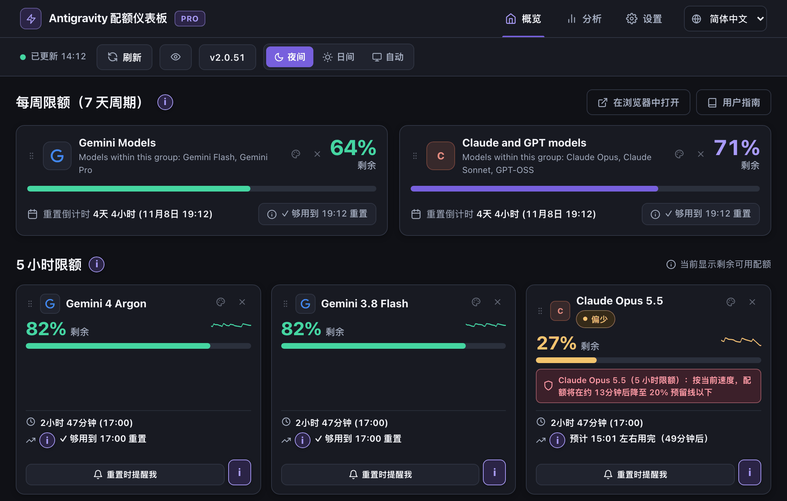

---

## 📌 完整功能图解

### 1. 概览仪表板：清爽的日间模式

**夜间**、**日间**、**自动**（跟随编辑器主题）三种外观随时切换。顶部一行显示你的**会员方案**（如 **Google AI Pro** 或 **Google AI Ultra**）和**提示词点数**。每张模型卡片都有 **10 格 LED 配额条**和**可自选的颜色**（`薄荷绿`、`天蓝`、`薰衣草紫`、`蜜桃色`、`玫瑰色`、`青绿`），还能**拖动排序（`⋮⋮`）**。开通 Pro 后，每张卡片还会显示**重置时间**和耗尽预测，点一下 **`🔔` 重置时提醒我**，就设好了。

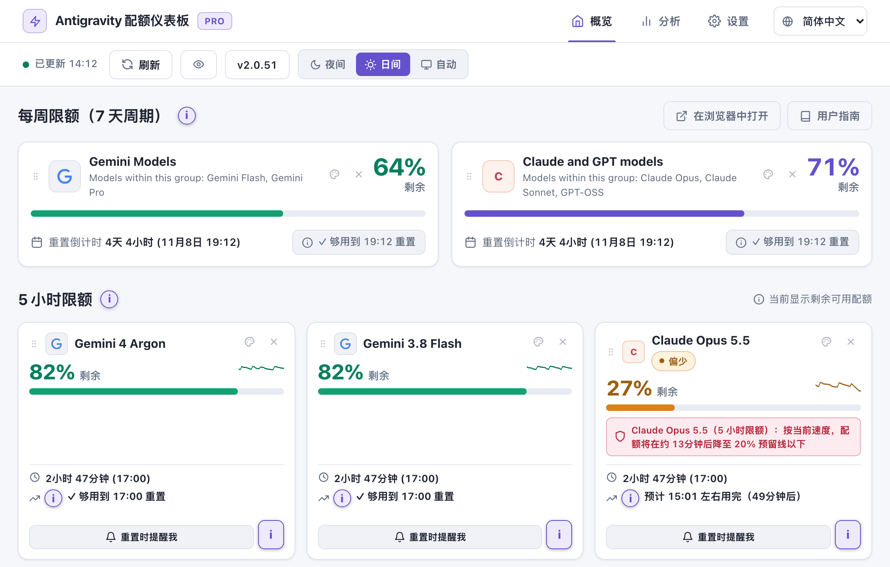

---

### 2. 状态栏、悬停详情和快捷操作

**Antigravity 配额**以绿色方块的形式常驻**状态栏**，样式可在设置中更改。**每周限额**快用完时，旁边会出现一个彩色标记。鼠标悬停，就能看到每个模型的 **5 小时限额**、**每周限额**、**重置时间**和耗尽预测。**快捷操作**让你一键刷新配额、设置提醒、查看报告或打开设置，不用停下手头的工作。

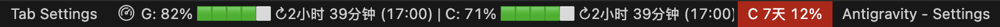

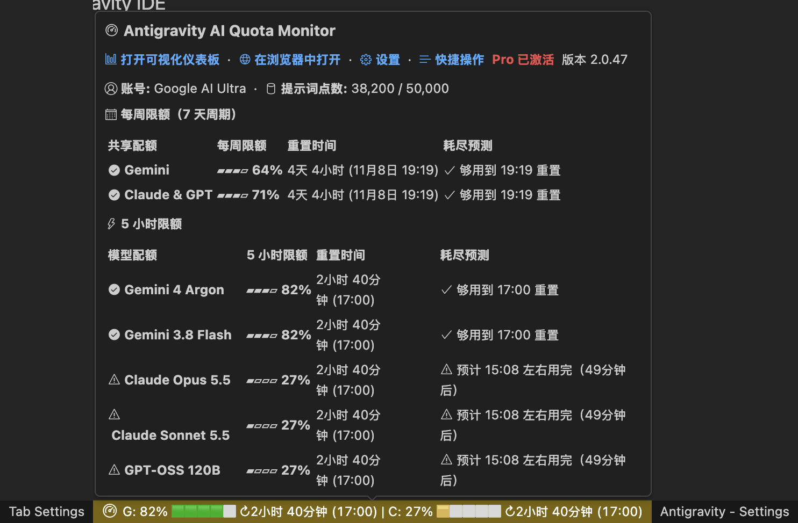

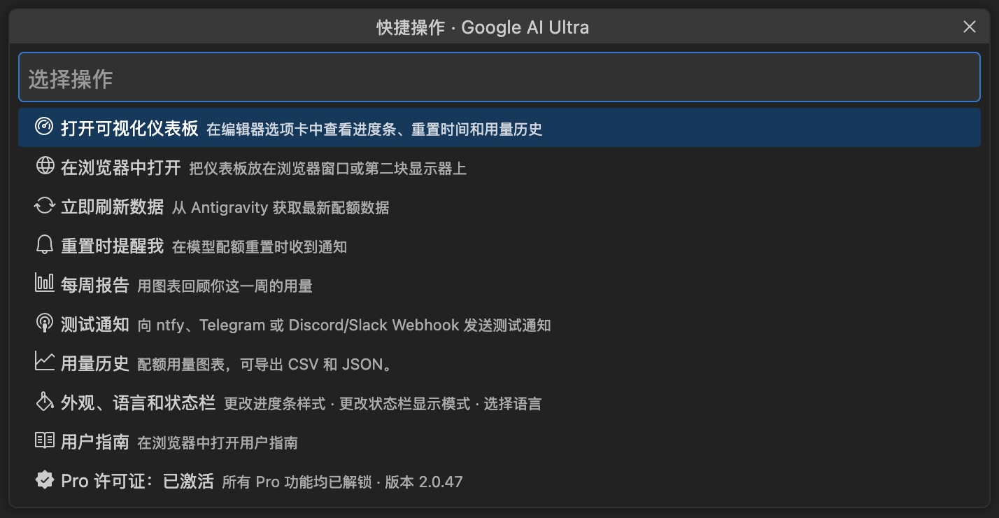

---

### 3. 活动栏专属侧边栏 + 旧对话文件清理

随时点击左侧活动栏的**仪表图标**，不用另开一个选项卡，就能查看**会员方案**、**5 小时限额**和**每周限额**。

**旧对话文件清理**会显示旧对话占用了多少磁盘空间，未经你确认不会移动任何文件。它会检查 `~/.gemini/antigravity/brain`，列出最近 7 天没有改动的文件夹及其大小。你确认后，这些文件夹会移到系统回收站（macOS 上是废纸篓），可以从那里恢复。`code_tracker/` 只统计大小，从不清理。

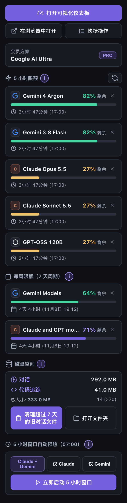

---

### 4. 设置选项卡：配额预留保护、提醒和 5 小时窗口自动预热

**状态栏显示模式**、**进度条样式**、**界面语言**、**配额预留保护百分比**、**早间配额摘要**、**macOS 提示音**、手机通知和许可证密钥，都在同一个选项卡里设置。点一下 `i` 按钮，就能看到大白话说明，讲清各项功能怎么用。

**⏰ 5 小时窗口自动预热：可选，默认关闭，只有你同意才会运行**。5 小时窗口不是从固定时间算起，而是从你的第一条提示词开始，满 5 小时后配额恢复到 100%。所以，如果你 `09:30` 才发第一条，又把配额用完了，可能要等到 `14:30` 才重置。

打开自动预热，在弹出的对话框中点同意，选好时间（默认 `07:00`）。到点后，插件就会运行 `agy`（这时你可能还在冲咖啡），用你自己的账号向 Claude 或 Gemini（也可以两个都选）发送一条简短的真实提示词（`OK`）。这会消耗一些配额。如果 `07:00` 启动，配额会在 `12:00` 回到 100%，当天工作时间内还能再用满一个窗口。如果到了设定时间编辑器没开，只要你在 3 小时内打开，自动预热就会补上。

Antigravity 的条款禁止将该服务与非 Google 提供的产品结合使用，并规定第三方访问可能被视为违约，可导致账号被暂停。因此，自动预热默认关闭，是否开启由你决定。

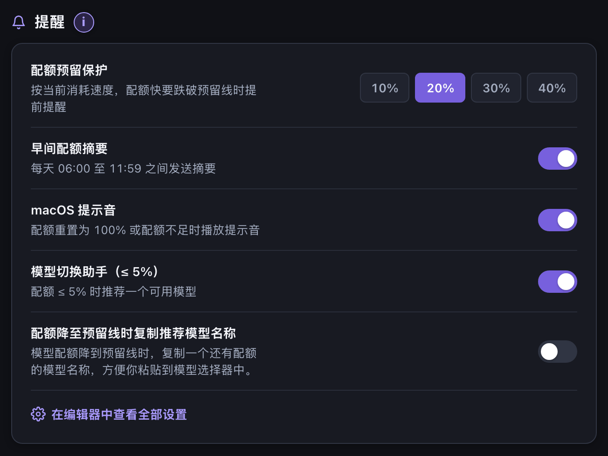

---

### 5. Pro 分析：90 天用量热力图、各项目估算和终端状态

**星期几 × 小时用量热力图**让你一眼看出哪个时段最耗配额；各项目用了多少 **Antigravity 配额**，也能看到估算。打开可视化的**每周报告**回顾这一周，或打开**用量历史**查看 7 天、30 天或 90 天的配额变化。报告可保存为 HTML 或 Markdown，历史记录可导出为 **CSV 或 JSON**。

在终端里用 **`agy` CLI** 工作？插件每次检查配额时，都会把 Claude 和 Gemini 的百分比写入 `~/.antigravity-quota/status.json`，用现成的代码片段就能把它们显示在 **zsh**/**Starship** 提示符或 **tmux** 状态栏中。

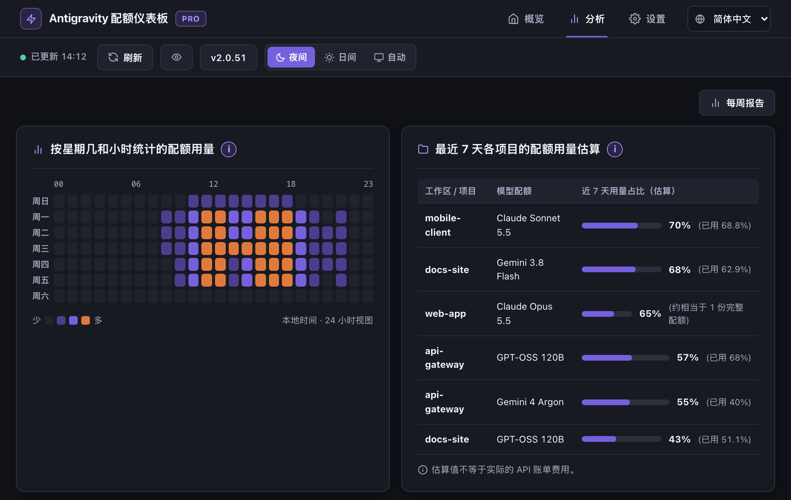

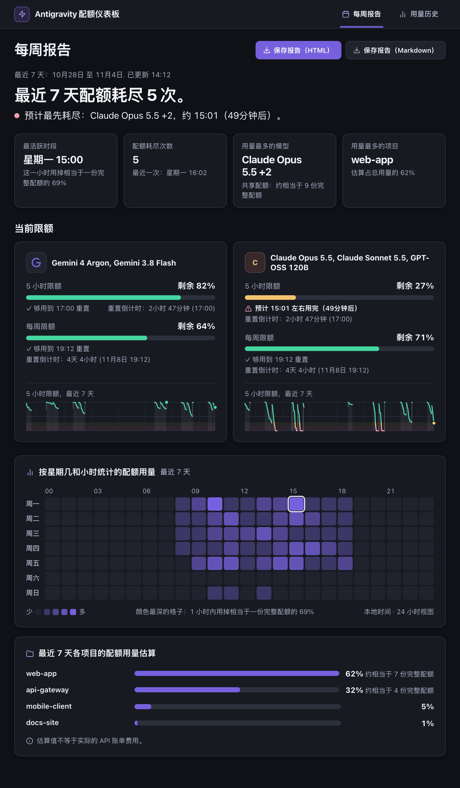

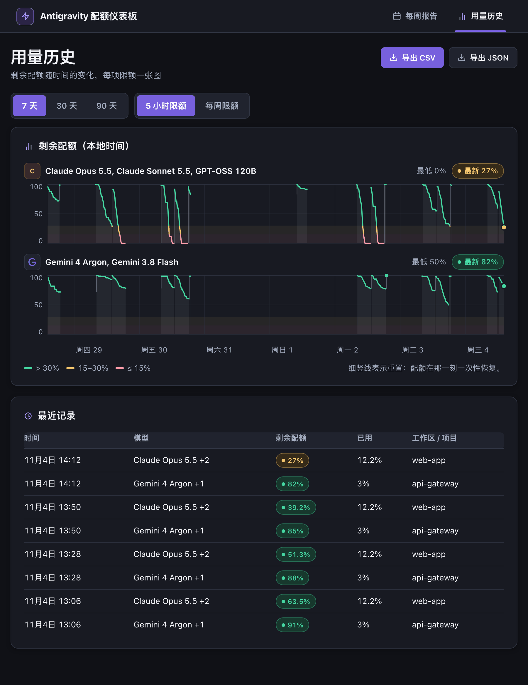

---

## 🎛️ 开发者为什么升级：有 Pro 和没 Pro 的一天

你已经在为 **Google AI Pro**、**Google AI Ultra** 或其他 AI 方案付费。一个下午的工作被突如其来的 **5 小时限额**打断，损失可能就超过 **€9.99**。

| 没有 Pro 的一天 | 有 Pro 的一天 |
| :--- | :--- |
| 5 小时窗口要等第一条提示词才开始，开工晚了，下午可能就得干等。 | 可选的**自动预热**提前启动窗口（默认 `07:00`），**当天工作时间内还能再用满一个窗口**。 |
| 你看得到百分比，却看不出 **Claude Opus** 和 **Sonnet** 用得多快，重构做到一半就可能撞上限额。 | **耗尽预测 + 配额预留保护**提前提醒你，**模型切换助手**推荐还有配额的模型。 |
| 你总要回到编辑器，看看 **5 小时限额**重置了没有。 | 放心离开工位，配额回到 **100%** 时**手机会提醒你**（`ntfy.sh`、Telegram）。 |
| 哪些时段、哪些项目用掉了**每周限额**，全靠猜。 | **热力图**和各项目估算告诉你，哪些时段、哪些项目最耗配额。 |

**以上全部只要 €9.99，一次付清**（或 €2.99/月）。

---

## ✅ 免费版与 Pro 版功能对比

> **提示**：新安装后自动解锁 **Pro 全部功能，免费用 7 天**，无需信用卡，也无需注册。试用结束后，免费版这一列的功能都能继续使用。

| 功能 | 免费版 | Pro 版（€2.99/月或 €9.99 一次性买断） |
| :--- | :---: | :---: |
| 📊 **状态栏配额条（显示剩余百分比）** | ✅ | ✅ |
| ⚡ **支持 `agy` 守护进程和 CLI** | ✅ | ✅ |
| 🎨 **自定义进度条样式**（8 种彩色和单色进度条） | ✅ | ✅ |
| 📌 **活动栏侧边栏 + 日间和夜间仪表板 + 可拖动卡片（`⋮⋮`）、6 种卡片颜色和旧对话文件清理** | ✅ | ✅ |
| 🌍 **37 种界面语言** | ✅ | ✅ |
| 🔔 **配额重置和配额不足提醒**（在编辑器内） | ✅ | ✅ |
| 🕒 **24 小时本地配额历史** | ✅ | ✅ |
| ⏱️ **重置倒计时和具体时刻（`4h 39m · ↻19:52`）、耗尽预测，以及在第二块显示器上用浏览器查看** | ➖ | ✅ |
| 🔄 **模型切换助手**（推荐可用模型并复制其名称） | ➖ | ✅ |
| 🛡️ **配额预留保护**（按当前消耗速度，模型配额快要跌破你设定的预留线时提前提醒，默认 20%） | ➖ | ✅ |
| 📈 **90 天历史、趋势线和星期几 × 小时用量热力图** | ➖ | ✅ |
| 📲 **手机和聊天软件通知**（`ntfy.sh` 二维码、Telegram、Discord/Slack） | ➖ | ✅ |
| 📁 **各项目配额用量估算** | ➖ | ✅ |
| 💻 **终端状态文件和 Shell 代码片段**（`~/.antigravity-quota/status.json`、zsh、Starship、tmux） | ➖ | ✅ |
| ⏰ **可选的 5 小时窗口自动预热（`07:00` 或自定时间）、“`🔔` 重置时提醒我”和早间配额摘要** | ➖ | ✅ |
| 📋 **每周 HTML 和 Markdown 用量报告** | ➖ | ✅ |
| 🔊 **macOS 提示音提醒** | ➖ | ✅ |
| 📥 **导出 CSV 和 JSON 用量历史**（最多 90 天） | ➖ | ✅ |

---

## 💳 试用结束后继续用 Pro：价格和许可证密钥

7 天试用免费，无需绑卡。试用结束后想继续用 Pro，可在 Polar 上选择方案：

- **Pro 终身版：€9.99，一次性买断**。无需订阅。比 Pro 月付版 4 个月的费用还低，比月付整整一年便宜 72%。
- **Pro 月付版：€2.99/月**。这个方案没有单独的试用期：即使插件内的 7 天试用还没结束，也从购买当天开始计费。可在 Polar 客户门户中取消。

 
&nbsp;&nbsp;
  

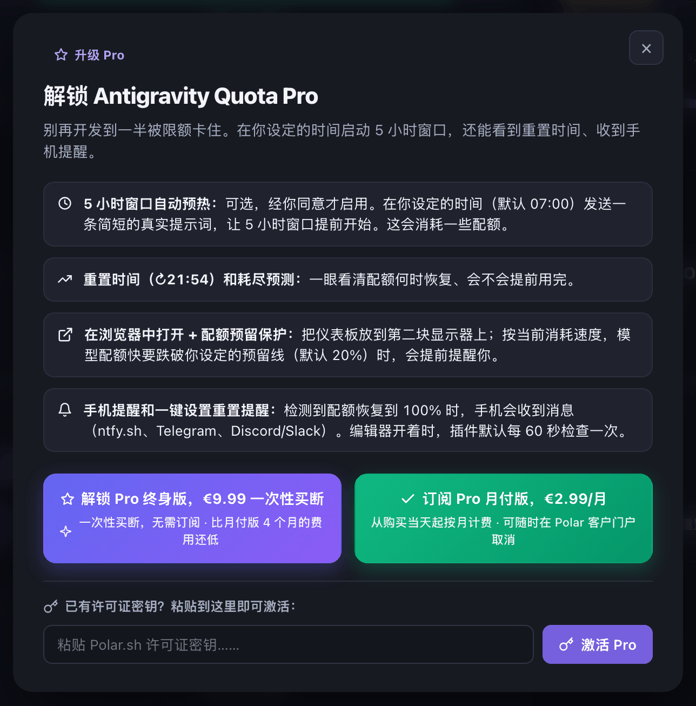

许可证密钥可在购买邮件里或 Polar 确认页面上找到。粘贴到设置中即可激活 Pro。

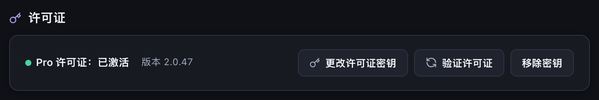

---

## 🔔 如何设置手机通知（`ntfy.sh` 或 Telegram）

想在 **Claude Opus**、**Sonnet** 或 **Gemini 配额**回到 **100%** 时，或者某个模型配额不足时，让手机提醒你？

### 方案 A：`ntfy.sh`（无需账号）

1. 从 [App Store](https://apps.apple.com/app/ntfy/id1625396347) 或 [Google Play](https://play.google.com/store/apps/details?id=io.heckel.ntfy) 安装免费的 **ntfy** 应用。
2. 在应用中点击 **`+`**，输入插件在**设置 → 连接手机**中给出的主题。如果你用 Android 手机，也可以直接扫描标有 Android 的二维码。
3. 点击**保存并发送测试通知**。手机应该会收到提醒。

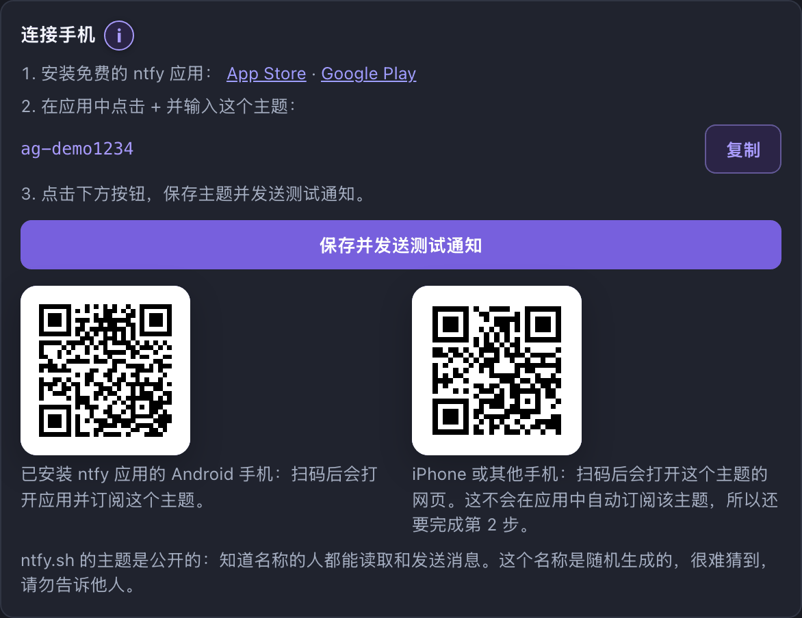

`ntfy.sh` 的主题是公开的：知道名称的人都能读取和发送消息。插件给出的是随机生成、很难猜到的名称，请勿告诉他人。

### 方案 B：Telegram 机器人

1. 在 Telegram 上向 **[@BotFather](https://t.me/BotFather)** 发送 `/newbot`，获取**机器人令牌（Bot Token）**。打开新机器人的链接，点击一次 **Start**，否则机器人无法在 Telegram 里给你发消息。
2. 向 **[@userinfobot](https://t.me/userinfobot)** 发消息，获取纯数字的**聊天 ID（Chat ID）**。
3. 在**设置**中输入聊天 ID，点击**保存**。然后点击**设置机器人令牌**，粘贴令牌，再点击**测试通知**。

**Discord 或 Slack Webhook** 也可以：在**设置**的同一区域，把 Webhook URL 粘贴到对应的输入框即可。

---

## 🌐 37 种内置语言（自动检测）

**Antigravity Quota Monitor** 会使用编辑器的语言；如果编辑器是英文，则使用系统语言。你也可以在设置中选择 **37 种语言**中的任意一种。部分新增文字可能暂时仍显示为英文。

---

## 🛡️ 隐私、联网和支持

你的 **Antigravity 配额**数据来自本机 `127.0.0.1` 上的 Antigravity 语言服务器。插件没有埋点统计，也没有遥测。只有以下情况才会联网：

- **检查更新**：每次启动时向 `open-vsx.org` 查询最新版本号。
- **许可证**：有许可证密钥时，大约每天向 `api.polar.sh` 验证一次。如果连续 7 天连不上 Polar，Pro 功能会暂停，直到连接恢复。
- **通知（可选）**：只有你设置过，才会把配额消息发送到 `ntfy.sh`、Telegram 或你的 Discord/Slack Webhook。
- **自动预热（可选，默认关闭）**：开启后，`agy` 会用你的账号向所选模型发送一条简短的真实提示词（`OK`）。不包含你的源代码。

**剪贴板**：插件只在一种情况下读取剪贴板。如果你点击购买按钮后 30 分钟内回到编辑器，它会检查一次剪贴板里有没有许可证密钥。读到的内容不会保存，只有你点击“激活”时才会发送到 `api.polar.sh`。其他任何时候都不会读取剪贴板。

详见[用户指南（英文和爱沙尼亚文）](https://github.com/Nordicstocks/antigravity-quota-monitor/blob/main/USER-GUIDE.md)。许可证或其他问题，请反馈到：[GitHub Issues](https://github.com/Nordicstocks/antigravity-quota-monitor/issues)。

---

## 🌟 Antigravityの5時間制限・週間制限で作業が突然止まる前に、残量をチェック：無料クォータモニター＋Pro全機能を7日間無料（クレジットカード不要）

**Antigravity Quota Monitor**は、**Antigravityのクォータ残量**をステータスバーに表示し、残りが少なくなると早めにお知らせします。ユーザー登録もAPIキーの設定も要りません。

- 🚫 **制限で作業が止まる前に気づけます。** クォータの残量はいつでも**ステータスバー**に表示されます。カーソルを合わせると、**Claude Opus**、**Sonnet**、**Gemini**、**GPT-OSS**の**5時間制限**と**週間制限**（使用量の上限）を確認できます。
- ⏱️ **クォータがいつ戻るかわかります。** **リセットまでの残り時間と時刻**が表示され（`4時間 39分 · ↻19:52`）、**使い切り予測**で、それまでクォータが持つのか、先に尽きるのかがわかります。
- 📲 **席を離れても大丈夫。クォータが戻ればスマホに通知が届きます。** 初期設定では、エディターを開いている間60秒ごとにクォータを確認し、**100%に戻る**とメッセージを送ります（`ntfy.sh`、Telegram、Discord/Slack）。
- ⏰ **席に着く前に5時間枠を始められます（任意）。** 5時間枠は最初のプロンプトで始まります。それが`09:30`なら、途中でクォータを使い切ると、リセットされる`14:30`まで待つことになるかもしれません。エディターを開いたまま**自動スタート**を`07:00`に設定しておけば、`12:00`にはクォータが100%に戻り、仕事時間内にもう1回、5時間枠をまるごと使えます。初期設定はオフです。オンにするとクォータを消費します。
- 🛡️ **後回しにできない作業のために、残量を確保できます。** **残量ガード**（初期値20%）は、今のペースだとモデルのクォータが下限を下回りそうなときに、前もって知らせます。**モデル切り替えアシスト**は、クォータが残っているモデルを提案し、モデル名も1クリックでコピーできます。
- 📈 **クォータを何に使っているかわかります。** **曜日×時間帯のヒートマップ**、90日間の履歴、プロジェクト別の推定使用量で、どの時間帯に、どのプロジェクトでクォータを多く消費しているかがわかります。
- 🌐 **クォータをサブモニターに表示できます。** ダッシュボードはChrome、Safari、Edge、Firefoxで開けるので、作業画面の横に置いておけます。

7日間の無料体験が終わっても、クォータモニターは無料で使い続けられます。無料版にはステータスバーの残量バー、サイドバー、ライト・ダーク両テーマのダッシュボード、エディター内のリセット通知と残量低下の通知などが含まれます。詳しくは下の無料版とProの比較表をご覧ください。

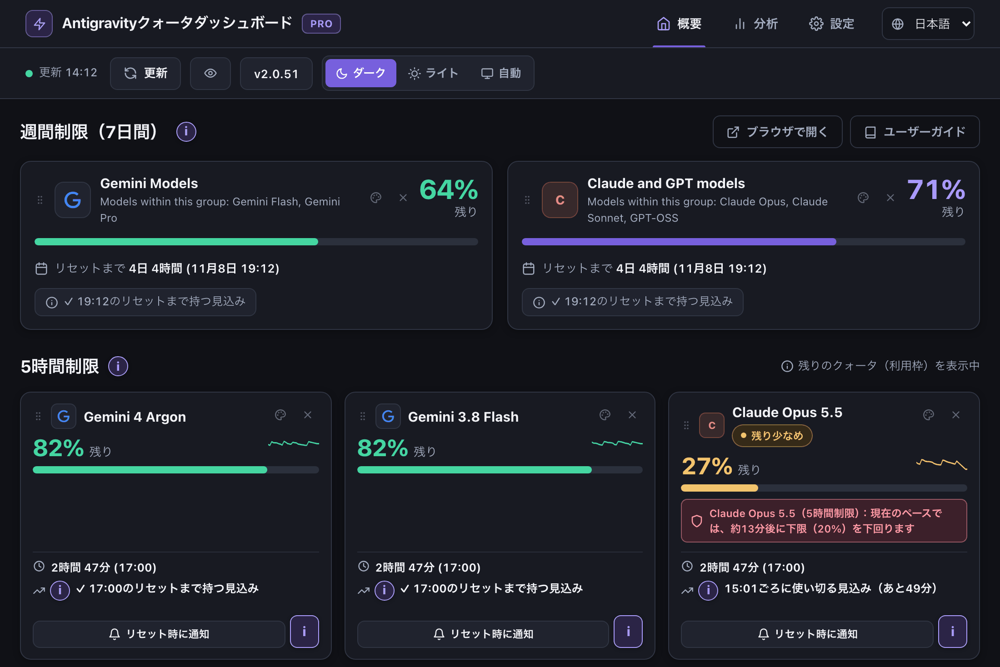

---

## 📌 機能をひととおり画面で紹介

### 1. クォータ残量の概要ダッシュボード：見やすいライトモード

**ダーク**、**ライト**、エディターのテーマに合わせる**自動**を切り替えられます。上段には**利用中のプラン**（**Google AI Pro**、**Google AI Ultra**など）と**プロンプトクレジット**を表示します。モデルカードには**10マスのLEDゲージ**があり、**好きな色**（`ミント`、`スカイ`、`ラベンダー`、`ピーチ`、`ローズ`、`ティール`）を選んで、**ドラッグ＆ドロップ（`⋮⋮`）で並べ替え**もできます。Proなら各カードに**リセット時刻**と**使い切り予測**も表示され、**`🔔` リセット時に通知**のベルを押せば、1クリックでリセット通知を設定できます。

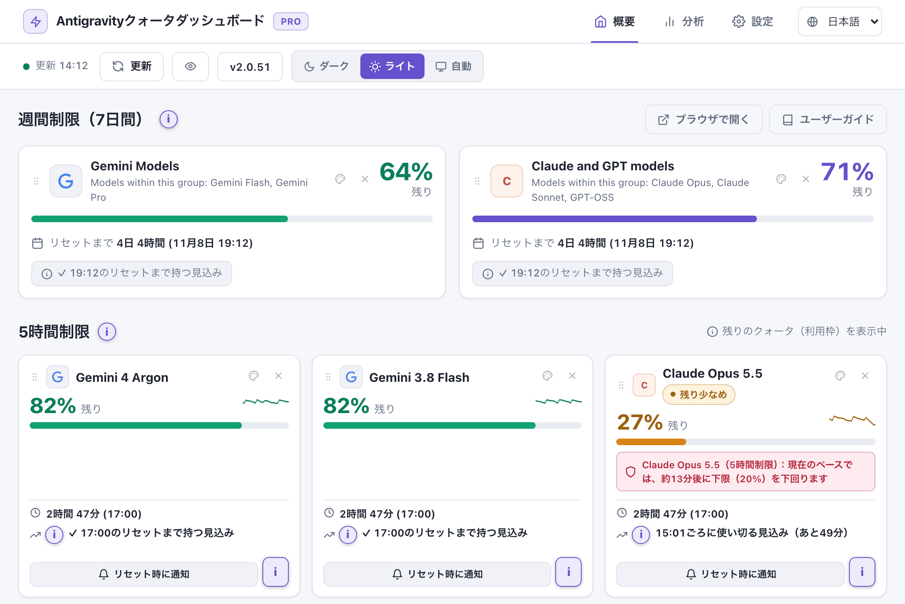

---

### 2. ステータスバーのクォータ残量、ホバー詳細、クイックアクション

**Antigravityのクォータ残量**は**ステータスバー**に緑のブロックで常に表示され、バーのスタイルは設定で変更できます。**週間制限**までの残りが少なくなると、ブロックのすぐ横に色付きのマークが出ます。カーソルを合わせると、モデルごとの**5時間制限**と**週間制限**の残量、**リセット時刻**、**使い切り予測**を確認できます。**クイックアクション**なら、作業の手を止めずに、更新、リセット通知の設定、レポートや設定画面の表示を1クリックで行えます。

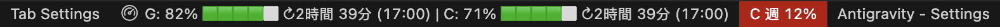

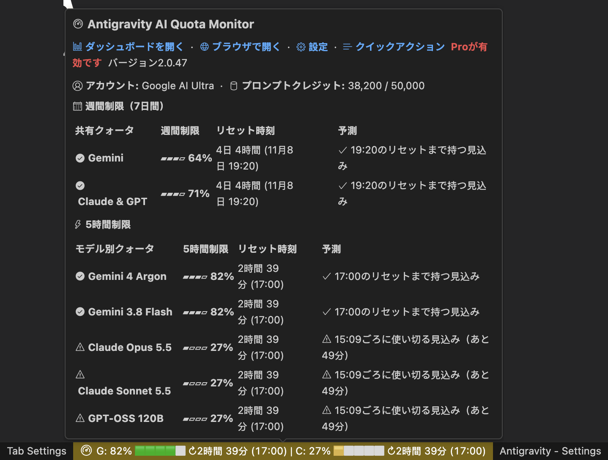

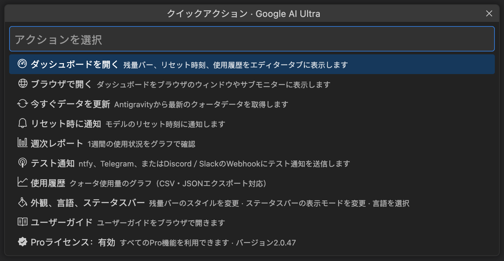

---

### 3. アクティビティバーの専用サイドバー＋古い会話ファイルのクリーナー

左側のアクティビティバーにある**ゲージのアイコン**をクリックすれば、タブを開かなくても、いつでも**利用中のプラン**、**5時間制限**、**週間制限**を確認できます。

**古い会話ファイルのクリーナー**は、過去の会話が使っているディスク容量を表示します。確認なしにファイルを動かすことはありません。`~/.gemini/antigravity/brain`を調べ、過去7日間変更のないフォルダーをサイズ付きで一覧表示します。一覧を確認して実行すると、ゴミ箱に移動します。ゴミ箱から元に戻すこともできます。`code_tracker/`はサイズを測るだけで、整理の対象にはなりません。

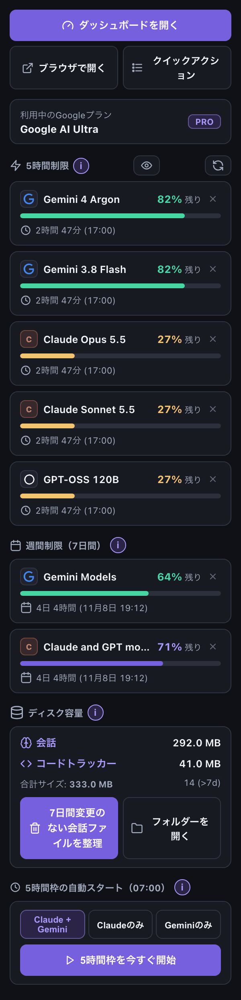

---

### 4. 設定タブ：残量ガード、通知、5時間枠の自動スタート

**ステータスバーの表示モード**、**残量バーのスタイル**、**表示言語**、**残量ガードの下限（%）**、**朝のクォータ状況**、**macOSのサウンド**、スマホ通知、ライセンスキーを、1つのタブでまとめて設定できます。`i`ボタンを押すと、仕組みの説明が表示されます。

**⏰ 5時間枠の自動スタート：初期設定はオフで、同意した場合にのみ動作します。** 5時間枠は決まった時刻ではなく最初のプロンプトで始まり、その5時間後にクォータが100%に戻ります。そのため、最初のプロンプトが`09:30`なら、途中でクォータを使い切ると、リセットされる`14:30`まで待つことになるかもしれません。

自動スタートをオンにして確認ダイアログで同意し、時刻を設定しておけば（初期設定は`07:00`）、朝のコーヒーを入れている間でも、その時刻に拡張機能が`agy`を実行し、ご自身のアカウントからClaude、Gemini、またはその両方に短いプロンプト（`OK`）を実際に送信します。このときクォータを消費します。`07:00`に始めれば`12:00`にクォータが100%に戻り、仕事時間内にもう1回、5時間枠をまるごと使えます。その時刻にエディターを閉じていた場合は、3時間以内に開いたときに自動スタートが実行されます。

Antigravityの利用規約では、Googleが提供していない製品と組み合わせてサービスを使うことが禁止されています。また、第三者のソフトウェアやツールを使ったアクセスは規約違反として扱われることがあり、アカウントの停止につながる場合があると定められています。そのため、自動スタートは初期設定でオフになっています。使うかどうかはご自身でご判断ください。

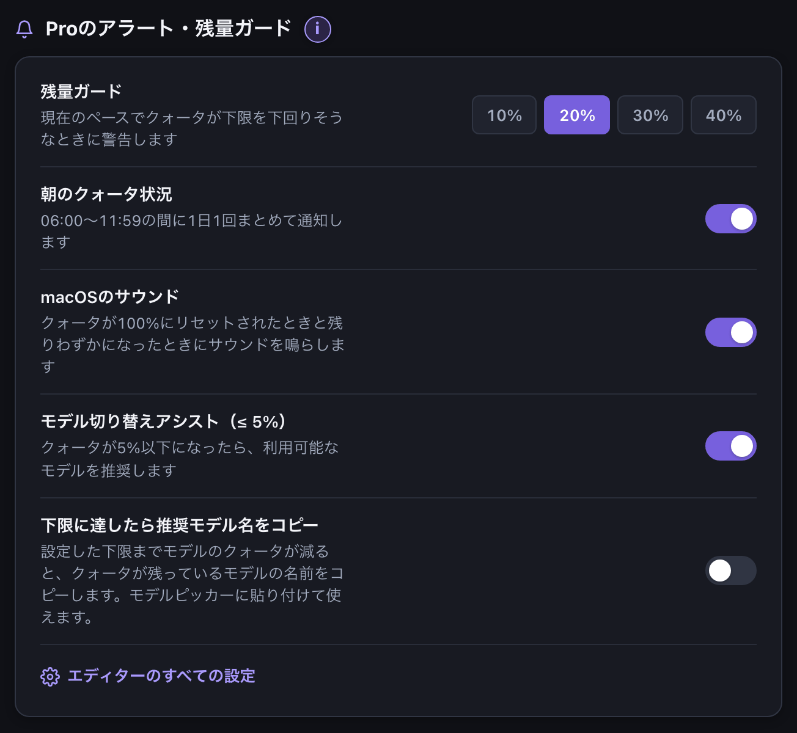

---

### 5. Proの分析、90日間の使用量ヒートマップ、プロジェクト別の推定、ターミナル表示

**曜日×時間帯の使用量ヒートマップ**でクォータを最も多く消費する時間帯がわかり、プロジェクトごとの**Antigravityのクォータ**使用量の推定値も確認できます。1週間を振り返るならグラフで見られる**週次レポート**を、7日間、30日間、90日間のクォータの推移なら**使用履歴**を開いてください。レポートはHTMLまたはMarkdownで、履歴は**CSVまたはJSON**で保存できます。

ターミナルで **`agy` CLI** を使っている方にも便利です。拡張機能はクォータを確認するたびに、ClaudeとGeminiの残量（%）を`~/.antigravity-quota/status.json`に書き込みます。用意されたスニペットを使えば、**zsh**や**Starship**のプロンプト、**tmux**のステータスラインに残量を表示できます。

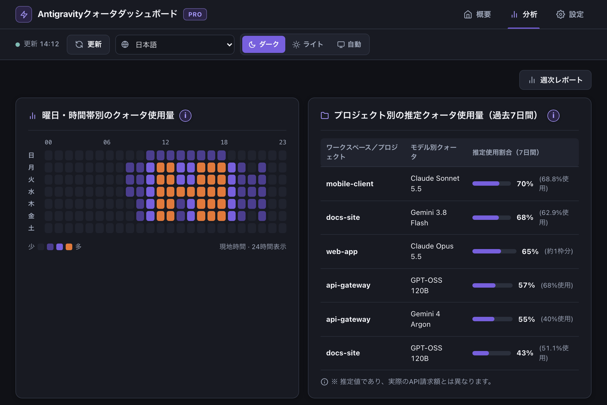

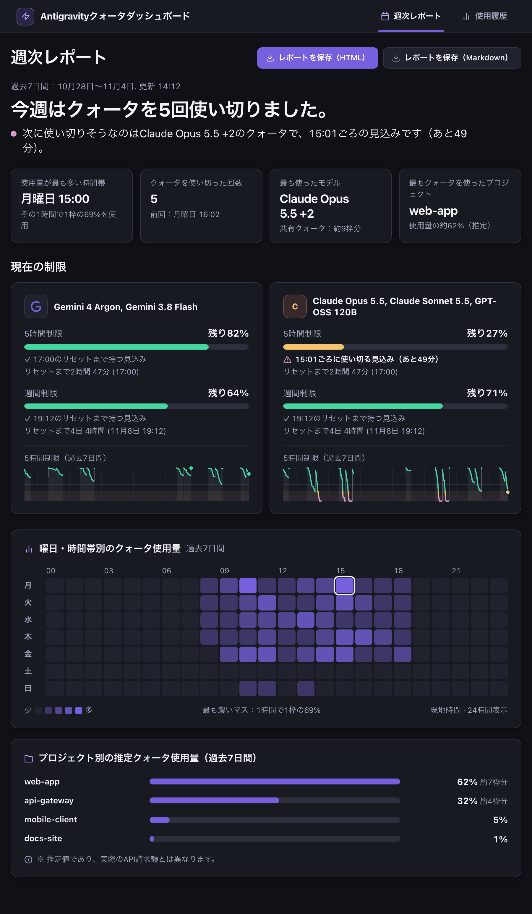

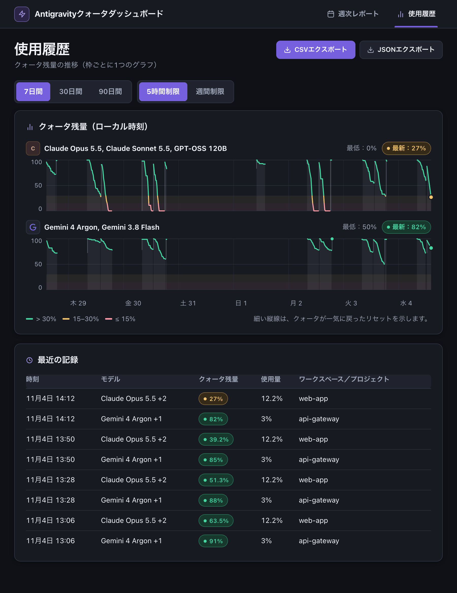

---

## 🎛️ 開発者がProにアップグレードする理由：1日の作業がこう変わります

すでに**Google AI Pro**や**Google AI Ultra**などの有料AIプランを契約しているなら、不意に**5時間制限**にかかって午後の作業がまるごと止まるだけで、**€9.99** 以上の損失になることもあります。

| Proなしの1日 | Proありの1日 |
| :--- | :--- |
| 5時間枠は最初のプロンプトで始まるため、使い始めるのが遅いと、午後の作業中にリセット待ちになることがあります。 | **自動スタート**（任意）が5時間枠を早めに始め（初期設定は`07:00`）、**仕事時間内にもう1回、5時間枠をまるごと使えます**。 |
| 残量の割合は見えても、**Claude Opus**と**Sonnet**の消費の速さはわからず、リファクタリングの途中で制限にかかることがあります。 | **使い切り予測＋残量ガード**が早めに知らせ、**モデル切り替えアシスト**がクォータの残っているモデルを提案します。 |
| **5時間制限**がリセットされたか確かめるために、何度もエディターに戻ることになります。 | クォータが **100%** に戻ると**スマホに通知が届く**（`ntfy.sh`、Telegram）ので、席を離れられます。 |
| どの時間帯に、どのプロジェクトでクォータを消費して**週間制限**に近づいているのか、推測するしかありません。 | **ヒートマップ**とプロジェクト別の推定で、いつ、どこでクォータを多く使っているかがわかります。 |

**これらすべてが、買い切り€9.99で手に入ります**（または月額€2.99）。

---

## ✅ 無料版とProの機能比較

> **ポイント：** 新しくインストールすると、**Pro全機能の7日間無料体験が自動で有効になります**。クレジットカードもユーザー登録も要りません。その後も、無料版の列にある機能はすべて使い続けられます。

| 機能 | 無料版 | Pro（月額€2.99または買い切り€9.99） |
| :--- | :---: | :---: |
| 📊 **ステータスバーの残量バー（残り%）** | ✅ | ✅ |
| ⚡ **`agy`デーモンとCLIに対応** | ✅ | ✅ |
| 🎨 **残量バーのスタイルを変更可能**（カラーとモノクロの計8種類） | ✅ | ✅ |
| 📌 **アクティビティバーのサイドバー＋ライト・ダークのダッシュボード＋ドラッグで並べ替えられるカード（`⋮⋮`）、カードの色6種類、古い会話ファイルのクリーナー** | ✅ | ✅ |
| 🌍 **37言語の表示に対応** | ✅ | ✅ |
| 🔔 **クォータのリセット通知と残量低下の通知**（エディター内） | ✅ | ✅ |
| 🕒 **ローカルに保存される24時間分のクォータ履歴** | ✅ | ✅ |
| ⏱️ **リセットまでのカウントダウンと時刻（`4時間 39分 · ↻19:52`）、使い切り予測、サブモニター用のブラウザ表示** | ➖ | ✅ |
| 🔄 **モデル切り替えアシスト**（利用可能なモデルを提案し、名前をコピー） | ➖ | ✅ |
| 🛡️ **残量ガード**（設定した下限をモデルのクォータが今のペースで下回りそうなときに警告。。初期値20%） | ➖ | ✅ |
| 📈 **90日間の履歴、推移グラフ、曜日×時間帯の使用量ヒートマップ** | ➖ | ✅ |
| 📲 **スマホ通知とチャット通知**（`ntfy.sh`のQRコード、Telegram、Discord/Slack） | ➖ | ✅ |
| 📁 **プロジェクト別の推定クォータ使用量** | ➖ | ✅ |
| 💻 **ターミナル用ステータスファイルとシェル用スニペット**（`~/.antigravity-quota/status.json`、zsh、Starship、tmux） | ➖ | ✅ |
| ⏰ **5時間枠の自動スタート（任意・`07:00`または好きな時刻）、`🔔` リセット時に通知、朝のクォータ状況** | ➖ | ✅ |
| 📋 **週次の使用状況レポート（HTML・Markdown）** | ➖ | ✅ |
| 🔊 **macOSのサウンド通知** | ➖ | ✅ |
| 📥 **使用履歴のエクスポート（CSV・JSON）**（最大90日分） | ➖ | ✅ |

---

## 💳 無料体験の後もProを使うには：料金とライセンスキー

7日間の無料体験にカードは要りません。無料体験の後もProを使うには、Polarでプランを選んでください。

- **Pro買い切りプラン：€9.99（1回払い）。** サブスクリプションではありません。Pro月額プランの4か月分より安く、1年分と比べると72%安くなります。
- **Pro月額プラン：€2.99/月。** このプランに無料体験は付きません。体験期間が残っていても、購入した日から課金が始まります。解約はPolarのカスタマーポータルで行えます。

 
&nbsp;&nbsp;
  

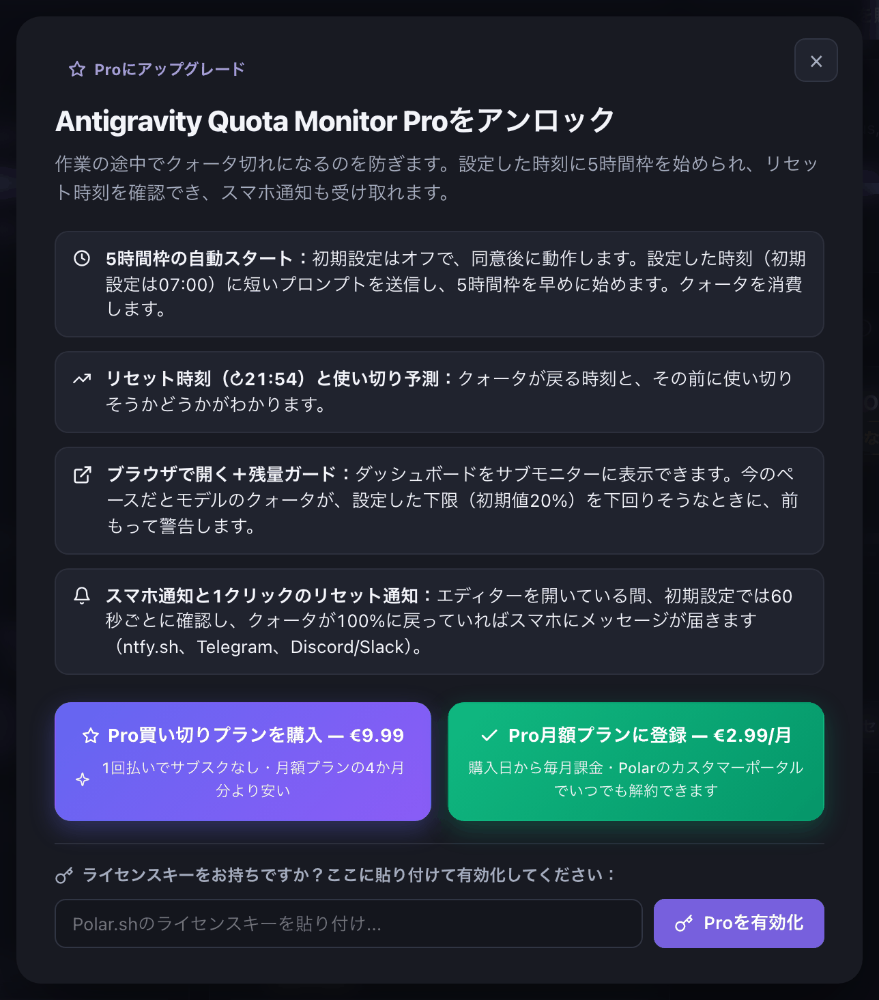

ライセンスキーは、購入確認メールとPolarの確認ページに記載されています。設定に貼り付けるとProが有効になります。

---

## 🔔 スマホ通知の設定方法（`ntfy.sh`またはTelegram）

**Claude Opus**、**Sonnet**、**Gemini**のクォータが **100%** に戻ったときや、各モデルのクォータ残量が少なくなったときに、スマホで通知を受け取れます。

### 方法A：`ntfy.sh`（アカウント不要）

1. 無料の**ntfy**アプリを[App Store](https://apps.apple.com/app/ntfy/id1625396347)または[Google Play](https://play.google.com/store/apps/details?id=io.heckel.ntfy)からインストールします。
2. アプリで **`+`** をタップし、トピックを入力します。トピックは拡張機能の**設定 → スマホを接続**に表示されています。Androidなら、入力の代わりに専用のQRコードを読み取ることもできます。
3. **保存してテスト通知を送信**をクリックします。スマホに通知が届けば完了です。

`ntfy.sh`のトピックは公開されています。名前を知っている人は誰でもメッセージを読んだり送ったりできます。拡張機能は推測されにくいランダムな名前を提案します。この名前は他の人に教えないでください。

### 方法B：Telegramボット

1. Telegramで **[@BotFather](https://t.me/BotFather)** に`/newbot`を送り、**ボットトークン**を取得します。新しいボットへのリンクを開いて **Start**を1回タップしてください。タップしないと、ボットからのメッセージが届きません。
2. **[@userinfobot](https://t.me/userinfobot)** にメッセージを送り、数字の**チャットID**を確認します。
3. **設定**でチャットIDを入力して**保存**をクリックします。次に**ボットトークンを設定**をクリックし、トークンを貼り付けて**テスト通知**をクリックします。

**DiscordまたはSlackのWebhook**も使えます。設定の同じセクションにURLを貼り付けてください。

---

## 🌐 37言語に対応（自動で切り替え）

**Antigravity Quota Monitor**の表示言語は、エディターの表示言語に合わせて切り替わります。エディターが英語の場合はOSの言語に合わせます。**37言語**のどれかを設定で選ぶこともできます。新しい文言の一部は、英語のまま表示されることがあります。

---

## 🛡️ プライバシー、ネットワーク利用、サポート

**Antigravityのクォータ**の数値は、ローカルのAntigravity言語サーバー（`127.0.0.1`）から取得します。この拡張機能はアナリティクスやテレメトリーを使用しません。ネットワークを使うのは次の場合だけです。

- **更新の確認：** 起動のたびに、`open-vsx.org`に最新のバージョン番号を問い合わせます。
- **ライセンス：** ライセンスキーがある場合、1日に1回程度`api.polar.sh`でキーを検証します。7日間Polarに接続できないと、接続が回復するまでPro機能は使えなくなります。
- **通知（任意）：** 設定した場合に限り、`ntfy.sh`、Telegram、またはDiscord/SlackのWebhookにクォータの通知を送信します。
- **自動スタート（任意、初期設定はオフ）：** オンにすると、`agy`がご自身のアカウントから、選択したモデルに短いプロンプト（`OK`）を送信します。ソースコードは含まれません。

**クリップボード：** 読み取るのは次の場合だけです。購入ボタンをクリックして30分以内にエディターに戻ると、ライセンスキーがないか、クリップボードを1回確認します。その内容は保存されず、**有効化**をクリックした場合にのみ`api.polar.sh`に送信されます。これ以外のときにクリップボードを読み取ることはありません。

[ユーザーガイド（英語・エストニア語）](https://github.com/Nordicstocks/antigravity-quota-monitor/blob/main/USER-GUIDE.md)をご覧ください。ライセンスなどのご質問は[GitHub Issues](https://github.com/Nordicstocks/antigravity-quota-monitor/issues)へどうぞ。

---

## 🌟 Se acabaron las sorpresas con los límites de Antigravity: monitor de cuota gratuito + 7 días gratis de Pro con todas sus funciones, sin tarjeta de crédito

**Antigravity Quota Monitor** muestra en la barra de estado la **cuota de Antigravity** que te queda y te avisa antes de que un límite te deje a medias, sin registro y sin claves de API que configurar.

- 🚫 **Anticípate al límite de cuota.** Tu cuota restante está siempre en la **barra de estado**. Pasa el cursor por encima para ver tus **límites de 5 horas** y tus **límites semanales** de **Claude Opus**, **Sonnet**, **Gemini** y **GPT-OSS**.
- ⏱️ **Ten claro cuándo se restablece tu cuota.** Ves el **tiempo que falta** y la **hora de restablecimiento** (`4h 39min · ↻19:52`), y el **pronóstico de agotamiento** te dice si tu cuota aguantará hasta entonces o se acabará antes.
- 📲 **Levántate de la silla. Tu teléfono vibra cuando vuelves a tener cuota.** Con el editor abierto, la extensión comprueba tu cuota cada 60 segundos por defecto, y recibes un mensaje cuando vuelve al **100 %** (`ntfy.sh`, Telegram, Discord/Slack).
- ⏰ **Empieza tu ventana de 5 horas antes de sentarte a trabajar (opcional).** Tu primer prompt pone en marcha la ventana de 5 horas. Si lo envías a las `09:30` y te quedas sin cuota, puede que tengas que esperar hasta las `14:30` a que se restablezca. Deja el editor abierto y programa el **Inicio automático** a las `07:00`: a las `12:00` tu cuota vuelve al 100 %, con una segunda ventana completa por delante en tu jornada. Viene desactivado por defecto y consume algo de cuota.
- 🛡️ **Guarda una reserva para el trabajo que no puede esperar.** La **Protección de reserva** (20 % por defecto) te avisa antes de que, a tu ritmo actual, la cuota de un modelo caiga por debajo de tu reserva. El **Asistente de cambio de modelo** recomienda un modelo al que aún le quede cuota y copia su nombre con un clic.
- 📈 **Descubre en qué se te va la cuota.** El **mapa de calor por día y hora**, el historial de 90 días y el uso estimado por proyecto muestran en qué horas y en qué proyectos gastas más cuota.
- 🌐 **Lleva tu cuota a un segundo monitor.** Abre el panel en Chrome, Safari, Edge o Firefox.

Pasados los 7 días, el monitor de cuota sigue siendo gratis: el medidor de la barra de estado, la barra lateral, el panel con modo día y modo noche, las alertas de restablecimiento y de cuota baja en el editor, y otras funciones. Mira abajo la tabla completa de Gratis y Pro.

---

## 📌 Recorrido visual completo

### 1. Panel de cuota y uso: modo día, claro y nítido (`Día`)

Cambia entre **Noche**, **Día** y **Automático**, que sigue el tema de tu editor. La fila superior muestra el **plan de la cuenta** (como **Google AI Pro** o **Google AI Ultra**) y los **créditos de prompt**. Cada tarjeta de modelo tiene un **medidor LED de 10 celdas** y un **color a tu elección** (`Mint`, `Sky`, `Lavender`, `Peach`, `Rose`, `Teal`), y puedes **arrastrarla para cambiarla de lugar (`⋮⋮`)**. Con Pro, cada tarjeta muestra además la **hora de restablecimiento** y el pronóstico, y la campana **`🔔` Avisarme cuando se restablezca** te programa un aviso con un clic.

---

### 2. Barra de estado, detalles al pasar el cursor y Acciones rápidas

Tu **cuota de Antigravity** siempre está a la vista en la **barra de estado**, con bloques verdes que puedes cambiar en Configuración. Cuando a un **límite semanal** le queda poco, aparece justo al lado una marca de color. Pasa el cursor por encima para ver el **límite de 5 horas**, el **límite semanal**, la **hora de restablecimiento** y el pronóstico de cada modelo. Con **Acciones rápidas** tienes a un clic la actualización de datos, los avisos, los informes y la configuración, sin dejar lo que estás haciendo.

---

### 3. Barra lateral propia, con icono en la barra de actividades + limpiador de conversaciones antiguas

Haz clic en el **icono del medidor** de la barra de actividades, a la izquierda, cuando quieras ver el **plan de la cuenta**, los **límites de 5 horas** y los **límites semanales** sin tener que abrir una pestaña.

El **limpiador de conversaciones antiguas** muestra cuánto espacio en disco ocupan tus conversaciones, y no mueve nada sin tu confirmación. El limpiador revisa `~/.gemini/antigravity/brain` y enumera, con su tamaño, las carpetas sin cambios en los últimos 7 días. Si lo confirmas, las mueve a la Papelera del sistema, desde donde puedes restaurarlas. `code_tracker/` solo se mide, nunca se limpia.

---

### 4. Pestaña Configuración: Protección de reserva, alertas e Inicio automático de la ventana de 5 horas

Configura el **modo de visualización de la barra de estado**, el **estilo de la barra de progreso**, el **idioma**, el **% de la Protección de reserva**, el **resumen matutino**, los **sonidos de macOS**, las notificaciones en el teléfono y la clave de licencia, todo en una sola pestaña. Los botones `i` explican cómo funciona cada cosa en lenguaje sencillo.

**⏰ Inicio automático de la ventana de 5 horas: opcional, desactivado por defecto y solo con tu consentimiento.** Tu ventana de 5 horas empieza con tu primer prompt, no a una hora fija, y tu cuota vuelve al 100 % cinco horas después. Así que, si tu primer prompt es a las `09:30` y te quedas sin cuota, puede que tengas que esperar hasta las `14:30` a que se restablezca.

Activa el Inicio automático, da tu consentimiento en el cuadro que aparece y elige tu hora (`07:00` si no la cambias). A esa hora, la extensión ejecuta `agy` y envía un prompt breve pero real (`OK`) desde tu propia cuenta a Claude, a Gemini o a ambos, mientras te preparas el café de la mañana. Consume algo de cuota. Si la ventana empieza a las `07:00`, tu cuota vuelve al 100 % a las `12:00`, y te queda una segunda ventana completa en tu jornada. Si el editor está cerrado a esa hora, el Inicio automático se ejecuta la próxima vez que lo abras, siempre que sea dentro de las 3 horas siguientes.

Los términos de Antigravity prohíben usar el servicio con productos que no proporciona Google. Indican que el acceso mediante herramientas de terceros puede considerarse un incumplimiento y dar lugar a la suspensión de la cuenta. Por eso el Inicio automático viene desactivado por defecto y la decisión es tuya.

---

### 5. Analítica Pro, mapa de calor de uso de 90 días, estimaciones por proyecto y estado en el terminal

Comprueba cuándo gastas más cuota con el **mapa de calor de uso por día y hora**, y obtén una estimación de cuánta **cuota de Antigravity** usa cada proyecto. Abre el **informe semanal** visual para repasar tu semana, o el **Historial de uso** para ver tu cuota de los últimos 7, 30 o 90 días. Guarda el informe en HTML o Markdown, y el historial en **CSV o JSON**.

¿Trabajas en el terminal con la **CLI `agy`**? Cada vez que comprueba tu cuota, la extensión escribe tus porcentajes de Claude y Gemini en `~/.antigravity-quota/status.json`, y un fragmento ya preparado los muestra en tu prompt de **zsh** o **Starship**, o en la línea de estado de **tmux**.

---

## 🎛️ Por qué los desarrolladores pasan a Pro: qué cambia en tu día

Ya pagas **Google AI Pro**, **Google AI Ultra** u otro plan de IA. Perder una tarde de trabajo por un **límite de 5 horas** inesperado puede salirte más caro que **9,99 €**.

| Tu día sin Pro | Tu día con Pro |
| :--- | :--- |
| Tu ventana de 5 horas solo empieza con tu primer prompt, así que, si empiezas a media mañana, puedes quedarte esperando por la tarde. | El **Inicio automático** opcional pone en marcha la ventana temprano (`07:00` por defecto), y te queda **una segunda ventana completa en tu jornada**. |
| Ves tu porcentaje, pero no a qué velocidad lo gastan **Claude Opus** y **Sonnet**, así que un límite puede dejarte una refactorización a medias. | El **pronóstico de agotamiento + la Protección de reserva** te avisan con tiempo, y el **Asistente de cambio de modelo** recomienda un modelo al que aún le quede cuota. |
| Vuelves una y otra vez al editor a ver si tu **límite de 5 horas** ya se ha restablecido. | **Tu teléfono vibra** cuando tu cuota vuelve al **100 %** (`ntfy.sh`, Telegram), así que puedes levantarte de la silla. |
| Tienes que adivinar en qué horas y en qué proyectos se te va la cuota de tu **límite semanal**. | El **mapa de calor** y las estimaciones por proyecto muestran cuándo y dónde gastas más cuota. |

**Todo eso por un pago único de 9,99 €** (o 2,99 €/mes).

---

## ✅ Gratis y Pro: comparación de funciones

> **Recuerda:** cada instalación nueva incluye **7 días de Pro con todas las funciones desbloqueadas automáticamente**, sin tarjeta de crédito y sin registro. Después, todo lo de la columna Gratis sigue funcionando.

| Función | Gratis | Pro (2,99 €/mes o 9,99 € en un solo pago) |
| :--- | :---: | :---: |
| 📊 **Medidor de cuota en la barra de estado (% restante)** | ✅ | ✅ |
| ⚡ **Funciona con el daemon y la CLI `agy`** | ✅ | ✅ |
| 🎨 **Estilos de barra de progreso a tu elección** (8 barras de colores y monocromas) | ✅ | ✅ |
| 📌 **Barra lateral con icono propio + panel con modo día y modo noche + tarjetas arrastrables (`⋮⋮`), 6 colores de tarjeta y limpiador de conversaciones antiguas** | ✅ | ✅ |
| 🌍 **37 idiomas de interfaz** | ✅ | ✅ |
| 🔔 **Alertas de restablecimiento y de cuota baja** (en el editor) | ✅ | ✅ |
| 🕒 **Historial local de cuota de 24 horas** | ✅ | ✅ |
| ⏱️ **Tiempo restante y hora de restablecimiento (`4h 39min · ↻19:52`), pronóstico de agotamiento y vista en el navegador para un segundo monitor** | ➖ | ✅ |
| 🔄 **Asistente de cambio de modelo** (recomienda un modelo disponible y copia su nombre) | ➖ | ✅ |
| 🛡️ **Protección de reserva** (te avisa antes de que, a tu ritmo actual, la cuota de un modelo caiga por debajo de la reserva que fijes, 20 % por defecto) | ➖ | ✅ |
| 📈 **Historial de 90 días, líneas de tendencia y mapa de calor de uso por día y hora** | ➖ | ✅ |
| 📲 **Notificaciones en el teléfono y por chat** (QR de `ntfy.sh`, Telegram, Discord/Slack) | ➖ | ✅ |
| 📁 **Uso estimado de la cuota por proyecto** | ➖ | ✅ |
| 💻 **Archivo de estado y fragmentos de código para el terminal** (`~/.antigravity-quota/status.json`, zsh, Starship, tmux) | ➖ | ✅ |
| ⏰ **Inicio automático opcional de la ventana de 5 horas (`07:00` o la hora que elijas), `🔔` Avisarme cuando se restablezca y resumen matutino** | ➖ | ✅ |
| 📋 **Informe de uso semanal en HTML y Markdown** | ➖ | ✅ |
| 🔊 **Alertas sonoras en macOS** | ➖ | ✅ |
| 📥 **Exportación del historial de uso a CSV y JSON** (hasta 90 días) | ➖ | ✅ |

---

## 💳 Sigue con Pro después de la prueba: precios y clave de licencia

Tu prueba de 7 días es gratis y no pide tarjeta. Para seguir con Pro después, elige un plan en Polar:

- **Pro de por vida: 9,99 € en un solo pago.** Sin suscripción. Cuesta menos que 4 meses de Pro mensual y un 72 % menos que un año completo.
- **Pro mensual: 2,99 €/mes.** La suscripción no incluye otro periodo de prueba: se te cobra desde el día en que la contratas, aunque aún te queden días de prueba. Puedes cancelarla en el portal de clientes de Polar.

 
&nbsp;&nbsp;
  

Encontrarás tu clave de licencia en el correo que recibirás al comprar y en la página de confirmación de Polar. Pégala en Configuración para activar Pro.

---

## 🔔 Cómo configurar las notificaciones en el teléfono (`ntfy.sh` o Telegram)

¿Quieres que tu teléfono vibre cuando tu **cuota de Claude Opus**, **Sonnet** o **Gemini** vuelva al **100 %**, o cuando a un modelo le quede poca?

### Opción A: `ntfy.sh` (sin cuenta)

1. Instala la aplicación gratuita **ntfy** desde [App Store](https://apps.apple.com/app/ntfy/id1625396347) o [Google Play](https://play.google.com/store/apps/details?id=io.heckel.ntfy).
2. En la aplicación, toca **`+`** e introduce el tema que sugiere la extensión en **Configuración → Conecta tu teléfono**. También puedes escanear el código QR para Android en lugar de escribir el tema.
3. Haz clic en **Guardar y enviar una notificación de prueba**. Tu teléfono debería vibrar.

Los temas de `ntfy.sh` son públicos: cualquiera que conozca el nombre puede leer y enviar mensajes. La extensión sugiere un nombre aleatorio y difícil de adivinar. No lo compartas.

### Opción B: bot de Telegram

1. Envía `/newbot` a **[@BotFather](https://t.me/BotFather)** en Telegram para obtener el **token de tu bot**. Abre el enlace a tu nuevo bot y toca **Iniciar** (`Start`) una vez; si no, Telegram no entregará sus mensajes.
2. Escribe a **[@userinfobot](https://t.me/userinfobot)** para obtener tu **ID de chat** numérico.
3. En **Configuración**, escribe el ID de chat y haz clic en **Guardar**. Luego haz clic en **Configurar token del bot**, pega el token y haz clic en **Notificación de prueba**.

También funciona un **webhook de Discord o Slack**: pega su URL en la misma sección de Configuración.

---

## 🌐 37 idiomas integrados (detección automática)

**Antigravity Quota Monitor** usa el idioma de tu editor o, si el editor está en inglés, el de tu sistema. También puedes elegir cualquiera de los **37 idiomas** en Configuración. Puede que algún texto reciente aparezca todavía en inglés.

---

## 🛡️ Privacidad, uso de la red y soporte

Las cifras de tu **cuota de Antigravity** vienen del servidor de lenguaje de Antigravity, que se ejecuta en tu equipo (`127.0.0.1`). La extensión no tiene analítica ni telemetría. Solo usa la red en estos casos:

- **Comprobación de actualizaciones:** en cada inicio, la extensión pregunta a `open-vsx.org` cuál es la última versión.
- **Licencia:** si tienes una clave de licencia, la extensión la valida en `api.polar.sh` aproximadamente una vez al día. Si la extensión no puede conectarse a Polar durante 7 días, Pro queda en pausa hasta que vuelva la conexión.
- **Notificaciones (opcional):** la extensión envía mensajes de cuota a `ntfy.sh`, Telegram o tu webhook de Discord/Slack, solo si los configuras.
- **Inicio automático (opcional, desactivado por defecto):** cuando lo activas, `agy` envía desde tu cuenta un prompt breve (`OK`) a los modelos seleccionados. No incluye tu código fuente.

**Portapapeles:** la extensión solo lo lee en un caso. Si haces clic en un botón de compra y vuelves al editor en menos de 30 minutos, la extensión comprueba una vez si hay una clave de licencia en el portapapeles. Ese texto no se guarda y solo va a `api.polar.sh` si haces clic en Activar. Nunca lee el portapapeles en ningún otro momento.

Lee la [guía de usuario (en inglés y estonio)](https://github.com/Nordicstocks/antigravity-quota-monitor/blob/main/USER-GUIDE.md). Para preguntas sobre tu licencia o cualquier otra cosa: [GitHub Issues](https://github.com/Nordicstocks/antigravity-quota-monitor/issues).
