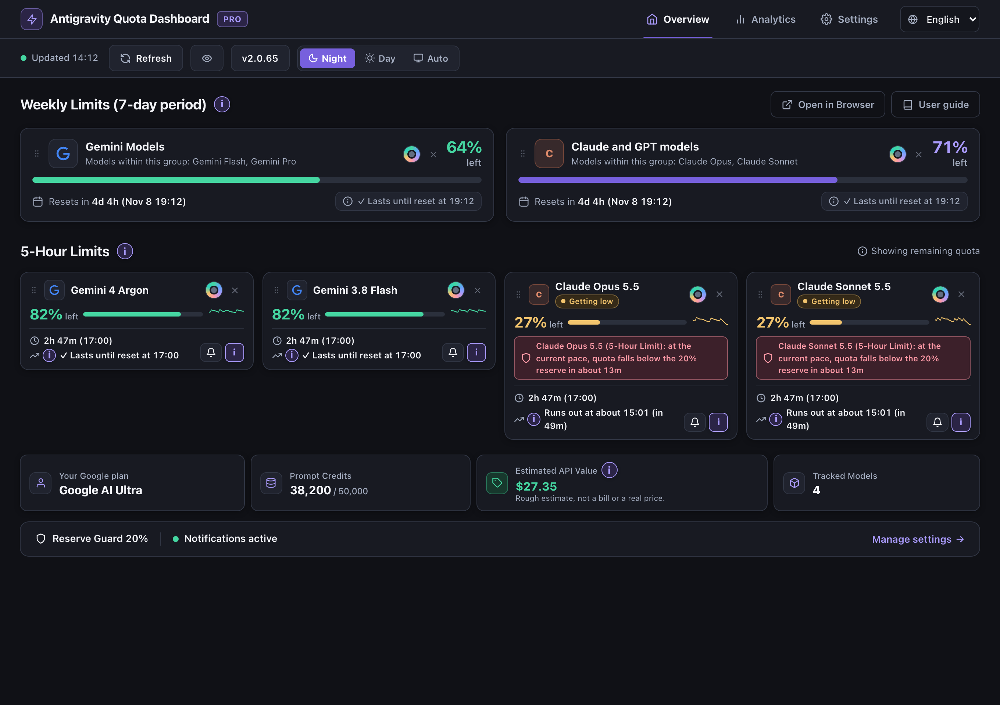
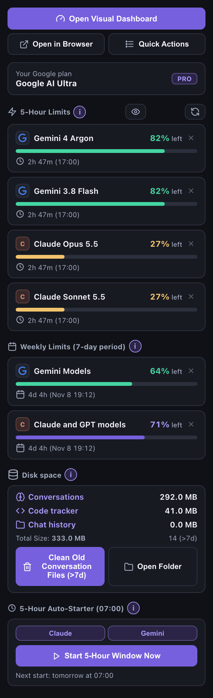
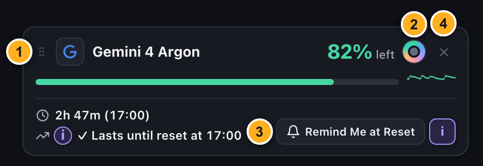
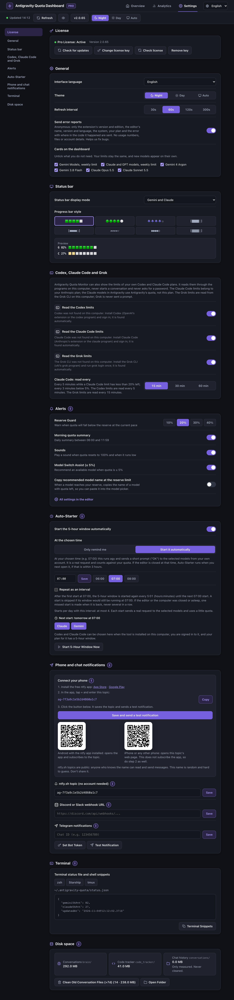

# Antigravity Quota Monitor: uživatelská příručka

*Verze 2.0.66*

**Jazyk:** [🇬🇧 English](https://github.com/Nordicstocks/antigravity-quota-monitor/blob/main/USER-GUIDE.md) · [🇪🇪 Eesti keel](https://github.com/Nordicstocks/antigravity-quota-monitor/blob/main/USER-GUIDE.et.md) · [🇩🇪 Deutsch](https://github.com/Nordicstocks/antigravity-quota-monitor/blob/main/USER-GUIDE.de.md) · [🇫🇮 Suomi](https://github.com/Nordicstocks/antigravity-quota-monitor/blob/main/USER-GUIDE.fi.md) · [🇪🇸 Español](https://github.com/Nordicstocks/antigravity-quota-monitor/blob/main/USER-GUIDE.es.md) · [🇫🇷 Français](https://github.com/Nordicstocks/antigravity-quota-monitor/blob/main/USER-GUIDE.fr.md) · [🇮🇹 Italiano](https://github.com/Nordicstocks/antigravity-quota-monitor/blob/main/USER-GUIDE.it.md) · [🇵🇱 Polski](https://github.com/Nordicstocks/antigravity-quota-monitor/blob/main/USER-GUIDE.pl.md) · [🇳🇱 Nederlands](https://github.com/Nordicstocks/antigravity-quota-monitor/blob/main/USER-GUIDE.nl.md) · [🇸🇪 Svenska](https://github.com/Nordicstocks/antigravity-quota-monitor/blob/main/USER-GUIDE.sv.md) · [🇵🇹 Português (Portugal)](https://github.com/Nordicstocks/antigravity-quota-monitor/blob/main/USER-GUIDE.pt-PT.md) · [🇧🇷 Português (Brasil)](https://github.com/Nordicstocks/antigravity-quota-monitor/blob/main/USER-GUIDE.pt-BR.md) · [🇧🇬 Български](https://github.com/Nordicstocks/antigravity-quota-monitor/blob/main/USER-GUIDE.bg.md) · [🇭🇷 Hrvatski](https://github.com/Nordicstocks/antigravity-quota-monitor/blob/main/USER-GUIDE.hr.md) · 🇨🇿 Čeština · [🇩🇰 Dansk](https://github.com/Nordicstocks/antigravity-quota-monitor/blob/main/USER-GUIDE.da.md) · [🇬🇷 Ελληνικά](https://github.com/Nordicstocks/antigravity-quota-monitor/blob/main/USER-GUIDE.el.md) · [🇭🇺 Magyar](https://github.com/Nordicstocks/antigravity-quota-monitor/blob/main/USER-GUIDE.hu.md) · [🇮🇪 Gaeilge](https://github.com/Nordicstocks/antigravity-quota-monitor/blob/main/USER-GUIDE.ga.md) · [🇱🇻 Latviešu](https://github.com/Nordicstocks/antigravity-quota-monitor/blob/main/USER-GUIDE.lv.md) · [🇱🇹 Lietuvių](https://github.com/Nordicstocks/antigravity-quota-monitor/blob/main/USER-GUIDE.lt.md) · [🇱🇺 Lëtzebuergesch](https://github.com/Nordicstocks/antigravity-quota-monitor/blob/main/USER-GUIDE.lb.md) · [🇲🇹 Malti](https://github.com/Nordicstocks/antigravity-quota-monitor/blob/main/USER-GUIDE.mt.md) · [🇷🇴 Română](https://github.com/Nordicstocks/antigravity-quota-monitor/blob/main/USER-GUIDE.ro.md) · [🇸🇰 Slovenčina](https://github.com/Nordicstocks/antigravity-quota-monitor/blob/main/USER-GUIDE.sk.md) · [🇸🇮 Slovenščina](https://github.com/Nordicstocks/antigravity-quota-monitor/blob/main/USER-GUIDE.sl.md) · [🇺🇦 Українська](https://github.com/Nordicstocks/antigravity-quota-monitor/blob/main/USER-GUIDE.uk.md) · [🇿🇦 Afrikaans](https://github.com/Nordicstocks/antigravity-quota-monitor/blob/main/USER-GUIDE.af.md) · [🇯🇵 日本語](https://github.com/Nordicstocks/antigravity-quota-monitor/blob/main/USER-GUIDE.ja.md) · [🇨🇳 简体中文](https://github.com/Nordicstocks/antigravity-quota-monitor/blob/main/USER-GUIDE.zh-CN.md) · [🇹🇼 繁體中文](https://github.com/Nordicstocks/antigravity-quota-monitor/blob/main/USER-GUIDE.zh-TW.md) · [🇰🇷 한국어](https://github.com/Nordicstocks/antigravity-quota-monitor/blob/main/USER-GUIDE.ko.md) · [🇻🇳 Tiếng Việt](https://github.com/Nordicstocks/antigravity-quota-monitor/blob/main/USER-GUIDE.vi.md) · [🇮🇩 Bahasa Indonesia](https://github.com/Nordicstocks/antigravity-quota-monitor/blob/main/USER-GUIDE.id.md) · [🇮🇳 हिन्दी](https://github.com/Nordicstocks/antigravity-quota-monitor/blob/main/USER-GUIDE.hi.md) · [🇰🇪 Kiswahili](https://github.com/Nordicstocks/antigravity-quota-monitor/blob/main/USER-GUIDE.sw.md) · [🇸🇦 العربية](https://github.com/Nordicstocks/antigravity-quota-monitor/blob/main/USER-GUIDE.ar.md)

---

## 1. Začínáme: kde co najdete

Po instalaci rozšíření ho najdete na dvou místech:
1. **📌 Ikona na Activity Bar:** Kliknutím na ikonu měřidla na Activity Bar otevřete boční panel **Antigravity Cockpit**.
2. **📊 Ukazatel ve stavovém řádku vpravo dole:** V plánu Free vypadá takto: `G: 87% 🟩🟩🟩🟩⬜ | C: 97% 🟩🟩🟩🟩🟩`. G znamená modely Gemini a C modely Claude. Plán Pro navíc ukazuje čas zbývající do obnovení limitu a hodinu obnovení, například `↻3h 52m (19:52)`. Najedete-li na ukazatel myší, zobrazí se podrobnosti (viz část 2).

### Co je v záhlaví a nahoře na kartě Přehled:
- **Karty:** **Přehled**, **Analýza** a **Nastavení**. Karty neopakují název stránky; ten je jen v záhlaví.
- **Čas poslední aktualizace a `Aktualizovat`:** čas ukazuje, kdy se data naposledy obnovila; tlačítko stáhne nejnovější data hned.
- **Tlačítko s okem:** zobrazí seznam všech karet; viditelné jsou zaškrtnuté. Zrušením zaškrtnutí kartu skryjete, zaškrtnutím ji vrátíte; změnu potvrdíte klávesou **Enter** nebo tlačítkem **OK**. Klávesa **Esc** zavře seznam bez uložení. Číslo na tlačítku ukazuje, kolik karet je skrytých. Boční panel má stejné tlačítko vedle tlačítka aktualizace.
- **Tlačítko verze (`v2.0.66`):** zjistí, jestli je k dispozici novější verze. Pokud ano, tlačítko zobrazí **`Aktualizovat na verzi …`**. Klikněte na něj a poté znovu načtěte okno editoru.
- **Vybrat jazyk:** rozbalovací nabídka je vpravo nahoře na každé kartě. První možnost, **Automaticky**, zároveň ukazuje jazyk, který se právě používá. Řídí se jazykem editoru, nebo jazykem systému, pokud je editor nastavený na angličtinu. Pod ní je 37 jazyků, každý zapsaný ve svém vlastním jazyce. Volba se projeví okamžitě a mění jazyk jen tohoto rozšíření. Když je seznam otevřený, stisknutím písmene skočíte na první jazyk, který jím začíná. Stejné nastavení je v části **Obecné** na kartě Nastavení.
- **`Noc / Den / Automaticky`:** přepíná mezi tmavým motivem, světlým motivem a motivem editoru.
- **Vedle prvního nadpisu na kartě Přehled:** **`Otevřít v prohlížeči`** (Pro, součást 7denní zkušební verze) otevře řídicí panel ve vašem výchozím webovém prohlížeči, například pro zobrazení na druhém monitoru, a **`Uživatelská příručka`** otevře tuto příručku. V plánu Free tam najdete také **`Koupit Pro`** a **`Mám klíč`**.
- **Co je na prvním místě:** karty limitů (nejdřív týdenní, potom 5hodinový). Pod nimi je váš plán Google, kredity na dotazy, odhadovaná hodnota API a počet modelů.
- **Větší okno ukáže víc:** vedle sebe se vejde víc karet. Nastavení má víc sloupců, když je okno široké asi 1 500 pixelů. Na kartě Přehled se podrobnosti o plánu Google přesunou do sloupce vpravo při šířce asi 1 700 pixelů a Analýza se objeví vedle limitů při šířce asi 2 400 pixelů.

---

## 2. Vyskakovací okno stavového řádku

Když najedete myší na ukazatel ve stavovém řádku, otevře se vyskakovací okno s těmito částmi:
- **Stav licence:** za odkazy okno červeně uvádí **Pro je aktivní**, pokud máte placený klíč, a během zkušební doby `ZKUŠEBNÍ OBDOBÍ · 5 d.` (zbývající dny). V plánu Free vyskakovací okno stav licence neukazuje.
- **Odkazy nahoře:** **Přehled**, **Otevřít v prohlížeči**, **Nastavení** (otevře kartu Nastavení) a **Rychlé akce** (otevře nabídku). V plánu Free je tam také odkaz ke koupi.
- **Účet a kredity na dotazy na jednom řádku:** ukazuje váš plán Google (`Google AI Pro`), e-mail a kredity na dotazy (`500 / 50 000`).
- **Týdenní limity a 5hodinové limity:** každý model má jeden řádek s ukazatelem se čtyřmi bloky, časem obnovení a předpovědí vyčerpání. Čas obnovení a předpověď jsou funkce Pro; v plánu Free je v těchto dvou sloupcích zámek.

**Samostatné upozornění na týdenní limit ve stavovém řádku:** Když z týdenní kvóty zbývá málo u modelů Gemini nebo u modelů Claude, objeví se vedle ukazatele ve stavovém řádku samostatná položka, například `G 7d 15%`. Ve výchozím nastavení má ikonu varování, když zbývá 30 % týdenní kvóty nebo méně, oranžové pozadí při 22 % nebo méně a červené pozadí při 15 % nebo méně. Prahy 30 % a 15 % můžete změnit v nastavení editoru (viz **Upozornění** v části 4); oranžový stupeň leží uprostřed mezi nimi. Kliknutí otevře řídicí panel. Dokud zbývá dost týdenní kvóty, položka se nezobrazuje.

---

## 3. Karty modelů: přetažení (`⋮⋮`), paleta barev (`🎨`), připomenutí obnovení (`🔔`) a skrytí (`✕`)

Změna pořadí karet, výběr jejich barev i skrývání patří do plánu Free a vaše volby se ukládají automaticky. Tlačítko **Připomenout obnovení** na kartě je funkce Pro: nastaví připomenutí na čas obnovení limitu daného modelu. Základní upozornění v editoru na obnovení kvóty na 100 % dostávají uživatelé všech plánů.
- **① ⋮⋮ Přetažení karty na jiné místo:** Uchopte kteroukoli kartu za úchyt **`⋮⋮`** vlevo nahoře a přetáhněte ji, kam chcete.
- **② 🎨 Paleta barev karty:** Kliknutím na tlačítko palety **`🎨`** v záhlaví kterékoli karty vyberete barvu (**Výchozí**, **Mátová**, **Blankytná**, **Levandulová**, **Broskvová**, **Růžová**, **Modrozelená**).
- **③ 🔔 Připomenutí obnovení:** Klikněte na **`🔔 Připomenout obnovení`** dole na kterékoli kartě modelu. Až se limit daného modelu obnoví, dostanete oznámení v editoru, zvuk (ve Windows a macOS) a, pokud to máte nastavené, i oznámení do telefonu. Editor musí být otevřený.
- **④ ✕ Skrytí karty:** Kliknutím na křížek v pravém horním rohu karty ji odeberete z řídicího panelu, bočního panelu, vyskakovacího okna stavového řádku i ze stavového řádku. Vaše volba se uloží. Vrátíte ji tlačítkem s okem vedle **`Aktualizovat`**, plusem v řádku **Skryté:** pod kartami nebo v **Nastavení → Obecné → Karty v přehledu**. Skrytí karty nemění vaše limity. Nové modely se dál objevují automaticky. Upozornění na limit přestanete dostávat, jen když jsou skryté všechny modely, které ho sdílejí.

---

## 4. Nastavení: Licence, Obecné, Stavový řádek, Upozornění, Auto-Starter, Oznámení do telefonu a chatu, Terminál, Místo na disku

Otevřete kartu **Nastavení** (také z vyskakovacího okna stavového řádku, z nabídky nebo příkazem `Antigravity Quota: Otevřít kartu nastavení`). Všechny části jsou na jedné stránce a žádná není sbalená. Jsou v jednom sloupci, nebo ve více sloupcích, když je okno široké. Odkazy vlevo vedou na jednotlivé části; v úzkém okně tvoří řádek nahoře. Pořadí je **Licence, Obecné, Stavový řádek, Upozornění, Auto-Starter, Oznámení do telefonu a chatu, Terminál, Místo na disku**. Části **Upozornění**, **Auto-Starter**, **Oznámení do telefonu a chatu** a **Terminál** jsou funkce Pro (součást zkušební verze) a mají štítek Pro. V plánu Free se po kliknutí na jejich ovládací prvky otevře dialog nákupu. V plánu Free fungují základní upozornění v editoru i bez těchto nastavení: dostanete zprávu, když kvóta klesne na 10 % nebo na 5 % a když se vrátí na 100 %.

- **Licence:** S aktivní licencí tato část ukazuje jeden řádek se stavem a tlačítky **`Změnit licenční klíč`**, **`Ověřit licenci`** a **`Odebrat klíč`**. V plánu Free a během zkušební doby ukazuje pole pro klíč s tlačítkem a odkaz ke koupi.
- **Obecné:** jazyk rozhraní (stejná volba jako v záhlaví), motiv, interval aktualizace, **Odesílat hlášení o chybách** a **Karty v přehledu**.
- **Odesílat hlášení o chybách (ve výchozím nastavení zapnuto):** Pokud v rozšíření dojde k neočekávané chybě, odešle se anonymní hlášení na `oeqbchgyoderqxnzcubh.supabase.co`: verze a edice rozšíření, název, verze a jazyk editoru, operační systém a typ procesoru, váš plán v tomto rozšíření (Free, zkušební verze nebo Pro) a chybová zpráva s místem v kódu, kde k chybě došlo. Nikdy se neodesílají údaje o využití, soubory, podrobnosti o účtu ani licenční klíč. Pokud máte v editoru vypnutou telemetrii, nic se neodesílá. Nic se neodesílá ani tehdy, když tuto možnost vypnete zde nebo nastavením `antigravityQuota.sendErrorReports`. Ostatní síťová připojení (kontrola aktualizací, licence, oznámení a Auto-Starter) jsou uvedena v části Ochrana soukromí na stránce rozšíření v obchodě.
- **Stavový řádek:** režim zobrazení (*Gemini a Claude*, *Nejméně zbývající kvóty*, *Gemini*, *Claude*) a 8 stylů ukazatele průběhu s náhledem.
- **Upozornění:** Reserve Guard, ranní souhrn, zvuky (ve Windows a macOS), Asistent přepínání modelů a kopírování názvu doporučeného modelu. **`Všechna nastavení editoru`** otevře vlastní nastavení editoru, vyfiltrované na toto rozšíření. Najdete tam méně často používané možnosti, například prahy upozornění. Samotný odkaz nic nemění.

Když několik modelů sdílí jeden limit, dostanete jedno oznámení v editoru a jedno oznámení do telefonu pro celou skupinu, ne jedno pro každý model. V nadpisu oznámení je uvedena skupina, například **Modely Gemini (5hodinový limit)**.

- **Auto-Starter — `Ve zvolený čas`: `Pouze připomenout` nebo `Spustit automaticky`.** S volbou `Pouze připomenout` (výchozí pro nové uživatele) dostanete ve zvolený čas, například v `07:00`, oznámení: pošlete v Antigravity libovolný dotaz a 5hodinové okno začne. Rozšíření nespouští žádný příkaz a žádný dotaz za vás neposílá, takže se kvóta nečerpá. Pokud je editor v tu dobu zavřený, připomenutí přijde, až ho znovu otevřete, pokud to bude do 3 hodin. Následující body o Auto-Starteru se týkají volby `Spustit automaticky`.
- **Auto-Starter — `Automaticky spouštět 5hodinové okno`:** Ve výchozím stavu vypnuto. 5hodinové okno začíná prvním dotazem, ne v pevně stanovený čas. Když je toto nastavení zapnuté, rozšíření ve vámi zvolený čas spustí `agy` a z vašeho vlastního účtu pošle vybraným modelům krátký dotaz (`OK`). Je to skutečný požadavek. Pokud 5hodinové okno začne v `07:00`, limit se obnoví zhruba ve `12:00`.
  - **Poprvé se zeptá na váš souhlas.** Zpráva, kterou modelům posílá, čerpá vaši kvótu. Oddíl 6 dokumentu [Dodatečné podmínky služby Google Antigravity](https://antigravity.google/terms) zakazuje používat službu ve spojení s produkty, které neposkytuje Google. Uvádí, že používání softwaru třetí strany k přístupu ke službě je porušením, které může vést k pozastavení nebo ukončení vašich účtů Antigravity a/nebo Gemini CLI. Rozhodnutí je na vás.
  - **Pokud byl editor v `07:00` zavřený:** Auto-Starter se spustí, až editor otevřete, pokud od vámi zvoleného času neuplynuly víc než 3 hodiny. Když tyto 3 hodiny uplynou, počká do dalšího dne.
  - **Pokud spuštění selže:** rozšíření to oznámí a po 30 minutách to zkusí znovu, nejvýše 3krát za den a jen během týchž 3 hodin po vámi zvoleném čase. Dotaz se znovu pošle jen modelům, u kterých selhal. Pokud není nainstalováno `agy`, rozšíření to ten den už nezkouší znovu.
  - **Vždy uvidíte, jak spuštění dopadlo:** pokud `agy` chybí nebo selže, zobrazí se chyba. Oznámení do telefonu, že 5hodinové okno začalo, se pošle až po úspěšném spuštění. Pokud je otevřeno víc oken editoru, dotaz pošle jen jedno z nich.
- **`Spustit 5hodinové okno teď`:** Pošle stejný dotaz okamžitě. Také poprvé se zeptá na váš souhlas.
- **Auto-Starter — `Opakovat v intervalu` (2.0.64, ve výchozím stavu vypnuto):** po prvním spuštění ve zvolený čas se 5hodinové okno spouští znovu v intervalu `5:01` (5 hodin a 1 minuta, doporučeno) nebo v intervalu, který zadáte ve formátu `H:MM` v rozmezí `1:00` až `24:00`, a to až do spuštění následujícího dne ve zvolený čas. Spuštění se vynechá, pokud by jím zahájené okno ještě běželo ve zvolený čas následujícího dne, takže při `5:01` proběhnou nejvýše 4 spuštění za den. Každé spuštění je skutečný požadavek a čerpá trochu kvóty. Karta ukazuje počet spuštění za den a čas příštího plánovaného spuštění.
- **Auto-Starter — která 5hodinová okna se spouštějí (2.0.64):** každý model a nástroj vybíráte zvlášť: **Claude** a **Gemini** (přes `agy`, z vašeho účtu Antigravity) a dále **Codex** a **Claude Code**, pokud jsou na tomto počítači nainstalované, jste v nich přihlášeni a váš plán má 5hodinové okno. Pro Codex rozšíření spouští `codex exec` (v režimu jen pro čtení, v dočasné složce), pro Claude Code `claude -p` (s vypnutými vestavěnými nástroji). Codex i Claude Code pošlou po jednom krátkém požadavku (`OK`) z vašeho vlastního účtu ChatGPT, resp. Anthropic; požadavek spustí 5hodinové okno daného plánu a vyčerpá malou část jeho kvóty.
  - **Souhlas pro každý účet:** Codex i Claude Code vás před svým prvním požadavkem každý zvlášť požádají o souhlas, protože se jejich požadavky odesílají z vašeho účtu ChatGPT nebo Anthropic, a ne z vašeho účtu Antigravity. Souhlas udělený před verzí 2.0.64 platí jen pro Claude a Gemini. Zrušením výběru nástroje odvoláte svůj souhlas s jeho použitím; když ho opět vyberete, rozšíření vás o souhlas požádá znovu. Pokud zrušíte výběr Claude i Gemini, stejným způsobem se odvolá souhlas pro `agy`.
- **Oznámení do telefonu a chatu — `Připojit telefon` (ntfy, účet není potřeba):**
  1. Nainstalujte bezplatnou aplikaci **ntfy** (App Store / Google Play).
  2. V aplikaci klepněte na **`+`** a zadejte téma, které se ukazuje na řídicím panelu (je u něj tlačítko **Kopírovat**). Témata na ntfy.sh jsou veřejná: kdokoli, kdo zná název, může číst i posílat zprávy. Proto je nabízené téma dlouhé a náhodné. Nesdílejte ho.
  3. Vraťte se do rozšíření a klikněte na **`Uložit a odeslat testovací oznámení`**. Výsledek se zobrazí v editoru.
  - **QR kódy:** QR kód pro Android otevře nainstalovanou aplikaci ntfy a přidá v ní odběr tématu. Druhý QR kód otevře webovou stránku tématu, která aplikaci k odběru nepřihlásí, takže na iPhonu proveďte krok 2 ručně.
- **Discord/Slack Webhook & Telegram:** Zadejte adresu URL webhooku a klikněte na **`Uložit`**. U Telegramu zadejte Chat ID, klikněte na **`Uložit`**, potom klikněte na **`Nastavit token bota`** a vložte token do vstupního pole nahoře v okně.
- **`Odeslat testovací oznámení`:** Kliknutím pošlete testovací oznámení do každého kanálu, který jste nastavili, ve vámi zvoleném jazyce.
- **Stavový soubor a ukázky pro terminál:** Kliknutím na **`zsh`**, **`Starship`** nebo **`tmux`** otevřete ukázky, zkopírujte ukázku pro nástroj, který používáte, a vložte ji do souboru uvedeného v této ukázce (stavový soubor: `~/.antigravity-quota/status.json`).
- **Místo na disku:** Ukazuje místo na disku, které zabírají **Konverzace** (složka `~/.gemini/antigravity/brain`; složka `conversations` vedle ní se nemění) a **Sledování kódu** (`code_tracker`). **`🧹 Uklidit staré konverzace (>7 dní)`** prochází jen složku `brain`: vypíše složky, v nichž se za posledních 7 dní nezměnil žádný soubor, a před potvrzením ukáže počet složek, počet souborů a velikost. V těchto složkách mohou být obrázky, plány a protokoly ze starých konverzací. Po potvrzení se přesunou do koše systému (ve Windows do Koše) a můžete je obnovit, dokud koš nevysypete. Pokud se to nepodaří, zůstanou na místě a rozšíření vám to oznámí. Složku `code_tracker` rozšíření jen měří, nikdy ji neuklízí.

### Codex, Claude Code a Grok (2.0.64)

Pokud máte v počítači nainstalovaný Codex, Claude Code nebo Grok CLI, limity vašeho vlastního plánu pro daný nástroj se zobrazují odděleně od limitů Antigravity: na samostatných kartách pod kartami Antigravity v řídicím panelu, v samostatném bloku v bočním panelu a jako samostatná položka ve stavovém řádku. Limity každého nástroje se načítají pomocí jeho vlastního programu (`codex app-server`, `claude -p /usage`, Grok CLI): nezahajuje se žádná konverzace, nic se neposílá žádnému modelu a nevyžaduje se žádné heslo. Nástroj, který není nainstalovaný, se nezobrazuje. Procento využití limitu uvidíte i bez Pro; čas obnovení, předpověď vyčerpání a připomenutí obnovení jsou funkce Pro. Zde zobrazené limity Claude Code jsou limity vašeho vlastního plánu Anthropic; modely Claude v Antigravity dál čerpají kvótu Antigravity. Grok ve svém plánu Free neuvádí procento využití, proto jeho karta nemá ukazatel.

**Nastavení → Codex, Claude Code a Grok:** přepínač pro každý nástroj (když je vypnutý, jeho program se nespouští) a interval načítání limitů Claude Code.

### Rychlé akce (nabídka)

Odkaz **Rychlé akce** ve vyskakovacím okně stavového řádku, tlačítko **Rychlé akce** v bočním panelu i příkaz `Antigravity Quota: Rychlé akce` otevřou tutéž nabídku: řídicí panel, prohlížeč, aktualizace, připomenutí, zpráva, testovací oznámení, historie využití (umí uložit CSV nebo JSON), **Vzhled, jazyk a stavový řádek**, uživatelská příručka a licence. Tato nabídka obsahuje jen akce. Čísla své kvóty uvidíte ve stavovém řádku, v jeho vyskakovacím okně nebo na řídicím panelu. **Zpět — zrušit výběr** vás vrátí o úroveň výš a poslední řádek podnabídky **Vzhled, jazyk a stavový řádek** otevře kartu **Nastavení**.

Kterýkoli seznam, dialog nebo informační okno rozšíření zavřete kliknutím na **X** v rohu nebo klávesou **Esc**.

### Týdenní zpráva a historie využití (Pro)

Otevřete **Týdenní zpráva** nebo **Historie využití** z **Rychlých akcí** (viz výše). **Týdenní zpráva** je také na kartě Analýza. V obou případech se otevře stránka se dvěma kartami:

- **Týdenní zpráva** ukazuje posledních 7 dní: kolikrát jste dosáhli limitu, co se vyčerpá jako další, nejvytíženější dobu, nejpoužívanější model a projekt, aktuální stav vašich limitů, graf využití kvóty podle dne a hodiny (teplotní mapu) a odhadované využití podle projektů.
- **Historie využití** ukazuje, kolik kvóty zbývalo během posledních 7, 30 nebo 90 dní, pro 5hodinový i týdenní limit. Každé obnovení označuje tenká svislá čára. Zobrazení 5hodinového limitu za 30 a 90 dní takové čáry nemá; tam každý bod ukazuje nejnižší úroveň daného dne.

Modely, které sdílejí jeden limit, sdílejí jeden graf. Tlačítka **Uložit přehled (HTML)** a **Uložit přehled (Markdown)** na kartě Týdenní zpráva a tlačítka **Exportovat CSV** a **Exportovat JSON** na kartě Historie využití se zeptají, kam soubor uložit, a potom nabídnou jeho otevření.

## 5. 🎁 7denní zkušební verze Pro a aktivace licence

Při první instalaci rozšíření dostanete **všechny funkce Pro na 7 dní**, bez platební karty a bez registrace. Potom vám zůstanou funkce Free: ukazatel ve stavovém řádku, řídicí panel a boční panel, pořadí a barvy karet, 8 stylů ukazatele průběhu, 37 jazyků, automatická upozornění v editoru, když je kvóta nízká nebo když se obnoví na 100 %, a 24 hodin historie (delší Historie využití je funkce Pro).

1. **Vyberte plán:**
   - **[💎 Doživotní Pro — jednorázová platba 9,99 €](https://buy.polar.sh/polar_cl_aUt37UmhWCxHCB9s7dFpmvoT5KNrFqzVWx64q073KIJ)**
   - **[Pro měsíčně — 2,99 € měsíčně, zrušení kdykoli](https://buy.polar.sh/polar_cl_LjI4JhW7qEbGDJyCyQslb5pSeHyETQ2Dfiuqb0tNkI5)**
2. **Najděte svůj klíč:** Klíč je v e-mailu o nákupu nebo na potvrzovací stránce služby Polar, našeho poskytovatele plateb.
3. **Aktivujte:** Vložte klíč `PRO-XXXX-...` do části **Licence** v Nastavení a klikněte na **`Aktivovat`**. Můžete také kliknout na tlačítko **`Mám klíč`** na pruhu zkušební verze, na kartě Přehled a v bočním panelu. Po aktivaci pruh zkušební verze okamžitě zmizí a odznak ukazuje **Pro**. Okno není třeba znovu načítat.
4. **Po nákupu:** Pokud jste klikli na tlačítko nákupu a do editoru se vrátíte do 30 minut, rozšíření jednou zkontroluje, zda schránka obsahuje licenční klíč, a před aktivací se zeptá. V jiné době schránku nečte a text ze schránky neukládá.
5. **Kontrola nebo odebrání klíče:** Nastavení → Licence → **`Ověřit licenci`** okamžitě ověří vaši licenci u služby Polar. **`Odebrat klíč`** (nebo příkaz `Antigravity Quota: Odebrat licenční klíč Pro`) klíč odebere. Po vašem potvrzení se klíč z tohoto počítače smaže, včetně souboru `~/.antigravity-quota/license.key`. Pokud se rozšíření dokáže spojit se službou Polar, uvolní se i aktivace tohoto počítače, takže klíč lze použít na jiném počítači. Váš nákup zůstává platný. Odebráním klíče se měsíční předplatné neruší. Předplatné trvá, dokud ho u služby Polar nezrušíte.
