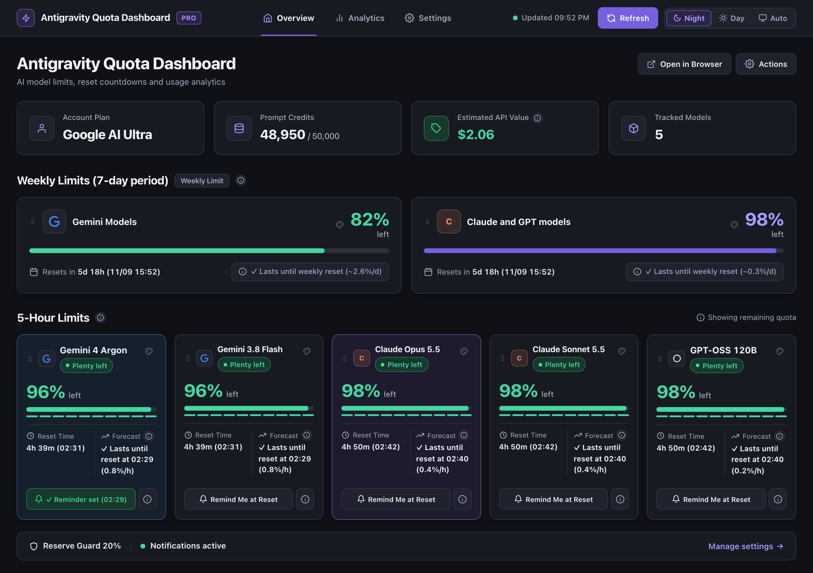
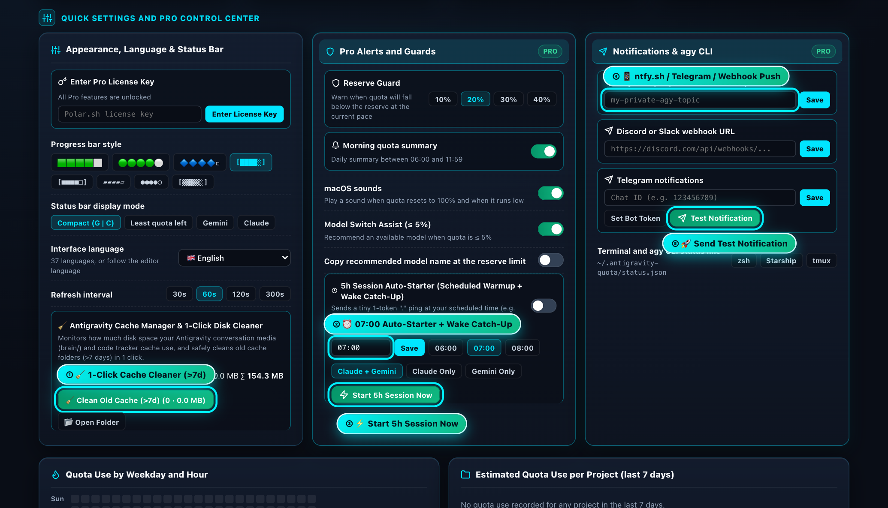

# 📖 Antigravity Quota Monitor: visuaalne kasutusjuhend

*Versioon 2.0.50*

**Keel:** [English](https://github.com/Nordicstocks/antigravity-quota-monitor/blob/main/USER-GUIDE.md) · Eesti · [Deutsch](https://github.com/Nordicstocks/antigravity-quota-monitor/blob/main/USER-GUIDE.de.md) · [简体中文](https://github.com/Nordicstocks/antigravity-quota-monitor/blob/main/USER-GUIDE.zh-CN.md) · [日本語](https://github.com/Nordicstocks/antigravity-quota-monitor/blob/main/USER-GUIDE.ja.md) · [Español](https://github.com/Nordicstocks/antigravity-quota-monitor/blob/main/USER-GUIDE.es.md)

---

## 1. Kiirstart — Kust leida Päise Nupud, Külgpaneel (`Activity Bar`), Brauserivaade ja Litsentsivõtme Lahter?

Pärast laienduse paigaldamist on sul **2 püsivat ja kohe nähtavat kohta**, kust oma AI kvoote ja tööriistu juhtida:
1. **📌 Vasakul suurel külgribal (`Activity Bar`):** Seal, kus asuvad Explorer, Search, Git ja Extensions, on püsiv **Antigravity Cockpit spidomeetri ikoon**. Klikkides sellele avaneb külgpaneel (*Mission Control*), kust näed reaalajas kõiki 5h ja 7 päeva limiite, saad 1 klikiga avada täis-Dashboardi või veebibrauseri vaate, käivitada 5h sessiooni ning puhastada vanad vestlusfailid!
2. **📊 All paremal olekuribal (`Status Bar`):** Reaalajas kvoodimõõdik `📊 G: 87% 🟩🟩🟩🟩⬜ ↻3h 52m (19:52) | C: 97% 🟩🟩🟩🟩🟩`.

### Mis on päises ja Ülevaate ülaosas:
- **Vahekaardid:** **Ülevaade**, **Analüütika** ja **Sätted**. Pealkiri on ainult päises.
- **Uuendamise kell ja `Värskenda`:** näitab viimast värskendust; nupp küsib andmed kohe.
- **Keel:** rippmenüü on päises igal vahekaardil. Esimene valik on **Automaatne (redaktori keel, ingliskeelse redaktori puhul süsteemi keel)**, seejärel 37 keelt nende endi nimedega. Valik rakendub kohe ja muudab ainult selle laienduse keelt. Tähe tippimine viib õige keeleni. Sama säte on Sätete osas **Üldine**.
- **`Öö / Päev / Automaatne`:** vahetab tumeda, heleda või redaktoriga sama teema.
- **Ülevaate esimese pealkirja kõrval:** **`Ava brauseris`** avab ülevaate sinu tavalises veebibrauseris, näiteks teisel ekraanil (Pro, kuulub ka 7 päeva prooviaega), ja **`Kasutusjuhend`** avab selle juhendi. Tasuta versioonis on seal ka **`Osta Pro`** ja **`Mul on võti`**.
- **Mis on kus:** limiidikaardid on kõige ees (nädal, siis 5 tundi). Pakett, kvoodikrediit, hinnanguline API väärtus ja mudelite arv on nende all.

---

## 2. Alumise Olekuriba Hüpikaken (`Status Bar Hover Tooltip`)

Kui liigutad hiire all paremal olekuribal kvoodimõõdiku (`G: 26% | C: 100%`) peale, avaneb **lai ja kompaktne kiirülevaate aken, kus igal asjal on oma rida**:
- **Nädalalimiidi hoiatus olekuribal:** kui mudelipere nädalalimiit on madal, tuleb peamise näidu kõrvale eraldi näit, näiteks `G 7p 15%`: hoiatusikooniga kuni 30%, oranž kuni 22%, punane kuni 15% (piirid tulevad sätetest). Klikk avab ülevaate. Kui limiiti jätkub, seda näitu pole.
- **Litsentsi seis:** linkide järel on makstud võtmega punaselt **PRO on aktiivne**, prooviajal prooviaja märk. Tasuta versioonis pole seal midagi lisaks.
- **Ülemine lingirida:** **Graafiline ülevaade**, **Ava brauseris**, **Sätted** (avab vahekaardi Sätted) ja **Kiirtoimingud** (avab menüü). Tasuta versioonis ka ostulink.
- **Konto ja Kvoodikrediit ühel real:** Näed kohe oma paketti (`Google AI Pro`), e-posti ja järelejäänud kvoodikrediiti (`500 / 50 000`).
- **7-päevased nädalalimiidid ja 5 tunni mudelilimiidid:** Iga mudel (*Claude Opus 5.5*, *Claude Sonnet 5.5*, *GPT-OSS 120B*, *Gemini 3.8 Flash*, *Gemini 4 Argon*) on **ühel selgel horisontaalsel real** koos värvilise edenemisriba, uuenemisaja ja ammendumise prognoosiga!

---

## 3. Mudelikaartide Lohistamine (`⋮⋮`), Taustavärvid (`🎨`) ja 1-Kliki Uuenemise Meeldetuletus (`🔔`)

Kõik ülevaate kaardikohandused on **tasuta** ja salvestuvad automaatselt:
- **`① ⋮⋮ Drag & Drop Card Order` (Kaartide ümbertõstmine):** Haara hiirega mis tahes mudelikaardi vasakust ülanurgast **`⋮⋮`** ikoonist ja **lohista kaart täpselt sinna kohta, kuhu soovid**. Sinu lemmikmudelid püsivad alati esimestena!
- **`② 🎨 Card Color Palette` (Mudelikaardi taustavärvi valimine):** Kliki mudelikaardi päises olevale värvipaleti ikoonile **`🎨`**. Avaneb värvitoonide hüpikmenüü (**Vaikimisi**, **Münt / Mint**, **Taevasinine / Sky**, **Lavendel / Lavender**, **Virsik / Peach**, **Roosa / Rose**, **Mereroheline / Teal**). Päevarežiimis on toonid mahedad pastelsed ja Öörežiimis sügavad tumedad klaasitoonid!
- **`③ 🔔 1-Click Reset Reminder` (`Remind Me at Reset` / `Teavita uuenemisel`):** Kliki kaardi all olevale nupule **`🔔 Remind Me at Reset`** — kui selle mudeli uuenemisaeg kätte jõuab, saad helimärguande, teate redaktoris ja kui oled telefoniteavitused seadistanud, siis ka teate telefoni. Redaktor peab selleks avatud olema.
- **`④ ✕ Peida kaart`:** Kliki kaardi paremas ülanurgas ristile ja kaart kaob töölaualt, külgpaneelilt, hüpikaknast ja olekuribalt. Valik jääb meelde. Kaartide all olevas reas **Peidetud:** saad kaardi plussiga tagasi tuua, sama valik on ka **Sätted → Üldine → Kaardid töölaual**. Limiidid sellest ei muutu. Uued mudelid ilmuvad ise. Hoiatus jääb ära siis, kui kõik selle limiidi mudelid on peidetud.

---

## 4. Sätted — Litsents, Keel, Olekuriba, Hoiatused, Automaatne Käivitus, Telefon, Terminal ja Kettaruum

Ava vahekaart **Sätted** (ka olekuriba hüpikust, menüüst või käsuga `Antigravity Quota: Ava sätete vahekaart`). Kõik sätted on ühes tulbas ja kõik osad on avatud. Vasakul on lingid osade juurde, kitsas aknas on need rida üleval. Järjekord on: **Litsents, Üldine, Olekuriba, Hoiatused, Automaatne käivitus, Telefon ja sõnumid, Terminal, Kettaruum**.

### Litsents
- **Aktiivse litsentsiga** on üks rida: seis ja nupud **`Muuda litsentsivõtit`**, **`Kontrolli litsentsi`** ja **`Eemalda võti`**.
- **Tasuta ja prooviajal** on võtme lahter koos nupuga ja ostulink.

### Üldine ja Olekuriba
- **Üldine:** kasutajaliidese keel (sama valik, mis päises), teema ja värskendusintervall.
- **Olekuriba:** näidurežiim (*Gemini ja Claude*, *Kõige vähem kvooti alles*, *Gemini*, *Claude*) ja 8 edenemisriba stiili koos eelvaatega.

### Hoiatused ja Automaatne Käivitus
- **🛡️ Reserve Guard (`10%`, `20%`, `30%`, `40%`):** Hoiatab sind enne, kui kvoot langeb praeguse kasutuskiiruse juures alla sinu valitud varupiiri.
- **Hommikune kokkuvõte, macOS-i helid** (ainult macOS-is), **Mudelivahetuse abi** ja **Kopeeri soovitatud mudeli nimi**: igaühel on oma lüliti.
- **`Kõik sätted redaktoris`:** avab redaktori enda sätted, filtreeritud sellele laiendusele. Seal on ka harvemad sätted, näiteks hoiatuspiirid. Link ise midagi ei muuda.
- **Automaatne käivitus — `Käivita 5 tunni periood automaatselt`:** vaikimisi väljas.
  - Google Antigravity 5 tunni periood algab sinu esimesest sõnumist, mitte kindlal kellaajal. Kui lülitad selle sisse, käivitab laiendus valitud kellaajal käsu `agy` ja saadab sinu enda kontolt valitud mudelitele lühikese päris päringu (`OK`). Kui periood algab kell `07:00`, peaks kvoot järgmisena taastuma umbes kell `12:00`.
  - **Esimesel sisselülitamisel küsib laiendus nõusolekut.** Päring kulutab kvooti. Antigravity kasutustingimuste järgi ei tohi teenust kasutada seoses toodetega, mida Google ei paku. Nende järgi on teenusele juurdepääs kolmanda osapoole tarkvara kaudu lepingu rikkumine, mille eest võidakse konto peatada või sulgeda. Otsustad ise.
  - **Kui arvuti oli kell `07:00` kinni:** päring tehakse redaktori avamisel, kuni 3 tundi hiljem. Hiljem sel päeval enam mitte.
  - **Kui päring ebaõnnestub:** laiendus ütleb selle ja proovib uuesti 30 minuti pärast, kokku kuni 3 katset päevas ja sama 3 tunni jooksul. Uuesti saadetakse ainult mudelitele, kus päring ebaõnnestus.
  - **Tulemus on päris:** kui `agy` puudub või ebaõnnestub, näed veateadet. Telefoniteade „käivitatud“ tuleb ainult pärast õnnestumist. Mitme avatud akna korral saadab päringu ainult üks aken.
- **`Käivita 5 tunni periood kohe`:** saadab sama päringu kohe (samuti pärast nõusolekut).

### Telefon ja Sõnumid (`ntfy.sh`, Telegram, Discord/Slack) ja Terminal

Mudelid, mis jagavad ühte limiiti, annavad ühe teate ja ühe telefoniteate, näiteks **Gemini mudelid (5 tunni limiit)**, mitte iga mudeli kohta eraldi.
- **`④ 📱 Ühenda telefon` (ntfy, kontot pole vaja):**
  1. Paigalda telefoni tasuta äpp **ntfy** (App Store / Google Play).
  2. Vajuta äpis **`+`** ja sisesta ülevaates näidatud teema (seal on nupp **Kopeeri**). Teema on juhuslik ja pikk, sest ntfy.sh teemad on avalikud: hoia see enda teada.
  3. Naase laiendusse ja klõpsa **`Salvesta ja saada testteavitus`**. Tulemus ilmub redaktoris.
  - **QR-koodid:** Androidi kood (kui ntfy äpp on olemas) avab äpi ja tellib teema. Teine kood avab teema veebilehe, kus tellimise nuppu ei ole, nii et iPhone'is tee samm 2 käsitsi.
- **💬 Discord / Slack Webhook & Telegram Bot:** Sisesta oma Webhook URL ja klõpsa **`Salvesta`**. Telegrami jaoks sisesta vestluse ID, klõpsa **`Salvesta`**, seejärel klõpsa **`Määra boti token`** ja kleebi token akna ülaossa avanevasse kasti.
- **`⑤ 🚀 Test Notification`:** Kliki rohelisele nupule **`🚀 Test Notification`**, et saata kohe testteavitus oma telefonile (teavitused saabuvad automaatselt sinu valitud keeles!).
- **💻 Terminali olekufail ja koodilõigud:** Kliki **`zsh`**, **`Starship`** või **`tmux`**, et avada koodilõigud; kopeeri oma kesta oma ja kleebi see faili, mille ta nimetab (olekufail: `~/.antigravity-quota/status.json`).

### Kettaruum
- **Kettakasutus ja vanad vestlusfailid:**
  - Näitab, kui palju kettaruumi võtavad Antigravity **vestlused** (kaust `brain`) ja **koodijälgija** (kaust `code_tracker`).
  - Nupp **`🧹 Puhasta vanad vestlusfailid (>7p)`** vaatab ainult kausta `~/.gemini/antigravity/brain`. Ta loetleb vestluskaustad, kus pole viimase 7 päeva jooksul ükski fail muutunud, ja näitab enne kinnitust kaustade ja failide arvu ning suurust. Neis võib olla vanade vestluste pilte, plaane ja logisid.
  - Pärast sinu kinnitust liiguvad need **süsteemi prügikasti**, kust saad need tagasi tuua. Kui prügikasti viimine ei õnnestu, jäävad kaustad alles ja laiendus ütleb selle sulle. `code_tracker` kausta ainult mõõdetakse.
  - **`📂 Ava kaust`** avab kausta Finderis/Exploreris.

### Kiirtoimingud (menüü)

Olekuriba hüpiku link **Kiirtoimingud**, külgpaneeli nupp ja käsk `Antigravity Quota: Kiirtoimingud` avavad sama menüü: ülevaade, brauser, värskendamine, meeldetuletus, aruanne, kasutusajalugu (sealt saab salvestada CSV- või JSON-faili), testteavitus, **Välimus, keel ja olekuriba**, kasutusjuhend ja litsents. Numbrid on olekuribal, selle hüpikus ja ülevaates. **Tagasi** viib ühe taseme võrra üles ja alammenüü viimane rida avab vahekaardi **Sätted**.

---

### Nädalaaruanne ja kasutusajalugu (Pro)

Ava olekuriba menüüst **Nädalaaruanne** või **Kasutusajalugu**, või Analüütika vaate nupust **Nädalaaruanne**. Avaneb leht kahe vahekaardiga:

- **Nädalaaruanne** näitab viimast 7 päeva: mitu korda kvoot otsa sai, mis saab järgmisena otsa, tipptund, enim kasutatud mudel ja projekt, praegused limiidid, nädalapäeva ja tunni soojuskaart ning hinnanguline kasutus projektide kaupa.
- **Kasutusajalugu** näitab iga limiidi kohta allesolevat kvooti 7, 30 või 90 päeva jooksul, eraldi 5 tunni limiidi ja nädalalimiidi kohta. Peen püstjoon tähistab uuenemist. 30 ja 90 päeva 5 tunni vaates on iga punkt selle päeva madalaim tase.

Mudelid, millel on üks ühine limiit, on ühes graafikus. Nupud **Salvesta aruanne (HTML)**, **Salvesta aruanne (Markdown)**, **Ekspordi CSV** ja **Ekspordi JSON** küsivad, kuhu fail salvestada, ja pakuvad seejärel selle avamist.

## 5. 🎁 7 Päeva TASUTA Pro Prooviaeg ja Litsentsi Aktiveerimine

Iga uus paigaldus saab **7 päeva kõiki Pro-funktsioone** otse laienduses, ilma kaardi ja registreerimiseta. Pärast seda jäävad tasuta osad alles.

1. **Vali plaan:**
   - **[💎 Eluaegne Pro — 9,99 € ühekordne makse](https://buy.polar.sh/polar_cl_xdY0LqtPIfPHfnG9o8Wo5QIIpJRlvhxQOZ6vL4g5jIB)**
   - **[Pro kuutellimus — 2,99 €/kuu, tühista igal ajal](https://buy.polar.sh/polar_cl_avl0NAvpPN4jQD0vZRRg11yZ92BQ2OHCKw29f4dxlPW)**
2. **Aktiveeri:** Kleebi oma `PRO-XXXX-...` võti Sätete ossa **Litsents** ja kliki **`Sisesta litsentsivõti`**. Võid vajutada ka Ülevaate nuppu **`Mul on võti`**.
3. **Võtme kontroll ja eemaldamine:** Sätted → Litsents → **`Kontrolli litsentsi`** küsib seisu Polarilt kohe. **`Eemalda võti`** (või käsk `Antigravity Quota: Eemalda Pro-litsentsivõti`). Pärast kinnitust kaob võti sellest arvutist, ka failist `~/.antigravity-quota/license.key`, ning võimaluse korral vabaneb selle arvuti aktiveering. Ost jääb kehtima. Kuutellimuse tühistad Polaris.
4. **Kust võti tuleb ja kuhu see läheb:** võtme leiad ostu e-kirjast või Polari kinnituslehelt. Nupp **`Mul on võti`** on prooviaja bänneril, Ülevaates ja külgpaneelil; Sätetes on kohe esimesena võtme lahter koos seisuga (Tasuta / prooviaeg). Pärast aktiveerimist kaob prooviaja bänner kohe ja märgiks saab **PRO**, akent pole vaja uuesti laadida.
5. **Pärast ostu:** kui vajutasid ostunuppu ja tuled 30 minuti jooksul redaktorisse tagasi, vaatab laiendus ühe korra, kas lõikelaual on litsentsivõti, ja küsib, kas see aktiveerida. Muul ajal ta lõikelauda ei loe, ja teksti ei salvestata.

Iga aken ja hüpik suletakse **X**-iga üleval paremas nurgas või klahviga **Esc**.
