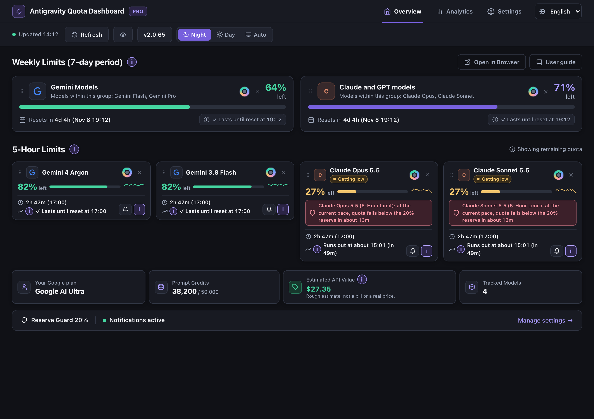
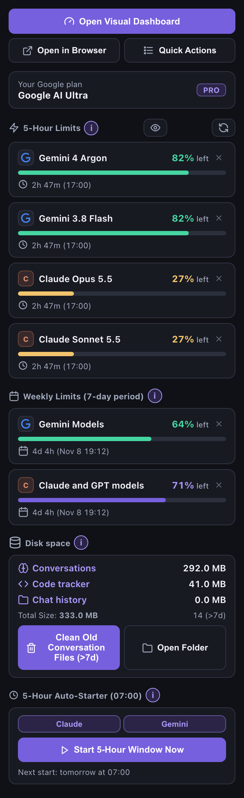
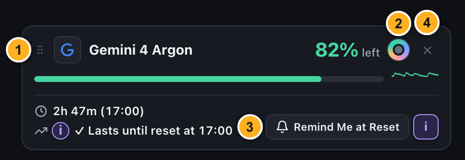
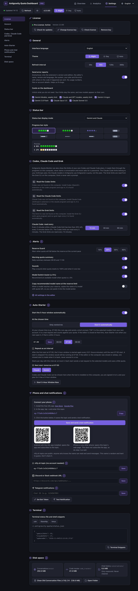

# Antigravity Quota Monitor: उपयोग गाइड

*संस्करण 2.0.65*

**भाषा:** [🇬🇧 English](https://github.com/Nordicstocks/antigravity-quota-monitor/blob/main/USER-GUIDE.md) · [🇪🇪 Eesti keel](https://github.com/Nordicstocks/antigravity-quota-monitor/blob/main/USER-GUIDE.et.md) · [🇩🇪 Deutsch](https://github.com/Nordicstocks/antigravity-quota-monitor/blob/main/USER-GUIDE.de.md) · [🇫🇮 Suomi](https://github.com/Nordicstocks/antigravity-quota-monitor/blob/main/USER-GUIDE.fi.md) · [🇪🇸 Español](https://github.com/Nordicstocks/antigravity-quota-monitor/blob/main/USER-GUIDE.es.md) · [🇫🇷 Français](https://github.com/Nordicstocks/antigravity-quota-monitor/blob/main/USER-GUIDE.fr.md) · [🇮🇹 Italiano](https://github.com/Nordicstocks/antigravity-quota-monitor/blob/main/USER-GUIDE.it.md) · [🇵🇱 Polski](https://github.com/Nordicstocks/antigravity-quota-monitor/blob/main/USER-GUIDE.pl.md) · [🇳🇱 Nederlands](https://github.com/Nordicstocks/antigravity-quota-monitor/blob/main/USER-GUIDE.nl.md) · [🇸🇪 Svenska](https://github.com/Nordicstocks/antigravity-quota-monitor/blob/main/USER-GUIDE.sv.md) · [🇵🇹 Português (Portugal)](https://github.com/Nordicstocks/antigravity-quota-monitor/blob/main/USER-GUIDE.pt-PT.md) · [🇧🇷 Português (Brasil)](https://github.com/Nordicstocks/antigravity-quota-monitor/blob/main/USER-GUIDE.pt-BR.md) · [🇧🇬 Български](https://github.com/Nordicstocks/antigravity-quota-monitor/blob/main/USER-GUIDE.bg.md) · [🇭🇷 Hrvatski](https://github.com/Nordicstocks/antigravity-quota-monitor/blob/main/USER-GUIDE.hr.md) · [🇨🇿 Čeština](https://github.com/Nordicstocks/antigravity-quota-monitor/blob/main/USER-GUIDE.cs.md) · [🇩🇰 Dansk](https://github.com/Nordicstocks/antigravity-quota-monitor/blob/main/USER-GUIDE.da.md) · [🇬🇷 Ελληνικά](https://github.com/Nordicstocks/antigravity-quota-monitor/blob/main/USER-GUIDE.el.md) · [🇭🇺 Magyar](https://github.com/Nordicstocks/antigravity-quota-monitor/blob/main/USER-GUIDE.hu.md) · [🇮🇪 Gaeilge](https://github.com/Nordicstocks/antigravity-quota-monitor/blob/main/USER-GUIDE.ga.md) · [🇱🇻 Latviešu](https://github.com/Nordicstocks/antigravity-quota-monitor/blob/main/USER-GUIDE.lv.md) · [🇱🇹 Lietuvių](https://github.com/Nordicstocks/antigravity-quota-monitor/blob/main/USER-GUIDE.lt.md) · [🇱🇺 Lëtzebuergesch](https://github.com/Nordicstocks/antigravity-quota-monitor/blob/main/USER-GUIDE.lb.md) · [🇲🇹 Malti](https://github.com/Nordicstocks/antigravity-quota-monitor/blob/main/USER-GUIDE.mt.md) · [🇷🇴 Română](https://github.com/Nordicstocks/antigravity-quota-monitor/blob/main/USER-GUIDE.ro.md) · [🇸🇰 Slovenčina](https://github.com/Nordicstocks/antigravity-quota-monitor/blob/main/USER-GUIDE.sk.md) · [🇸🇮 Slovenščina](https://github.com/Nordicstocks/antigravity-quota-monitor/blob/main/USER-GUIDE.sl.md) · [🇺🇦 Українська](https://github.com/Nordicstocks/antigravity-quota-monitor/blob/main/USER-GUIDE.uk.md) · [🇿🇦 Afrikaans](https://github.com/Nordicstocks/antigravity-quota-monitor/blob/main/USER-GUIDE.af.md) · [🇯🇵 日本語](https://github.com/Nordicstocks/antigravity-quota-monitor/blob/main/USER-GUIDE.ja.md) · [🇨🇳 简体中文](https://github.com/Nordicstocks/antigravity-quota-monitor/blob/main/USER-GUIDE.zh-CN.md) · [🇹🇼 繁體中文](https://github.com/Nordicstocks/antigravity-quota-monitor/blob/main/USER-GUIDE.zh-TW.md) · [🇰🇷 한국어](https://github.com/Nordicstocks/antigravity-quota-monitor/blob/main/USER-GUIDE.ko.md) · [🇻🇳 Tiếng Việt](https://github.com/Nordicstocks/antigravity-quota-monitor/blob/main/USER-GUIDE.vi.md) · [🇮🇩 Bahasa Indonesia](https://github.com/Nordicstocks/antigravity-quota-monitor/blob/main/USER-GUIDE.id.md) · 🇮🇳 हिन्दी · [🇰🇪 Kiswahili](https://github.com/Nordicstocks/antigravity-quota-monitor/blob/main/USER-GUIDE.sw.md) · [🇸🇦 العربية](https://github.com/Nordicstocks/antigravity-quota-monitor/blob/main/USER-GUIDE.ar.md)

---

## 1. शुरुआत: हर चीज़ कहाँ मिलेगी

Extension इंस्टॉल होने के बाद यह दो जगह मिलता है:
1. **📌 Activity Bar का आइकन:** Activity Bar में गेज वाले आइकन पर क्लिक करें। **Antigravity Cockpit** साइड पैनल खुल जाएगा।
2. **📊 स्टेटस बार मीटर, नीचे दाईं ओर:** Free प्लान में यह ऐसा दिखता है: `G: 87% 🟩🟩🟩🟩⬜ | C: 97% 🟩🟩🟩🟩🟩`। G का मतलब Gemini मॉडल और C का मतलब Claude मॉडल हैं। Pro में रीसेट तक बचा समय और घड़ी के हिसाब से रीसेट होने का समय भी दिखता है, जैसे `↻3h 52m (19:52)`। ब्योरे के लिए मीटर पर माउस ले जाएँ (भाग 2 देखें)।

### हेडर में और सारांश के ऊपरी हिस्से में क्या है:
- **टैब:** **सारांश**, **विश्लेषण** और **सेटिंग्स**। टैब पेज का शीर्षक नहीं दोहराते; वह सिर्फ़ हेडर में आता है।
- **आख़िरी अपडेट का समय और `रीफ़्रेश करें`:** समय बताता है कि डेटा आख़िरी बार कब ताज़ा हुआ था; बटन तुरंत नवीनतम डेटा लाता है।
- **आँख वाला बटन:** सभी कार्डों की सूची खोलता है, दिखने वाले कार्डों पर टिक रहता है। किसी कार्ड को छिपाने के लिए उसका टिक हटाएँ, वापस लाने के लिए टिक लगाएँ, फिर लागू करने के लिए **Enter** या **OK** दबाएँ। **Esc** सूची को बिना सहेजे बंद कर देता है। बटन पर लिखी संख्या बताती है कि कितने कार्ड छिपे हैं। साइड पैनल में रीफ़्रेश बटन के बगल में यही बटन है।
- **संस्करण वाला बटन (`v2.0.65`):** नया संस्करण है या नहीं, यह जाँचता है। जब नया संस्करण हो, बटन पर **`… में अपडेट करें`** लिखा आता है। उस पर क्लिक करें, फिर विंडो रीलोड करें।
- **भाषा:** ड्रॉपडाउन हर टैब में ऊपर दाईं ओर है। पहला विकल्प, **ऑटो**, यह भी दिखाता है कि अभी कौन-सी भाषा चल रही है। यह एडिटर की भाषा अपनाता है, और एडिटर अंग्रेज़ी पर हो तो सिस्टम की भाषा। उसके नीचे 37 भाषाएँ हैं और हर भाषा का नाम उसी भाषा में लिखा है। आपका चुनाव तुरंत लागू होता है और सिर्फ़ इस extension की भाषा बदलता है। सूची खुली हो तो कोई अक्षर टाइप करें; सूची उस अक्षर से शुरू होने वाली पहली भाषा पर पहुँच जाती है। यही सेटिंग सेटिंग्स के **सामान्य** भाग में भी है।
- **`रात / दिन / ऑटो`:** डार्क थीम, लाइट थीम या एडिटर की अपनी थीम लागू करता है।
- **सारांश के पहले शीर्षक के बगल में:** **`ब्राउज़र में खोलें`** (Pro, 7 दिन के ट्रायल में शामिल) डैशबोर्ड को आपके डिफ़ॉल्ट वेब ब्राउज़र में खोलता है, ताकि आप उसे, उदाहरण के लिए, दूसरी स्क्रीन पर दिखा सकें, और **`उपयोग गाइड`** यही गाइड खोलता है। Free प्लान में वहीं **`Pro खरीदें`** और **`मेरे पास key है`** भी मिलते हैं।
- **सबसे पहले क्या आता है:** सीमा वाले कार्ड (पहले साप्ताहिक, फिर 5 घंटे वाला)। आपका Google प्लान, प्रॉम्प्ट क्रेडिट, API का अनुमानित मूल्य और मॉडलों की संख्या उनके नीचे हैं।
- **बड़ी विंडो में ज़्यादा दिखता है:** एक पंक्ति में ज़्यादा कार्ड आते हैं। विंडो लगभग 1,500 पिक्सेल चौड़ी होने पर सेटिंग्स में ज़्यादा कॉलम हो जाते हैं। सारांश में, लगभग 1,700 पिक्सेल पर Google प्लान का ब्योरा दाईं ओर के कॉलम में चला जाता है, और लगभग 2,400 पिक्सेल पर विश्लेषण सीमाओं के बगल में दिखने लगता है।

---

## 2. स्टेटस बार पॉपअप

स्टेटस बार मीटर पर माउस ले जाने से एक पॉपअप खुलता है, जिसके ये हिस्से हैं:
- **License की स्थिति:** पॉपअप में लिंकों के बाद, पेड key होने पर लाल रंग में **PRO सक्रिय है** लिखा होता है, और ट्रायल के दौरान `TRIAL · 5d` (बचे हुए दिन)। Free प्लान में पॉपअप में License की स्थिति नहीं दिखती।
- **ऊपर के लिंक:** **डैशबोर्ड**, **ब्राउज़र में खोलें**, **सेटिंग्स** (सेटिंग्स टैब खोलता है) और **त्वरित कार्रवाइयाँ** (मेन्यू खोलता है)। Free प्लान में खरीदने का लिंक भी।
- **खाता और प्रॉम्प्ट क्रेडिट एक ही पंक्ति में:** एक ही पंक्ति में आपका Google प्लान (`Google AI Pro`), ईमेल और प्रॉम्प्ट क्रेडिट (`500 / 50,000`) दिखते हैं।
- **साप्ताहिक सीमाएँ और 5 घंटे की सीमाएँ:** हर मॉडल की जानकारी एक ही पंक्ति में दिखती है, अपने 4 ब्लॉक वाले गेज, रीसेट के समय और ख़त्म होने के पूर्वानुमान के साथ। रीसेट का समय और पूर्वानुमान Pro सुविधाएँ हैं; Free प्लान में ये दोनों कॉलम ताले का आइकन दिखाते हैं।

**स्टेटस बार पर साप्ताहिक सीमा की अलग चेतावनी:** जब Gemini मॉडलों या Claude मॉडलों का साप्ताहिक कोटा कम बचता है, तो स्टेटस बार मीटर के बगल में एक अलग आइटम आ जाता है, जैसे `G 7d 15%`। डिफ़ॉल्ट रूप से, साप्ताहिक कोटा 30% या उससे कम बचने पर उस पर चेतावनी का आइकन आता है, 22% या उससे कम पर नारंगी पृष्ठभूमि और 15% या उससे कम पर लाल पृष्ठभूमि। आप 30% और 15% की सीमाएँ एडिटर की सेटिंग्स में बदल सकते हैं (भाग 4 में **अलर्ट** देखें); नारंगी चरण इन दोनों के ठीक बीच में है। क्लिक करने से डैशबोर्ड खुलता है। साप्ताहिक कोटा काफ़ी बचा हो तो यह आइटम नहीं दिखता।

---

## 3. मॉडल कार्ड: खींचकर क्रम बदलना (`⋮⋮`), रंग पैलेट (`🎨`), रीसेट रिमाइंडर (`🔔`) और छिपाना (`✕`)

कार्डों का क्रम बदलना, उनके रंग चुनना और उन्हें छिपाना, ये सब Free प्लान में शामिल हैं, और आपके चुनाव अपने आप सहेज लिए जाते हैं। कार्ड पर **रीसेट होने पर याद दिलाएँ** बटन Pro सुविधा है: यह उस मॉडल के रीसेट के समय के लिए रिमाइंडर लगाता है। कोटा फिर से 100% होने पर एडिटर में बुनियादी अलर्ट हर प्लान में उपलब्ध है।
- **① ⋮⋮ खींचकर कार्डों का क्रम बदलना:** किसी भी कार्ड को उसके ऊपर बाईं ओर के **`⋮⋮`** हैंडल से पकड़ें और जहाँ चाहें वहाँ खींच दें।
- **② 🎨 कार्ड का रंग पैलेट:** किसी भी कार्ड के हेडर में पैलेट बटन **`🎨`** पर क्लिक करके रंग चुनें (**डिफ़ॉल्ट**, **मिंट**, **आसमानी**, **लैवेंडर**, **पीच**, **गुलाबी**, **टील**)।
- **③ 🔔 रीसेट रिमाइंडर:** किसी भी मॉडल कार्ड के नीचे **`🔔 रीसेट होने पर याद दिलाएँ`** पर क्लिक करें। जब उस मॉडल की सीमा रीसेट होती है, तब आपको एडिटर में सूचना मिलती है, एक आवाज़ आती है (Windows और macOS पर) और, अगर आपने सेट किया हो, तो फ़ोन पर भी सूचना आती है। एडिटर खुला होना चाहिए।
- **④ ✕ कार्ड छिपाना:** कार्ड के ऊपर दाएँ कोने के क्रॉस पर क्लिक करें; कार्ड डैशबोर्ड, साइड पैनल, स्टेटस बार पॉपअप और स्टेटस बार से हट जाता है। आपका चुनाव सहेज लिया जाता है। उसे वापस लाने के लिए **`रीफ़्रेश करें`** के बगल वाला आँख का बटन, कार्डों के नीचे **छिपे हुए:** पंक्ति का प्लस, या **सेटिंग्स → सामान्य → डैशबोर्ड के कार्ड** इस्तेमाल करें। कार्ड छिपाने से आपकी सीमाएँ नहीं बदलतीं। नए मॉडल फिर भी अपने आप दिखते हैं। किसी सीमा के अलर्ट आना तभी बंद होता है जब उसे साझा करने वाले सभी मॉडल छिपे हों।

---

## 4. सेटिंग्स: License, सामान्य, स्टेटस बार, अलर्ट, Auto-Starter, फ़ोन और चैट सूचनाएँ, टर्मिनल, डिस्क जगह

**सेटिंग्स** टैब खोलें (स्टेटस बार पॉपअप से, मेन्यू से या कमांड `Antigravity Quota: सेटिंग्स टैब खोलें` से भी)। सभी भाग एक ही पेज पर खुले दिखते हैं; कोई भी समेटा हुआ नहीं रहता। वे एक कॉलम में होते हैं, और विंडो चौड़ी हो तो कई कॉलम में। बाईं ओर के लिंक हर भाग तक ले जाते हैं; संकरी विंडो में वे ऊपर एक पंक्ति में आ जाते हैं। क्रम यह है: **License, सामान्य, स्टेटस बार, अलर्ट, Auto-Starter, फ़ोन और चैट सूचनाएँ, टर्मिनल, डिस्क जगह**। **अलर्ट**, **Auto-Starter**, **फ़ोन और चैट सूचनाएँ** और **टर्मिनल** भाग Pro सुविधाएँ हैं (ट्रायल में शामिल) और इन पर Pro टैग लगा है। Free प्लान में इनके नियंत्रण खरीदारी का डायलॉग खोलते हैं। Free प्लान में एडिटर के बुनियादी अलर्ट इन सेटिंग्स के बिना काम करते हैं: कोटा घटकर 10% और 5% पर पहुँचने पर और फिर से 100% होने पर आपको बता दिया जाता है।

- **License:** सक्रिय license होने पर यह भाग एक पंक्ति दिखाता है, जिसमें स्थिति और **`License key बदलें`**, **`लाइसेंस जाँचें`** और **`Key हटाएँ`** हैं। Free प्लान में और ट्रायल के दौरान यह भाग key का फ़ील्ड, उसका बटन और ख़रीदने का लिंक दिखाता है।
- **सामान्य:** इंटरफ़ेस की भाषा (हेडर वाला ही विकल्प), थीम, रीफ़्रेश का अंतराल, **त्रुटि रिपोर्ट भेजें** और **डैशबोर्ड के कार्ड**।
- **त्रुटि रिपोर्ट भेजें (डिफ़ॉल्ट रूप से चालू):** एक्सटेंशन में कोई अप्रत्याशित त्रुटि होने पर `oeqbchgyoderqxnzcubh.supabase.co` पर गुमनाम रिपोर्ट भेजी जाती है: एक्सटेंशन का वर्शन और एडिशन, आपके एडिटर का नाम, वर्शन और भाषा, आपका ऑपरेटिंग सिस्टम और प्रोसेसर का प्रकार, इस एक्सटेंशन के लिए आपका प्लान (Free, ट्रायल या Pro), त्रुटि संदेश और कोड में वह स्थान जहाँ त्रुटि हुई। इस्तेमाल के आँकड़े, फ़ाइलें, खाते की जानकारी और लाइसेंस कुंजी नहीं भेजे जाते। आपके एडिटर की टेलीमेट्री सेटिंग बंद रहने पर कुछ भी नहीं भेजा जाता। इसे यहाँ या `antigravityQuota.sendErrorReports` सेटिंग से बंद करने पर भी कुछ नहीं भेजा जाता। नेटवर्क के अन्य इस्तेमाल (अपडेट की जाँच, लाइसेंस, सूचनाएँ, Auto-Starter) स्टोर पेज के Privacy भाग में दिए गए हैं।
- **स्टेटस बार:** डिस्प्ले मोड (*Gemini और Claude*, *सबसे कम शेष कोटा*, *Gemini*, *Claude*) और प्रीव्यू के साथ प्रोग्रेस बार की 8 शैलियाँ।
- **अलर्ट:** Reserve Guard, सुबह का सारांश, आवाज़ें (Windows और macOS पर), मॉडल बदलने में सहायता और सुझाए गए मॉडल का नाम कॉपी करना। **`एडिटर की सभी सेटिंग्स`** एडिटर की अपनी सेटिंग्स खोलता है, इस extension के लिए फ़िल्टर की हुई। उनमें कम इस्तेमाल होने वाले विकल्प हैं, जैसे चेतावनी की सीमाएँ। लिंक अपने आप कुछ नहीं बदलता।

कई मॉडल एक ही सीमा साझा करते हों, तो पूरे समूह के लिए एडिटर में एक सूचना और फ़ोन पर एक सूचना आती है, हर मॉडल के लिए अलग-अलग नहीं। शीर्षक में समूह का नाम होता है, जैसे **Gemini मॉडल (5 घंटे की सीमा)**।

- **Auto-Starter — `चुने हुए समय पर`: `केवल याद दिलाएँ` या `अपने-आप शुरू करें`:** `केवल याद दिलाएँ` (नए उपयोगकर्ताओं के लिए डिफ़ॉल्ट) चुनने पर आपके चुने हुए समय पर, जैसे `07:00` बजे, आपको एक सूचना मिलती है: Antigravity में कोई भी प्रॉम्प्ट भेजें, और 5 घंटे की विंडो शुरू हो जाएगी। एक्सटेंशन कोई कमांड नहीं चलाता और आपकी ओर से कोई प्रॉम्प्ट नहीं भेजता, इसलिए कोटा ख़र्च नहीं होता। अगर उस समय एडिटर बंद हो, तो अगली बार एडिटर खोलने पर याद दिलाया जाता है, बशर्ते तब तक 3 घंटे से ज़्यादा न बीते हों। नीचे दिए गए Auto-Starter विकल्प `अपने-आप शुरू करें` पर लागू होते हैं।
- **Auto-Starter — `5 घंटे की विंडो अपने-आप शुरू करें`:** डिफ़ॉल्ट रूप से बंद है। 5 घंटे की अवधि आपके पहले प्रॉम्प्ट से शुरू होती है, किसी तय समय पर नहीं। यह सेटिंग चालू हो तो extension आपके चुने हुए समय पर `agy` चलाता है और आपके अपने खाते से चुने हुए मॉडलों को एक छोटा प्रॉम्प्ट (`OK`) भेजता है। यह असली अनुरोध है। अगर 5 घंटे की अवधि `07:00` बजे शुरू होती है, तो सीमा लगभग `12:00` बजे रीसेट होगी।
  - **पहली बार यह आपकी सहमति माँगता है।** मॉडलों को जाने वाला संदेश आपका कोटा इस्तेमाल करता है। [Google Antigravity की सेवा की अतिरिक्त शर्तें](https://antigravity.google/terms) का भाग 6 उन उत्पादों के साथ सेवा का उपयोग करने से मना करता है जिन्हें Google ने उपलब्ध नहीं कराया है। उसमें लिखा है कि सेवा तक पहुँचने के लिए थर्ड-पार्टी सॉफ़्टवेयर का उपयोग उल्लंघन है, जिसके चलते आपके Antigravity और/या Gemini CLI खाते निलंबित या समाप्त किए जा सकते हैं। फ़ैसला आपका है।
  - **अगर `07:00` बजे एडिटर बंद था:** आपके चुने हुए समय के बाद 3 घंटे से ज़्यादा न बीते हों, तो एडिटर खोलते ही Auto-Starter चल जाता है। 3 घंटे बीत जाने पर Auto-Starter अगले दिन तक रुका रहता है।
  - **अगर कोई रन विफल हो जाए:** extension आपको बताता है और 30 मिनट बाद फिर कोशिश करता है, दिन में अधिकतम 3 बार, और सिर्फ़ आपके चुने हुए समय के बाद के उन्हीं 3 घंटों में। प्रॉम्प्ट दोबारा सिर्फ़ उन मॉडलों को भेजा जाता है जो विफल हुए थे। अगर `agy` इंस्टॉल नहीं है, तो extension उस दिन दोबारा कोशिश नहीं करता।
  - **असली नतीजा हमेशा दिखता है:** `agy` न मिले या विफल हो, तो आपको त्रुटि दिखती है। 5 घंटे की अवधि शुरू होने की फ़ोन सूचना सिर्फ़ सफल रन के बाद भेजी जाती है। कई एडिटर विंडो खुली हों, तो उनमें से सिर्फ़ एक प्रॉम्प्ट भेजती है।
- **`अभी 5 घंटे की विंडो शुरू करें`:** वही प्रॉम्प्ट तुरंत भेजता है। पहली बार यह भी आपकी सहमति माँगता है।
- **Auto-Starter — `तय अंतराल पर दोहराएँ` (2.0.64, डिफ़ॉल्ट रूप से बंद):** चुने हुए समय पर पहली शुरुआत के बाद, अगले दिन चुने हुए समय पर होने वाली शुरुआत तक, 5 घंटे की विंडो हर `5:01` (5 घंटे 1 मिनट, सुझाया गया) पर, या `1:00` से `24:00` के बीच आपके `H:MM` फ़ॉर्मैट में दर्ज किए गए अंतराल पर, फिर से शुरू होती है। जिस शुरुआत से विंडो अगले दिन चुने हुए समय तक चलती रहती, उसे छोड़ दिया जाता है, इसलिए `5:01` पर विंडो दिन में ज़्यादा से ज़्यादा 4 बार शुरू होती है। हर बार शुरू होने पर एक असली अनुरोध भेजा जाता है और थोड़ा कोटा ख़र्च होता है। कार्ड पर दिखता है कि दिन में कितनी बार विंडो शुरू होती है और अगली बार कब शुरू होगी।
- **Auto-Starter — 5 घंटे की कौन-सी विंडो शुरू होंगी (2.0.64):** हर विकल्प अलग से चुनें: **Claude** और **Gemini** (`agy` के ज़रिए, आपके Antigravity खाते से), और **Codex** व **Claude Code**, बशर्ते संबंधित टूल इस कंप्यूटर पर इंस्टॉल हो, आपने उसमें साइन इन किया हो और आपके प्लान में 5 घंटे की विंडो हो। Codex के लिए एक्सटेंशन `codex exec` चलाता है (रीड-ओनली मोड में, एक अस्थायी फ़ोल्डर में) और Claude Code के लिए `claude -p` (उसके सभी बिल्ट-इन टूल बंद रखकर)। Codex और Claude Code में से हर एक क्रमशः आपके अपने ChatGPT और Anthropic खाते से एक छोटा अनुरोध (`OK`) भेजता है; यह अनुरोध उस प्लान की 5 घंटे की विंडो शुरू करता है और उसका थोड़ा कोटा ख़र्च करता है।
  - **हर खाते के लिए अलग सहमति:** Codex और Claude Code अपने पहले अनुरोध से पहले अलग-अलग आपकी सहमति माँगते हैं, क्योंकि उनके अनुरोध आपके Antigravity खाते से नहीं, बल्कि आपके ChatGPT या Anthropic खाते से जाते हैं। 2.0.64 से पहले दी गई सहमति सिर्फ़ Claude और Gemini पर लागू होती है। किसी टूल का चयन हटाने पर उस टूल के लिए दी गई आपकी सहमति वापस ले ली जाती है; उसे फिर से चुनने पर सहमति दोबारा माँगी जाती है। Claude और Gemini दोनों का चयन हटाने पर इसी तरह `agy` के लिए दी गई आपकी सहमति वापस ले ली जाती है।
- **फ़ोन और चैट सूचनाएँ — `फ़ोन जोड़ें` (ntfy, खाते की ज़रूरत नहीं):**
  1. मुफ़्त **ntfy** app install करें (App Store / Google Play)।
  2. App में **`+`** दबाएँ और डैशबोर्ड पर दिख रहा topic डालें (उसके लिए **Copy** बटन है)। ntfy.sh के topic सार्वजनिक होते हैं: नाम जानने वाला कोई भी संदेश पढ़ और भेज सकता है। इसीलिए सुझाया गया topic लंबा और यादृच्छिक होता है। उसे किसी से साझा न करें।
  3. Extension पर लौटें, फिर **`सहेजें और test सूचना भेजें`** पर क्लिक करें। नतीजा एडिटर में दिखता है।
  - **QR कोड:** अगर ntfy app इंस्टॉल है, तो Android वाला QR कोड स्कैन करने पर app खुल जाता है और topic की सदस्यता जुड़ जाती है। दूसरा QR कोड topic का वेब पेज खोलता है, जो app को सदस्य नहीं बनाता, इसलिए iPhone पर चरण 2 मैन्युअल रूप से करें।
- **Discord/Slack Webhook & Telegram:** अपना Webhook URL डालें और **`सहेजें`** पर क्लिक करें। Telegram के लिए अपना Chat ID डालें, **`सहेजें`** पर क्लिक करें, फिर **`बॉट टोकन सेट करें`** पर क्लिक करें और टोकन को विंडो के ऊपर के इनपुट बॉक्स में पेस्ट करें।
- **`टेस्ट सूचना भेजें`:** क्लिक करने पर आपके सेट किए हर चैनल पर, आपकी चुनी भाषा में, एक test सूचना जाती है।
- **टर्मिनल status फ़ाइल और snippet:** snippet खोलने के लिए **`zsh`**, **`Starship`** या **`tmux`** पर क्लिक करें, जिस टूल का आप इस्तेमाल करते हैं उसका snippet कॉपी करें और उसे उस फ़ाइल में पेस्ट करें जिसका नाम उसी snippet में दिया है (status फ़ाइल: `~/.antigravity-quota/status.json`)।
- **डिस्क जगह:** **बातचीत** (फ़ोल्डर `~/.gemini/antigravity/brain`; उसके बगल का `conversations` फ़ोल्डर छुआ नहीं जाता) और **कोड ट्रैकर** (`code_tracker`) द्वारा इस्तेमाल की गई डिस्क जगह दिखाता है। **`🧹 पुरानी बातचीत फ़ाइलें साफ़ करें (>7d)`** सिर्फ़ `brain` को देखता है: यह उन फ़ोल्डरों की सूची बनाता है जिनमें पिछले 7 दिनों में कोई फ़ाइल नहीं बदली, और आपके पुष्टि करने से पहले फ़ोल्डरों की संख्या, फ़ाइलों की संख्या और आकार दिखाता है। इन फ़ोल्डरों में पुरानी बातचीत की तस्वीरें, योजनाएँ और लॉग हो सकते हैं। आपके पुष्टि करने के बाद वे सिस्टम के Trash में चले जाते हैं (Windows पर Recycle Bin), और जब तक आप उसे ख़ाली न करें, आप उन्हें वापस ला सकते हैं। यह विफल हो जाए तो वे अपनी जगह पर ही रहते हैं और extension आपको बता देता है। Extension `code_tracker` को सिर्फ़ नापता है; उसे कभी साफ़ नहीं करता।

### Codex, Claude Code और Grok (2.0.64)

अगर आपके कंप्यूटर पर Codex, Claude Code या Grok CLI इंस्टॉल है, तो उस टूल के लिए आपके अपने प्लान की सीमाएँ Antigravity की सीमाओं से अलग दिखती हैं: डैशबोर्ड पर Antigravity के कार्डों के नीचे अलग कार्डों में, साइड पैनल में अलग ब्लॉक में और स्टेटस बार में एक अलग आइटम के रूप में। हर टूल की सीमाएँ उसके अपने प्रोग्राम से पढ़ी जाती हैं (`codex app-server`, `claude -p /usage`, Grok CLI): कोई बातचीत शुरू नहीं होती, किसी मॉडल को कुछ नहीं भेजा जाता और कोई पासवर्ड नहीं माँगा जाता। जो टूल इंस्टॉल नहीं है, वह नहीं दिखता। इस्तेमाल का प्रतिशत Pro के बिना भी दिखता है; रीसेट का समय, कोटा ख़त्म होने का पूर्वानुमान और रीसेट रिमाइंडर Pro सुविधाएँ हैं। यहाँ दिखाई गई Claude Code की सीमाएँ आपके अपने Anthropic प्लान की हैं; Antigravity के Claude मॉडल पहले की तरह Antigravity का कोटा इस्तेमाल करते हैं। Grok अपने Free प्लान में इस्तेमाल का प्रतिशत नहीं बताता, इसलिए उसके कार्ड पर कोई प्रोग्रेस बार नहीं दिखता।

**सेटिंग्स → Codex, Claude Code और Grok:** हर टूल के लिए एक स्विच (बंद होने पर उस टूल का प्रोग्राम शुरू नहीं होता) और Claude Code की सीमाएँ पढ़ने का अंतराल।

### त्वरित कार्रवाइयाँ (मेन्यू)

स्टेटस बार पॉपअप का **त्वरित कार्रवाइयाँ** लिंक, साइड पैनल का **त्वरित कार्रवाइयाँ** बटन और कमांड `Antigravity Quota: त्वरित कार्रवाइयाँ`, तीनों एक ही मेन्यू खोलते हैं: डैशबोर्ड, ब्राउज़र, रीफ़्रेश, रिमाइंडर, रिपोर्ट, test सूचना, उपयोग का इतिहास (यह CSV या JSON में सहेज सकता है), **रंग-रूप, भाषा और स्टेटस बार**, उपयोग गाइड और license। इस मेन्यू में सिर्फ़ कार्रवाइयाँ हैं। अपने कोटा के आँकड़े देखने के लिए स्टेटस बार, उसका पॉपअप या डैशबोर्ड देखें। **वापस — चयन रद्द करें** एक स्तर ऊपर ले जाता है, और **रंग-रूप, भाषा और स्टेटस बार** सबमेन्यू की आख़िरी पंक्ति **सेटिंग्स** टैब खोलती है।

Extension की किसी भी सूची, डायलॉग या जानकारी वाले पॉपअप को बंद करने के लिए कोने के **X** पर क्लिक करें या **Esc** दबाएँ।

### साप्ताहिक रिपोर्ट और उपयोग history (Pro)

**त्वरित कार्रवाइयाँ** से **साप्ताहिक रिपोर्ट** या **उपयोग history** खोलें (ऊपर देखें)। **साप्ताहिक रिपोर्ट** विश्लेषण टैब में भी है। दोनों तरह से एक पेज खुलता है जिसमें दो टैब हैं:

- **साप्ताहिक रिपोर्ट** पिछले 7 दिन दिखाती है: आप कितनी बार किसी सीमा तक पहुँचे, आगे कौन-सी सीमा ख़त्म होने वाली है, सबसे व्यस्त समय, सबसे ज़्यादा इस्तेमाल हुआ मॉडल और प्रोजेक्ट, आपकी सीमाओं की मौजूदा स्थिति, दिन और घंटे के हिसाब से कोटे के इस्तेमाल का चार्ट (हीटमैप), और हर प्रोजेक्ट का अनुमानित उपयोग।
- **उपयोग history** 7, 30 या 90 दिनों में कितना कोटा बचा था, यह दिखाती है, 5 घंटे वाली और साप्ताहिक, दोनों सीमाओं के लिए। हर रीसेट को एक पतली खड़ी रेखा से दिखाया जाता है। 5 घंटे वाली सीमा के 30 दिन और 90 दिन वाले दृश्यों में ऐसी रेखाएँ नहीं होतीं; वहाँ हर बिंदु उस दिन का सबसे निचला स्तर दिखाता है।

एक सीमा साझा करने वाले मॉडल एक ही चार्ट साझा करते हैं। साप्ताहिक रिपोर्ट टैब के **Report सहेजें (HTML)** और **Report सहेजें (Markdown)** बटन तथा उपयोग history टैब के **CSV में निर्यात करें** और **JSON में निर्यात करें** बटन पूछते हैं कि फ़ाइल कहाँ सहेजनी है, फिर उसे खोलने का विकल्प देते हैं।

## 5. 🎁 7 दिन का Pro ट्रायल और license सक्रिय करना

Extension पहली बार इंस्टॉल करने पर आपको **7 दिन तक सभी Pro सुविधाएँ** मिलती हैं, पेमेंट कार्ड दिए बिना और रजिस्ट्रेशन के बिना। उसके बाद Free सुविधाएँ आपके पास रहती हैं: स्टेटस बार मीटर, डैशबोर्ड और साइड पैनल, कार्डों का क्रम और रंग, प्रोग्रेस बार की 8 शैलियाँ, 37 भाषाएँ, कोटा कम होने पर या फिर से 100% होने पर एडिटर में अपने आप आने वाले अलर्ट, और 24 घंटे का इतिहास (लंबा उपयोग history Pro सुविधा है)।

1. **प्लान चुनें:**
   - **[💎 आजीवन Pro — €9.99 एकमुश्त भुगतान](https://buy.polar.sh/polar_cl_aUt37UmhWCxHCB9s7dFpmvoT5KNrFqzVWx64q073KIJ)**
   - **[मासिक Pro — €2.99/माह, कभी भी रद्द करें](https://buy.polar.sh/polar_cl_LjI4JhW7qEbGDJyCyQslb5pSeHyETQ2Dfiuqb0tNkI5)**
2. **अपनी key ढूँढें:** आपकी key ख़रीद के बाद आए ईमेल में या Polar के पुष्टि पेज पर है। Polar हमारा पेमेंट प्रदाता है।
3. **सक्रिय करें:** अपनी `PRO-XXXX-...` key को सेटिंग्स के **License** भाग में पेस्ट करें और **`सक्रिय करें`** पर क्लिक करें। आप **`मेरे पास key है`** पर भी क्लिक कर सकते हैं, जो ट्रायल बैनर पर, सारांश में और साइड पैनल में है। सक्रिय करने के बाद ट्रायल बैनर तुरंत ग़ायब हो जाता है और बैज पर **PRO** लिखा आता है। विंडो रीलोड करने की ज़रूरत नहीं है।
4. **ख़रीदने के बाद:** अगर आपने ख़रीदने के बटन पर क्लिक किया हो और 30 मिनट के भीतर एडिटर पर लौट आएँ, तो extension एक बार जाँचता है कि क्लिपबोर्ड में license key है या नहीं, और उसे सक्रिय करने से पहले आपसे पूछता है। इसके अलावा यह क्लिपबोर्ड कभी नहीं पढ़ता, और क्लिपबोर्ड का टेक्स्ट सहेजा नहीं जाता।
5. **Key जाँचना या हटाना:** सेटिंग्स → License → **`लाइसेंस जाँचें`** आपके license को तुरंत Polar से जाँचता है। **`Key हटाएँ`** (या कमांड `Antigravity Quota: Pro license key हटाएँ`) key को हटा देता है। आपके पुष्टि करने के बाद key इस कंप्यूटर से मिटा दी जाती है, फ़ाइल `~/.antigravity-quota/license.key` समेत। अगर extension Polar तक पहुँच सके, तो इस कंप्यूटर की activation भी हटा दी जाती है, इसलिए key को किसी दूसरे कंप्यूटर पर इस्तेमाल किया जा सकता है। आपकी ख़रीद वैध रहती है। Key हटाने से मासिक सब्सक्रिप्शन रद्द नहीं होता। सब्सक्रिप्शन चलता रहता है, जब तक आप उसे Polar पर रद्द नहीं करते।
