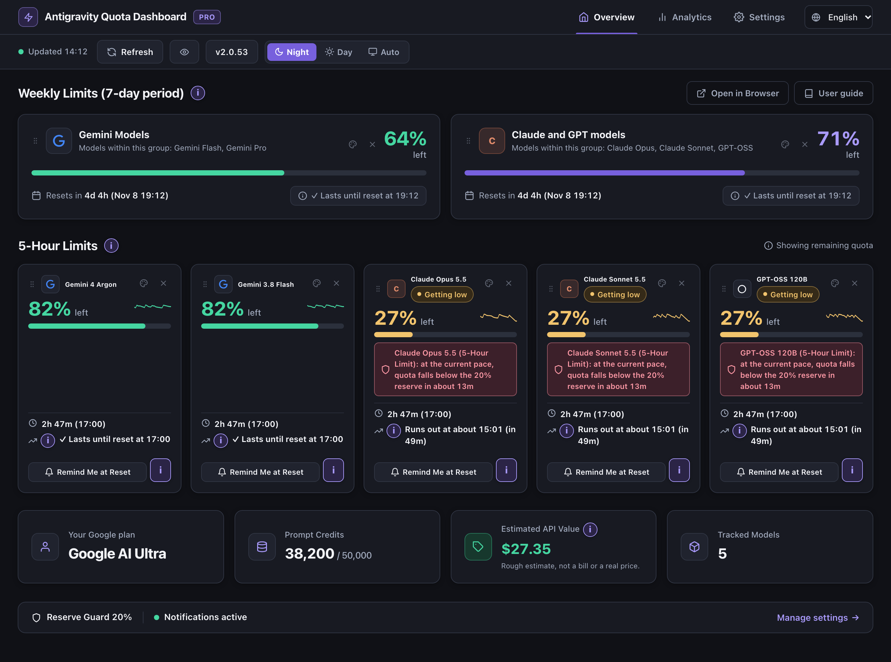
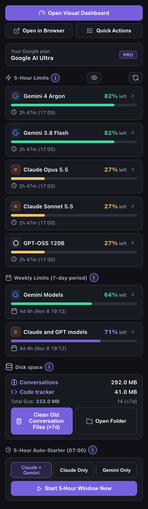
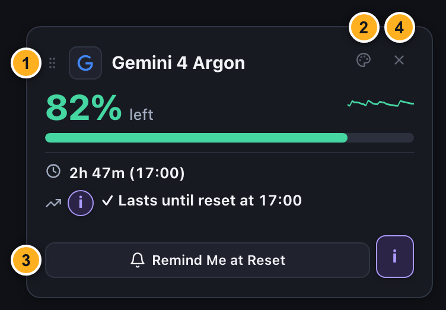
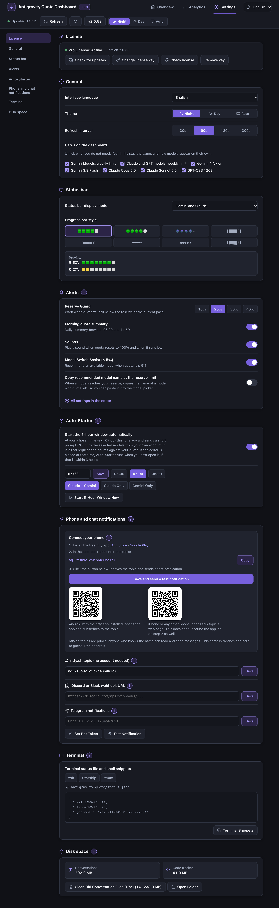

# Antigravity Quota Monitor: Panduan Pengguna

*Versi 2.0.53*

**Bahasa:** [🇬🇧 English](https://github.com/Nordicstocks/antigravity-quota-monitor/blob/main/USER-GUIDE.md) · [🇪🇪 Eesti keel](https://github.com/Nordicstocks/antigravity-quota-monitor/blob/main/USER-GUIDE.et.md) · [🇩🇪 Deutsch](https://github.com/Nordicstocks/antigravity-quota-monitor/blob/main/USER-GUIDE.de.md) · [🇫🇮 Suomi](https://github.com/Nordicstocks/antigravity-quota-monitor/blob/main/USER-GUIDE.fi.md) · [🇪🇸 Español](https://github.com/Nordicstocks/antigravity-quota-monitor/blob/main/USER-GUIDE.es.md) · [🇫🇷 Français](https://github.com/Nordicstocks/antigravity-quota-monitor/blob/main/USER-GUIDE.fr.md) · [🇮🇹 Italiano](https://github.com/Nordicstocks/antigravity-quota-monitor/blob/main/USER-GUIDE.it.md) · [🇵🇱 Polski](https://github.com/Nordicstocks/antigravity-quota-monitor/blob/main/USER-GUIDE.pl.md) · [🇳🇱 Nederlands](https://github.com/Nordicstocks/antigravity-quota-monitor/blob/main/USER-GUIDE.nl.md) · [🇸🇪 Svenska](https://github.com/Nordicstocks/antigravity-quota-monitor/blob/main/USER-GUIDE.sv.md) · [🇵🇹 Português (Portugal)](https://github.com/Nordicstocks/antigravity-quota-monitor/blob/main/USER-GUIDE.pt-PT.md) · [🇧🇷 Português (Brasil)](https://github.com/Nordicstocks/antigravity-quota-monitor/blob/main/USER-GUIDE.pt-BR.md) · [🇧🇬 Български](https://github.com/Nordicstocks/antigravity-quota-monitor/blob/main/USER-GUIDE.bg.md) · [🇭🇷 Hrvatski](https://github.com/Nordicstocks/antigravity-quota-monitor/blob/main/USER-GUIDE.hr.md) · [🇨🇿 Čeština](https://github.com/Nordicstocks/antigravity-quota-monitor/blob/main/USER-GUIDE.cs.md) · [🇩🇰 Dansk](https://github.com/Nordicstocks/antigravity-quota-monitor/blob/main/USER-GUIDE.da.md) · [🇬🇷 Ελληνικά](https://github.com/Nordicstocks/antigravity-quota-monitor/blob/main/USER-GUIDE.el.md) · [🇭🇺 Magyar](https://github.com/Nordicstocks/antigravity-quota-monitor/blob/main/USER-GUIDE.hu.md) · [🇮🇪 Gaeilge](https://github.com/Nordicstocks/antigravity-quota-monitor/blob/main/USER-GUIDE.ga.md) · [🇱🇻 Latviešu](https://github.com/Nordicstocks/antigravity-quota-monitor/blob/main/USER-GUIDE.lv.md) · [🇱🇹 Lietuvių](https://github.com/Nordicstocks/antigravity-quota-monitor/blob/main/USER-GUIDE.lt.md) · [🇱🇺 Lëtzebuergesch](https://github.com/Nordicstocks/antigravity-quota-monitor/blob/main/USER-GUIDE.lb.md) · [🇲🇹 Malti](https://github.com/Nordicstocks/antigravity-quota-monitor/blob/main/USER-GUIDE.mt.md) · [🇷🇴 Română](https://github.com/Nordicstocks/antigravity-quota-monitor/blob/main/USER-GUIDE.ro.md) · [🇸🇰 Slovenčina](https://github.com/Nordicstocks/antigravity-quota-monitor/blob/main/USER-GUIDE.sk.md) · [🇸🇮 Slovenščina](https://github.com/Nordicstocks/antigravity-quota-monitor/blob/main/USER-GUIDE.sl.md) · [🇺🇦 Українська](https://github.com/Nordicstocks/antigravity-quota-monitor/blob/main/USER-GUIDE.uk.md) · [🇿🇦 Afrikaans](https://github.com/Nordicstocks/antigravity-quota-monitor/blob/main/USER-GUIDE.af.md) · [🇯🇵 日本語](https://github.com/Nordicstocks/antigravity-quota-monitor/blob/main/USER-GUIDE.ja.md) · [🇨🇳 简体中文](https://github.com/Nordicstocks/antigravity-quota-monitor/blob/main/USER-GUIDE.zh-CN.md) · [🇹🇼 繁體中文](https://github.com/Nordicstocks/antigravity-quota-monitor/blob/main/USER-GUIDE.zh-TW.md) · [🇰🇷 한국어](https://github.com/Nordicstocks/antigravity-quota-monitor/blob/main/USER-GUIDE.ko.md) · [🇻🇳 Tiếng Việt](https://github.com/Nordicstocks/antigravity-quota-monitor/blob/main/USER-GUIDE.vi.md) · 🇮🇩 Bahasa Indonesia · [🇮🇳 हिन्दी](https://github.com/Nordicstocks/antigravity-quota-monitor/blob/main/USER-GUIDE.hi.md) · [🇰🇪 Kiswahili](https://github.com/Nordicstocks/antigravity-quota-monitor/blob/main/USER-GUIDE.sw.md) · [🇸🇦 العربية](https://github.com/Nordicstocks/antigravity-quota-monitor/blob/main/USER-GUIDE.ar.md)

---

## 1. Memulai: di mana menemukan semuanya

Setelah ekstensi terpasang, Anda dapat menemukannya di dua tempat:
1. **📌 Ikon Activity Bar:** Klik ikon pengukur di Activity Bar untuk membuka panel samping **Antigravity Cockpit**.
2. **📊 Meter bilah status, kanan bawah:** Di paket Free, tampilannya seperti ini: `G: 87% 🟩🟩🟩🟩⬜ | C: 97% 🟩🟩🟩🟩🟩`. G berarti model Gemini dan C berarti model Claude dan GPT. Pro juga menampilkan sisa waktu hingga reset dan jam reset, misalnya `↻3h 52m (19:52)`. Arahkan kursor ke meter untuk melihat detailnya (lihat bagian 2).

### Isi header dan bagian atas Ringkasan:
- **Tab:** **Ringkasan**, **Analitik** dan **Pengaturan**. Tab tidak mengulang judul halaman; judul hanya muncul di header.
- **Waktu pembaruan terakhir dan `Segarkan`:** waktu menunjukkan kapan data terakhir diperbarui; tombolnya mengambil data terbaru sekarang.
- **Tombol mata:** menampilkan daftar semua kartu, dengan tanda centang pada kartu yang terlihat. Hapus centang untuk menyembunyikan kartu atau beri centang untuk menampilkannya lagi, lalu tekan **Enter** atau **OK** untuk menerapkan. **Esc** menutup daftar tanpa menyimpan. Angka pada tombol menunjukkan jumlah kartu yang disembunyikan. Panel samping memiliki tombol yang sama di samping tombol **`Segarkan`**.
- **Tombol versi (`v2.0.53`):** memeriksa versi yang lebih baru. Jika ada, tombol berubah menjadi **`Perbarui ke …`**. Klik tombol itu, lalu muat ulang jendela.
- **Pilih bahasa:** menu tarik-turun ada di kanan atas di setiap tab. Pilihan pertama, **Otomatis**, juga menampilkan bahasa yang sedang digunakan. Pilihan ini mengikuti bahasa editor, atau bahasa sistem jika editor diatur ke bahasa Inggris. Di bawahnya ada 37 bahasa, masing-masing ditulis dalam bahasanya sendiri. Pilihan Anda langsung berlaku dan hanya mengubah bahasa ekstensi ini. Saat daftar terbuka, ketik satu huruf untuk melompat ke bahasa pertama yang diawali huruf itu. Pengaturan yang sama ada di bagian **Umum** pada Pengaturan.
- **`Malam / Siang / Otomatis`:** beralih ke tema gelap, tema terang atau tema editor.
- **Di samping judul pertama pada Ringkasan:** **`Buka di Browser`** (Pro, termasuk dalam uji coba 7 hari) membuka dasbor di browser web default Anda, misalnya untuk menampilkannya di layar kedua, dan **`Panduan pengguna`** membuka panduan ini. Di paket Free Anda juga menemukan **`Beli Pro`** dan **`Saya punya kunci`** di sana.
- **Yang tampil lebih dulu:** kartu batas (mingguan, lalu 5 jam). Paket Google Anda, kredit prompt, perkiraan nilai API, dan jumlah model ada di bawahnya.
- **Jendela yang lebih besar menampilkan lebih banyak:** lebih banyak kartu muat dalam satu baris. Saat lebar jendela mencapai sekitar 1.500 piksel, Pengaturan memakai lebih banyak kolom. Di Ringkasan, detail paket Google berpindah ke kolom di sebelah kanan pada sekitar 1.700 piksel, dan Analitik muncul di samping batas pada sekitar 2.400 piksel.

---

## 2. Popup bilah status

Mengarahkan kursor ke meter bilah status membuka popup dengan bagian-bagian berikut:
- **Status lisensi:** setelah tautan, popup menampilkan **PRO aktif** dengan warna merah jika Anda memiliki kunci berbayar, dan `UJI COBA · 5 hari` (sisa hari) selama masa uji coba. Di paket Free, popup tidak menampilkan status lisensi.
- **Tautan di atas:** **Dasbor**, **Buka di Browser**, **Pengaturan** (membuka tab Pengaturan) dan **Tindakan Cepat** (membuka menu). Di paket Free, ada juga tautan untuk membeli.
- **Akun dan kredit prompt dalam satu baris:** menampilkan paket Google Anda (`Google AI Pro`), email, dan kredit prompt (`500 / 50.000`).
- **Batas mingguan dan Batas 5 jam:** Setiap baris model tetap dalam satu baris dengan pengukur 4 blok, waktu reset, dan perkiraan kapan kuota habis. Waktu reset dan perkiraan itu adalah fitur Pro; di paket Free kedua kolom itu menampilkan gembok.

**Peringatan batas mingguan terpisah di bilah status:** Saat kuota mingguan untuk model Gemini atau untuk model Claude dan GPT tinggal sedikit, sebuah item terpisah muncul di samping meter bilah status, misalnya `G 7d 15%`. Secara default item ini memiliki ikon peringatan saat kuota mingguan tersisa 30% atau kurang, latar oranye pada 22% atau kurang, dan latar merah pada 15% atau kurang. Anda dapat mengubah ambang 30% dan 15% di pengaturan editor (lihat **Peringatan** di bagian 4); tingkat oranye berada di tengah-tengah keduanya. Klik pada item itu membuka dasbor. Item ini tidak ditampilkan selama kuota mingguan masih cukup.

---

## 3. Kartu model: seret dan lepas (`⋮⋮`), palet warna (`🎨`), pengingat reset (`🔔`) dan menyembunyikan (`✕`)

Ketiganya tersedia di paket Free: mengubah urutan kartu, memilih warnanya, dan menyembunyikannya, dan pilihan Anda tersimpan otomatis. Tombol **Ingatkan saat reset** pada kartu adalah fitur Pro: tombol ini mengatur pengingat untuk waktu reset model tersebut. Semua paket mendapat peringatan dasar di editor saat kuota kembali ke 100%.
- **① ⋮⋮ Urutan kartu dengan seret dan lepas:** Pegang kartu mana pun pada pegangan **`⋮⋮`** di kiri atasnya, lalu seret ke tempat yang Anda inginkan.
- **② 🎨 Palet warna kartu:** Klik tombol palet **`🎨`** di header kartu mana pun untuk memilih warna (**Default**, **Mint**, **Biru langit**, **Lavender**, **Persik**, **Mawar**, **Tosca**).
- **③ 🔔 Pengingat reset:** Klik **`🔔 Ingatkan saat reset`** di bagian bawah kartu model mana pun. Saat batas model itu direset, Anda menerima notifikasi di editor, disertai suara di Windows dan macOS serta, jika sudah diatur, notifikasi di ponsel. Editor harus terbuka.
- **④ ✕ Sembunyikan kartu:** Klik tanda silang di sudut kanan atas kartu untuk menyembunyikannya dari dasbor, panel samping, popup bilah status, dan bilah status. Pilihan Anda tersimpan. Tampilkan lagi dengan tombol mata di samping **`Segarkan`**, dengan tanda plus di baris **Disembunyikan:** di bawah kartu, atau lewat **Pengaturan → Umum → Kartu di dasbor**. Menyembunyikan kartu tidak mengubah batas Anda. Model baru tetap muncul otomatis. Anda berhenti menerima peringatan untuk suatu batas hanya jika semua model yang berbagi batas itu disembunyikan.

---

## 4. Pengaturan: Lisensi, Umum, Bilah status, Peringatan, Auto-Starter, Notifikasi ponsel dan chat, Terminal, Ruang disk

Buka tab **Pengaturan** (bisa juga dari popup bilah status, dari menu, atau dengan perintah `Antigravity Quota: Buka Tab Pengaturan`). Semua bagian ditampilkan dalam satu halaman; tidak ada yang diciutkan. Bagian-bagian itu berada dalam satu kolom, atau lebih banyak kolom saat jendela lebar. Tautan di kiri membawa Anda ke tiap bagian; di jendela sempit tautan itu tampil sebagai satu baris di bagian atas. Urutannya adalah **Lisensi, Umum, Bilah status, Peringatan, Auto-Starter, Notifikasi ponsel dan chat, Terminal, Ruang disk**. Bagian **Peringatan**, **Auto-Starter**, **Notifikasi ponsel dan chat** dan **Terminal** adalah fitur Pro (termasuk dalam uji coba) dan memiliki label **Pro**. Di paket Free, kontrol ini membuka dialog pembelian. Peringatan dasar di editor berfungsi tanpa pengaturan ini: Anda diberi tahu saat kuota turun ke 10% dan 5% serta saat kuota kembali ke 100%.

- **Lisensi:** Dengan lisensi aktif, bagian ini menampilkan satu baris berisi status serta **`Ganti kunci lisensi`**, **`Periksa lisensi`** dan **`Hapus kunci`**. Di paket Free dan selama uji coba, bagian ini menampilkan kolom kunci beserta tombolnya, dan tautan untuk membeli.
- **Umum:** bahasa antarmuka (pilihan yang sama dengan di header), tema, interval penyegaran, dan **Kartu di dasbor**.
- **Bilah status:** mode tampilan (*Gemini and Claude*, *Least quota left*, *Gemini*, *Claude*) dan 8 gaya bilah kemajuan dengan pratinjau.
- **Peringatan:** Reserve Guard, ringkasan pagi, suara (di Windows dan macOS), Asisten penggantian model, serta penyalinan nama model yang direkomendasikan. **`Semua pengaturan di editor`** membuka pengaturan bawaan editor, yang disaring untuk ekstensi ini. Isinya mencakup opsi yang lebih jarang dipakai, seperti ambang peringatan. Tautan itu sendiri tidak mengubah apa pun.

Saat beberapa model berbagi satu batas, Anda mendapat satu notifikasi editor dan satu notifikasi ponsel untuk seluruh grup, bukan satu untuk setiap model. Judulnya menyebut grup, misalnya **Model Gemini (batas 5 jam)**.

- **Auto-Starter — `Mulai periode 5 jam secara otomatis`:** Nonaktif secara default. Periode 5 jam dimulai dengan prompt pertama Anda, bukan pada waktu yang tetap. Saat pengaturan ini aktif, ekstensi menjalankan `agy` pada waktu yang Anda pilih dan mengirim prompt singkat (`OK`) dari akun Anda sendiri ke model yang dipilih. Ini adalah permintaan sungguhan. Jika periode 5 jam dimulai pada `07:00`, batas akan direset sekitar `12:00`.
  - **Pertama kali, ekstensi meminta persetujuan Anda.** Pesan yang dikirim ke model memakai kuota Anda. Bagian 6 dari [Ketentuan Layanan Tambahan Google Antigravity](https://antigravity.google/terms) melarang penggunaan layanan itu sehubungan dengan produk yang tidak disediakan oleh Google. Di dalamnya disebutkan bahwa menggunakan perangkat lunak pihak ketiga untuk mengakses layanan merupakan pelanggaran yang dapat berujung pada penangguhan atau penghentian akun Antigravity dan/atau Gemini CLI Anda. Keputusan ada di tangan Anda.
  - **Jika editor tertutup pada `07:00`:** Auto-Starter berjalan saat Anda membuka editor, selama belum lewat dari 3 jam sejak waktu yang Anda pilih. Setelah 3 jam itu lewat, ia menunggu hingga hari berikutnya.
  - **Jika proses gagal:** ekstensi memberi tahu Anda dan mencoba lagi setelah 30 menit, hingga 3 kali sehari, dan hanya selama 3 jam setelah waktu yang Anda pilih. Prompt dikirim ulang hanya ke model yang gagal. Jika `agy` tidak terpasang, ekstensi tidak mencoba lagi pada hari itu.
  - **Anda selalu melihat hasil sebenarnya:** jika `agy` tidak ada atau gagal, Anda melihat pesan galat. Notifikasi ponsel yang menyatakan periode 5 jam telah dimulai hanya dikirim setelah proses berhasil. Jika beberapa jendela editor terbuka, hanya satu di antaranya yang mengirim prompt.
- **`Mulai Periode 5 Jam Sekarang`:** Mengirim prompt yang sama segera. Pertama kali, ini juga meminta persetujuan Anda.
- **Notifikasi ponsel dan chat — `Hubungkan ponsel` (ntfy, tanpa akun):**
  1. Instal aplikasi **ntfy** gratis (App Store / Google Play).
  2. Di aplikasi, ketuk **`+`** dan masukkan topik yang ditampilkan di dasbor (ada tombol **Salin**). Topik ntfy.sh bersifat publik: siapa pun yang tahu namanya dapat membaca dan mengirim pesan. Karena itu topik yang disarankan panjang dan acak. Jangan bagikan topik ini.
  3. Kembali ke ekstensi, lalu klik **`Simpan dan kirim notifikasi uji`**. Hasilnya muncul di editor.
  - **Kode QR:** kode QR untuk Android membuka aplikasi ntfy, jika terpasang, dan berlangganan topik itu. Kode QR yang lain membuka halaman web topik, yang tidak membuat aplikasi berlangganan topik itu, jadi di iPhone lakukan langkah 2 secara manual.
- **Discord/Slack Webhook & Telegram:** Masukkan URL webhook Anda dan klik **`Simpan`**. Untuk Telegram, masukkan Chat ID Anda, klik **`Simpan`**, lalu klik **`Atur token bot`** dan tempel token ke kolom input di bagian atas jendela.
- **`Uji notifikasi`:** Klik untuk mengirim notifikasi uji ke setiap kanal yang sudah Anda atur, dalam bahasa pilihan Anda.
- **File status terminal dan cuplikan:** Klik **`zsh`**, **`Starship`** atau **`tmux`** untuk membuka cuplikan, salin cuplikan untuk alat yang Anda pakai, lalu tempel ke file yang disebut dalam cuplikan itu (file status: `~/.antigravity-quota/status.json`).
- **Ruang disk:** Menampilkan ruang disk yang dipakai oleh **Percakapan** (folder `~/.gemini/antigravity/brain`; folder `conversations` di sebelahnya tidak disentuh) dan **Pelacak kode** (`code_tracker`). **`🧹 Bersihkan File Percakapan Lama (>7 hari)`** hanya memeriksa `brain`: ia mencantumkan folder yang tidak berisi file yang diubah dalam 7 hari terakhir dan menampilkan jumlah folder, jumlah file, dan ukurannya sebelum Anda mengonfirmasi. Folder-folder ini dapat berisi gambar, rencana, dan log dari percakapan lama. Setelah Anda mengonfirmasi, folder dipindahkan ke Tempat Sampah sistem (Recycle Bin di Windows), dan dapat dipulihkan selama Tempat Sampah itu belum dikosongkan. Jika gagal, folder tetap di tempatnya dan ekstensi memberi tahu Anda. Ekstensi hanya mengukur `code_tracker`; tidak pernah membersihkannya.

### Tindakan Cepat (menu)

Tautan **Tindakan Cepat** di popup bilah status, tombol **Tindakan Cepat** di panel samping, dan perintah `Antigravity Quota: Tindakan Cepat` semuanya membuka menu yang sama: dasbor, browser, segarkan, pengingat, laporan, uji notifikasi, riwayat penggunaan (dapat menyimpan CSV atau JSON), **Tampilan, Bahasa & Bilah Status**, panduan pengguna, dan lisensi. Menu ini hanya berisi tindakan. Untuk melihat angka kuota Anda, lihat bilah status, popup-nya, atau dasbor. **Kembali — Batalkan pilihan** membawa Anda satu tingkat ke atas, dan baris terakhir submenu **Tampilan, Bahasa & Bilah Status** membuka tab **Pengaturan**.

Untuk menutup daftar, dialog, atau popup info mana pun dari ekstensi, klik **X** di sudutnya atau tekan **Esc**.

### Laporan mingguan dan Riwayat Penggunaan (Pro)

Buka **Laporan mingguan** atau **Riwayat Penggunaan** dari **Tindakan Cepat** (lihat di atas). **Laporan mingguan** juga ada di tab Analitik. Dengan cara mana pun, halaman terbuka dengan dua tab:

- **Laporan mingguan** menampilkan 7 hari terakhir: berapa kali Anda mencapai batas, batas mana yang akan habis berikutnya, jam tersibuk, model dan proyek yang paling banyak dipakai, kondisi batas Anda saat ini, grafik pemakaian kuota per hari dan jam (peta panas), serta perkiraan pemakaian per proyek.
- **Riwayat Penggunaan** menampilkan berapa banyak kuota yang tersisa selama 7, 30 atau 90 hari, baik untuk batas 5 jam maupun batas mingguan. Garis vertikal tipis menandai setiap reset. Tampilan 30 hari dan 90 hari untuk batas 5 jam tidak memiliki garis seperti itu; di sana, setiap titik menunjukkan tingkat terendah pada hari itu.

Model yang berbagi satu batas berbagi satu grafik. Tombol **Simpan laporan (HTML)** dan **Simpan laporan (Markdown)** di tab Laporan mingguan serta tombol **Ekspor CSV** dan **Ekspor JSON** di tab Riwayat Penggunaan menanyakan tempat menyimpan file, lalu menawarkan untuk membukanya.

## 5. 🎁 Uji coba Pro 7 hari dan aktivasi lisensi

Saat pertama kali memasang ekstensi, Anda mendapat **semua fitur Pro selama 7 hari**, tanpa kartu kredit atau debit dan tanpa registrasi. Setelah itu, Anda tetap memiliki fitur Free: meter bilah status, dasbor dan panel samping, urutan dan warna kartu, 8 gaya bilah kemajuan, 37 bahasa, peringatan otomatis di editor saat kuota menipis atau kembali ke 100%, dan riwayat 24 jam (Riwayat Penggunaan yang lebih panjang adalah fitur Pro).

1. **Pilih paket:**
   - **[💎 Pro seumur hidup — pembayaran satu kali €9,99](https://buy.polar.sh/polar_cl_xdY0LqtPIfPHfnG9o8Wo5QIIpJRlvhxQOZ6vL4g5jIB)**
   - **[Pro Bulanan — €2,99/bulan, bisa dibatalkan kapan saja](https://buy.polar.sh/polar_cl_avl0NAvpPN4jQD0vZRRg11yZ92BQ2OHCKw29f4dxlPW)**
2. **Temukan kunci Anda:** Kunci Anda ada di email pembelian atau di halaman konfirmasi Polar, penyedia pembayaran kami.
3. **Aktifkan:** Tempel kunci `PRO-XXXX-...` Anda ke bagian **Lisensi** di Pengaturan dan klik **`Aktifkan`**. Anda juga dapat mengklik **`Saya punya kunci`**, yang ada di spanduk uji coba, di Ringkasan, dan di panel samping. Setelah aktivasi, spanduk uji coba langsung hilang dan lencana menampilkan **Pro**. Anda tidak perlu memuat ulang jendela.
4. **Setelah membeli:** jika Anda mengklik tombol beli dan kembali ke editor dalam 30 menit, ekstensi memeriksa satu kali apakah papan klip berisi kunci lisensi dan bertanya sebelum mengaktifkannya. Ekstensi tidak membaca papan klip pada waktu lain, dan teks papan klip tidak disimpan.
5. **Memeriksa atau menghapus kunci:** Pengaturan → Lisensi → **`Periksa lisensi`** memeriksa lisensi Anda ke Polar saat itu juga. **`Hapus kunci`** (atau perintah `Antigravity Quota: Hapus Kunci Lisensi Pro`) menghapus kunci. Setelah Anda mengonfirmasi, kunci dihapus dari komputer ini, termasuk file `~/.antigravity-quota/license.key`. Jika ekstensi dapat menjangkau Polar, aktivasi untuk komputer ini juga dinonaktifkan, sehingga kunci dapat dipakai di komputer lain. Pembelian Anda tetap berlaku. Menghapus kunci TIDAK membatalkan langganan bulanan. Langganan tetap berjalan sampai Anda membatalkannya di Polar.
