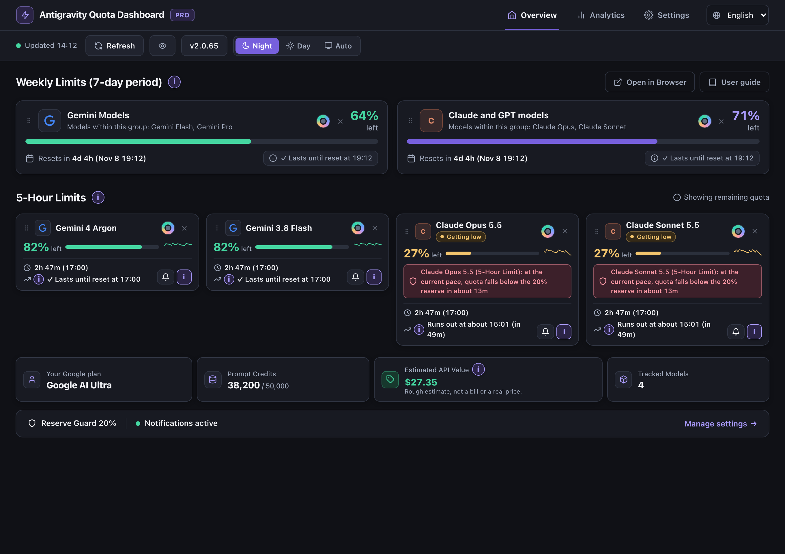
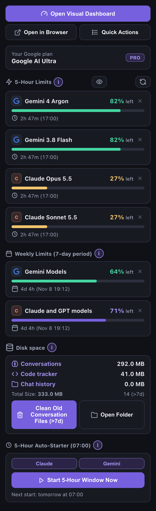
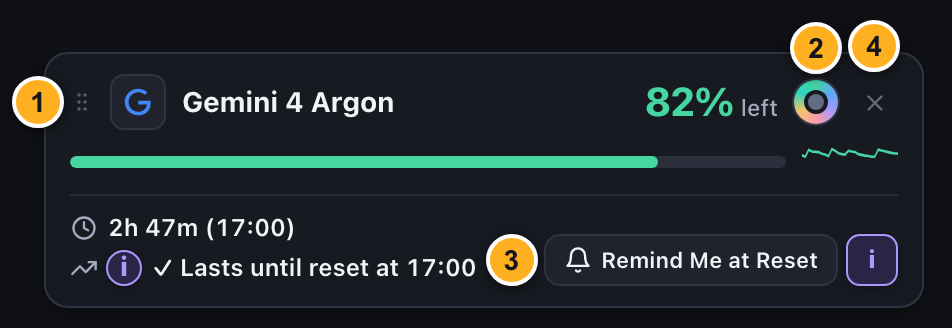
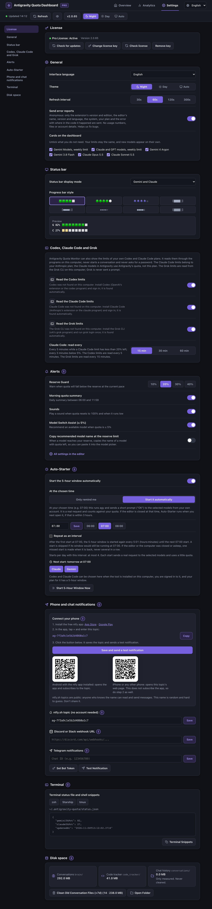

# Antigravity Quota Monitor: naudotojo vadovas

*Versija 2.0.65*

**Kalba:** [🇬🇧 English](https://github.com/Nordicstocks/antigravity-quota-monitor/blob/main/USER-GUIDE.md) · [🇪🇪 Eesti keel](https://github.com/Nordicstocks/antigravity-quota-monitor/blob/main/USER-GUIDE.et.md) · [🇩🇪 Deutsch](https://github.com/Nordicstocks/antigravity-quota-monitor/blob/main/USER-GUIDE.de.md) · [🇫🇮 Suomi](https://github.com/Nordicstocks/antigravity-quota-monitor/blob/main/USER-GUIDE.fi.md) · [🇪🇸 Español](https://github.com/Nordicstocks/antigravity-quota-monitor/blob/main/USER-GUIDE.es.md) · [🇫🇷 Français](https://github.com/Nordicstocks/antigravity-quota-monitor/blob/main/USER-GUIDE.fr.md) · [🇮🇹 Italiano](https://github.com/Nordicstocks/antigravity-quota-monitor/blob/main/USER-GUIDE.it.md) · [🇵🇱 Polski](https://github.com/Nordicstocks/antigravity-quota-monitor/blob/main/USER-GUIDE.pl.md) · [🇳🇱 Nederlands](https://github.com/Nordicstocks/antigravity-quota-monitor/blob/main/USER-GUIDE.nl.md) · [🇸🇪 Svenska](https://github.com/Nordicstocks/antigravity-quota-monitor/blob/main/USER-GUIDE.sv.md) · [🇵🇹 Português (Portugal)](https://github.com/Nordicstocks/antigravity-quota-monitor/blob/main/USER-GUIDE.pt-PT.md) · [🇧🇷 Português (Brasil)](https://github.com/Nordicstocks/antigravity-quota-monitor/blob/main/USER-GUIDE.pt-BR.md) · [🇧🇬 Български](https://github.com/Nordicstocks/antigravity-quota-monitor/blob/main/USER-GUIDE.bg.md) · [🇭🇷 Hrvatski](https://github.com/Nordicstocks/antigravity-quota-monitor/blob/main/USER-GUIDE.hr.md) · [🇨🇿 Čeština](https://github.com/Nordicstocks/antigravity-quota-monitor/blob/main/USER-GUIDE.cs.md) · [🇩🇰 Dansk](https://github.com/Nordicstocks/antigravity-quota-monitor/blob/main/USER-GUIDE.da.md) · [🇬🇷 Ελληνικά](https://github.com/Nordicstocks/antigravity-quota-monitor/blob/main/USER-GUIDE.el.md) · [🇭🇺 Magyar](https://github.com/Nordicstocks/antigravity-quota-monitor/blob/main/USER-GUIDE.hu.md) · [🇮🇪 Gaeilge](https://github.com/Nordicstocks/antigravity-quota-monitor/blob/main/USER-GUIDE.ga.md) · [🇱🇻 Latviešu](https://github.com/Nordicstocks/antigravity-quota-monitor/blob/main/USER-GUIDE.lv.md) · 🇱🇹 Lietuvių · [🇱🇺 Lëtzebuergesch](https://github.com/Nordicstocks/antigravity-quota-monitor/blob/main/USER-GUIDE.lb.md) · [🇲🇹 Malti](https://github.com/Nordicstocks/antigravity-quota-monitor/blob/main/USER-GUIDE.mt.md) · [🇷🇴 Română](https://github.com/Nordicstocks/antigravity-quota-monitor/blob/main/USER-GUIDE.ro.md) · [🇸🇰 Slovenčina](https://github.com/Nordicstocks/antigravity-quota-monitor/blob/main/USER-GUIDE.sk.md) · [🇸🇮 Slovenščina](https://github.com/Nordicstocks/antigravity-quota-monitor/blob/main/USER-GUIDE.sl.md) · [🇺🇦 Українська](https://github.com/Nordicstocks/antigravity-quota-monitor/blob/main/USER-GUIDE.uk.md) · [🇿🇦 Afrikaans](https://github.com/Nordicstocks/antigravity-quota-monitor/blob/main/USER-GUIDE.af.md) · [🇯🇵 日本語](https://github.com/Nordicstocks/antigravity-quota-monitor/blob/main/USER-GUIDE.ja.md) · [🇨🇳 简体中文](https://github.com/Nordicstocks/antigravity-quota-monitor/blob/main/USER-GUIDE.zh-CN.md) · [🇹🇼 繁體中文](https://github.com/Nordicstocks/antigravity-quota-monitor/blob/main/USER-GUIDE.zh-TW.md) · [🇰🇷 한국어](https://github.com/Nordicstocks/antigravity-quota-monitor/blob/main/USER-GUIDE.ko.md) · [🇻🇳 Tiếng Việt](https://github.com/Nordicstocks/antigravity-quota-monitor/blob/main/USER-GUIDE.vi.md) · [🇮🇩 Bahasa Indonesia](https://github.com/Nordicstocks/antigravity-quota-monitor/blob/main/USER-GUIDE.id.md) · [🇮🇳 हिन्दी](https://github.com/Nordicstocks/antigravity-quota-monitor/blob/main/USER-GUIDE.hi.md) · [🇰🇪 Kiswahili](https://github.com/Nordicstocks/antigravity-quota-monitor/blob/main/USER-GUIDE.sw.md) · [🇸🇦 العربية](https://github.com/Nordicstocks/antigravity-quota-monitor/blob/main/USER-GUIDE.ar.md)

---

## 1. Pradžia: kur ką rasti

Įdiegus plėtinį, jį rasite dviejose vietose:
1. **📌 Veiklos juostos piktograma:** spustelėkite matuoklio piktogramą veiklos juostoje (Activity Bar) ir atsivers šoninis skydelis **Antigravity Cockpit**.
2. **📊 Būsenos juostos rodiklis apačioje dešinėje:** plane Free jis atrodo taip: `G: 87% 🟩🟩🟩🟩⬜ | C: 97% 🟩🟩🟩🟩🟩`. G žymi Gemini modelius, o C – Claude modelius. Plane Pro dar rodoma, kiek laiko liko iki atsinaujinimo ir kurią valandą jis įvyks, pavyzdžiui, `↻3h 52m (19:52)`. Užveskite pelę ant rodiklio, kad pamatytumėte išsamesnę informaciją (žr. 2 skyrių).

### Kas yra antraštėje ir viršutinėje Apžvalgos dalyje:
- **Skirtukai:** **Apžvalga**, **Analizė** ir **Nustatymai**. Skirtukai nekartoja puslapio pavadinimo; jis rodomas tik antraštėje.
- **Paskutinio atnaujinimo laikas ir `Atnaujinti`:** laikas rodo, kada duomenys buvo atnaujinti paskutinį kartą; mygtukas iškart atnaujina duomenis.
- **Akies mygtukas:** parodo visų kortelių sąrašą, matomos kortelės pažymėtos varnele. Nuimkite varnelę, kad kortelę paslėptumėte, arba pažymėkite, kad ji vėl atsirastų, tada paspauskite **Enter** arba **OK**, kad pakeitimas įsigaliotų. **Esc** uždaro sąrašą nieko neišsaugojus. Skaičius ant mygtuko rodo, kiek kortelių paslėpta. Šoniniame skydelyje tas pats mygtukas yra šalia atnaujinimo mygtuko.
- **Versijos mygtukas (`v2.0.65`):** tikrina, ar yra naujesnė versija. Kai tokia versija yra, mygtuke parašyta **`Atnaujinti į …`**. Spustelėkite jį ir iš naujo įkelkite redaktoriaus langą.
- **Kalba:** išskleidžiamasis sąrašas **Pasirinkti kalbą** yra viršuje dešinėje kiekviename skirtuke. Pirmasis pasirinkimas, **Automatiškai**, taip pat rodo šiuo metu naudojamą kalbą. Ji atitinka redaktoriaus kalbą arba sistemos kalbą, jei redaktorius nustatytas anglų kalba. Žemiau yra 37 kalbos, kiekviena parašyta savo kalba. Pasirinkimas pritaikomas iškart ir pakeičia tik šio plėtinio kalbą. Kai sąrašas atidarytas, paspauskite raidę, kad peršoktumėte prie pirmos kalbos, prasidedančios ja. Tas pats nustatymas yra Nustatymų skiltyje **Bendrieji**.
- **`Naktis / Diena / Automatiškai`:** perjungia tamsią, šviesią arba redaktoriaus temą.
- **Šalia pirmos Apžvalgos antraštės:** **`Atverti naršyklėje`** (Pro, įtraukta į 7 dienų bandomąjį laikotarpį) atveria suvestinę numatytojoje naršyklėje, pavyzdžiui, kad parodytumėte ją antrame ekrane, o **`Naudotojo vadovas`** atveria šį vadovą. Plane Free ten taip pat rasite **`Įsigyti Pro`** ir **`Turiu raktą`**.
- **Kas rodoma pirmiausia:** limitų kortelės (savaitės, paskui 5 valandų). Žemiau yra jūsų Google planas, užklausų kreditai, numatoma API vertė ir modelių skaičius.
- **Didesnis redaktoriaus langas rodo daugiau:** eilutėje telpa daugiau kortelių. Kai langas maždaug 1 500 pikselių pločio, Nustatymai turi daugiau stulpelių. Apžvalgoje maždaug ties 1 700 pikselių Google plano duomenys persikelia į stulpelį dešinėje, o ties maždaug 2 400 pikselių Analizė atsiranda šalia limitų.

---

## 2. Būsenos juostos iškylantysis langas

Užvedus pelę ant būsenos juostos rodiklio, atsiveria iškylantysis langas su šiomis dalimis:
- **Licencijos būsena:** po nuorodomis raudonai rodoma **Pro licencija aktyvi**, jei turite mokamą raktą, o bandomuoju laikotarpiu – `BAND. 5 d.` (likusios dienos). Plane Free iškylantysis langas licencijos būsenos nerodo.
- **Viršutinės nuorodos:** **Suvestinė**, **Atverti naršyklėje**, **Nustatymai** (atveria nustatymų skirtuką) ir **Greitieji veiksmai** (atveria meniu). Plane Free taip pat yra pirkimo nuoroda.
- **Paskyra ir užklausų kreditai vienoje eilutėje:** rodo jūsų Google planą (`Google AI Pro`), el. paštą ir užklausų kreditus (`500 / 50 000`).
- **Savaitės limitai ir 5 valandų limitai:** kiekvienas modelis užima vieną eilutę su 4 blokų matuokliu, atsinaujinimo laiku ir išsekimo prognoze. Atsinaujinimo laikas ir prognozė yra Pro funkcijos; plane Free tie du stulpeliai rodo užraktą.

**Atskiras savaitės limito įspėjimas būsenos juostoje:** kai Gemini modelių arba Claude modelių savaitės kvotos lieka nedaug, šalia būsenos juostos rodiklio atsiranda atskiras elementas, pavyzdžiui, `G 7d 15%`. Pagal numatytuosius nustatymus jis turi įspėjamąją piktogramą, kai lieka 30 % savaitės kvotos ar mažiau, oranžinį foną, kai lieka 22 % ar mažiau, ir raudoną foną, kai lieka 15 % ar mažiau. 30 % ir 15 % ribas galite keisti redaktoriaus nustatymuose (žr. **Įspėjimai** 4 skyriuje); oranžinė pakopa yra per vidurį tarp jų. Spustelėjus atsidaro suvestinė. Kol savaitės kvotos pakanka, elemento nėra.

---

## 3. Modelių kortelės: vilkimas (`⋮⋮`), spalvų paletė (`🎨`), priminimas apie atsinaujinimą (`🔔`) ir slėpimas (`✕`)

Kortelių tvarkos keitimas, spalvų pasirinkimas ir slėpimas įeina į planą Free, o jūsų pasirinkimai išsaugomi automatiškai. Kortelės mygtukas **Priminti apie atsinaujinimą** yra Pro funkcija: jis nustato priminimą apie to modelio atsinaujinimo laiką. Visuose planuose redaktoriuje rodomas pagrindinis įspėjimas, kai kvota vėl pasiekia 100 %.
- **① ⋮⋮ Kortelių tvarkos keitimas vilkiant:** paimkite bet kurią kortelę už jos viršutiniame kairiajame kampe esančios rankenėlės **`⋮⋮`** ir nuvilkite ten, kur norite.
- **② 🎨 Kortelės spalvų paletė:** spustelėkite paletės mygtuką **`🎨`** bet kurios kortelės antraštėje, kad pasirinktumėte spalvą (**Default**, **mėtinė**, **žydra**, **levandinė**, **persikinė**, **rožinė**, **žalsvai mėlyna**).
- **③ 🔔 Priminimas apie atsinaujinimą:** spustelėkite **`🔔 Priminti apie atsinaujinimą`** bet kurios modelio kortelės apačioje. Kai to modelio limitas atsinaujina, redaktoriuje gaunate pranešimą, pasigirsta garsas (sistemose Windows ir macOS), o jei esate nustatę, gaunate ir pranešimus telefone. Redaktorius turi būti atidarytas.
- **④ ✕ Kortelės slėpimas:** spustelėkite kryžiuką kortelės viršutiniame dešiniajame kampe, kad pašalintumėte ją iš suvestinės, šoninio skydelio, būsenos juostos iškylančiojo lango ir būsenos juostos. Jūsų pasirinkimas išsaugomas. Grąžinti ją galite akies mygtuku šalia **`Atnaujinti`**, pliusu eilutėje **Paslėpta:** po kortelėmis arba per **Nustatymai → Bendrieji → Suvestinės kortelės**. Kortelės paslėpimas nekeičia jūsų limitų. Nauji modeliai vis tiek atsiranda automatiškai. Įspėjimus apie limitą nustojate gauti tik tada, kai paslėpti visi modeliai, kuriems tas limitas bendras.

---

## 4. Nustatymai: Licencija, Bendrieji, Būsenos juosta, Įspėjimai, Auto-Starter, Pranešimai telefone ir pokalbiuose, Terminalas, Vieta diske

Atverkite skirtuką **Nustatymai** (taip pat iš būsenos juostos iškylančiojo lango, iš meniu arba komanda `Antigravity Quota: atverti nustatymų skirtuką`). Visos skiltys rodomos viename puslapyje; nė viena nėra suskleista. Jos išdėstytos viename stulpelyje arba keliuose, kai langas platus. Kairėje esančios nuorodos veda į kiekvieną skiltį; siaurame lange jos sudaro eilutę viršuje. Tvarka: **Licencija, Bendrieji, Būsenos juosta, Įspėjimai, Auto-Starter, Pranešimai telefone ir pokalbiuose, Terminalas, Vieta diske**. Skiltys **Įspėjimai**, **Auto-Starter**, **Pranešimai telefone ir pokalbiuose** ir **Terminalas** yra Pro funkcijos (įskaičiuotos į bandomąjį laikotarpį) ir turi žymę Pro. Plane Free jų valdikliai atveria pirkimo langą. Plane Free pagrindiniai įspėjimai redaktoriuje veikia ir be šių nustatymų: jums pranešama, kai kvota nukrenta iki 10 % ir 5 % bei kai ji vėl pasiekia 100 %.

- **Licencija:** kai licencija aktyvi, ši skiltis rodo vieną eilutę su būsena ir mygtukais **`Keisti licencijos raktą`**, **`Tikrinti licenciją`** ir **`Pašalinti raktą`**. Plane Free ir bandomuoju laikotarpiu ji rodo rakto įvedimo lauką su mygtuku ir pirkimo nuorodą.
- **Bendrieji:** sąsajos kalba (tas pats pasirinkimas kaip antraštėje), tema, atnaujinimo intervalas, **Siųsti klaidų ataskaitas** ir **Suvestinės kortelės**.
- **Siųsti klaidų ataskaitas (įjungta pagal numatytuosius nustatymus):** kai plėtinyje netikėtai įvyksta klaida, į `oeqbchgyoderqxnzcubh.supabase.co` siunčiama anoniminė ataskaita: plėtinio versija ir leidimas, redaktoriaus pavadinimas, versija ir kalba, operacinė sistema ir procesoriaus tipas, šio plėtinio planas (Free, bandomasis arba Pro), klaidos pranešimas ir vieta kode. Nesiunčiami kvotų duomenys, failai, paskyros duomenys ar licencijos raktas. Kai redaktoriaus telemetrijos nustatymas išjungtas, nieko nesiunčiama. Išjungus šią parinktį čia arba išjungus ją nustatymu `antigravityQuota.sendErrorReports`, nieko nesiunčiama. Kiti tinklo naudojimo atvejai (naujinimų tikrinimas, licencija, pranešimai ir Auto-Starter) išvardyti parduotuvės puslapio skiltyje „Privatumas“.
- **Būsenos juosta:** rodymo režimas (*Gemini ir Claude*, *Mažiausiai likusios kvotos*, *Gemini*, *Claude*) ir 8 eigos juostos stiliai su peržiūra.
- **Įspėjimai:** Reserve Guard, ryto santrauka, garsai (sistemose Windows ir macOS), Modelio keitimo pagalba ir rekomenduojamo modelio pavadinimo kopijavimas. **`Visi redaktoriaus nustatymai`** atveria paties redaktoriaus nustatymus, filtruotus pagal šį plėtinį. Juose yra rečiau naudojamų parinkčių, pavyzdžiui, įspėjimų ribos. Pati nuoroda nieko nekeičia.

Kai keli modeliai turi bendrą limitą, gaunate vieną pranešimą redaktoriuje ir vieną pranešimą telefone visai grupei, o ne po vieną kiekvienam modeliui. Pranešimo pavadinime nurodoma grupė, pavyzdžiui, **Gemini modeliai (5 valandų limitas)**.

- **Auto-Starter — `Pasirinktu laiku`: `Tik priminti` arba `Paleisti automatiškai`.** Pasirinkę `Tik priminti` (numatytoji parinktis naujiems naudotojams), pasirinktu laiku, pavyzdžiui, `07:00`, gaunate pranešimą: išsiųskite bet kokią užklausą redaktoriuje Antigravity ir 5 valandų langas prasidės. Plėtinys nevykdo jokios komandos ir užklausos už jus nesiunčia, todėl kvota nenaudojama. Jei tuo metu redaktorius uždarytas, priminimas pasirodys, kai jį vėl atidarysite, jei tai įvyks per 3 valandas. Toliau pateikti Auto-Starter punktai taikomi parinkčiai `Paleisti automatiškai`.
- **Auto-Starter — `Automatiškai pradėti 5 valandų langą`:** pagal numatytuosius nustatymus išjungta. 5 valandų langas prasideda nuo jūsų pirmos užklausos, o ne nustatytu laiku. Kai šis nustatymas įjungtas, plėtinys jūsų pasirinktu laiku paleidžia `agy` ir pasirinktiems jūsų paskyros modeliams išsiunčia trumpą užklausą (`OK`). Tai tikra užklausa. Jei 5 valandų langas prasideda `07:00`, limitas atsinaujins maždaug `12:00`.
  - **Pirmą kartą jis paprašo jūsų sutikimo.** Modeliams siunčiama užklausa naudoja jūsų kvotą. Google Antigravity papildomų paslaugų teikimo sąlygų ([Google Antigravity Additional Terms of Service](https://antigravity.google/terms)) 6 skirsnis draudžia naudoti paslaugą kartu su produktais, kurių nepateikia Google. Jame sakoma, kad naudojimasis trečiųjų šalių programine įranga siekiant pasiekti paslaugą yra pažeidimas, dėl kurio jūsų Antigravity ir (arba) Gemini CLI paskyros gali būti sustabdytos arba panaikintos. Sprendimas jūsų.
  - **Jei redaktorius `07:00` buvo uždarytas:** Auto-Starter pasileidžia, kai atidarote redaktorių, jei nuo jūsų pasirinkto laiko praėjo ne daugiau kaip 3 valandos. Praėjus toms 3 valandoms, jis laukia iki kitos dienos.
  - **Jei paleidimas nepavyksta:** plėtinys apie tai praneša ir bando dar kartą po 30 minučių, ne daugiau kaip 3 kartus per dieną ir tik per tas pačias 3 valandas nuo jūsų pasirinkto laiko. Užklausa vėl siunčiama tik tiems modeliams, kuriems nepavyko. Jei komanda `agy` neįdiegta, plėtinys tą dieną daugiau nebando.
  - **Visada matote, kas iš tikrųjų įvyko:** jei `agy` trūksta arba ji nepasileidžia, matote klaidą. Pranešimas telefone, kad 5 valandų langas prasidėjo, siunčiamas tik po sėkmingo paleidimo. Jei atidaryti keli redaktoriaus langai, užklausą siunčia tik vienas iš jų.
- **`Pradėti 5 valandų langą dabar`:** iškart išsiunčia tą pačią užklausą. Pirmą kartą tai taip pat paprašo jūsų sutikimo.
- **Auto-Starter — `Kartoti nustatytu intervalu` (2.0.64, pagal numatytuosius nustatymus išjungta):** po pirmojo paleidimo pasirinktu laiku 5 valandų langas vėl prasideda kas `5:01` (5 valandos ir 1 minutė, rekomenduojama) arba jūsų įvestu intervalu, nurodytu `H:MM` formatu nuo `1:00` iki `24:00`, iki kitos dienos paleidimo pasirinktu laiku. Paleidimas praleidžiamas, jei jo pradėtas 5 valandų langas kitos dienos pasirinktu laiku dar nebūtų pasibaigęs, todėl nustačius `5:01` per dieną būna ne daugiau kaip 4 paleidimai. Kiekvienas paleidimas yra tikra užklausa ir sunaudoja šiek tiek kvotos. Kortelėje rodomas paleidimų skaičius per dieną ir kito suplanuoto paleidimo laikas.
- **Auto-Starter — kurių modelių ir įrankių 5 valandų langai pradedami (2.0.64):** kiekvieną modelį ir įrankį pasirenkate atskirai: **Claude** ir **Gemini** (per `agy`, iš jūsų Antigravity paskyros), taip pat **Codex** ir **Claude Code**, jei jie įdiegti šiame kompiuteryje, esate prisijungę ir jūsų plane yra 5 valandų langas. Codex atveju plėtinys paleidžia komandą `codex exec` (tik skaitymo režimu, laikinajame aplanke), o Claude Code atveju – komandą `claude -p` (išjungus integruotus įrankius). Codex ir Claude Code išsiunčia po vieną trumpą užklausą (`OK`) atitinkamai iš jūsų ChatGPT ir Anthropic paskyrų; užklausa pradeda to plano 5 valandų langą ir sunaudoja nedidelę jo kvotos dalį.
  - **Sutikimas kiekvienai paskyrai:** Codex ir Claude Code prieš pirmąją užklausą kiekvienas atskirai paprašo jūsų sutikimo, nes jų užklausos siunčiamos iš jūsų ChatGPT arba Anthropic paskyros, o ne iš jūsų Antigravity paskyros. Sutikimas, kurį davėte iki 2.0.64 versijos, galioja tik Claude ir Gemini. Panaikinus įrankio pasirinkimą, jūsų sutikimas naudoti tą įrankį atšaukiamas; vėl jį pasirinkus, sutikimo prašoma iš naujo. Panaikinus ir Claude, ir Gemini pasirinkimą, tokiu pačiu būdu atšaukiamas jūsų sutikimas naudoti `agy`.
- **Pranešimai telefone ir pokalbiuose — `Prijunkite telefoną` (ntfy, paskyros nereikia):**
  1. Įdiekite nemokamą **ntfy** programėlę (App Store / Google Play).
  2. Programėlėje bakstelėkite **`+`** ir įveskite suvestinėje rodomą temą (ten yra mygtukas **Kopijuoti**). ntfy.sh temos yra viešos: bet kas, žinantis pavadinimą, gali skaityti ir siųsti pranešimus. Todėl siūloma tema yra ilga ir atsitiktinė. Jos niekam neduokite.
  3. Grįžkite į plėtinį ir spustelėkite **`Išsaugoti ir siųsti bandomąjį pranešimą`**. Rezultatas rodomas redaktoriuje.
  - **QR kodai:** QR kodas, skirtas Android, atveria ntfy programėlę (jei ji įdiegta) ir joje užsiprenumeruoja temą. Kitas QR kodas atveria temos tinklalapį; tame puslapyje tema programėlėje neužprenumeruojama, todėl iPhone telefone 2 žingsnį atlikite rankiniu būdu.
- **Discord/Slack Webhook ir Telegram:** įveskite savo Webhook URL ir spustelėkite **`Išsaugoti`**. Telegram atveju įveskite savo Chat ID, spustelėkite **`Išsaugoti`**, tada spustelėkite **`Nustatyti boto prieigos raktą`** ir įklijuokite prieigos raktą į įvesties laukelį lango viršuje.
- **`Bandomasis pranešimas`:** spustelėkite, kad išsiųstumėte bandomąjį pranešimą į kiekvieną jūsų nustatytą kanalą pasirinkta kalba.
- **Terminalo būsenos failas ir fragmentai:** spustelėkite **`zsh`**, **`Starship`** arba **`tmux`**, kad atvertumėte fragmentus, nukopijuokite naudojamam įrankiui skirtą fragmentą ir įklijuokite jį į tame fragmente nurodytą failą (būsenos failas: `~/.antigravity-quota/status.json`).
- **Vieta diske:** rodo, kiek vietos diske užima **Pokalbiai** (aplankas `~/.gemini/antigravity/brain`; šalia esantis aplankas `conversations` neliečiamas) ir **Kodo sekiklis** (`code_tracker`). **`🧹 Valyti senus pokalbių failus (>7 d.)`** tikrina tik `brain`: išvardija aplankus, kuriuose per paskutines 7 dienas nepasikeitė nė vienas failas, ir prieš jums patvirtinant parodo aplankų skaičių, failų skaičių ir dydį. Šiuose aplankuose gali būti senų pokalbių paveikslėlių, planų ir žurnalų. Patvirtinus, jie perkeliami į sistemos šiukšlinę (Windows – Recycle Bin), ir galite juos atkurti, kol šiukšlinės neištuštinate. Jei nepavyksta, jie lieka savo vietoje, o plėtinys jums apie tai praneša. Aplankas `code_tracker` tik matuojamas; jis niekada nevalomas.

### Codex, Claude Code ir Grok (2.0.64)

Jei jūsų kompiuteryje įdiegtas Codex, Claude Code arba Grok CLI, jūsų su tuo įrankiu susieto plano limitai rodomi atskirai nuo Antigravity limitų: atskirose kortelėse po Antigravity kortelėmis suvestinėje, atskirame bloke šoniniame skydelyje ir kaip atskiras elementas būsenos juostoje. Kiekvieno įrankio limitai nuskaitomi jo paties programa (`codex app-server`, `claude -p /usage`, Grok CLI): pokalbis nepradedamas, modeliui nieko nesiunčiama ir slaptažodžio neprašoma. Neįdiegtas įrankis nerodomas. Procentai rodomi ir be Pro; atsinaujinimo laikas, išsekimo prognozė ir priminimas apie atsinaujinimą yra Pro funkcijos. Čia rodomi Claude Code limitai yra jūsų pačių Anthropic plano limitai; Claude modeliai redaktoriuje Antigravity ir toliau naudoja Antigravity kvotą. Savo Free plane Grok nenurodo naudojimo procentais, todėl jo kortelėje nėra naudojimo juostos.

**Nustatymai → Codex, Claude Code ir Grok:** kiekvieno įrankio jungiklis (kai jis išjungtas, įrankio programa nepaleidžiama) ir Claude Code limitų nuskaitymo dažnis.

### Greitieji veiksmai (meniu)

Nuoroda **Greitieji veiksmai** būsenos juostos iškylančiajame lange, mygtukas **Greitieji veiksmai** šoniniame skydelyje ir komanda `Antigravity Quota: greitieji veiksmai` atveria tą patį meniu: suvestinė, naršyklė, atnaujinimas, priminimas, ataskaita, bandomasis pranešimas, naudojimo istorija (ją galima išsaugoti kaip CSV arba JSON), **Išvaizda, kalba ir būsenos juosta**, naudotojo vadovas ir licencija. Šiame meniu yra tik veiksmai. Kad pamatytumėte kvotos skaičius, žiūrėkite į būsenos juostą, jos iškylantįjį langą arba suvestinę. **Atgal — atšaukti pasirinkimą** grąžina vienu lygiu aukštyn, o paskutinė submeniu **Išvaizda, kalba ir būsenos juosta** eilutė atveria skirtuką **Nustatymai**.

Kad uždarytumėte bet kurį plėtinio sąrašą, dialogo langą ar informacinį iškylantįjį langą, spustelėkite kampe esantį **X** arba paspauskite **Esc**.

### Savaitės ataskaita ir naudojimo istorija (Pro)

Atverkite **Savaitės ataskaita** arba **Naudojimo istorija** iš **Greitieji veiksmai** (žr. aukščiau). **Savaitės ataskaita** taip pat yra skirtuke Analizė. Bet kuriuo atveju atsidaro puslapis su dviem skirtukais:

- **Savaitės ataskaita** rodo paskutines 7 dienas: kiek kartų pasiekėte limitą, kurio limito kvota išseks pirmiausia, laiką, kada naudojimas buvo didžiausias, dažniausiai naudotą modelį ir projektą, dabartinę jūsų limitų būseną, kvotos naudojimo pagal dienas ir valandas diagramą (šilumos žemėlapį) ir numatomą naudojimą pagal projektą.
- **Naudojimo istorija** rodo, kiek kvotos buvo likę per 7, 30 arba 90 dienų, tiek 5 valandų, tiek savaitės limitui. Plona vertikali linija žymi kiekvieną atsinaujinimą. 5 valandų limito 30 dienų ir 90 dienų vaizduose tokių linijų nėra; ten kiekvienas taškas rodo žemiausią tos dienos lygį.

Modeliai, kuriems limitas bendras, turi vieną diagramą. Mygtukai **Išsaugoti ataskaitą (HTML)** ir **Išsaugoti ataskaitą (Markdown)** skirtuke Savaitės ataskaita bei **Eksportuoti CSV** ir **Eksportuoti JSON** skirtuke Naudojimo istorija paklausia, kur failą išsaugoti, tada pasiūlo jį atverti.

## 5. 🎁 7 dienų Pro bandomasis laikotarpis ir licencijos aktyvinimas

Pirmą kartą įdiegus plėtinį, **visas Pro funkcijas gaunate 7 dienoms**, be mokėjimo kortelės ir be registracijos. Po to lieka plano Free funkcijos: būsenos juostos rodiklis, suvestinė ir šoninis skydelis, kortelių tvarka ir spalvos, 8 eigos juostos stiliai, 37 kalbos, automatiniai įspėjimai redaktoriuje, kai kvotos lieka nedaug arba ji vėl pasiekia 100 %, ir 24 valandų istorija (ilgesnė naudojimo istorija yra Pro funkcija).

1. **Pasirinkite planą:**
   - **[💎 Neterminuota Pro licencija — vienkartinis mokėjimas 9,99 €](https://buy.polar.sh/polar_cl_aUt37UmhWCxHCB9s7dFpmvoT5KNrFqzVWx64q073KIJ)**
   - **[Pro kas mėnesį — 2,99 € per mėnesį, atšaukti galima bet kada](https://buy.polar.sh/polar_cl_LjI4JhW7qEbGDJyCyQslb5pSeHyETQ2Dfiuqb0tNkI5)**
2. **Raskite savo raktą:** jūsų raktas yra pirkimo el. laiške arba Polar, mūsų mokėjimų teikėjo, patvirtinimo puslapyje.
3. **Aktyvinkite:** įklijuokite savo `PRO-XXXX-...` raktą į Nustatymų skiltį **Licencija** ir spustelėkite **`Aktyvinti`**. Taip pat galite spustelėti **`Turiu raktą`**, kuris yra bandomojo laikotarpio juostoje, Apžvalgoje ir šoniniame skydelyje. Aktyvinus, bandomojo laikotarpio juosta iškart dingsta, o ženklelyje parašyta **Pro**. Iš naujo įkelti lango nereikia.
4. **Po pirkimo:** jei spustelėjote pirkimo mygtuką ir į redaktorių grįžtate per 30 minučių, plėtinys vieną kartą patikrina, ar iškarpinėje yra licencijos raktas, ir prieš aktyvindamas paklausia. Kitu metu jis iškarpinės neskaito, o iškarpinės tekstas nesaugomas.
5. **Rakto tikrinimas arba šalinimas:** Nustatymai → Licencija → **`Tikrinti licenciją`** iškart patikrina jūsų licenciją Polar sistemoje. **`Pašalinti raktą`** (arba komanda `Antigravity Quota: pašalinti Pro licencijos raktą`) pašalina raktą. Kai patvirtinate, raktas ištrinamas iš šio kompiuterio, įskaitant failą `~/.antigravity-quota/license.key`. Jei plėtiniui pavyksta prisijungti prie Polar, šio kompiuterio aktyvinimas taip pat panaikinamas, todėl raktą galima naudoti kitame kompiuteryje. Jūsų pirkimas lieka galioti. Rakto pašalinimas neatšaukia mėnesinės prenumeratos. Prenumerata tęsiasi, kol ją atšauksite Polar sistemoje.
