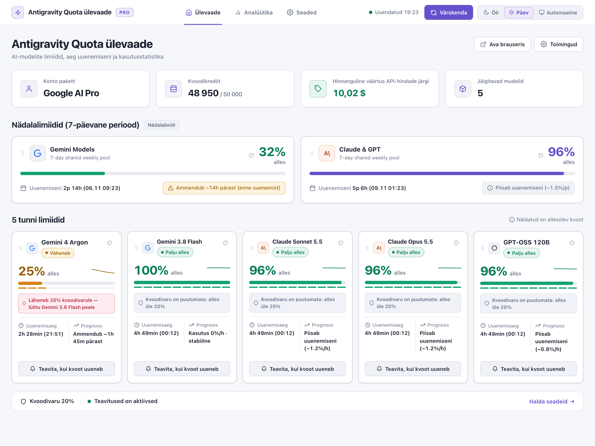
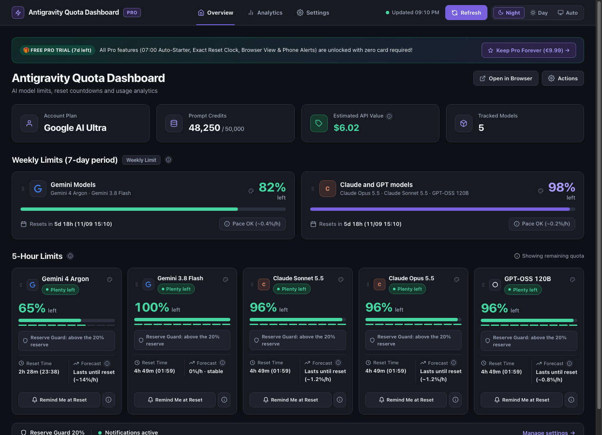
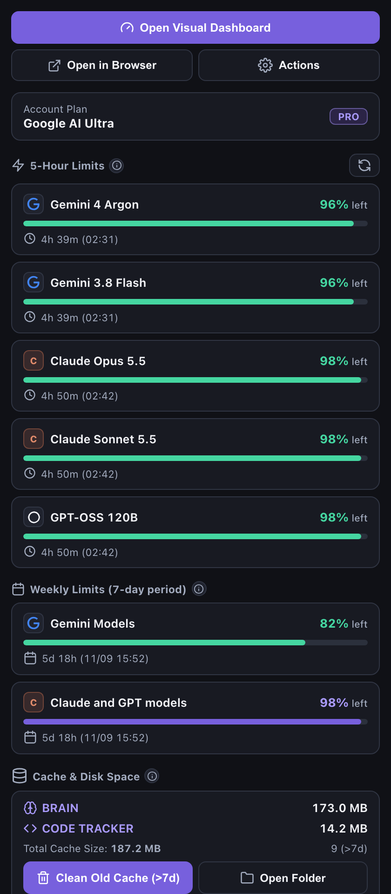
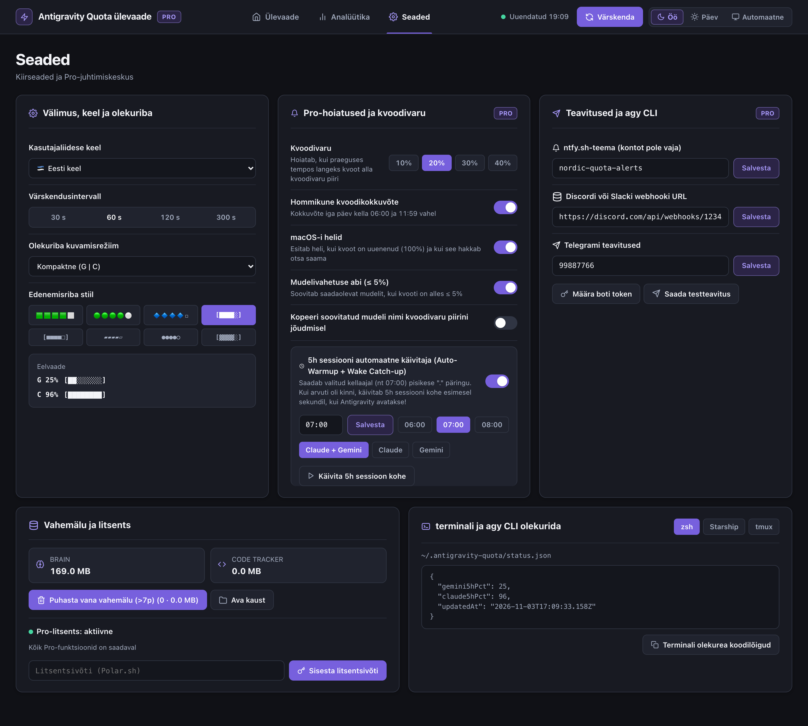
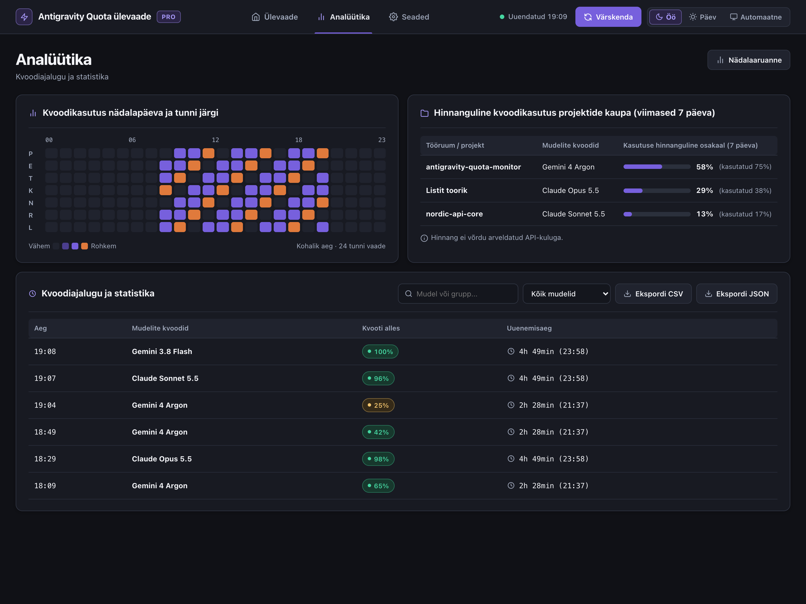

# ⚡ Antigravity Quota Monitor & Dashboard (Pro v2)

🌍 **37 Languages:** [🇬🇧 English](../README.md) · [🇪🇪 Eesti keel](README.et.md) · [🇩🇪 Deutsch](README.de.md) · [🇫🇮 Suomi](README.fi.md) · [🇪🇸 Español](README.es.md) · [🇫🇷 Français](README.fr.md) · [🇮🇹 Italiano](README.it.md) · [🇵🇱 Polski](README.pl.md) · [🇳🇱 Nederlands](README.nl.md) · [🇸🇪 Svenska](README.sv.md) · [🇵🇹 Português](README.pt-PT.md) · [🇧🇷 Português](README.pt-BR.md) · [🇧🇬 Български](README.bg.md) · [🇭🇷 Hrvatski](README.hr.md) · [🇨🇿 Čeština](README.cs.md) · [🇩🇰 Dansk](README.da.md) · [🇬🇷 Ελληνικά](README.el.md) · [🇭🇺 Magyar](README.hu.md) · [🇮🇪 Gaeilge](README.ga.md) · [🇱🇻 Latviešu](README.lv.md) · [🇱🇹 Lietuvių](README.lt.md) · [🇱🇺 Lëtzebuergesch](README.lb.md) · [🇲🇹 Malti](README.mt.md) · [🇷🇴 Română](README.ro.md) · [🇸🇰 Slovenčina](README.sk.md) · [🇸🇮 Slovenščina](README.sl.md) · [🇺🇦 Українська](README.uk.md) · [🇿🇦 Afrikaans](README.af.md) · [🇯🇵 日本語](README.ja.md) · [🇨🇳 简体中文](README.zh-CN.md) · [🇹🇼 繁體中文](README.zh-TW.md) · [🇰🇷 한국어](README.ko.md) · [🇻🇳 Tiếng Việt](README.vi.md) · [🇮🇩 Bahasa Indonesia](README.id.md) · [🇮🇳 हिन्दी](README.hi.md) · [🇰🇪 Kiswahili](README.sw.md) · [🇸🇦 العربية](README.ar.md)

  

  <strong>Sledování kvót AI v reálném čase pro Google Antigravity IDE a agy CLI. Zdarma: týdenní a 5hodinové limity, odpočítávání do obnovení, přehled, 37 jazyků. Pro: čas obnovení na stavovém řádku (↻19:52), prognóza vyčerpání, hlídání rezervy, mapa využití podle dne v týdnu a hodiny, oznámení.</strong>

  
  
  

  
  &nbsp;&nbsp;
  

---

## 🔥 Přehled kvót Antigravity — 🇨🇿 Čeština

### ☀️ 1. Přehled kvót Antigravity — Den (Týdenní limit + 5hodinový limit + Rychlé nastavení a ovládací centrum Pro)

### 🌙 2. Přehled kvót Antigravity — Noc (Týdenní limit + 5hodinový limit + Využití kvóty podle dne v týdnu a hodiny)

### ⚡ Status Bar (`↻3h 52m (19:52)` & `⏳42m`)

### 📋 📊 Antigravity Quota Monitor

### 🎨 🎨 Změnit styl indikátoru průběhu

---

## 💻 Google Antigravity IDE, `agy` CLI & VS Code / Cursor / Windsurf

- **Google Antigravity IDE:** `G: 87% 🟩🟩🟩🟩⬜ ↻3h 52m (19:52) | C: 64% 🟨🟨🟨⬜⬜ ↻3h 50m (19:50) ⏳42m`
- **Antigravity CLI (`agy` CLI) & Terminal (`zsh`, `Starship`, `tmux`):** `~/.antigravity-quota/status.json`
- **AI Models:** Gemini 3.8 Flash, Gemini 4 Argon, Claude Opus 5.5, Claude Sonnet 5.5, GPT-OSS 120B (High / Medium / Low).

---

## ⌨️ Commands (🇨🇿 Čeština)

| Command | Title |
| :--- | :--- |
| `antigravityQuota.showDashboard` | Antigravity Quota: Otevřít grafický přehled |
| `antigravityQuota.showMenu` | Antigravity Quota: Otevřít nabídku |
| `antigravityQuota.selectBarStyle` | Antigravity Quota: Změnit styl indikátoru průběhu |
| `antigravityQuota.selectDisplayMode` | Antigravity Quota: Změnit režim zobrazení na stavovém řádku |
| `antigravityQuota.selectLanguage` | Antigravity Quota: Vybrat jazyk |
| `antigravityQuota.refresh` | Antigravity Quota: Aktualizovat data nyní |
| `antigravityQuota.buyPro` | Antigravity Quota: Přejít na Pro (2,99 € měsíčně nebo 9,99 € jednorázově) |
| `antigravityQuota.enterLicense` | Antigravity Quota: Zadat licenční klíč Pro |
| `antigravityQuota.refreshLicense` | Antigravity Quota: Znovu ověřit licenci Pro |
| `antigravityQuota.setResetAlarm` | Antigravity Quota: Připomenout obnovení kvóty (Pro) |
| `antigravityQuota.generateWeeklyReport` | Antigravity Quota: Týdenní zpráva o využití (Pro) |
| `antigravityQuota.showTerminalSnippets` | Antigravity Quota: Fragmenty kódu pro stavový řádek terminálu (Pro) |
| `antigravityQuota.configureTelegramToken` | Antigravity Quota: Nastavit token bota pro Telegram (Pro) |
| `antigravityQuota.sendTestPush` | Antigravity Quota: Odeslat testovací oznámení (Pro) |
| `antigravityQuota.exportCsv` | Antigravity Quota: Exportovat historii využití jako CSV (Pro) |
| `antigravityQuota.exportJson` | Antigravity Quota: Exportovat historii využití jako JSON (Pro) |

---

## 📄 License
MIT License © Nordicstocks — [🇬🇧 Full English Documentation](../README.md)
