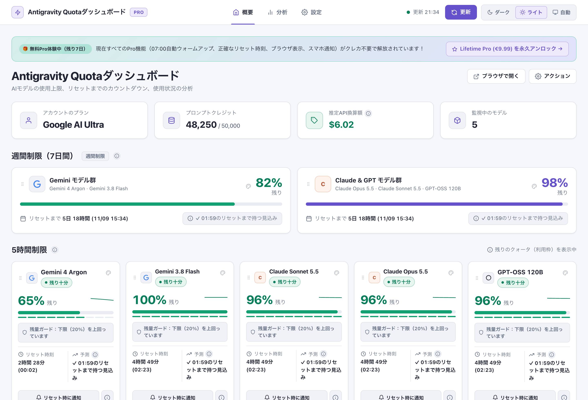
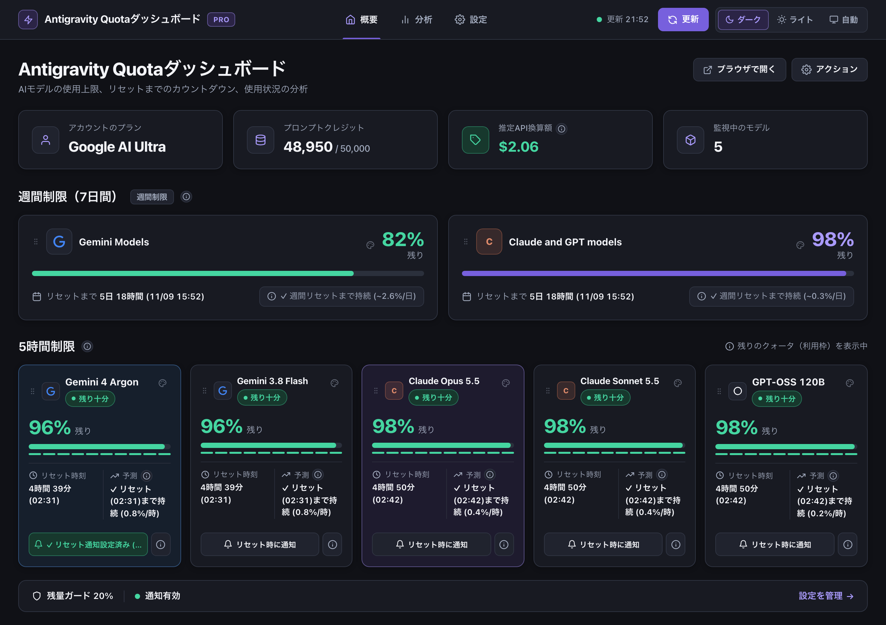
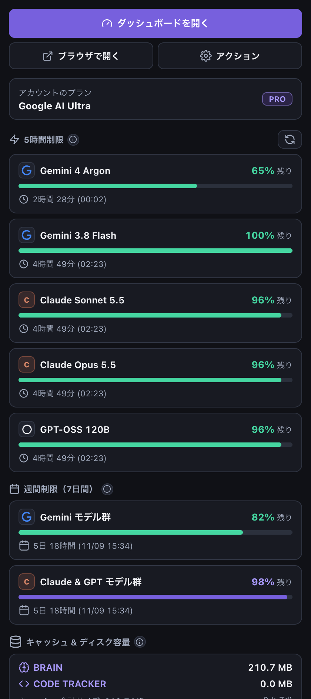
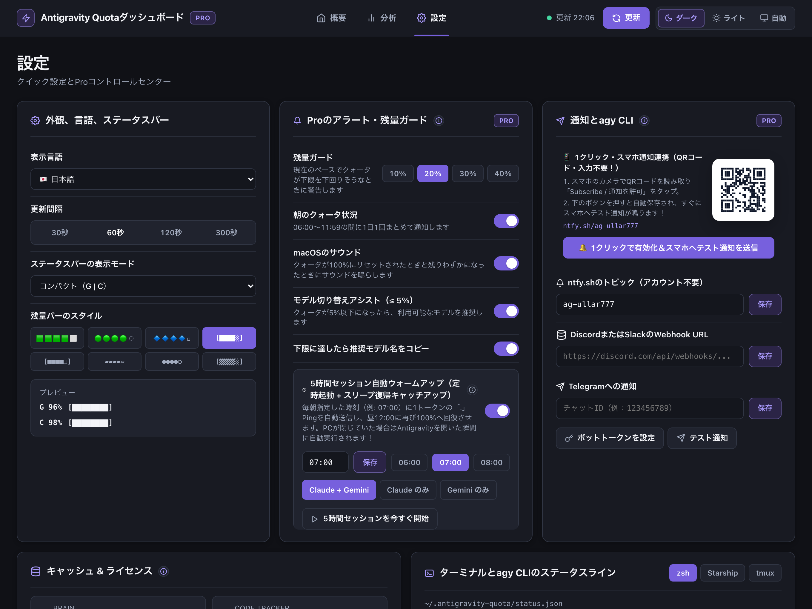
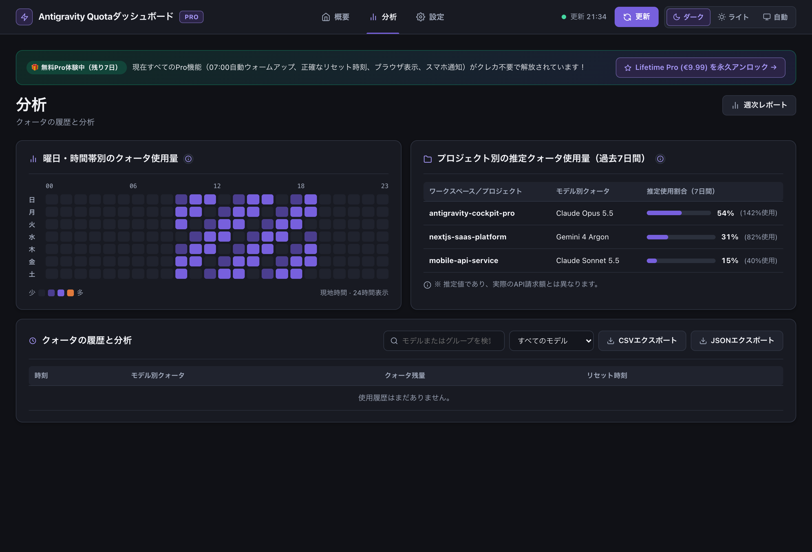

# ⚡ Antigravity Quota Monitor & Dashboard (Pro v2)

🌍 **37 Languages:** [🇬🇧 English](../README.md) · [🇪🇪 Eesti keel](README.et.md) · [🇩🇪 Deutsch](README.de.md) · [🇫🇮 Suomi](README.fi.md) · [🇪🇸 Español](README.es.md) · [🇫🇷 Français](README.fr.md) · [🇮🇹 Italiano](README.it.md) · [🇵🇱 Polski](README.pl.md) · [🇳🇱 Nederlands](README.nl.md) · [🇸🇪 Svenska](README.sv.md) · [🇵🇹 Português](README.pt-PT.md) · [🇧🇷 Português](README.pt-BR.md) · [🇧🇬 Български](README.bg.md) · [🇭🇷 Hrvatski](README.hr.md) · [🇨🇿 Čeština](README.cs.md) · [🇩🇰 Dansk](README.da.md) · [🇬🇷 Ελληνικά](README.el.md) · [🇭🇺 Magyar](README.hu.md) · [🇮🇪 Gaeilge](README.ga.md) · [🇱🇻 Latviešu](README.lv.md) · [🇱🇹 Lietuvių](README.lt.md) · [🇱🇺 Lëtzebuergesch](README.lb.md) · [🇲🇹 Malti](README.mt.md) · [🇷🇴 Română](README.ro.md) · [🇸🇰 Slovenčina](README.sk.md) · [🇸🇮 Slovenščina](README.sl.md) · [🇺🇦 Українська](README.uk.md) · [🇿🇦 Afrikaans](README.af.md) · [🇯🇵 日本語](README.ja.md) · [🇨🇳 简体中文](README.zh-CN.md) · [🇹🇼 繁體中文](README.zh-TW.md) · [🇰🇷 한국어](README.ko.md) · [🇻🇳 Tiếng Việt](README.vi.md) · [🇮🇩 Bahasa Indonesia](README.id.md) · [🇮🇳 हिन्दी](README.hi.md) · [🇰🇪 Kiswahili](README.sw.md) · [🇸🇦 العربية](README.ar.md)

  

  <strong>Google Antigravity IDEとagy CLI向けのリアルタイムAIクォータモニター。無料版：週間・5時間クォータの残量表示、リセットまでのカウントダウン、ダッシュボード、37言語対応。Pro版：ステータスバーのリセット時刻表示（↻19:52）、使い切り予測、残量ガード、曜日×時間帯のヒートマップ、通知。</strong>

  
  
  

  
  &nbsp;&nbsp;
  

---

## 🔥 Antigravity Quotaダッシュボード — 🇯🇵 日本語

### ☀️ 1. Antigravity Quotaダッシュボード — 昼 (週間制限 + 5時間制限 + クイック設定とProコントロールセンター)

### 🌙 2. Antigravity Quotaダッシュボード — 夜 (週間制限 + 5時間制限 + 曜日・時間帯別のクォータ使用量)

### ⚡ Status Bar (`↻3h 52m (19:52)` & `⏳42m`)

### 📋 📊 Antigravity Quota Monitor

### 🎨 🎨 残量バーのスタイルを変更

---

## 💻 Google Antigravity IDE, `agy` CLI & VS Code / Cursor / Windsurf

- **Google Antigravity IDE:** `G: 87% 🟩🟩🟩🟩⬜ ↻3h 52m (19:52) | C: 64% 🟨🟨🟨⬜⬜ ↻3h 50m (19:50) ⏳42m`
- **Antigravity CLI (`agy` CLI) & Terminal (`zsh`, `Starship`, `tmux`):** `~/.antigravity-quota/status.json`
- **AI Models:** Gemini 3.8 Flash, Gemini 4 Argon, Claude Opus 5.5, Claude Sonnet 5.5, GPT-OSS 120B (High / Medium / Low).

---

## ⌨️ Commands (🇯🇵 日本語)

| Command | Title |
| :--- | :--- |
| `antigravityQuota.showDashboard` | Antigravity Quota: ダッシュボードを開く |
| `antigravityQuota.showMenu` | Antigravity Quota: メニューを開く |
| `antigravityQuota.selectBarStyle` | Antigravity Quota: 残量バーのスタイルを変更 |
| `antigravityQuota.selectDisplayMode` | Antigravity Quota: ステータスバーの表示モードを変更 |
| `antigravityQuota.selectLanguage` | Antigravity Quota: 言語を選択 |
| `antigravityQuota.refresh` | Antigravity Quota: 今すぐデータを更新 |
| `antigravityQuota.buyPro` | Antigravity Quota: Proにアップグレード（月額€2.99または買い切り€9.99） |
| `antigravityQuota.enterLicense` | Antigravity Quota: Proライセンスキーを入力 |
| `antigravityQuota.refreshLicense` | Antigravity Quota: Proライセンスを再確認 |
| `antigravityQuota.setResetAlarm` | Antigravity Quota: クォータのリセット時に通知（Pro） |
| `antigravityQuota.generateWeeklyReport` | Antigravity Quota: 週次の使用状況レポートを生成（Pro） |
| `antigravityQuota.showTerminalSnippets` | Antigravity Quota: ターミナルのステータスライン用スニペットを表示（Pro） |
| `antigravityQuota.configureTelegramToken` | Antigravity Quota: Telegramのボットトークンを設定（Pro） |
| `antigravityQuota.sendTestPush` | Antigravity Quota: テスト通知を送信（Pro） |
| `antigravityQuota.exportCsv` | Antigravity Quota: 使用履歴をCSVでエクスポート（Pro） |
| `antigravityQuota.exportJson` | Antigravity Quota: 使用履歴をJSONでエクスポート（Pro） |

---

## 📄 License
MIT License © Nordicstocks — [🇬🇧 Full English Documentation](../README.md)
